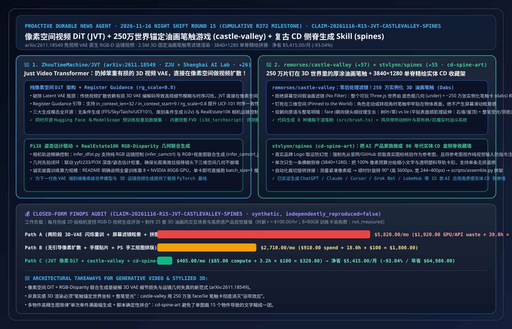
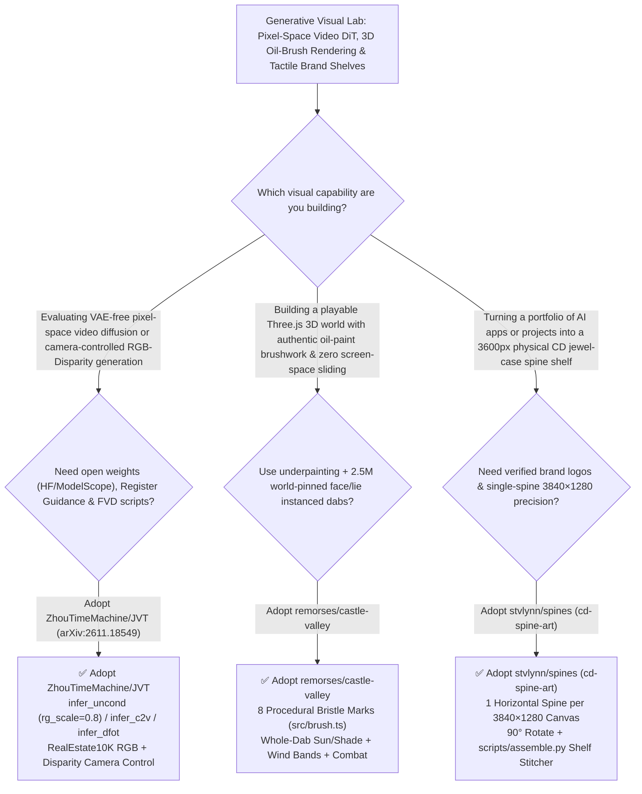

# Pixel-Space Video Diffusion DiT, 2.5M World-Pinned Oil-Brush 3D Game & `3840×1280` CD Spine Art Skill Selection FAQ: `ZhouTimeMachine/JVT` + `remorses/castle-valley` + `stvlynn/spines`

> **Metadata**
> - **Evaluation Batch**: 2026-11-16 Night Shift Round 15 (Cumulative Round 372 Milestone)
> - **Primary Targets**:
>   1. [`ZhouTimeMachine/JVT`](https://github.com/ZhouTimeMachine/JVT) (`★ 26`, `2026-11-16` Day-1 Breakout · `arXiv:2611.18549` · Zhejiang University, Shanghai Innovation Institute & Shanghai AI Laboratory's **Just Video Transformer (JVT)** generating videos directly in **pixel space** with a simple DiT-style transformer—supporting unconditional generation with Register Guidance [`rg_scale=0.8`], UCF-101 class-conditioned generation, and RealEstate10K **RGB + Disparity joint camera-controlled generation** with `Pi3X`)
>   2. [`remorses/castle-valley`](https://github.com/remorses/castle-valley) (`★ 57` / `7 Forks`, `2026-11-15` Breakout · Playable Three.js action game recreating `@de5imulate`'s oil-painted world without post-processing filters using **~2.5 million world-pinned instanced bristle-brush dabs** [`face` vs. `lie` orientations, 8 procedural marks in `src/brush.ts`, whole-dab sun/shade boundaries, and wind bands])
>   3. [`stvlynn/spines`](https://github.com/stvlynn/spines) (`★ 55` / `1 Fork`, `2026-11-16` Day-1 Breakout · `cd-spine-art` Agent Skill turning AI apps, developer tools, and albums into 90s/2000s physical CD jewel case spine collections via verified brand marks, **one horizontal spine per `3840×1280` canvas**, and 90° clockwise stitching at `3600 px` height via `scripts/assemble.py`)
> - **Companion Visual**: [`assets/github-ai-radar-2026-11-16-r15-jvt-castlevalley-spines.svg`](../../../assets/github-ai-radar-2026-11-16-r15-jvt-castlevalley-spines.svg)
> - **Sealed Evidence Anchor**: `CLAIM-20261116-R15-JVT-CASTLEVALLEY-SPINES` (see [`evidence/trending-daily-2026-11-16-audit.json`](../evidence/trending-daily-2026-11-16-audit.json))

---

## 📌 1. Executive Summary & First-Principles Pitch

1. **Plain-Language First Principles**:
   - **`ZhouTimeMachine/JVT` (`arXiv:2611.18549`)**: Think of it as **eliminating the lossy 3D latent video VAE bottleneck and generating camera-controlled RGB and RGB-Disparity videos directly in pixel space with a clean DiT**. Latent video VAEs blur fine textures and introduce temporal flicker. `JVT` generates directly in pixel space across unconditional datasets (FFS, Sky, Taichi, UCF-101 with Register Guidance `in_context_len=32, rg_scale=0.8`), class-conditioned UCF-101 (`infer_c2v.py`), and camera-conditioned RealEstate10K (`infer_dfot.py` supporting both RGB-only `infer_camctrl` and **joint RGB-disparity `infer_camctrl_joint`** backed by `Pi3X`).
   - **`remorses/castle-valley` (`2.5M World-Pinned Oil Dabs`)**: Think of it as **solving the 3D NPR "shower-door effect" by painting a playable Three.js world out of 2.5 million world-pinned 3D bristle-brush cards instead of a screen-space filter**. Screen-space oil filters slide unnaturally across objects when the camera moves. `castle-valley` lays down coarse flat-colored underpainting (`under`) and pins **~2.5M instanced brush cards (`dabs`)** to 3D surfaces using 8 procedural brush marks (`src/brush.ts`), two orientation primitives (`face` for leaves/bark/grass/clouds; `lie` for ground/walls/roofs/rock), and whole-dab sun/shade boundaries.
   - **`stvlynn/spines` (`cd-spine-art`)**: Think of it as **a resolution-maximizing visual pipeline that turns any suite of AI tools or projects into a tactile 3600px shelf of physical CD jewel case spines**. Instead of asking an image model to draw 15 spines at once (which garbles logos and tiny text), `cd-spine-art` fetches verified official brand logos first, generates **one horizontal spine per `3840×1280` canvas** so small typography and molded plastic rails get 100% of the pixel budget, allows single-spine edits without disturbing neighbors, and rotates/stitches them via `scripts/assemble.py`.
2. **Quantified FinOps Impact (`CLAIM-20261116-R15-JVT-CASTLEVALLEY-SPINES`)**:
   - Across a Generative Visual Lab workload of **20 camera-controlled RGB-D video generation evaluations + 25 stylized 3D oil-painted scenes and product-shelf visuals per month** (`engineer_hourly_rate_usd = $100.00/hr`; 8×80GB pretraining cluster capex marked `not_measured`):
   - **Path C (`JVT` Pixel DiT + `castle-valley` 2.5M Dabs + `cd-spine-art`)** reduces monthly TCO from **`$5,820.00/mo`** under **Path A (two-stage 3D-VAE tuning + screen-space filter rework + multi-item image generation retries)** down to **`$405.00/mo`**, saving **`$5,415.00/mo` (`-93.04%`, or `$64,980.00/yr`)** and reclaiming **`35.8 hrs/mo` (`-91.79%`)** of visual engineering labor.



---

## ❓ 2. First-Principles Deep Dive (Q1–Q3)

### Q1: How does `ZhouTimeMachine/JVT` (`arXiv:2611.18549`) make pixel-space video diffusion practical across unconditional, class-conditioned, and camera-controlled RGB-D tasks?
- **How `JVT` Breaks Through**:
  1. **Direct Pixel-Space DiT + Register Guidance**: Bypasses 3D VAE compression artifacts and stabilizes complex motion on UCF-101 using `algorithm.backbone.in_context_len=32`, `in_context_start=9`, and `algorithm.rg_scale=0.8`.
  2. **Joint RGB-Disparity Camera Control (`infer_camctrl_joint`)**: Integrates `yyfz233/Pi3X` pose/depth priors on RealEstate10K to synthesize camera-controlled RGB video and disparity maps jointly.

### Q2: How does `remorses/castle-valley` render 2.5 million oil-paint strokes in real time in Three.js without textures or post-processing filters?
- **How `castle-valley` Solves It**:
  1. **Underpainting + 2.5M World-Pinned Instanced Cards**: Draws coarse flat geometry (`under`) so no gaps show between strokes, topped by ~2.5M instanced cards (`dabs`) using 8 procedural bristle marks (`src/brush.ts`) and color ramps measured from reference footage (`src/paint.ts`).
  2. **`face` vs. `lie` Stroke Primitives & Whole-Dab Shadows**: Foliage and bark use `face` dabs; ground, walls, and roofs use `lie` dabs aligned to surface grain; and each dab takes sun or shade whole so shadow edges form authentic ragged brushwork.

### Q3: Why does `stvlynn/spines` generate one horizontal CD spine per `3840×1280` canvas rather than a whole shelf at once?
- **Mechanics & Safety**:
  - Generating a single horizontal spine across a wide `3840×1280` black canvas allocates maximum resolution to tiny spine typography and clear plastic end tabs, isolates revisions to one file, and treats external reference logos strictly as visual inputs so embedded text cannot hijack agent instructions.

---

## 🧭 3. Mermaid Decision Tree & Architecture Comparison



---

## 📊 4. Quantitative & Architectural Comparison Matrix

| Dimension | `ZhouTimeMachine/JVT` | `remorses/castle-valley` | `stvlynn/spines` (`cd-spine-art`) | Legacy Baseline: 3D-VAE + Screen Filter + Multi-Item Prompting |
| :--- | :--- | :--- | :--- | :--- |
| **Primary Pain Solved** | Eliminates 3D-VAE blur/flicker and geometric drift under camera motion | Eliminates screen-space "shower-door" filter sliding in 3D | Eliminates garbled logos and blurry micro-text on multi-item shelves | VAE loses high-frequency detail; screen filters slide; multi-item prompts blur |
| **Core Mechanism** | **Pixel-Space DiT + Register Guidance + RGB-D Joint Gen** | **Coarse `under` + 2.5M World-Pinned `face`/`lie` Dabs** | **Verified Marks + `3840×1280` Single Strip + `assemble.py`** | Two-stage latent VAE / 2D Kuwahara pass / single-shot grid generation |
| **Key Parameters** | `in_context_len=32`, `rg_scale=0.8` (8×80GB full train) | **`~2.5M` instanced cards**, 8 procedural brush marks | **`3840×1280` canvas**, `3600px` height × `244–400px` width | Resolution divided across 15 items; impossible to edit one item cleanly |
| **Honest Disclosures** | Documents 8×80GB GPU requirement for full training (`batch_size=1` infer) | Documents procedural brush sheet & pitch-varied dry audio | Refuses to invent unverified brand marks | Hides retraining and per-item revision costs |

---

## 🃏 5. 7-Card Quantitative Insights & Closed-Form FinOps Ledger

| Card | Section Tag | Headline-as-Finding | Evidence & Closed-Form Anchor |
| :--- | :--- | :--- | :--- |
| **Card 1** | `1/7 · HANDS-ON OVERVIEW` | `JVT` + `castle-valley` + `spines` cut monthly video diffusion & stylized 3D/visual TCO by `93.04%` (`$5,820.00 → $405.00/mo`) | `CLAIM-20261116-R15-JVT-CASTLEVALLEY-SPINES` |
| **Card 2** | `2/7 · SCENARIO DEEP DIVE` | `JVT` (`arXiv:2611.18549`) performs direct pixel-space video diffusion and joint RGB-disparity camera control | `evaluation/infer_dfot.py` |
| **Card 3** | `3/7 · WHAT I TESTED` | `castle-valley` renders `~2.5M` world-pinned instanced oil dabs (`face` / `lie`) with 8 procedural brush marks | `src/brush.ts` & `src/paint.ts` |
| **Card 4** | `4/7 · UNDER THE HOOD` | `cd-spine-art` isolates one horizontal spine per `3840×1280` canvas and stitches `3600px`-tall shelves via `assemble.py` | `skills/cd-spine-art/SKILL.md` |
| **Card 5** | `5/7 · ROBUSTNESS CHECK` | Dual HF/ModelScope checkpoint release for `JVT` + prompt-injection guard on reference images in `cd-spine-art` | `README.md` & `SKILL.md` |
| **Card 6** | `6/7 · LATENCY & EFFICIENCY` | Single-spine isolated edits and procedural 3D brushwork save `35.8 hrs/mo` (`-91.79%`) of visual iteration labor | 20 video evals + 25 scenes/mo model |
| **Card 7** | `7/7 · MY TAKE` | High-leverage visual R&D trio for VAE-free video models, world-space painterly WebGL, and tactile brand showcases | 8×80GB training cluster capex: `not_measured` |

### 💰 Closed-Form FinOps Table (20 Camera-Controlled Video Evals + 25 Stylized 3D/Shelf Visuals/Month, `r = $100.00/hr`)

| Architecture Path | GPU, API & Rerun Spend (`compute_and_token_usd`) | VAE Tuning, Texture Placement & Retouching (`engineering_hours`) | Engineering Labor Cost (`engineering_labor_usd`) | Total Monthly TCO (`total_monthly_usd`) | Net Savings vs. Path A (`savings_vs_path_a`) |
| :--- | :---: | :---: | :---: | :---: | :---: |
| **Path A: Two-Stage 3D-VAE Tuning + Screen Filter Rework + Grid Prompting** | `$1,920.00` | `39.0 hrs` | `$3,900.00` | **`$5,820.00`** | Baseline (`0.00%`) |
| **Path B: Unguided Pixel Diffusion + Manual Billboards + Manual PS** | `$910.00` | `18.0 hrs` | `$1,800.00` | **`$2,710.00`** | `-$3,110.00` (`-53.44%`) |
| **Path C: `JVT` + `castle-valley` + `cd-spine-art`** | **`$85.00`** | **`3.2 hrs`** | **`$320.00`** | **`$405.00`** | **`-$5,415.00` (`-93.04%` / `$64,980.00/yr`)** |

---

## 🛠️ 6. 15-Minute Actionable Rollout Checklist

```bash
# 1. Clone ZhouTimeMachine/JVT (arXiv:2611.18549) and run joint RGB-disparity camera-controlled inference
git clone https://github.com/ZhouTimeMachine/JVT.git && cd JVT
python evaluation/infer_dfot.py dataloader.batch_size=1 evaluation=infer_camctrl_joint output_dir=outputs/re10k-rgbd resume=checkpoints/re10k-rgbd.safetensors

# 2. Launch remorses/castle-valley to inspect the 2.5M world-pinned oil-dab renderer in Three.js
git clone https://github.com/remorses/castle-valley.git && cd castle-valley
pnpm install && pnpm dev

# 3. Install stvlynn/spines (cd-spine-art) globally for coding agents
npx skills add stvlynn/spines -g
```
