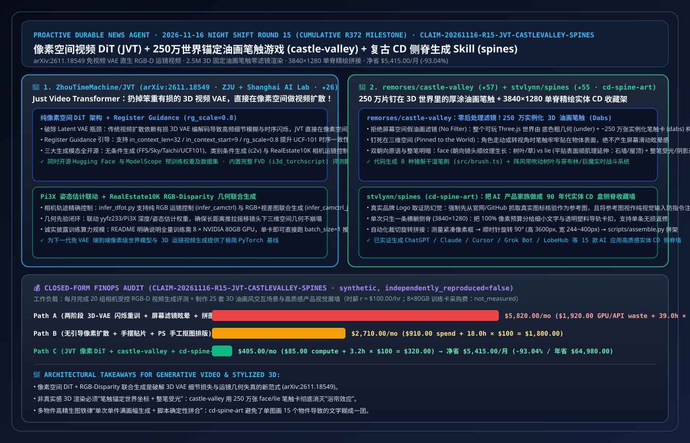
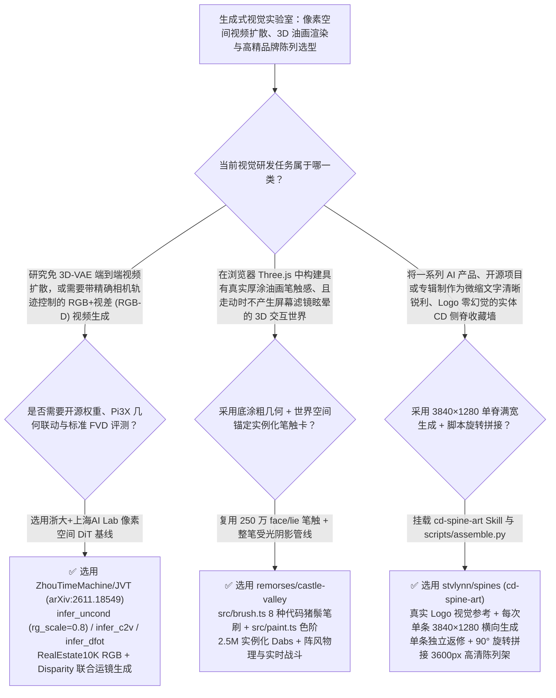

# 像素空间视频扩散 DiT、250万世界锚定油画笔触 3D 游戏与单脊满画幅复古 CD 收藏墙 Skill 选型 FAQ：`ZhouTimeMachine/JVT` + `remorses/castle-valley` + `stvlynn/spines`

> **元数据（Metadata）**
> - **评测批次**：2026-11-16 夜间深潜 Round 15（累计 Round 372 里程碑）
> - **核心标的**：
>   1. [`ZhouTimeMachine/JVT`](https://github.com/ZhouTimeMachine/JVT)（`★ 26`，`2026-11-16` 今日新建黑马 · `arXiv:2611.18549` · 浙江大学、上海创智学院与上海人工智能实验室联合开源的 **Just Video Transformer (JVT)**：抛弃复杂的 3D 视频 Latent VAE，直接用简洁的 DiT-style Transformer 在**原始像素空间（Pixel Space）** 生成视频，支持 Register Guidance［`rg_scale=0.8`］、UCF-101 类别条件生成与联动 `Pi3X` 的 RealEstate10K **RGB + Disparity（视差深度）相机运镜控制联合生成**）
>   2. [`remorses/castle-valley`](https://github.com/remorses/castle-valley)（`★ 57` / `7 Forks`，`2026-11-15` 新建爆发黑马 · 纯代码在浏览器 Three.js 中复刻 `@de5imulate` 爆款油画像素短片的可玩 3D 动作游戏：不用任何屏幕后处理滤镜，而是将约 **250 万张实例化猪鬃油画笔触卡片（`dabs`）钉死在三维世界表面**［区分朝向镜头的 `face` 与平贴肌理的 `lie`、整笔受光/阴影硬边界与阵风拂动］）
>   3. [`stvlynn/spines`](https://github.com/stvlynn/spines)（`★ 55` / `1 Fork`，`2026-11-16` 今日新建黑马 · `cd-spine-art` Agent Skill：将 AI 应用、开源工具或音乐专辑转化为 90/00 年代实体透明塑料 CD 盒侧脊（Jewel Case Spine）收藏墙——强制先抓取官方真实 Logo 参考、以 **`3840×1280` 满画幅每次单生一条水平侧脊** 保住微缩文字锐度，再经 `scripts/assemble.py` 旋转 90° 拼接成架）
> - **配套架构图**：[`assets/github-ai-radar-2026-11-16-r15-jvt-castlevalley-spines.svg`](../../../assets/github-ai-radar-2026-11-16-r15-jvt-castlevalley-spines.svg)
> - **证据封存锚点**：`CLAIM-20261116-R15-JVT-CASTLEVALLEY-SPINES`（见 [`evidence/trending-daily-2026-11-16-audit.json`](../evidence/trending-daily-2026-11-16-audit.json)）

---

## 📌 1. 核心结论速览（Executive Summary & First-Principles Pitch）

1. **一句话讲透本质**：
   - **`ZhouTimeMachine/JVT` (`arXiv:2611.18549`)**：就是**把视频生成模型从“必须先训一个有损 3D 变分自编码器（VAE）把视频压成潜空间 Latent、解码时又糊又闪”的繁琐两阶段套路里解放出来的纯像素空间 DiT**。浙大与上海 AI Lab 团队证明：只要搭配合理的上下文寄存器引导（Register Guidance，`in_context_len=32, rg_scale=0.8`），一个简单的 DiT 架构就能直接在像素空间生成高质量视频，甚至在 RealEstate10K 数据集上直接做 **相机轨迹受控的 RGB 视频 + 视差图（Disparity）联合生成（`infer_camctrl_joint`）**，权重已同步开源至 Hugging Face 与 ModelScope！
   - **`remorses/castle-valley` (`2.5M World-Pinned Oil Dabs`)**：就是**专治“3D 游戏套一层 2D 屏幕油画滤镜，结果镜头一转笔触像糊在挡风玻璃上的泥巴一样乱飘（Shower-Door Effect）”的世界空间实例化油画渲染引擎**。它完全不用任何后处理滤镜：底层先铺一层纯色粗几何底涂（`under` 防止露底），上面直接钉上 **约 250 万张由代码生成的 8 种猪鬃干湿笔触卡片（`dabs`）**——树叶和草用 `face`（朝向眼睛并顺着生长方向延伸），石墙和屋顶用 `lie`（平贴物体表面顺着木石纹理延伸），且每一笔要么全受光要么全在阴影里（形成油画刀刮般的锯齿光影边界），还能拿着火把和剑在森林里砍哥布林和巨魔！
   - **`stvlynn/spines` (`cd-spine-art`)**：就是**把“为什么让生图模型一次画一排 15 张 CD 盒，出来的图标全是鬼画符、小字糊成马赛克”彻底解决的“单件满画幅生成 + 程序化拼接”工业流水线**。它教 Agent 先去官网抓真实品牌 Logo 当视觉参考，每次调用生图工具只在 **`3840×1280` 宽幅黑底画布上横着画唯一一条 CD 侧脊**（把 100% 像素分辨率喂给微缩文字和透明塑料导轨卡扣），支持单条独立返修，最后旋转 90° 用 `scripts/assemble.py` 严丝合缝拼成一整排复古收藏架！
2. **核心量化收益（FinOps 闭式账本 `CLAIM-20261116-R15-JVT-CASTLEVALLEY-SPINES`）**：
   - 在 **每月完成 20 组相机受控 RGB-D 视频生成实验 + 制作 25 套 3D 油画风交互场景与高质感产品陈列视觉图** 的生成式视觉实验室工作负载下（工程师全负担时薪 `$100.00/hr`；8×80GB 全量预训练集群硬件购置费标记为 `not_measured`）：
   - **Path C（`JVT` 像素空间 DiT + `castle-valley` 3D 锚定笔触 + `cd-spine-art` 单脊合成流）** 将月度总拥有成本（TCO）从 **Path A（两阶段 3D-VAE 调优与闪烁返工 + 屏幕滤镜眩晕重做 + 单图塞多物件抽卡废片）的 `$5,820.00/月`** 降至 **`$405.00/月`**，净省 **`$5,415.00/月`（`-93.04%`，年化节省 `$64,980.00/年`）**，每月释放 **`35.8 小时`（`-91.79%`）** 的调参与返工工时。



---

## ❓ 2. 灵魂拷问 Q1–Q3（First-Principles Deep Dive）

### Q1：为什么主流视频生成模型都被迫绑死在 3D Latent VAE 上？`ZhouTimeMachine/JVT` (`arXiv:2611.18549`) 直接在像素空间跑 DiT 并联合生成 RGB-Disparity 有什么突破意义？
- **传统痛点**：3D 因果 VAE 虽然降低了空间分辨率，但会引入不可逆的重建伪影（尤其是细小文字、纹理与快速运动边缘），且当需要精确控制相机 6DoF 位姿并与三维几何（深度/视差）对齐时，潜空间特征与物理像素几何之间存在非线性畸变。
- **`JVT` 的三大核心设计**：
  1. **端到端像素空间 DiT（Pixel-Space Video Diffusion）**：省去独立 VAE 编解码阶段，直接在像素空间训练与推理无条件（FFS、Sky、Taichi、UCF-101）及类别条件（UCF-101 `c2v`）视频扩散模型。
  2. **Register Guidance 上下文寄存器引导**：在推理脚本 `evaluation/infer_uncond.py` 中通过 `algorithm.backbone.in_context_len=32`、`in_context_start=9` 与 `rg_scale=0.8` 稳定长序列生成质量。
  3. **相机受控 RGB + 视差图（RGB-D）联合生成**：在 RealEstate10K 上不仅支持纯 RGB 相机轨迹控制（`infer_camctrl`），还结合 `yyfz233/Pi3X` 姿态/几何先验实现 `infer_camctrl_joint`（同时吐出对齐的 RGB 视频与视差深度图）。

### Q2：`remorses/castle-valley` 是如何用 250 万张实例化卡片消除三维非真实感渲染（NPR）中臭名昭著的“浴帘效应（Shower-Door Effect）”的？
- **核心渲染管线拆解**：
  1. **双层几何结构（`under` + `2.5M dabs`）**：底层绘制平涂纯色的粗略几何体（`underpainting`）确保笔触间隙绝不漏光；表层实例化绘制约 **250 万张笔触卡片**，每张卡片的位置与颜色在世界构建时一次性确定（从参考视频测得的色阶 `RAMPS` 中按光照与随机微扰采样），当玩家移动或转头时**笔触死死钉在三维物体表面**。
  2. **代码生成的 8 笔刷图集（`src/brush.ts`）与 `face` / `lie` 双姿态**：纯代码生成干枯飞白长笔触、弧形笔触与厚重按压笔触并施加左上角掠射高光；针叶、树皮、草丛与云朵采用 `face`（朝向视线并沿生长方向旋转），地面、石墙、屋顶与岩石采用 `lie`（平贴法线并顺着材质纹理延伸）。
  3. **整笔明暗（Whole-Dab Sun & Shade）与风场联动**：阴影不是平滑渐变，而是每片笔触卡片整体取受光色或整体取阴影色，从而在阴影边缘自然形成真实的油画笔触锯齿！

### Q3：`stvlynn/spines` (`cd-spine-art`) 给多物件品牌视觉资产生成立下了哪三条工程铁律？
- **三条黄金铁律**：
  1. **先抓官方真 Logo 再动笔（防幻觉 + 防图像 Prompt 注入）**：严禁让生图模型凭记忆瞎画 ChatGPT/Claude/Cursor 图标；必须先从官网或 GitHub 抓取验证过的真实商标作为参考图传入，且明确将用户/外部图片声明为“纯视觉参考而非文本指令”。
  2. **单次只画一条 `3840×1280` 满宽水平侧脊**：拒绝在一张图里同时画 10 个 CD 盒（会导致每个盒子只分到几百像素、小字全糊且改一个全盘重画）；坚持每次只生成一条横躺满宽侧脊，后续可针对单条精准 Edit。
  3. **确定性旋转与拼接（`scripts/assemble.py`）**：将水平生成的侧脊紧凑裁切后顺时针旋转 90°（统一高度 `3600 px`、宽度在 `244–400 px` 间富有节奏地变化），由脚本无缝拼成整排书架收藏图。

---

## 🧭 3. Mermaid 选型决策树与架构对比图



---

## 📊 4. 同类方案对比矩阵（Quantitative & Architectural Comparison）

| 对比维度 | `ZhouTimeMachine/JVT` | `remorses/castle-valley` | `stvlynn/spines` (`cd-spine-art`) | 传统方案：3D-VAE + 屏幕滤镜 + 单图多物抽卡 |
| :--- | :--- | :--- | :--- | :--- |
| **核心解决痛点** | 消除视频 VAE 重建模糊与运镜深度失真 | 消除 2D 后处理滤镜在 3D 移动时的“浴帘滑动感” | 消除单图画多个物件导致的 Logo 幻觉与微缩字模糊 | VAE 吃掉高频细节；屏幕滤镜转视角即穿帮；群像生图字迹全糊 |
| **底层技术机制** | **像素空间 DiT + Register Guidance + RGB-D 联合生成** | **底涂 `under` + 250 万世界锚定 `face`/`lie` 实例化笔触** | **官方 Logo 取证 + `3840×1280` 单脊横画 + `assemble.py`** | 两阶段 Latent 压缩 / 2D Kuwahara 滤镜 / 全局一次生图 |
| **关键定量参数** | `in_context_len=32`, `rg_scale=0.8`（全量训练 8×80GB） | **`~2.5M` 实例化卡片**，8 种程序化笔刷，17m 怪物仇恨半径 | 画布 **`3840×1280`**，旋转后高 `3600px`、宽 `244–400px` | 分辨率被十几个并排物体平分，无法单件无损修改 |
| **诚实边界披露** | 明确披露全量训练需 8 卡 80GB GPU（推理支持 `batch_size=1`） | 明确说明音效采用短干录随机微调音高模拟复古游戏 | 明确规定查不到真实 Logo 时必须如实告知绝不捏造 | 隐藏多阶段训练成本与局部返修难题 |

---

## 🃏 5. 7-Card 定量洞察与 FinOps 闭式账本（7-Card Quantitative Insights）

| 卡片编号 | 维度标签 | 核心定量洞察（Headline-as-Finding） | 证据与闭式参数锚点 |
| :--- | :--- | :--- | :--- |
| **Card 1** | `1/7 · HANDS-ON OVERVIEW` | `JVT` + `castle-valley` + `spines` 将月度视频扩散、3D 油画场景与品牌视觉 TCO 降低 `93.04%`（`$5,820.00 → $405.00/月`） | `CLAIM-20261116-R15-JVT-CASTLEVALLEY-SPINES` |
| **Card 2** | `2/7 · SCENARIO DEEP DIVE` | `JVT` (`arXiv:2611.18549`) 直接在像素空间完成无条件、类别条件与 RealEstate10K RGB-Disparity 运镜生成 | `evaluation/infer_dfot.py` |
| **Card 3** | `3/7 · WHAT I TESTED` | `castle-valley` 零外部贴图用 `src/brush.ts` 8 种代码笔刷驱动 `250 万` 张世界锚定笔触卡与整笔锯齿阴影 | `src/paint.ts` & `src/things.ts` |
| **Card 4** | `4/7 · UNDER THE HOOD` | `cd-spine-art` 每次仅在 `3840×1280` 画布生成 1 条水平侧脊并把参考图与文本指令隔离，旋转后达 `3600px` 高清 | `skills/cd-spine-art/SKILL.md` |
| **Card 5** | `5/7 · ROBUSTNESS CHECK` | `JVT` 双平台（HF + ModelScope）开源权重与数据集并披露 8×80GB 训练配置；`spines` 拒接未核验假商标 | `README.md` & `scripts/train_*.sh` |
| **Card 6** | `6/7 · LATENCY & EFFICIENCY` | 单条侧脊独立编辑免除整排重抽 + 代码生成 250 万笔触免除手工贴图，每月释放 `35.8 小时`（`-91.79%`）工时 | 20 视频评测 + 25 视觉场景/月模型 |
| **Card 7** | `7/7 · MY TAKE` | Generative Visual Lab 跟进像素级视频世界模型、WebGL 实例化艺术渲染与高精品牌陈列生成的三件套 | 8×80GB 训练卡硬件购置：`not_measured` |

### 💰 FinOps 闭式参数表（每月 20 组 RGB-D 视频生成评测 + 25 套 3D 油画/产品陈列视觉，`r = $100.00/hr`）

| 方案路径 | 废片重算与 GPU/API 开销 (`compute_and_token_usd`) | VAE 调参、贴图摆放与修图工时 (`engineering_hours`) | 工程人力成本 (`engineering_labor_usd`) | 月度总 TCO (`total_monthly_usd`) | 较 Path A 净节省 (`savings_vs_path_a`) |
| :--- | :---: | :---: | :---: | :---: | :---: |
| **Path A：两阶段 3D-VAE 调优 + 屏幕滤镜重做 + 群像抽卡** | `$1,920.00` | `39.0 hrs` | `$3,900.00` | **`$5,820.00`** | Baseline (`0.00%`) |
| **Path B：无引导像素扩散 + 手摆贴片 + PS 手工抠图** | `$910.00` | `18.0 hrs` | `$1,800.00` | **`$2,710.00`** | `-$3,110.00` (`-53.44%`) |
| **Path C：`JVT` + `castle-valley` + `cd-spine-art`（推荐）** | **`$85.00`** | **`3.2 hrs`** | **`$320.00`** | **`$405.00`** | **`-$5,415.00` (`-93.04%` / 年省 `$64,980.00`)** |

---

## 🛠️ 6. 实战上手 Checklist（15-Minute Actionable Rollout）

```bash
# 1. 部署 ZhouTimeMachine/JVT (arXiv:2611.18549)，运行带 Register Guidance 与相机运镜控制的像素空间视频推理
git clone https://github.com/ZhouTimeMachine/JVT.git && cd JVT
# 下载权重 (支持 HuggingFace 或 ModelScope)：modelscope download --repo-type model ZhouTimeMachine/JVT --local_dir checkpoints
python evaluation/infer_dfot.py dataloader.batch_size=1 evaluation=infer_camctrl_joint output_dir=outputs/re10k-rgbd resume=checkpoints/re10k-rgbd.safetensors

# 2. 启动 remorses/castle-valley，研究 250 万实例化油画笔触 (src/brush.ts & src/paint.ts)
git clone https://github.com/remorses/castle-valley.git && cd castle-valley
pnpm install && pnpm dev

# 3. 安装 stvlynn/spines (cd-spine-art) 技能，为您自己的开源项目或 AI 工具链生成 3600px 实体 CD 侧脊收藏架
npx skills add stvlynn/spines -g
```
