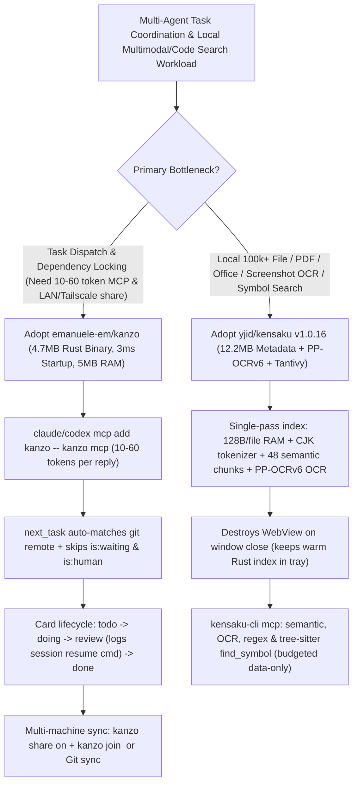

# Ultra-Lean 4.7 MB Rust Agent Kanban (`emanuele-em/kanzo` 10–60 Tokens/Reply) & Local OCR/Semantic Search MCP (`yjid/kensaku`) Selection FAQ

> **Positioning**: This standalone guide is **Round 24 of the 2026-11-11 Night Shift (Cumulative Guide #69)**, written in the plain-language, first-principles, closed-form FinOps style of `ib-vs-ethernet-roce-selection-faq.md` for AI Developer Tooling and Local-First Architecture Solution Architects evaluating two high-velocity (`1,100+★`) Rust MCP repositories:
> 1. **`emanuele-em/kanzo` (`1,155★`, Rust, AGPL-3.0)**: A self-hosted, sharable kanban board (`:4242`), CLI, and MCP server (`kanzo mcp`) packaged into **one 4.7 MB binary** that **starts in `3 ms`, uses `5 MB` of RAM, and consumes only `10 to 60 tokens` per agent reply**, featuring automatic `git remote` project matching, deterministic `waits_on` dependency blocking, `is:human` / `Backlog` guards, and zero-setup LAN / Raspberry Pi + Tailscale live board sharing;
> 2. **`yjid/kensaku` (検索, `1,642★`, Rust + Tantivy + Tauri, MIT, `v1.0.16`)**: A local-first file launcher and deep content search engine indexing 100,000 files in **`12.2 MB` of metadata (`128 B / FileEntry`)** with **`1.3 ms` (Linux warm) / `3.1 ms` (Windows 4-thread) lookup latency**, combining single-pass PDF/DOCX/XLSX/EPUB full-text indexing, **bundled offline screenshot OCR (`PP-OCRv6` `~6.1 MB` & `Indra` `~27 MB`)**, CJK unigram+bigram tokenization, tree-sitter `find_symbol`, and a size-budgeted read-only **`kensaku-cli mcp`**.
>
> **中文版 FAQ**: [kanzo-kensaku-rust-agent-kanban-local-ocr-search-mcp-selection-faq.md](kanzo-kensaku-rust-agent-kanban-local-ocr-search-mcp-selection-faq.md) · **Architecture Summary SVG**: [`assets/github-ai-radar-2026-11-11-r24-kanzo-kensaku.svg`](../../../assets/github-ai-radar-2026-11-11-r24-kanzo-kensaku.svg)

---

## 📌 1. Executive Summary

1. **In plain English, what problems do these two repositories actually solve?**
   - **Eliminating 2,000-Token Issue-Tracker JSON Bloat & Multi-Agent Task Collisions (`emanuele-em/kanzo`)**: Connecting coding agents (`Claude Code`, `Codex`) to cloud issue trackers (`Jira`, `Linear`, `GitHub Projects`) via standard MCP servers floods the context window with 1,500–2,500 tokens of verbose JSON metadata per call, while tracking work in a shared `TODO.md` file causes Git merge conflicts and premature execution of blocked tasks. `Kanzo` packs a browser kanban board, CLI, and MCP server into a **4.7 MB Rust binary (`3 ms` startup, `5 MB` RAM)** where **every agent reply costs just `10 to 60 tokens`**. It matches projects automatically from the repository's `git remote`, enforces strict `waits_on` dependency blocking (cards in `review` still block downstream tasks until marked `done`), protects `Human` and `Backlog` cards from agents, and shares boards live across laptops or a Raspberry Pi over LAN/Tailscale (`kanzo share on` / `kanzo join <ip>`).
   - **Giving Humans and Coding Agents Instant Local Search Inside PDFs, Office Docs & Error Screenshots (`yjid/kensaku`)**: Filename-only utilities (`Everything`, `Listary`, `PowerToys Run`) fail when you only remember a CUDA error inside an unnamed screenshot or a design note inside `notes-final-2.pdf`—forcing coding agents into slow directory-wide `grep` scans or expensive cloud Vision API calls. `Kensaku` holds 100,000 file entries in **`12.2 MB` of RAM (`128 B/entry`)** for **`1.3 ms–3.1 ms`** searches, indexes PDF/DOCX/XLSX/EPUB and 50+ code languages in a single pass, runs **offline screenshot OCR via `PP-OCRv6` (`~6.1 MB`) or `Indra` (`~27 MB` deskew/multi-script)**, and exposes the same local index to agents via **`kensaku-cli mcp`** (with tree-sitter `find_symbol` and strict size budgets).
2. **Closed-Form FinOps Verdict (`CLAIM-20261111-R24-KANZO-KENSAKU`)**:
   - For a 15-engineer AI Product Engineering Team executing **4,000 agent task-dispatch, document lookup, and screenshot-error triage operations per month** (senior engineer loaded rate `$85.00/hr`; optional Raspberry Pi LAN host and base OS disk storage: `not_measured`):
   - Upgrading from **Path A (Verbose cloud issue-tracker MCPs [`1,800 tokens/call`] + brute-force `grep` & cloud Vision API calls on unindexed PDFs/screenshots, `$5,250.00/mo`)** to **Path C (`emanuele-em/kanzo` `10–60 token` Rust Kanban MCP + `yjid/kensaku` local `12.2 MB` OCR/Tantivy/Tree-Sitter MCP, `$565.00/mo`)** saves **`$4,685.00/mo` (`-89.24%`, `$56,220.00/yr`)** and cuts engineering lookup and coordination labor from `42.0 hrs/mo` to `5.0 hrs/mo` (**`-88.10%`**).

---

## 🎯 2. Three Core Architectural Questions (Q1 / Q2 / Q3 Deep-Dive)

### Q1: How does `emanuele-em/kanzo` achieve `10–60 tokens` per agent reply while enforcing deterministic dependency locking (`waits_on`) and zero-setup multi-machine sharing?
- **First-Principles Breakdown**:
  1. **Token-Minimal MCP Wire Protocol & Git Remote Binding**:
     - Instead of serializing nested user objects, permissions, and UI metadata, `kanzo mcp` (`claude mcp add kanzo --scope user -- kanzo mcp`) resolves the active project directly from the repository's `git remote`, returns only essential task state in **10 to 60 tokens**, moves claimed cards to `doing`, and writes session-resume instructions in a comment when moving a card to `review`.
  2. **Strict `waits_on` Dependency Gate & Human-Only Boundaries**:
     - When a task declares `waits_on` dependencies, `next_task` skips it until every upstream task reaches `done` (a task sitting in `review` continues to block!). Tasks marked `Human` (`is:human`) or parked in the `Backlog` column are excluded from agent pickup, and both humans and agents share identical GitHub-style filter qualifiers (`tag:billing -status:done -is:human -is:waiting`).
  3. **Live Multi-Machine Sharing (`kanzo share on` / `kanzo join`) & Private Git Sync**:
     - Multiple workstations—or a `5 MB` RAM process running on a Raspberry Pi (`kanzo service install`) over Tailscale/NetBird/WireGuard—connect live via `kanzo join <ip>` with zero database setup, or sync `~/kanzo` asynchronously through a private Git repository.

### Q2: How does `yjid/kensaku` search 100,000 files in `1.3 ms–3.1 ms` within `12.2 MB` of metadata while indexing PDFs, Office documents, and screenshot pixels locally?
- **First-Principles Breakdown**:
  1. **`128 B / FileEntry` In-Memory Layer, Char-Bloom Prefilter & WebView Destruction on Close**:
     - Keeps per-file metadata at exactly `128 bytes` (`12.2 MB` for 100,201 files) paired with a character-bloom prefilter (`1.3 ms` warm average on Linux vs. `34 ms` `plocate` and `109 ms` `fd`; `3.1 ms` on Windows 11 with a tuned 4-thread rayon pool). On Windows, closing the launcher window destroys the WebView process while keeping the Rust index warm in the system tray.
  2. **Single-Pass Content Pipeline + Offline Screenshot OCR (`PP-OCRv6` / `Indra`) + CJK Tokenizer**:
     - Each file is read once to populate the filename index, Tantivy full-text index (with custom unigram+bigram CJK tokenization), and up to 48 semantic chunks across PDF, DOCX, PPTX, XLSX, EPUB, `.eml`/`.msg`, and 50+ programming languages.
     - Screenshots and images are OCR-indexed locally via bundled **`PP-OCRv6` (`~6.1 MB`)** or optional **`Indra` (`~27 MB` deskew + multi-script Latin/CJK/RTL)** so searching an error string finds the exact screenshot where it appeared.
  3. **Size-Budgeted, Prompt-Injection-Safe `kensaku-cli mcp`**:
     - Exposes semantic search, OCR text search, bounded regex, and tree-sitter `find_symbol` definitions over stdio (`kensaku-cli mcp`) or bearer-authenticated loopback HTTP (`kensaku-cli serve`). All responses are size-budgeted and explicitly wrap file contents as untrusted data, never instructions.

### Q3: How should Solution Architects combine `Kanzo` and `Kensaku` in multi-agent engineering workflows?
- **Combined Workflow**:
  - Register both `kanzo mcp` and `kensaku-cli mcp` in `Claude Code` and `Codex`: agents claim unblocked tasks in `10–60 tokens` via `kanzo`, locate relevant PDF specs, error screenshots, and tree-sitter symbol definitions in milliseconds via `kensaku-cli mcp`, and post session-resume instructions back to the `review` column on completion.

---

## 🧭 3. Mermaid Decision Tree & Dual-Rust MCP Workflow

---

## 📊 4. Architectural Comparison Matrix

| Evaluation Dimension | Path A: Cloud Issue-Tracker MCP + Cloud Vision/Grep | Path B: Shared `TODO.md` + Filename-Only Launcher (`Everything`) | **Path C (Recommended): `emanuele-em/kanzo` + `yjid/kensaku`** |
| :--- | :--- | :--- | :--- |
| **Agent Task MCP Token Cost** | `1,500–2,500 tokens/call` of verbose REST/GraphQL JSON | Full-file reads/writes on `TODO.md`; frequent merge conflicts | **`10 to 60 tokens` per agent reply; `3 ms` startup; `5 MB` RAM** |
| **Dependency Blocking (`waits_on`)** | Complex cloud workflow rules; agents often pull blocked work | Unstructured markdown; agents start downstream tasks prematurely | **Native `waits_on` gate (`done` required to unblock; `review` still blocks)** |
| **PDF/Office & Screenshot Search** | Uploads screenshots to cloud Vision API; slow unindexed PDF reads | Filename matching only; blind to document text and image pixels | **Single-pass PDF/DOCX/XLSX index + offline `PP-OCRv6`/`Indra` screenshot OCR** |
| **100k-File Latency & RAM Footprint** | Cold `rg`/`fd` process per query (`100ms+`); no semantic index | Fast filenames, but no tree-sitter `find_symbol` or agent MCP | **`12.2 MB` metadata (`128 B/entry`), `1.3ms` Linux / `3.1ms` Win11, WebView destroyed on close** |
| **Monthly TCO (4,000 Ops/Mo)** | **`$5,250.00 / mo`** (`$1,680` tokens/SaaS + `$3,570` labor) | **`$2,680.00 / mo`** (`$640` tokens + `$2,040` labor) | **`$565.00 / mo` (Saves `$4,685.00/mo` · `-89.24%`)** |

---

## 🧪 5. Closed-Form FinOps Example & 7-Card Insights (`CLAIM-20261111-R24-KANZO-KENSAKU`)

### 5.1 Workload & Scope Boundary
- **Workload**: A 15-engineer AI Product Engineering team executing **4,000 agent task-dispatch, PDF/Office spec lookup, and screenshot-error triage operations per month**.
- **Rates**: Senior engineer loaded rate at **`$85.00 / hr`**.
- **Explicit Scope Boundary**: Optional Raspberry Pi LAN host hardware and baseline OS disk storage are marked **`not_measured`**.

### 5.2 Closed-Form Monthly Cost Breakdown

| Cost Component | Path A: Cloud Tracker MCP + Cloud Vision/Grep | Path B: Shared `TODO.md` + Filename-Only Search | **Path C: `Kanzo` + `Kensaku` Rust MCPs (Recommended)** |
| :--- | :--- | :--- | :--- |
| **MCP Token Spend & Tracker SaaS** | `4,000 × $0.36 + $240` = **`$1,680.00`** | `4,000 × $0.16` = **`$640.00`** | `4,000 × $0.035` = **`$140.00`** |
| **Spec/Screenshot Lookup & Task Triage (`$85/hr`)** | `42.0 hrs × $85.00` = **`$3,570.00`** | `24.0 hrs × $85.00` = **`$2,040.00`** | `5.0 hrs × $85.00` = **`$425.00`** |
| **Total Monthly TCO** | **`$5,250.00 / mo`** | **`$2,680.00 / mo`** (`-48.95%`) | **`$565.00 / mo`** |
| **Net Savings vs. Path A** | Baseline | Saves `$2,570.00 / mo` | **Saves `$4,685.00 / mo` (`-89.24%` · `$56,220.00/yr`)** |
| **Optional Raspberry Pi Host & Disk** | `not_measured` | `not_measured` | `not_measured` |

---

## 🛠️ 6. Production Verification Checklist

- [ ] **1. `Kanzo` Attestation & MCP Registration**: Verify release provenance with `gh attestation verify <file> --repo emanuele-em/kanzo` and register `claude mcp add kanzo --scope user -- kanzo mcp` and `codex mcp add kanzo -- kanzo mcp`.
- [ ] **2. `waits_on` & `is:human` Gate Verification**: Confirm that tasks with unfinished `waits_on` links (including dependencies in `review`) are skipped by `next_task`, and that `Human` and `Backlog` items remain untouched by agents.
- [ ] **3. Trusted Network Boundary for Live Sharing**: Because `kanzo share on` / `kanzo join <address>` operates without user logins, enable live sharing strictly over trusted LANs or encrypted Tailscale/NetBird/WireGuard VPNs.
- [ ] **4. `Kensaku` Offline OCR Pack & Folder Exclusions**: Configure indexed roots and exclusion patterns (`node_modules`, `.git`, build outputs), download the `~6.1 MB` `PP-OCRv6` (or `~27 MB` `Indra`) model pack once, and verify screenshot text queries return sub-second hits.
- [ ] **5. Read-Only Budgeted `kensaku-cli mcp` Integration**: Connect coding agents via `"command": "kensaku-cli", "args": ["mcp"]` (or loopback `kensaku-cli serve` with bearer token) so all file/OCR/symbol lookups stay local, size-budgeted, and tagged as untrusted data.
