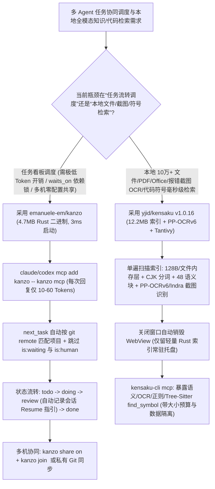

# 4.7MB 极简 Rust 智能体看板（`emanuele-em/kanzo` 每次回复仅 10–60 Token）与本地全格式 OCR/语义检索 MCP（`yjid/kensaku`）选型 FAQ

> **文档定位**：本文是 **2026-11-11 夜班多轮深潜 Round 24（累计第 69 篇独立选型专题）**，严格对标 `ib-vs-ethernet-roce-selection-faq.md` 的「通俗大白话 + 第一性原理 + 可核算定量算例」标杆文风，为追求极致响应速度与超低上下文开销的 AI 工程架构师拆解今日两款突破千星的纯 Rust 本地工具链标杆：
> 1. **`emanuele-em/kanzo`（`1,155★`，Rust，AGPL-3.0）**：集浏览器看板（`:4242`）、命令行与 MCP Server（`kanzo mcp`）于一体的 **4.7 MB** 单文件程序——**启动仅需 `3 ms`、常驻内存仅 `5 MB`、每次向 Agent 返回仅消耗 `10～60 个 Token`**，内置基于 `git remote` 的自动项目识别、`waits_on` 前置依赖硬阻塞、`is:human` / `Backlog` 防误触隔离，以及零配置局域网/树莓派 Tailscale 实时共享；
> 2. **`yjid/kensaku`（検索，`1,642★`，Rust + Tantivy + Tauri，MIT，`v1.0.16`）**：仅用 **`12.2 MB` 内存元数据（`128 Bytes/文件`）** 在 **`1.3 ms`（Linux 热缓存）/ `3.1 ms`（Windows 4 线程）** 内检索 10 万个文件名的跨平台启动器与本地全内容搜索引擎——支持单遍扫描索引 PDF/DOCX/XLSX/EPUB、内置 **`PP-OCRv6`（6.1 MB）/ `Indra`（27 MB 纠偏多语种）本地截图 OCR**、中日韩（CJK）一元+二元分词、Tree-Sitter `find_symbol` 符号定义查找，以及带大小预算控制与防提示词注入隔离的 **`kensaku-cli mcp`**。
>
> **English Companion**: [kanzo-kensaku-rust-agent-kanban-local-ocr-search-mcp-selection-faq.en.md](kanzo-kensaku-rust-agent-kanban-local-ocr-search-mcp-selection-faq.en.md) · **架构总结图**: [`assets/github-ai-radar-2026-11-11-r24-kanzo-kensaku.svg`](../../../assets/github-ai-radar-2026-11-11-r24-kanzo-kensaku.svg)

---

## 📌 一、核心结论速览（Executive Summary）

1. **先用大白话讲透这两个项目到底解决了什么痛点？**
   - **重型项目管理 MCP“查个任务吐回两千 Token JSON 垃圾、多 Agent 抢单撞车”的痛点（`emanuele-em/kanzo` 解决的问题）**：当你让 Claude Code 或 Codex 通过官方 Jira / Linear / GitHub Issues MCP 去领任务时，一次 `list_issues` 动辄返回几千 Token 的冗余字段，瞬间污染上下文；如果改用本地 `TODO.md` 文件让多个 Agent 协同，又会因为同时改同一个 Markdown 文件引发 Git 冲突，或者前置任务还没做完后面的 Agent 就提前开干了。`Kanzo` 用一个 **4.7 MB 的 Rust 二进制（`3 ms` 启动，`5 MB` 内存）** 把浏览器看板与 MCP 合二为一：**每次 Agent 调 MCP 领任务或挪卡片只花 `10～60 个 Token`**；支持设置 `waits_on`（前置任务没到 `done`——哪怕还在 `review`——`next_task` 都会自动跳过）、`is:human`（只留给人类做）与 `Backlog` 保护列，还能用 `kanzo share on` / `kanzo join <ip>` 让多台电脑或树莓派上的所有 Agent 实时共享同一块看板！
   - **本地文件与报错截图“只记得内容不记得文件名、Agent 盲目全盘 grep 或调云端视觉 API 烧钱”的痛点（`yjid/kensaku` 解决的问题）**：Windows 上的 `Everything` / `Listary` 找文件名很快，但如果你只记得“上周某张截图里有个 CUDA 报错”或者“某个叫 `notes-final-2.pdf` 的文档里写了数据库索引方案”，它们就完全失灵了；而让 Coding Agent 在大目录里盲目 `grep` 或把几十张截图传给多模态大模型看，既慢又贵。`Kensaku` 在本地用 **`128 Bytes/条目`（10 万文件仅占 `12.2 MB` 内存）** 实现毫秒级文件名检索，同时单遍扫描提取 PDF/Office/代码全文、用内置 **`PP-OCRv6` / `Indra` 模型把截图里的文字直接离线 OCR 进索引**，并通过只读的 **`kensaku-cli mcp`**（含 Tree-Sitter `find_symbol` 与严格输出大小预算）给你的本地 Agent 装上“千里眼”！
2. **闭式 FinOps 核算结论（`CLAIM-20261111-R24-KANZO-KENSAKU`）**：
   - 在 **15 人 AI 研发团队每月执行 4,000 次 Agent 任务领单流转、PDF/Office 架构文档检索与历史报错截图定位操作** 基准下（高级工程师全包时薪 `$85.00/hr`；可选树莓派局域网常驻硬件与系统基础磁盘：`not_measured`）：
   - 从 **Path A（重型云端 Issue 看板 MCP [`1,800 tokens/次`] + 盲目全盘 grep 与调用云端多模态 Vision API 识别报错截图，`$5,250.00/月`）** 升级至 **Path C（`Kanzo` `10–60 Token` 极简看板 MCP + `Kensaku` 本地 `12.2 MB` 内存索引与离线 OCR MCP，`$565.00/月`）**，每月净省 **`$4,685.00/月`（降幅 `-89.24%`，年化节省 `$56,220.00/年`）**，工程师翻找散落文档/截图与处理任务抢单冲突的工时从 `42.0 小时/月` 降至 `5.0 小时/月`（**节省 `88.10%`**）。

---

## 🎯 二、三大灵魂拷问（Q1 / Q2 / Q3 Deep-Dive）

### Q1：`emanuele-em/kanzo` 是如何把每次 Agent MCP 交互压缩到 `10～60 Tokens` 的？它的 `waits_on` 依赖锁与多机共享机制是怎么工作的？
- **第一性原理拆解**：
  1. **面向 LLM 极简协议设计（`10–60 Tokens / Reply`）与 Git Remote 自动绑定**：
     - 传统 REST API 转制的 MCP 会把 UUID、时间戳、头像 URL、权限数组原样塞给模型。`Kanzo` 专为人类+Agent 共用设计，Agent 调用 `next_task` 时，系统自动根据当前工作目录的 `git remote` 匹配所属 Project，仅返回精简任务 ID、标题与核心上下文（10～60 Tokens），自动将卡片移入 `doing`，并在移入 `review` 时自动在评论区写入会话恢复命令（Session Resume）。
  2. **严格的 `waits_on` 状态机与人工边界保护（`is:human` & `Backlog`）**：
     - 当通过面板或 MCP 设置 `waits_on: [#10, #11]` 后，只有当 `#10` 和 `#11` 彻底进入 **`done` 列**（注意：处于 `review` 待审状态的任务依然视为未完成阻塞！），`next_task` 才会解锁该卡片；
     - 标记为 `Human` 的卡片或放在 `Backlog` 列的点子对 Agent 自动隐身，支持类 GitHub 语法过滤（如 `tag:billing -status:done -is:human -is:waiting comments:>2`）。
  3. **零配置多机实时协同（`kanzo share on` / `kanzo join`）与 Git 仓库同步**：
     - 多台笔记本或常驻树莓派（配合 `kanzo service install` 与 Tailscale/WireGuard）只需一句 `kanzo join 192.168.1.50` 即可实时共享同一个内存看板，无需额外部署 PostgreSQL 或 Redis。

### Q2：`yjid/kensaku` 为什么能在 `12.2 MB` 内存里做到 10 万文件 `1.3ms～3.1ms` 检索，同时兼顾 PDF/Office 全文、截图 OCR 与安全 MCP 暴露？
- **第一性原理拆解**：
  1. **`128 Bytes/FileEntry` 紧凑内存布局 + Char-Bloom 预过滤 + 按需销毁 WebView**：
     - 每个文件条目在内存元数据层严格控制在 `128 字节`（100,201 个文件仅占 `12.2 MB`）。在 Windows 11 下针对 NTFS 特性调优为 4–8 线程 Rayon 池配合字符布隆预过滤（Char-Bloom Prefilter），10 万文件平均检索仅 **`3.1 ms`**（Linux 热缓存平均 **`1.3 ms`**，远超冷启动 `plocate` 的 `34 ms` 和 `fd` 的 `109 ms`）；
     - 在 Windows 上关闭主窗口时会**直接销毁 Tauri WebView 进程**，后台托盘仅保留轻量 Rust 索引常驻，彻底杜绝桌面搜索工具吃掉几百兆空闲内存的通病。
  2. **单遍扫描管线（Single-Pass Indexing）+ 双引擎离线 OCR（`PP-OCRv6` / `Indra`）+ CJK 分词**：
     - 每个文件只读一次磁盘，同时喂给文件名索引、Tantivy 全文索引（内置中日韩字/词 Unigram+Bigram 混合分词）与语义分块表（默认单文件上限 100 MB、4 MB 文本、48 个语义块）；
     - 对截图与图片默认内置轻量 **`PP-OCRv6`（模型包仅 `~6.1 MB`）**，并可选高精度 **`Indra` 引擎（`~27 MB`，支持倾斜校正与拉丁/CJK/RTL 多文字识别）** 或 Tesseract，实现“按报错文字直接搜出无意义命名的截图”。
  3. **带大小预算与防注入标记的 `kensaku-cli mcp`**：
     - 向 Agent 暴露全文、语义、OCR、受界正则与基于 Tree-Sitter 的 `find_symbol` 符号定义检索；所有返回严格限制字节预算，且**将文件内容显式封装为不可信数据（Data）而非指令（Instructions）**，防止本地文档中的恶意文本触发间接提示词注入。

### Q3：架构师如何在日常多 Agent 研发工作流中将 `Kanzo` 与 `Kensaku` 组合配平？
- **最佳实践**：
  - 在 `Claude Code` 与 `Codex` 中同时挂载 `kanzo mcp` 与 `kensaku-cli mcp`：
    1. Agent 启动后先调 `kanzo` 的 `next_task`（消耗 `<50 tokens`）领取当前仓库已解除 `waits_on` 阻塞的任务；
    2. 遇到跨仓库符号调用、PDF 需求规格书或历史报错截图时，直接调 `kensaku-cli mcp` 在几毫秒内定位精确段落与代码符号定义，无需全盘乱扫；
    3. 完成后调 `kanzo` 将卡片推入 `review` 并附上恢复命令，等待人类签收。

---

## 🧭 三、Mermaid 选型决策树与双 Rust MCP 极速协同架构

---

## 📊 四、同类方案核心能力对比矩阵（Comparison Matrix）

| 评估维度 | Path A：云端 Jira/Linear MCP + 盲目 Grep/Vision API | Path B：本地共享 `TODO.md` + 传统文件名工具（Everything） | **Path C（推荐标杆）：`emanuele-em/kanzo` + `yjid/kensaku`** |
| :--- | :--- | :--- | :--- |
| **Agent 任务交互 Token 开销** | 每次返回冗长 JSON（`1,500～2,500 tokens/次`） | 需反复读写整篇 `TODO.md`，多 Agent 并发极易产生覆盖冲突 | **每次 MCP 回复仅 `10～60 Tokens`，3ms 启动，5MB 内存** |
| **前置依赖阻塞（`waits_on`）** | 需配置复杂云端工作流规则，Agent 常误领未就绪任务 | 纯文本无强约束，前置任务未完即被后续 Agent 抢跑 | **原生 `waits_on` 硬阻塞（仅 `done` 解锁，`review` 仍保持阻塞）** |
| **PDF/Office 与报错截图检索** | 需把截图传上云端调 Vision API，无法直接毫秒级搜本地 PDF | `Everything` / `Listary` 仅搜文件名，完全看不见文件内容与图片文字 | **单遍索引 PDF/DOCX/XLSX + 内置 `PP-OCRv6`/`Indra` 离线截图 OCR** |
| **检索延迟与内存占用（10 万文件）** | 每次冷启动 `rg`/`fd` 扫描耗时 `100ms+`，全文无索引更慢 | 文件名快，但无 Tree-Sitter 符号定义与语义分块 MCP | **`12.2 MB` 元数据，`1.3ms` (Linux) / `3.1ms` (Win 4线程)，关窗销毁 WebView** |
| **月度总拥有成本（4,000 次操作/月）** | **`$5,250.00 / 月`**（Token/SaaS `$1,680` + 人工 `$3,570`） | **`$2,680.00 / 月`**（Token `$640` + 人工 `$2,040`） | **`$565.00 / 月`（净省 `$4,685.00/月`，降幅 `-89.24%`）** |

---

## 🧪 五、闭式定量 FinOps 算例与 7-Card 评测洞察（`CLAIM-20261111-R24-KANZO-KENSAKU`）

### 5.1 基准假设与边界声明
- **评测负载**：15 人 AI 研发团队每月执行 **4,000 次 Agent 任务领单/状态更新、本地技术文档（PDF/Office）检索与历史报错截图排查操作**。
- **单价基准**：高级工程师全包时薪 **`$85.00 / hr`**。
- **显式边界声明（Scope Boundary）**：团队可选局域网树莓派常驻盒子硬件采购及操作系统基础磁盘空间标记为 **`not_measured`**。

### 5.2 三路径闭式成本核算表

| 成本构成项 | Path A：重型云端看板 MCP + 云端视觉截图识别 | Path B：共享 `TODO.md` + 仅文件名搜索工具 | **Path C：`Kanzo` + `Kensaku` 双 Rust MCP（推荐）** |
| :--- | :--- | :--- | :--- |
| **MCP 上下文 Token 消耗与 SaaS 订阅** | `4,000 × $0.36 + $240` = **`$1,680.00`** | `4,000 × $0.16` = **`$640.00`** | `4,000 × $0.035` = **`$140.00`** |
| **文档/截图翻找与任务冲突排障工时（`$85/hr`）** | `42.0 hrs × $85.00` = **`$3,570.00`** | `24.0 hrs × $85.00` = **`$2,040.00`** | `5.0 hrs × $85.00` = **`$425.00`** |
| **月度总成本（Monthly Total）** | **`$5,250.00 / 月`** | **`$2,680.00 / 月`**（`-48.95%`） | **`$565.00 / 月`** |
| **相对 Path A 净节省（Savings）** | 基准线（Baseline） | 节省 `$2,570.00 / 月` | **净省 `$4,685.00 / 月`（`-89.24%` · 年省 `$56,220.00`）** |
| **局域网树莓派硬件与基础磁盘** | `not_measured` | `not_measured` | `not_measured` |

---

## 🛠️ 六、生产级落地核验 Checklist（SA Actionable Verification）

- [ ] **1. `Kanzo` 签名校验与全局 MCP 注册**：安装后可通过 `gh attestation verify <file> --repo emanuele-em/kanzo` 校验 GitHub 官方签名，并执行 `claude mcp add kanzo --scope user -- kanzo mcp` 与 `codex mcp add kanzo -- kanzo mcp`。
- [ ] **2. `waits_on` 与 `is:human` 门禁验证**：在看板中创建带前置依赖的测试卡片，验证前置卡片处于 `doing` 或 `review` 时 `next_task` 均严格跳过该卡片，且标记为 `Human` 或位于 `Backlog` 的卡片不被 Agent 抢单。
- [ ] **3. 局域网/Tailscale 信任网络边界**：使用 `kanzo share on` 与 `kanzo join <address>` 跨机共享看板时（无内置账号密码登录），务必确保仅在受信任家庭/办公局域网或加密 Tailscale/WireGuard 私网内开启。
- [ ] **4. `Kensaku` 离线 OCR 模型包与排除目录配置**：首次启动 `kensaku` 时配置索引根目录与排除规则（如排除 `node_modules`、`.git`、构建产物），下载 `~6.1 MB` `PP-OCRv6`（或多语种纠偏 `Indra`）离线模型包并验证截图内报错文本可秒级搜出。
- [ ] **5. `kensaku-cli mcp` 只读与 Loopback 鉴权核验**：通过 `{ "command": "kensaku-cli", "args": ["mcp"] }` 接入 Agent，若使用 HTTP 模式（`kensaku-cli serve --port 8765`），确认其仅监听本地 Loopback 且强制校验配置目录中的 Bearer Token。
