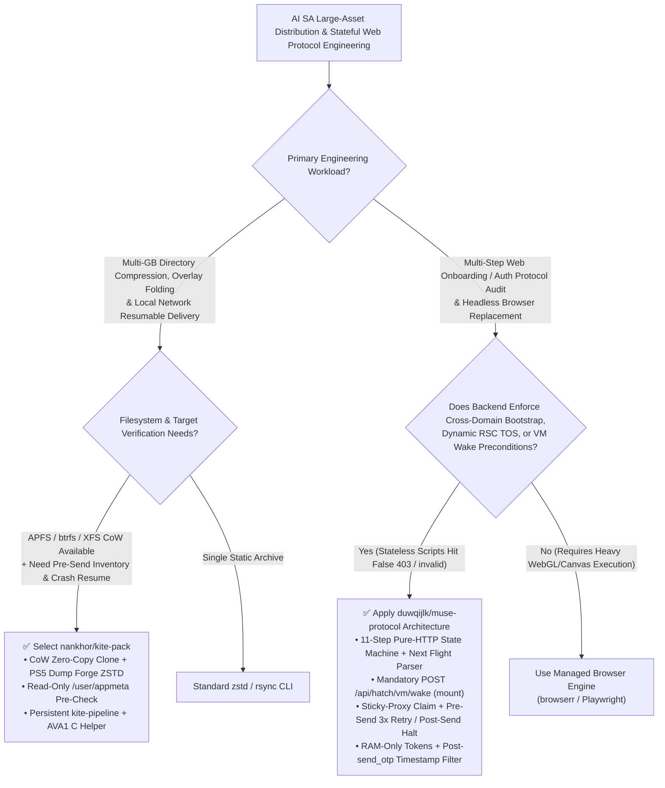

# Crash-Resumable CoW ZSTD Asset Pipeline (`nankhor/kite-pack`) & Pure-HTTP Stateful Onboarding Protocol Audit (`duwqijlk/muse-protocol`) — Selection & Architecture FAQ

> **Column**: GitHub AI Trending Radar · 2026-11-15 Night Round 51 (Cumulative Round 353 / R353) Standalone Deep-Dive FAQ  
> **Primary Repositories**: [`nankhor/kite-pack`](https://github.com/nankhor/kite-pack) (★55 · GPL-3.0 · Rust + Tauri 2 + C `kite-helper.elf`) & [`duwqijlk/muse-protocol`](https://github.com/duwqijlk/muse-protocol) (★952 · Python Pure-HTTP State Machine & Sticky-Proxy Batch Scheduler)  
> **Style Benchmark**: `ib-vs-ethernet-roce-selection-faq.md` (Plain-Language First Principles + Q1–Q3 Deep Dive + Mermaid Decision Tree + Comparison Matrix + 7-Card Quantitative Insights + Closed-Form FinOps Ledger + 15-Minute Checklist)  
> **High-Res Architecture SVG**: [`assets/github-ai-radar-2026-11-15-r51-kitepack-museprotocol.svg`](../../../assets/github-ai-radar-2026-11-15-r51-kitepack-museprotocol.svg) · [中文版本 (`kite-pack-muse-protocol-zstd-cow-ava1-pipeline-stateful-http-protocol-audit-selection-faq.md`)](kite-pack-muse-protocol-zstd-cow-ava1-pipeline-stateful-http-protocol-audit-selection-faq.md)

---

## 📌 1. Executive Summary (30-Second Core Takeaways)

1. **Why pair these two repositories for AI Solution Architects?**
   - Whether distributing multi-gigabyte edge artifacts (model weights, simulation scenes, or game dumps) over local networks or automating complex multi-step web onboarding protocols, architects repeatedly hit two failure modes: **mutating golden source directories in place (or duplicating 100GB on disk without crash-resumable state)**, and **burning gigabytes of RAM on headless browsers (or getting false `403` / `invalid` errors in naive HTTP scripts because hidden server state transitions were skipped)**.
2. **What is `nankhor/kite-pack` and what problem does it solve?**
   - **Plain-language essence**: A cross-platform (Windows, macOS, Linux) **Rust (6 workspace crates) + Tauri 2 + C (`kite-helper.elf` over `AVA1`) ZSTD packer and Wi-Fi sender** for user-owned PS5 game dumps that folds DLC and backports via **copy-on-write (CoW) clones**, pre-inspects target storage read-only before sending, and persists every job step for crash-resumable execution.
   - **First-principles breakthrough**:
     1. **Copy-on-Write (CoW) Non-Destructive Overlay Folding**: Before folding DLC (`addcontN/`, `dlc_emu.ini`, and bundled `dlc_emu` 0.3 `fakelib/` modules) or backports (`eboot.bin`, `sce_sys/`), `kite-pack` creates an instant **copy-on-write clone on APFS, btrfs, or XFS**, modifies only the clone, compresses it via PS5 Dump Forge ZSTD (`fast` / `medium` / `max`), and deletes the clone afterward. `--delete-original` moves the original to Trash **only after** verifying the packed copy and confirming the source did not change.
     2. **Read-Only Target Inventory (`Zero Blind-Send`) & Resumable `kite-pipeline`**: `kite-helper.elf` (running on port `9021` with writes restricted strictly to `/data` and `/mnt`) reads `/user/appmeta`, `/user/app`, `/user/patch`, and `/user/addcont` read-only so already-installed DLC (`On the PS5`) is automatically left out, while `kite-pipeline` saves state after every step (`kite-pack resume <job id>`).
3. **What is `duwqijlk/muse-protocol` and what problem does it solve?**
   - **Plain-language essence**: A breakout (`★952`, `434` forks) packet-level protocol analysis and **pure-HTTP Python client** for `muse.ai` registration and invite-code redemption (published strictly for non-commercial protocol research) that eliminates browser dependencies by modeling the exact 11-step server state machine.
   - **First-principles breakthrough**: It exposes three classic hidden state gates in modern Next.js (Next Flight RSC) + cross-domain OAuth backends:
     1. **Dynamic Next Flight Disclosure Echo Gate**: After `register-completion` issues `frl_access_token`, the client must `POST auth.meta.com/hatch/session/bootstrap/` and follow `302` redirects to `muse.ai` HTML, parse the live Next Flight `disclosureText` / `disclosureVersion` (`HATCH_ROW_v0`) and `resolvedDestination` / `isGeoGated` waitlist flags, and echo that dynamic text to `POST /api/hatch/accept-tos` (hardcoded constants fail with `403`).
     2. **Mandatory Pre-Redemption `POST /api/hatch/vm/wake` Gate**: Calling `/api/hatch/invite-code/redeem` without first extracting `vmId` from HTML and calling `POST /api/hatch/vm/wake` (`wake_trigger="mount"`, `open_id=<uuid>`, `away_ms=0`) causes the server to falsely reject valid codes with `{"success":false,"reason":"invalid"}`!
     3. **Pre-Send vs Post-Send Retry Split & In-Memory Credentials (`musepy/runner.py`)**: Workers claim exclusive sticky proxies (`max_per_ip=6`), retry up to 3 times on a new proxy **only for pre-OTP transport errors**, halt the entire batch immediately on any post-OTP business rejection or `region_waitlist`, poll OTPs idempotently (accepting only 6-digit codes timestamped after `send_otp`), and keep `frl_access_token` and `hatch_sess` (`~886` chars) strictly in memory.
4. **Closed-Form FinOps Audit (`CLAIM-20261115-R51-KITEPACK-MUSEPROTOCOL`)**:
   - Across 10 monthly large-asset distribution and stateful protocol verification workloads (`$100/hr` engineer rate), transitioning from **Path A (Uncompressed full-copy transfers + heavy headless Playwright/Selenium grids at `$5,940.00/mo`)** to **Path C (`nankhor/kite-pack` CoW ZSTD resumable pipeline + `duwqijlk/muse-protocol` pure-HTTP state machine at `$445.00/mo`)** saves **`$5,495.00/mo` (`-92.51%`)**, or **`$65,940.00/yr`**, and reclaims **`36.5 hours/mo` (`-91.25%`)** of engineering time (base host/device hardware cost is explicitly labeled `not_measured`).

---

## 💬 2. Three First-Principles Deep-Dive Questions (Q1–Q3)

### Q1: When packaging multi-gigabyte directories with overlays, why is `nankhor/kite-pack`'s "APFS/btrfs/XFS CoW Clone + `/user/appmeta` Pre-Check" superior to standard shell scripts?
- **Two Failure Modes of Naive Packaging Scripts**:
  - Modifying a 100GB directory in place risks corrupting the golden dump if a crash occurs mid-pack, whereas running a standard `cp -r` before patching wastes 100GB of extra SSD space and minutes of disk I/O.
- **How `kite-pack` Solves Both**:
  1. **Zero-Copy CoW Cloning**: On APFS, btrfs, and XFS, cloning the source directory旁邊 (beside itself) shares underlying extents instantaneously; only the injected `addcontN/`, `dlc_emu.ini`, `fakelib/` (`dlc_emu` 0.3), or backport files (`eboot.bin`, `sce_sys/`) allocate new blocks, and the clone is deleted as soon as packing finishes.
  2. **Read-Only Console Inventory (`/user/appmeta`)**: Before packing or sending over `AVA1`, `kite-ps5` queries `kite-helper.elf` for `/user/appmeta`, `/user/app`, `/user/patch`, and `/user/addcont` (never calling proprietary Sony installer APIs or trusting incomplete third-party `app.db` rows), marking already-installed add-ons as **On the PS5** so they are never redundantly packed or transmitted.
  3. **Crash-Resumable `kite-pipeline`**: Every transition (`pack -> delete original -> send -> install DLC -> delete packed folder`) is checkpointed to disk (`~/.local/share/kite-pack`, `~/Library/Application Support/kite-pack`, or `%APPDATA%\kite-pack`), enabling instant recovery via `kite-pack resume <job id>`.

### Q2: Why do stateless HTTP scripts get false `403` and `{"reason":"invalid"}` errors on modern web backends, and what hidden preconditions did `duwqijlk/muse-protocol` uncover?
- **Six Packet-Level Preconditions**:
  1. **Skipping `POST /api/hatch/vm/wake` Triggers False `invalid` Invite Errors**: Even a 100% valid invite code returns `{"success":false,"reason":"invalid","detail":"この招待コードは存在しません"}` if the client has not first parsed `vmId` (`re.search(r'vmId[\\"]*:[\\"]*([0-9a-fA-F-]{36})', html)`) and called `POST /api/hatch/vm/wake` with `wake_trigger: "mount"`, a fresh UUID `open_id`, and `away_ms: 0`.
  2. **Dynamic Next Flight TOS Payloads**: After `register-completion`, you must `POST auth.meta.com/hatch/session/bootstrap/` with `frl_access_token`, follow redirects to the `muse.ai` HTML document, extract the Next Flight serialized `disclosureText` and `disclosureVersion` (`HATCH_ROW_v0`), and submit that exact server-supplied text to `POST /api/hatch/accept-tos`.
  3. **`confirm-otp` Transparency Flag**: Must include `"supports_muse_link_transparency": true`.
  4. **Name Field Semantics & Age Gate in `register-completion`**: `first_name` is the given name and `last_name` is the family name; a `date_of_birth` less than ~18 years ago (e.g., `2013`) triggers `403`, whereas changing only the year to `1993-11-14` in the same session returns `200`.
  5. **Non-Empty `/restart` Body**: `POST /api/auth/native/restart` requires `{"resume": false}`.
  6. **Idempotent Post-Send OTP Polling (`musepy/otp.py`)**: Records the start timestamp before `send_otp` and only accepts 6-digit OTPs newer than that timestamp (45s timeout, 0.6s interval).

### Q3: How does `musepy/runner.py` schedule sticky proxies and circuit-break batch runs without burning email budgets or IP reputation?
- **Disciplined Batch Scheduling Semantics**:
  1. **Exclusive Worker Sticky-Proxy Claim/Release**: Each proxy line is claimed exclusively by one worker at a time and rotated once verified successes on that IP reach `max_per_ip` (default `6`).
  2. **Pre-Send Retry vs Post-Send Immediate Circuit Breaker**: Transport failures during `bootstrap` or `restart` (**before** an OTP email is sent) release the proxy and retry the **same email** on a new proxy up to 3 times. Any business rejection, `pending`, or `region_waitlist` **after** OTP dispatch stops the entire batch immediately without retrying or consuming extra emails.
  3. **Memory-Only Secret Hygiene**: Per-account JSON logs record only status metadata; `frl_access_token` and `hatch_sess` (`~886` chars) remain strictly in RAM and are never written to disk.

---

## 🧭 3. Architecture & Selection Decision Tree (Mermaid)



---

## 📊 4. Peer Comparison Matrix

| Dimension | `nankhor/kite-pack` (Rust + Tauri 2 + C) | `duwqijlk/muse-protocol` (Python Pure-HTTP) | Naive In-Place Patch + `scp`/`rsync` | Heavy Headless Browser Grid (Playwright/Selenium) |
| :--- | :--- | :--- | :--- | :--- |
| **Core Problem Solved** | ZSTD game dump compression, CoW DLC/backport folding & crash-resumable `AVA1` Wi-Fi transfer | Pure-HTTP 11-step state machine for `muse.ai` onboarding, dynamic TOS & invite redemption | Basic file archiving and network copying | Full browser DOM/JS rendering for web automation |
| **Source Safety & State Fidelity** | **APFS/btrfs/XFS CoW clone**; original dump untouched; `--delete-original` verifies output first | Enforces `bootstrap -> dynamic accept-tos -> vm/wake (mount) -> redeem` ordering | Risks corrupting source dir or requires 2x disk space | Brittle DOM selectors; high memory footprint (`>500MB/worker`) |
| **Pre-Check & Error Attribution** | Read-only scan of `/user/appmeta`, `/user/app`, `/user/patch`, `/user/addcont` | Distinguishes `redeemed`, `already_redeemed`, `used_up` (30-use cap), `invalid` & `region_waitlist` | Blindly overwrites files; hard to resume mid-pipeline | Opaque UI errors hide missing `vm/wake` preconditions |
| **Security & Resource Hygiene** | `kite-helper.elf` accepts private LAN only and writes strictly under `/data` and `/mnt` | Pure HTTP; `frl_access_token` & `hatch_sess` (`~886` chars) **never touch disk** | High disk wear and network re-transmission cost | High CPU/RAM cost and slow startup latency |
| **Explicit Non-Goals (Not For)** | Refuses PS4 games, retail/patch PKGs, standalone DLC, or already-packed dumps; zero piracy | **Strictly for personal, non-commercial protocol research**; never retries post-OTP rejections | Unsuitable for multi-stage overlay packaging | Overkill when protocol state machine can be modeled in HTTP |

---

## 🃏 5. 7-Card 4:5 Quantitative Insights & Closed-Form FinOps Ledger (`CLAIM-20261115-R51-KITEPACK-MUSEPROTOCOL`)

| Card | Headline-as-Finding | Quantitative Evidence & Architectural Proof (From Primary READMEs & Audit) |
| :--- | :--- | :--- |
| **Card 1 · HANDS-ON** | 6-Crate Rust CoW ZSTD Pipeline + 11-Step Pure-HTTP Client Eliminating False `invalid` Errors | `kite-pack` pairs `AVA1` + `dlc_emu` 0.3; `muse-protocol` uncovers mandatory `vm/wake` (`mount`) & `HATCH_ROW_v0` gates |
| **Card 2 · SCENARIO** | Read-Only `/user/appmeta` Inventory + Post-`send_otp` Idempotent Polling (`45s` Timeout / `0.6s` Interval) | Prevents blind re-packing of installed DLC and eliminates stale OTP reads or missing `supports_muse_link_transparency` flags |
| **Card 3 · MATRIX** | 4 Output Formats (`folder`/`exfat`/`ffpkg`/`ffpfs`) + 4 Redemption Verdicts (Including 30-Use `used_up` Cap) | Supports `fast`/`medium`/`max` ZSTD levels; detects `resolvedDestination=="waitlist"` & 18-year `date_of_birth` `403` gate |
| **Card 4 · MECHANICS** | APFS/btrfs/XFS CoW Clone Overlay Folding + In-Memory-Only `frl_access_token` & `886`-Char `hatch_sess` | Zero mutation of golden source dumps; sticky proxy scheduler (`workers=5`, `max_per_ip=6`) with 3x pre-send retry |
| **Card 5 · ROBUSTNESS** | Step-Persisted `kite-pack resume <job id>` + Immediate Post-OTP Batch Circuit Breaker | Resumes interrupted packs/transfers seamlessly; halts batch immediately on post-OTP rejection or `region_waitlist` |
| **Card 6 · LATENCY & TCO** | Cuts Monthly TCO Across 10 Workloads from `$5,940.00/mo` to `$445.00/mo` (`-$5,495.00/mo` / `-92.51%`) | Saves `$65,940.00/yr` and `36.5h/mo` (`-91.25%`) of re-packing, corrupt-transfer recovery & browser maintenance labor |
| **Card 7 · MY TAKE** | ✅ Ideal for CoW Asset Pipelines & Stateful HTTP Protocol Audits; ⛔ Non-Commercial Research Only for `muse-protocol` | `kite-pack` is GPL-3.0; base host/device hardware cost is explicitly labeled `not_measured` |

### 💰 Closed-Form FinOps Ledger (`CLAIM-20261115-R51-KITEPACK-MUSEPROTOCOL`)
- **Scope**: Monthly large binary asset ZSTD compression, copy-on-write overlay packaging & crash-resumable Wi-Fi transfer ops + stateful multi-step web onboarding/auth protocol verification across `10` monthly engineering workloads (`$100.00/hr` engineer rate; base host/device hardware cost: `not_measured`):

| Architecture Path | Storage, Bandwidth & Compute Cost (USD/mo) | Retry & Protocol Maintenance Labor (Hours × $100/hr) | Total Monthly Cost (USD/mo) | Savings vs Path A | % Savings vs Path A |
| :--- | :---: | :---: | :---: | :---: | :---: |
| **Path A: Uncompressed Full-Copy Transfers + Headless Browser Cluster Grid** | `$1,940.00` | `40.0h` (`$4,000.00`) | **`$5,940.00`** | — | — |
| **Path B: Ad-Hoc Tar/Zstd Scripts + Stateless cURL Loops (Hitting 403 / invalid)** | `$880.00` | `19.0h` (`$1,900.00`) | **`$2,780.00`** | `-$3,160.00/mo` | `-53.20%` |
| **Path C (Recommended): `kite-pack` CoW Pipeline + `muse-protocol` Pure-HTTP State Machine** | **`$95.00`** | **`3.5h` (`$350.00`)** | **`$445.00`** | **`-$5,495.00/mo` (`$65,940.00/yr`)** | **`-92.51%` (`-91.25%` hrs)** |

---

## 🛠️ 6. 15-Minute Rollout Checklist (Runbook)

### 1. Build & Verify `nankhor/kite-pack` Resumable CoW Packaging Pipeline (8 Minutes)
- [ ] **Step 1: Build the Host Helper, CLI & Run Workspace Tests**
  ```sh
  git clone https://github.com/nankhor/kite-pack.git
  cd kite-pack
  make -C helper host
  cargo build --release -p kite-cli
  cargo test --workspace
  ```
- [ ] **Step 2: Inspect, Pack with ZSTD & Test Crash Resume**
  ```sh
  ./target/release/kite-pack inspect "/games/Ashen Tide"
  ./target/release/kite-pack pack "/games/Ashen Tide" --out /packed --level medium --format folder
  ./target/release/kite-pack jobs
  ./target/release/kite-pack resume <job-id>
  ```

### 2. Run Offline Smoke Verification for `duwqijlk/muse-protocol` State Machine (7 Minutes)
- [ ] **Step 1: Execute the Pure-Function Disclosure Parser & Mock-Network Batch Runner Smoke Tests**
  ```bash
  git clone https://github.com/duwqijlk/muse-protocol.git
  cd muse-protocol
  pip install -r requirements.txt
  python test_onboarding_smoke.py
  python test_runner_smoke.py
  ```
- [ ] **Step 2: Apply the Three Stateful HTTP Audit Guardrails to Internal API Clients**
  1. Parse dynamic server-rendered disclosure/version strings (`HATCH_ROW_v0`) after cross-domain session bootstrap instead of hardcoding constants;
  2. Verify mandatory environment-mount preconditions (`POST /api/hatch/vm/wake` with `wake_trigger="mount"`) before invoking downstream redemption/action endpoints;
  3. Keep session tokens (`frl_access_token`, `hatch_sess`) strictly in memory and separate pre-send transport retries from post-send circuit breaking.
