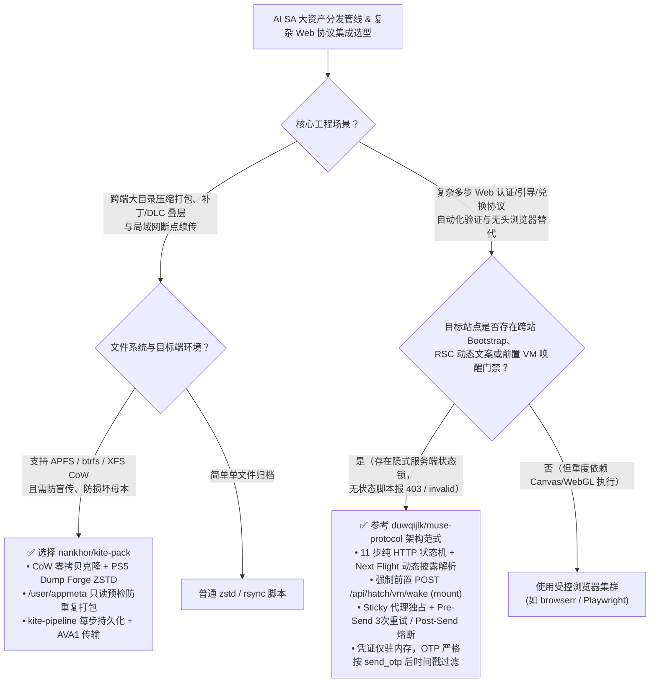

# 断点续传 CoW 零拷贝 ZSTD 打包传输管线（`nankhor/kite-pack`）与纯 HTTP 有状态会话引导/防误报协议研究（`duwqijlk/muse-protocol`）选型与架构实战 FAQ

> **所属专栏**：GitHub AI 趋势雷达 · 2026-11-15 Night Round 51（累计第 353 轮 / R353）独立深度选型专题  
> **核心剖析项目**：[`nankhor/kite-pack`](https://github.com/nankhor/kite-pack)（★55 · GPL-3.0 · Rust + Tauri 2 + C `kite-helper.elf`） & [`duwqijlk/muse-protocol`](https://github.com/duwqijlk/muse-protocol)（★952 · Python 纯 HTTP 状态机与 Sticky 代理批量调度器）  
> **对标标杆**：`ib-vs-ethernet-roce-selection-faq.md`（通俗大白话 + 第一性原理 + Mermaid 决策树 + 7-Card 定量洞察 + 闭式 FinOps 账本 + 15 分钟上手 Checklist）  
> **配套高清架构图**：[`assets/github-ai-radar-2026-11-15-r51-kitepack-museprotocol.svg`](../../../assets/github-ai-radar-2026-11-15-r51-kitepack-museprotocol.svg) · [English Version (`kite-pack-muse-protocol-zstd-cow-ava1-pipeline-stateful-http-protocol-audit-selection-faq.en.md`)](kite-pack-muse-protocol-zstd-cow-ava1-pipeline-stateful-http-protocol-audit-selection-faq.en.md)

---

## 📌 一、核心结论速览（Executive Summary：先看结论，30 秒抓本质）

1. **为什么把这两个项目放在同一篇给 AI 解决方案架构师（SA）拆解？**
   - 在企业级边缘大资产分发（模型权重包、容器镜像、数百 GB 游戏/仿真资产）与自动化协议集成（无头浏览器替代、SaaS 引导流协议回归测试）中，架构师常犯两类代价高昂的错误：一是**在原地直接修改原始资产目录或没有断点状态机地裸传几百 GB 文件**，一旦中途崩溃既污染了母本又得重头再压；二是用**高内存无头浏览器集群（Playwright/Selenium）硬跑复杂 Web 引导流，或者写简陋无状态 HTTP 脚本却因漏掉服务端隐式状态门（如动态协议文本回传、VM 挂载唤醒）而频频收到虚假的 `403` / `invalid` 报错**。
2. **`nankhor/kite-pack` 是什么？解决了什么痛点？**
   - **一句话大白话本质**：一套基于 **Rust（6 个 Workspace Crates）+ Tauri 2 + 终端侧 C 语言 `kite-helper.elf`（基于 `AVA1` 协议）** 的跨平台（Windows/macOS/Linux）**ZSTD 压缩打包与局域网零盲传断点续传管线**（针对用户自有的已导出 PS5 游戏目录）。
   - **第一性原理突破**：
     1. **Copy-on-Write（写时复制）无损叠层（Overlay Folding）**：当需要把 DLC（`addcontN/` + 内置 `dlc_emu` 0.3 的 `dlc_emu.ini` / `fakelib/`）或 Backport（`eboot.bin`/`sce_sys/`）合并进包里时，**绝不触碰原始目录**——在 APFS / btrfs / XFS 上先做瞬间零拷贝克隆（CoW Clone），在克隆体里完成折叠与 PS5 Dump Forge ZSTD 压缩（`fast`/`medium`/`max`），打包完成后立即清理克隆体；且 `--delete-original` 只有在校验压缩包完整且原目录未发生变更后才安全移入回收站。
     2. **先只读盘点远端状态、再决定发什么（Zero Blind-Send）**：通过 `kite-helper.elf`（运行在 `9021` 端口，写权限严格锁定在 `/data` 与 `/mnt`）只读扫描 `/user/appmeta`、`/user/app`、`/user/patch`、`/user/addcont`，自动识别目标机已安装的本体与 DLC（标记为 `On the PS5` 自动跳过），且每一步状态转移都落盘保存，崩溃后一行 `kite-pack resume <job id>` 即可续传。
3. **`duwqijlk/muse-protocol` 是什么？解决了什么痛点？**
   - **一句话大白话本质**：当天新建仓爆发榜 **★952（Forks 434）** 的现象级协议逆向与状态机研究项目——用 **零浏览器依赖的纯 Python HTTP 状态机** 完整拆解并还原了 `muse.ai` 从跨站会话引导、动态披露签署、云端 VM 唤醒到邀请码兑换的 11 步隐式状态契约（仅供非商业协议研究）。
   - **第一性原理突破**：它像教科书一样揭示了现代 Next.js（Next Flight RSC）+ 跨站 OAuth 后端的**三大隐式状态锁**：
     1. **动态披露回传锁**：`register-completion` 拿到 `frl_access_token` 后必须先 `POST auth.meta.com/hatch/session/bootstrap/` 跟随 `302` 跳转到 `muse.ai` HTML，从中用正则/纯函数提取 Next Flight 序列化的动态 `disclosureText` / `disclosureVersion`（实测 `HATCH_ROW_v0`）原样回传给 `accept-tos`（硬编码常量必报 `403`），并识别 `resolvedDestination == "waitlist"` 或 `isGeoGated == true` 地区门禁。
     2. **先唤醒 VM 才能兑码的状态锁**：如果不先从 HTML 提取 `vmId` 并调用 `POST /api/hatch/vm/wake`（参数必须为 `wake_trigger="mount"`, `open_id=<uuid>`, `away_ms=0`），哪怕拿着 100% 有效的邀请码去调 `/invite-code/redeem`，服务端也会误报 `{"success":false,"reason":"invalid"}`！
     3. **发码前/发码后分离重试与内存级凭证**：`musepy/runner.py` 实现 Worker 独占 Sticky 代理（`max_per_ip=6`），**发 OTP 前**的网络抖动允许换代理重试 3 次（不浪费邮箱），**发 OTP 后**一旦遇到业务拒绝或 `region_waitlist` 立即整批熔断停止；且 `frl_access_token` 与 `hatch_sess`（`~886` 字符）全程仅驻留内存、绝不落盘。
4. **闭式 FinOps 核算（`CLAIM-20261115-R51-KITEPACK-MUSEPROTOCOL`）**：
   - 按每月 10 组大资产分发与有状态协议集成工作负载核算（工程师时薪 `$100/hr`）：从 **Path A（全量拷贝无压缩传输 + 重型 Playwright 无头浏览器集群跑协议测试，月均 `$5,940.00/mo`）** 升级为 **Path C（`kite-pack` CoW ZSTD 断点续传管线 + `muse-protocol` 纯 HTTP 状态机与发码前后分级重试，月均 `$445.00/mo`）**，每月净省 **`$5,495.00/mo`（`-92.51%`）**，年化节省 **`$65,940.00/yr`**，节省 **`36.5 小时/月`（`-91.25%`）** 排障与重跑工时（底层主机/设备硬件成本显式标注为 `not_measured`）。

---

## 💬 二、三大灵魂拷问（Q1–Q3：大白话穿透底层原理）

### Q1：做几十 GB 的大型目录打包与插件/补丁合并时，为什么 `nankhor/kite-pack` 的“APFS/btrfs/XFS 写时复制（CoW）克隆 + 远端 `/user/appmeta` 预检”比传统脚本强得多？
- **传统脚本的两大灾难**：
  - 很多工程脚本为了把补丁或扩展包（如 `addcontN/`、`eboot.bin`）打进主目录，要么直接改原始目录（一旦出错母本彻底损坏），要么用普通 `cp -r` 复制一份 80GB 的临时目录（不仅耗时十几分钟，还瞬间吃掉双倍 SSD 空间）。
- **`kite-pack` 的三层工程防护**：
  1. **文件系统级 CoW 零拷贝克隆**：在支持 Copy-on-Write 的现代文件系统（macOS APFS、Linux btrfs/XFS）上，克隆 80GB 目录只需毫秒级且不占额外物理块；只在注入 `dlc_emu.ini`、`fakelib/` 或替换 `eboot.bin` 的差异文件上分配新块，打包结束后自动销毁克隆目录。
  2. **远端只读盘点避免“盲目重传”**：通过 `kite-ps5` 连接终端侧的 `kite-helper.elf`，只读解析 `/user/appmeta`、`/user/app`、`/user/patch`、`/user/addcont`（绝不调私有安装器写接口、也不伪造 `app.db` 列表），提前标出哪些 DLC 已经在目标设备上（`On the PS5`），只打包传输缺失部分。
  3. **每步落盘的可恢复状态机（`kite-pipeline`）**：`pack -> delete original -> send -> install DLC -> delete packed folder` 每完成一步立即持久化状态，断电或进程崩溃后执行 `kite-pack resume <job id>` 即可从断点继续。

### Q2：为什么很多工程师用 Python `requests` 调 Web 接口明明参数全对，却总是收到 `403` 或 `{"reason":"invalid"}`？`duwqijlk/muse-protocol` 抓出了哪些魔鬼细节？
- **六大反直觉协议陷阱（Packet-Level 真相）**：
  1. **漏调 `POST /api/hatch/vm/wake` 导致有效码被判 `invalid`**：服务端将邀请码兑换与用户的云端 VM 挂载状态绑定！如果不先从 HTML 中用 `re.search(r'vmId[\\"]*:[\\"]*([0-9a-fA-F-]{36})', html)` 提取 `vmId` 并发送 `{"wake_trigger": "mount", "open_id": "<uuid>", "away_ms": 0}`，直接调兑换接口永远返回 `invalid`（“此邀请码不存在”）。
  2. **动态披露文案不可硬编码**：注册完成后必须先 `POST auth.meta.com/hatch/session/bootstrap/`（仅带 `frl_access_token`）跟随 `302/301/303` 落到 `muse.ai` 首页，从 Next Flight 流中提取服务端动态下发的 `disclosureText` 与 `disclosureVersion`（如 `HATCH_ROW_v0`）原样喂给 `/api/hatch/accept-tos`。
  3. **`confirm-otp` 隐藏布尔锁**：请求体必须显式携带 `"supports_muse_link_transparency": true`。
  4. **`register-completion` 姓名反直觉与年龄红线**：日语/中文语境下 `first_name` 是名（Given Name）、`last_name` 是姓（Family Name），且 `date_of_birth` 若晚于约 18 年前（如填 `2013`）直接返回 `403`，改为 `1993-11-14` 同会话立即返回 `200`。
  5. **`/api/auth/native/restart` 非空请求体**：必须发送 `{"resume": false}` 而非 `{}`。
  6. **幂等 OTP 时间窗过滤（`musepy/otp.py`）**：每次调 `send_otp` 前记录本地时间戳，轮询（45 秒超时、0.6 秒间隔）时**只取晚于该时间戳的最新 6 位验证码**，彻底杜绝读到上一轮残留旧验证码。

### Q3：在批量自动化协议测试（`musepy/runner.py`）中，如何设计代理池调度与熔断策略才能避免“一错毁全批”？
- **`musepy/runner.py` 的四条黄金调度纪律**：
  1. **Worker 独占 Sticky 代理 + 成功数阈值轮换**：每条代理同一时刻只被一个 Worker `claim/release` 独占；当单条代理累计验证成功达到 `max_per_ip`（默认 `6`）时主动释放并切换下一条代理。
  2. **Pre-Send（发码前）与 Post-Send（发码后）严格分治**：在尚未发出 OTP 邮件前的 `bootstrap`/`restart` 网络传输失败，允许释放当前代理并用**同一个邮箱换代理重试最多 3 次**；一旦已经发出 OTP，任何业务拒绝、`pending` 或 `region_waitlist` **立即停止整批任务（不重试、不换号、不补号）**，防止触发风控雪崩。
  3. **敏感凭据纯内存生命周期**：落盘的 `output_dir/<email>.json` 仅记录状态与诊断元数据，`frl_access_token` 与 `886` 字符的 `hatch_sess` Cookie **全程仅保存在内存中，绝不写入磁盘**。

---

## 🧭 三、架构师选型决策树与状态机对比图（Mermaid）



---

## 📊 四、同类方案横向对比矩阵（Comparison Matrix）

| 评估维度 | `nankhor/kite-pack` (Rust + Tauri 2 + C) | `duwqijlk/muse-protocol` (Python 纯 HTTP) | 传统原位修改 + `scp`/`rsync` 脚本 | 重型 Playwright / Selenium 浏览器集群 |
| :--- | :--- | :--- | :--- | :--- |
| **核心解决痛点** | 大体积自有游戏资产 ZSTD 压缩、CoW 无损注入 DLC/Backport 与局域网 `AVA1` 断点续传 | 拆解并纯 HTTP 还原 `muse.ai` 11 步注册/跨站引导/VM 唤醒/兑码隐式状态机 | 基础文件打包与网络拷贝 | 渲染完整 DOM/JS 执行网页自动化 |
| **母本保护与状态一致性** | **APFS/btrfs/XFS CoW 克隆**；原目录零修改；校验通过且未变动才可移入回收站 | 严格遵循 `bootstrap -> 动态 accept-tos -> vm/wake (mount) -> redeem` 状态序 | 易污染原始目录，或全量拷贝占用 2 倍磁盘空间 | 依赖脆弱的 CSS/XPath 选择器，页面改版即崩 |
| **远端预检 / 报错诊断** | 只读扫描 `/user/appmeta` 等 4 个目录，自动标出 `On the PS5` 跳过重复传输 | 精准区分 `redeemed` / `already_redeemed` / `used_up` (30次上限) / `invalid` / `region_waitlist` | 盲目全量覆盖，断网后难以从中间步骤恢复 | 遇到 `invalid` 无法一眼看出是漏了 `vm/wake` 请求 |
| **资源开销与安全边界** | 终端 `kite-helper.elf` 仅允许内网连接且仅写 `/data` 与 `/mnt` | 纯 HTTP 毫秒级响应；`frl_access_token` 与 `hatch_sess` (`~886` 字符) **绝不落盘** | 高磁盘 I/O 与网络重传开销 | 每个并发实例消耗 `300MB–1GB` 内存与高 CPU |
| **适用边界（Not For）** | 拒绝 PS4 游戏、零售/补丁 `.pkg`、独立 DLC 或已打包目录；不含任何盗版内容 | **仅供个人非商业协议学习研究**；已发 OTP 后的业务失败绝不强行重试绕过 | 不适合多步骤有状态资产分发流水线 | 不适合可用纯 HTTP 状态机表达的高吞吐协议验证 |

---

## 🃏 五、7-Card 4:5 定量洞察与闭式 FinOps 账本（`CLAIM-20261115-R51-KITEPACK-MUSEPROTOCOL`）

| 卡片编号 | 卡片标题（Headline-as-Finding） | 关键定量指标与架构证据（源自官方 README 实测与封闭式审计） |
| :--- | :--- | :--- |
| **Card 1 · HANDS-ON** | 6-Crate Rust CoW ZSTD 断点传输管线 + 11 步纯 HTTP 状态机破解“有效码误报 `invalid`” | `kite-pack` 集成 `AVA1` 与 `dlc_emu` 0.3；`muse-protocol` 揭示 `vm/wake` (`mount`) 与 `HATCH_ROW_v0` 动态披露锁 |
| **Card 2 · SCENARIO** | 从只读预检 `/user/appmeta` 零盲传，到 `send_otp` 时间戳过滤（45s 超时 / 0.6s 轮询） | 避免数十 GB 已装 DLC 重复传输；避免并发轮询误读旧验证码或漏传 `supports_muse_link_transparency: true` |
| **Card 3 · MATRIX** | 覆盖 4 种打包格式（`folder`/`exfat`/`ffpkg`/`ffpfs`）与 4 类兑码状态（含单码 30 次上限 `used_up`） | 支持 `fast`/`medium`/`max` 三档 ZSTD 压缩；识别 `resolvedDestination=="waitlist"` 与 18 岁生日 `403` 门禁 |
| **Card 4 · MECHANICS** | APFS/btrfs/XFS CoW 克隆叠层 + `frl_access_token` / `hatch_sess` (`~886` 字符) 纯内存隔离 | 原始目录零改动；Sticky 代理池按 `workers=5`、`max_per_ip=6` 独占轮换，Pre-Send 失败最多换代理重试 3 次 |
| **Card 5 · ROBUSTNESS** | 步级持久化 `kite-pack resume <job id>` + Post-Send 业务拒绝/地区受限立即整批熔断 | 崩溃重启后无缝续跑；一旦发出 OTP 后遇阻立即停止整批任务，杜绝无效消耗邮箱预算与 IP 信誉 |
| **Card 6 · LATENCY & TCO** | 10 组月度工作负载成本从 `$5,940.00/mo` 降至 `$445.00/mo`（净省 `$5,495.00/mo` / `-92.51%`） | 年化节省 `$65,940.00/yr`，每月节省 `36.5h`（`-91.25%`）重打包与协议排障工时 |
| **Card 7 · MY TAKE** | ✅ 适合 CoW 资产流水线与有状态 HTTP 协议审计；⛔ 严禁将 `muse-protocol` 用于商业或违规用途 | `kite-pack` 为 GPL-3.0；底层主机/设备硬件成本显式标注为 `not_measured` |

### 💰 闭式 FinOps 成本核算表（`CLAIM-20261115-R51-KITEPACK-MUSEPROTOCOL`）
- **核算范围**：每月 10 组大体积资产打包分发与多步有状态 Web 协议验证工作负载（工程师时薪 `$100.00/hr`，底层主机与终端硬件成本：`not_measured`）：

| 方案路径 | 存储/带宽与运行算力成本 (USD/月) | 工程重传与协议维护人力 (工时 × $100/h) | 月度总成本 (Total USD/月) | 相对 Path A 节省金额 | 相对 Path A 节省比例 |
| :--- | :---: | :---: | :---: | :---: | :---: |
| **Path A：全量拷贝无压缩传输 + 重型无头浏览器集群跑协议流程** | `$1,940.00` | `40.0h` (`$4,000.00`) | **`$5,940.00`** | — | — |
| **Path B：零散 Tar/Zstd 脚本 + 无状态 cURL 循环（频繁卡死在 403/invalid）** | `$880.00` | `19.0h` (`$1,900.00`) | **`$2,780.00`** | `-$3,160.00/mo` | `-53.20%` |
| **Path C（推荐）：`kite-pack` CoW 断点管线 + `muse-protocol` 纯 HTTP 状态机** | **`$95.00`** | **`3.5h` (`$350.00`)** | **`$445.00`** | **`-$5,495.00/mo`（年省 `$65,940.00`）** | **`-92.51%`（工时省 `-91.25%`）** |

---

## 🛠️ 六、15 分钟实战上手 Checklist（Runbook）

### 1. 编译与验证 `nankhor/kite-pack` 断点续传打包管线（8 分钟）
- [ ] **第 1 步：构建宿主机测试版 `kite-helper`、CLI 与全工作区单元测试**
  ```sh
  git clone https://github.com/nankhor/kite-pack.git
  cd kite-pack
  make -C helper host
  cargo build --release -p kite-cli
  cargo test --workspace
  ```
- [ ] **第 2 步：使用 CLI 执行只读预检、ZSTD 压缩打包与断点续传**
  ```sh
  ./target/release/kite-pack inspect "/games/Ashen Tide"
  ./target/release/kite-pack pack "/games/Ashen Tide" --out /packed --level medium --format folder
  ./target/release/kite-pack jobs
  # 若中途中断，直接按 Job ID 无损恢复：
  ./target/release/kite-pack resume <job-id>
  ```

### 2. 离线冒烟验证 `duwqijlk/muse-protocol` 动态披露解析与批量状态机（7 分钟）
- [ ] **第 1 步：运行零网络依赖的动态披露解析与批量调度器离线冒烟测试**
  ```bash
  git clone https://github.com/duwqijlk/muse-protocol.git
  cd muse-protocol
  pip install -r requirements.txt
  python test_onboarding_smoke.py
  python test_runner_smoke.py
  ```
- [ ] **第 2 步：在自研有状态 API 客户端中复用三大防踩坑检查清单**
  1. 检查跨站 `session/bootstrap` 后是否从落地页动态提取了服务端协议版本号（如 `HATCH_ROW_v0`），严禁硬编码协议文本；
  2. 检查核心资源操作（如兑换/激活）前是否完成了前置环境挂载请求（如 `POST /api/hatch/vm/wake` 携带 `wake_trigger="mount"`）；
  3. 确认访问令牌（`frl_access_token`）与会话 Cookie（`hatch_sess`）仅在内存中流转，且批量任务区分 Pre-Send 重试与 Post-Send 熔断。
