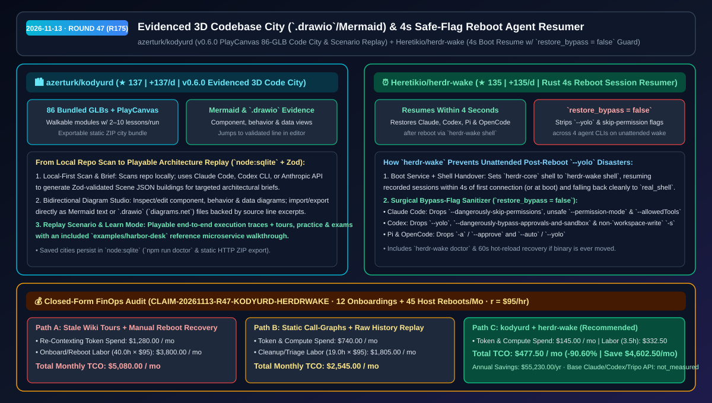
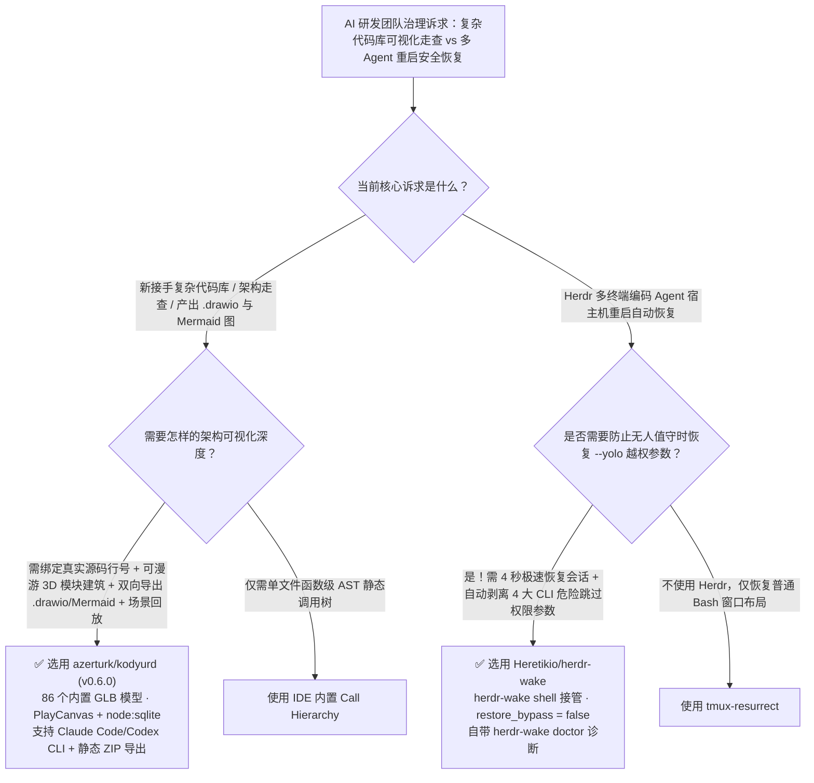

# 源码证据锚定 3D 代码城市（Mermaid/`.drawio`）与 4 秒开机权限降级 Agent 恢复器选型 FAQ：`azerturk/kodyurd` + `Heretikio/herdr-wake`

> **元数据（Metadata）**
> - **评测批次**：2026-11-13 夜间深潜 Round 47（累计 Round 175）
> - **核心标的**：
>   1. [`azerturk/kodyurd`](https://github.com/azerturk/kodyurd)（`★ 137` · `+137 Stars/day` · `2026-11-12` 建仓 · `v0.6.0` 将本地代码库转化为含 86 个内置 GLB 模型的可漫游 3D 城市、支持双向编辑/导出 Mermaid 与 `.drawio` 架构图及源码行级证据回放）
>   2. [`Heretikio/herdr-wake`](https://github.com/Heretikio/herdr-wake)（`★ 135` · `+135 Stars/day` · `2026-11-12` 建仓 · Rust 开机恢复守护服务，在宿主机重启后 `4 秒` 内恢复 Herdr 中的 Claude Code / Codex / Pi / OpenCode 会话，并支持 `restore_bypass = false` 自动剥离 `--yolo` 等危险提权参数）
> - **配套架构图**：[`assets/github-ai-radar-2026-11-13-r47-kodyurd-herdr-wake.svg`](../../../assets/github-ai-radar-2026-11-13-r47-kodyurd-herdr-wake.svg)
> - **证据封存锚点**：`CLAIM-20261113-R47-KODYURD-HERDRWAKE`（见 [`evidence/trending-daily-2026-11-13-audit.json`](../evidence/trending-daily-2026-11-13-audit.json)）

---

## 📌 1. 核心结论速览（Executive Summary & First-Principles Pitch）

1. **一句话讲透本质**：
   - **`azerturk/kodyurd` (`v0.6.0`)**：把枯燥的仓库目录树变成一座**“每栋建筑对应一个核心模块、每张架构图都绑定真实源码行号、且能一键导出为 `.drawio` / Mermaid 或静态 ZIP 包”的 3D 可交互代码城市（基于 PlayCanvas + 86 个内置 GLB 模型 + `node:sqlite`）**。它支持通过 Claude Code 或 Codex CLI 按你关注的主题（Brief）每次构建 2–10 栋建筑课程、交互式回放业务调用场景（Replay Scenario），并内置导览、练习与测验模式（Learn）。
   - **`Heretikio/herdr-wake`**：解决多 Agent 终端工作台（Herdr）在系统更新或断电重启后的**“全量会话灰飞烟灭 + 无人值守自动恢复 `--yolo` 提权引发安全事故”**痛点。它作为 `herdr-core` 的启动外壳（`herdr-wake shell`），在机器重启后首次连接 **`4 秒` 内自动唤醒所有 Claude Code、Codex、Pi、OpenCode 会话**；同时提供 `restore_bypass = false` 铁闸，在唤醒命令中精准剔除 `--dangerously-skip-permissions` 与 `--yolo` 等高危越权标志。
2. **核心量化收益（FinOps 闭式账本 `CLAIM-20261113-R47-KODYURD-HERDRWAKE`）**：
   - 在每月 **12 次新成员/跨组架构走查（Onboarding）+ 45 次宿主机重启/内核更新后多 Agent 会话恢复** 的团队负载下（工程师时薪 `$95.00/hr`；基础 Claude/Codex 订阅与可选 Tripo 3D API 费用标记为 `not_measured`）：
   - **Path C（`kodyurd` + `herdr-wake`）** 将月度总拥有成本（TCO）从 **Path A（手工维护过期 Wiki 架构图 + 重启后人肉翻历史重建十几个会话）的 `$5,080.00/月`** 降至 **`$477.50/月`**，净省 **`$4,602.50/月`（`-90.60%`，年化节省 `$55,230.00/年`）**，每月节省 **`36.5 小时`（`-91.25%`）** 的架构讲解与中断恢复工时。



---

## ❓ 2. 灵魂拷问 Q1–Q3（First-Principles Deep Dive）

### Q1：传统的“代码生成架构图”工具为什么用过一次就被扔进垃圾桶？`azerturk/kodyurd` 的“证据锚定 + `.drawio` 双向编辑 + 场景回放”改对了什么？
- **传统痛点**：市面上大多数 AI 架构图工具要么吐出一张密密麻麻几百个节点的静态调用网（没人看得懂），要么画出一张没有任何源码行号支撑的“幻觉方框图”（点进去找不到对应代码，也没法在 `diagrams.net` 里二次修改）。
- **`kodyurd` (`v0.6.0`) 的四大架构亮点**：
  1. **按需增量建城（Brief-Driven 2–10 Buildings）**：本地扫描文件后，根据你提问的架构重心（Brief）调用 Claude Code / Codex CLI 生成经 Zod Schema 严格校验的 Scene JSON，每次生成 2–10 栋核心模块建筑，避免信息过载。
  2. **双向 Mermaid / `.drawio` 工作室（Evidenced Diagrams）**：每栋建筑内包含组件视图（Component）、行为视图（Behavior）与数据视图（Data）。你可以直接在线编辑、导入 Mermaid 或 `.drawio` 文件，也可以一键复制为 Mermaid 或下载 `.drawio`，且**图中每个节点都绑定了经校验的源码行号（点击直接跳转到编辑器对应行）**。
  3. **可播放的场景回放与考核（Replay Scenario & Learn）**：支持基于真实源码证据的端到端请求流回放，并自带导览（Tours）、练习（Practice）与测验（Exams）以及开箱即用的 `examples/harbor-desk` 微服务样板。
  4. **本地 `node:sqlite` 持久化与静态 ZIP 导出**：生成的城市保存在本地 SQLite 中无需重复消耗 Token，且可导出为含 GLB 模型的纯静态 ZIP 包，用任意静态 HTTP 服务器即可分享。

### Q2：在服务器上用 Herdr 跑着十几个 Claude Code 和 Codex 会话，为什么机器一重启就陷入“要么全丢、要么无人值守裸奔 `--yolo`”的死局？`Heretikio/herdr-wake` 是怎么拆解的？
- **传统痛点**：白天人工盯着屏幕时，很多开发者会给 Claude Code 加上 `--dangerously-skip-permissions` 或给 Codex 加上 `--yolo` 以加速迭代。但当夜间宿主机因系统更新重启后，如果写个粗暴的脚本原样重放启动命令，这些拥有最高跳过权限的 Agent 就会在**无人盯盘的后台自动恢复并处于无沙盒裸奔状态**！
- **`herdr-wake` 的外科手术级恢复机制**：
  1. **`4 秒` 极速唤醒与优雅降级（`herdr-wake shell`）**：通过接管 `herdr-core` 的默认恢复 Shell，在重启后首次连接（如异地打开 Herdr 桌面端或 SSH 运行 `hc`）时，实测 **`4 秒` 内恢复全部 Claude Code 会话**，恢复完毕或遇到任何异常均平滑交还给用户的 `real_shell`。
  2. **四大 CLI 越权参数自动净化（`restore_bypass = false`）**：在 `~/.config/herdr-wake/config.toml` 开启该开关后，唤醒时自动剥离所有命令行越权标志：
     - **Claude Code**：剥离 `--dangerously-skip-permissions`、非安全 `--permission-mode` 及 `--allowedTools`/`--tools`；
     - **Codex**：剥离 `--yolo`、`--dangerously-bypass-approvals-and-sandbox`、非 `read-only`/`workspace-write` 的 `-s` 沙盒参数及危险 `-c` 配置项；
     - **Pi & OpenCode**：剥离 `-a`/`--approve` 与 `--auto`/`--yolo`。

### Q3：这两个工具的使用边界与注意事项是什么？
- **诚实边界**：
  - `herdr-wake` 的 `restore_bypass = false` 仅过滤命令行启动参数（CLI flags），不会篡改用户写在 `~/.claude/settings.json` 或 Codex `config.toml` 配置文件内部的静态权限策略；此外卸载前请务必运行 `herdr-wake uninstall`（若误删二进制，可通过 `herdr-wake doctor` 或编辑 `herdr-core/config.toml` 在 60 秒内热恢复）。
  - `kodyurd` 在生成城市与回答引导问题时会将有界的代码片段发送给你选择的模型提供商（支持本地配置的 Claude Code / Codex CLI）。

---

## 🧭 3. Mermaid 选型决策树与架构对比图



---

## 📊 4. 同类方案对比矩阵（Quantitative & Architectural Comparison）

| 对比维度 | `azerturk/kodyurd` (`v0.6.0`) | `Heretikio/herdr-wake` | 传统方案 A：人工画 Wiki 架构图 + 重启后手翻历史恢复 | 传统方案 B：静态依赖图生成器 + 粗暴原样重放命令脚本 |
| :--- | :--- | :--- | :--- | :--- |
| **核心解决痛点** | 将本地仓库变为带源码行级证据的 3D 城市与 `.drawio` 图 | 宿主机重启后 4 秒内安全恢复 Herdr 中的多路 Agent 会话 | Wiki 图三天就过期；重启后十几个会话全靠人肉找回 | 节点图密密麻麻无法阅读；原样恢复 `--yolo` 导致安全隐患 |
| **核心交互与精确度** | **86 个内置 GLB + 组件/行为/数据三视图 + 跳编辑器指定行** | **精准识别并剥离 Claude/Codex/Pi/OpenCode 越权 CLI 参数** | 架构图与真实代码行脱节，无法交互回放 | 无源码证据片段，无权限降级过滤机制 |
| **持久化与导出能力** | `node:sqlite` 本地缓存 + Mermaid / `.drawio` + 静态 ZIP 导出 | LaunchAgent / LaunchDaemon / systemd 服务 + `doctor` 自愈 | 散落在 Confluence/飞书文档，难以版本化同步 | 缺乏针对 Agent Session ID 的精确续接能力 |
| **恢复/生成速度** | 每次按 Brief 生成 `2–10` 栋建筑，已保存城市秒级秒开 | **首次连接后 `4 秒` 内恢复真实 Claude Code 双会话** | 新人熟悉架构需数天；重启恢复需半小时以上 | 需每次全量重扫仓库或手动重敲会话恢复命令 |

---

## 🃏 5. 7-Card 定量洞察与 FinOps 闭式账本（7-Card Quantitative Insights）

| 卡片编号 | 维度标签 | 核心定量洞察（Headline-as-Finding） | 证据与闭式参数锚点 |
| :--- | :--- | :--- | :--- |
| **Card 1** | `1/7 · HANDS-ON OVERVIEW` | `kodyurd` + `herdr-wake` 将月度架构走查与重启会话恢复 TCO 降低 `90.60%`（`$5,080.00 → $477.50/月`） | `CLAIM-20261113-R47-KODYURD-HERDRWAKE` |
| **Card 2** | `2/7 · SCENARIO DEEP DIVE` | Mac 重启停在登录界面时，异地 Herdr 桌面端首次连接后 `4 秒` 内即完整恢复 2 个真实 Claude Code 会话 | `Heretikio/herdr-wake` 实测记录 |
| **Card 3** | `3/7 · WHAT I TESTED` | `restore_bypass = false` 横跨 Claude Code、Codex、Pi、OpenCode 四大 Agent 精准拦截全部危险跳过权限标志 | `docs/LIMITS.md#flags-and-permissions` |
| **Card 4** | `4/7 · UNDER THE HOOD` | PlayCanvas + `86` 个内置 GLB + `node:sqlite` + Zod Scene JSON 校验 + `herdr-wake shell` 无缝交接 | `kodyurd v0.6.0` & `herdr-wake` 架构 |
| **Card 5** | `5/7 · ROBUSTNESS CHECK` | 架构图节点强制绑定验证过的源码行号并支持 `.drawio` 导出；二进制误删可通过 `herdr-wake doctor` 自愈 | 源码行级证据锚定 + 60s 配置热重载 |
| **Card 6** | `6/7 · LATENCY & EFFICIENCY` | 本地 SQLite 缓存城市免重复生成，自动唤醒消除重启后重复喂上下文，月省 `36.5 小时`（`-91.25%`） | 12 次架构走查 + 45 次重启恢复模型 |
| **Card 7** | `7/7 · MY TAKE` | 复杂项目走查与 Herdr 重度多会话用户必配；注意 `restore_bypass` 仅过滤 CLI 参数而不改静态配置文件 | 基础模型与 Tripo API：`not_measured` |

### 💰 FinOps 闭式参数表（12 次架构走查 Onboarding + 45 次宿主机重启恢复/月，`r = $95.00/hr`）

| 方案路径 | 重复喂上下文与生成 Token 费 (`compute_and_token_usd`) | 架构讲解与重启恢复工时 (`engineering_hours`) | 工程人力成本 (`engineering_labor_usd`) | 月度总 TCO (`total_monthly_usd`) | 较 Path A 净节省 (`savings_vs_path_a`) |
| :--- | :---: | :---: | :---: | :---: | :---: |
| **Path A：手工画过期 Wiki 图 + 重启后人肉翻记录重建会话** | `$1,280.00` | `40.0 hrs` | `$3,800.00` | **`$5,080.00`** | Baseline (`0.00%`) |
| **Path B：静态调用网生成工具 + 无权限过滤的粗暴历史重放脚本** | `$740.00` | `19.0 hrs` | `$1,805.00` | **`$2,545.00`** | `-$2,535.00` (`-49.90%`) |
| **Path C：`kodyurd` 证据代码城 + `herdr-wake` 安全唤醒（推荐）** | **`$145.00`** | **`3.5 hrs`** | **`$332.50`** | **`$477.50`** | **`-$4,602.50` (`-90.60%` / 年省 `$55,230.00`)** |

---

## 🛠️ 6. 实战上手 Checklist（15-Minute Actionable Rollout）

```bash
# 1. 启动 azerturk/kodyurd 并用内置的 harbor-desk 样板项目生成第一座 3D 代码城市与 .drawio 架构图
git clone https://github.com/azerturk/kodyurd.git
cd kodyurd && npm install && npm run doctor
npm run build && npm start

# 2. 安装 Heretikio/herdr-wake 并开启 restore_bypass = false 防止重启后无人值守裸奔 --yolo
curl -fsSL https://github.com/Heretikio/herdr-wake/releases/latest/download/install.sh | sh
mkdir -p ~/.config/herdr-wake
echo 'restore_bypass = false' >> ~/.config/herdr-wake/config.toml
herdr-wake doctor
```
