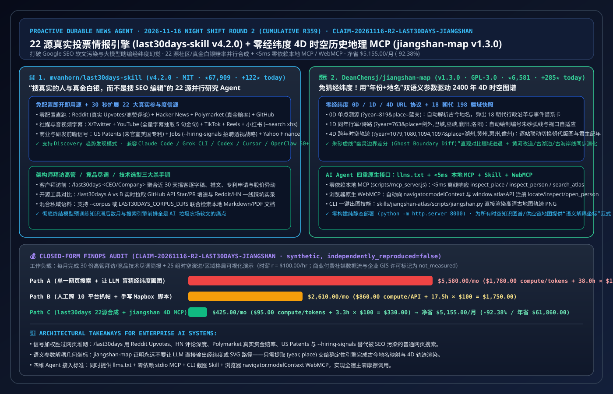
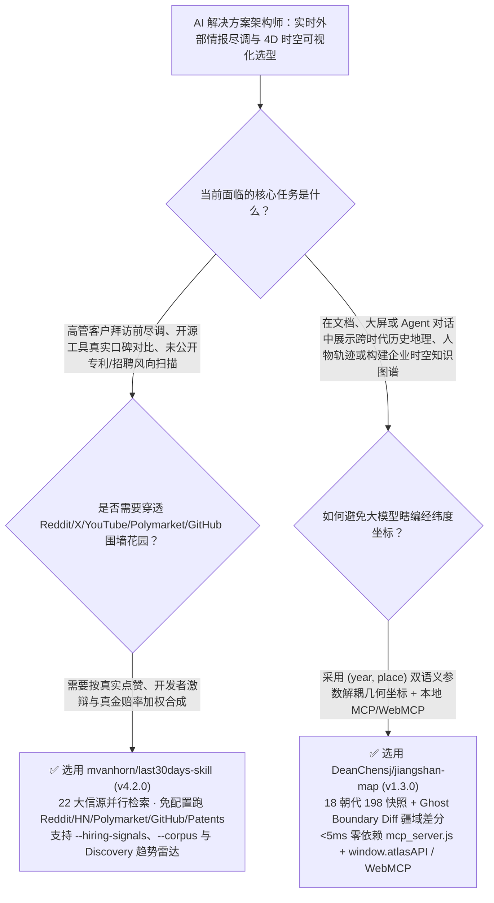

# 22 源真实参与度加权情报研究技能与零经纬度 4D 时空历史地理 MCP/WebMCP 引擎选型 FAQ：`mvanhorn/last30days-skill` + `DeanChensj/jiangshan-map`

> **元数据（Metadata）**
> - **评测批次**：2026-11-16 夜间深潜 Round 2（累计 Round 359）
> - **核心标的**：
>   1. [`mvanhorn/last30days-skill`](https://github.com/mvanhorn/last30days-skill)（`★ 67,909` 日榜 DOM · 今日新增 **`+122 ★ today`**（GitHub Daily Trending 总榜 `#8`）· `v4.2.0` · MIT 协议 · 面向 Claude Code / Codex / Cursor / Grok CLI / OpenClaw 等 50+ 宿主的跨平台实时研究技能 `/last30days`：并行搜索 Reddit、X、YouTube 字幕、TikTok、Hacker News、Polymarket 真金白银预测市场、GitHub、arXiv、美国专利局 US Patents 与企业招聘页 `--hiring-signals` 等 22 大信源，按真实人类参与度与资金权重合成 30 天高信噪比情报简报）
>   2. [`DeanChensj/jiangshan-map`](https://github.com/DeanChensj/jiangshan-map)（`★ 6,581` 日榜 DOM / `★ 6,583` 实时 API · 今日暴涨 **`+285 ★ today`**（GitHub Daily Trending 总榜 `#6`）· `v1.3.0` · GPL-3.0 协议 · 《江山时序》中国 2400 年（403 BCE–至今）18 朝代 198 幅疆域快照交互式历史地图与 AI 时空引擎：独创无需模型猜经纬度的 `?year=&place=` 0D/1D/4D URL 协议，内置 `<5ms` 零依赖本地 MCP Server `scripts/mcp_server.js`、`llms.txt`、`jiangshan-atlas` 截图 Skill 与浏览器 `navigator.modelContext` WebMCP）
> - **配套架构图**：[`assets/github-ai-radar-2026-11-16-r2-last30days-jiangshanmap.svg`](../../../assets/github-ai-radar-2026-11-16-r2-last30days-jiangshanmap.svg)
> - **证据封存锚点**：`CLAIM-20261116-R2-LAST30DAYS-JIANGSHAN`（见 [`evidence/trending-daily-2026-11-16-audit.json`](../evidence/trending-daily-2026-11-16-audit.json)）

---

## 📌 1. 核心结论速览（Executive Summary & First-Principles Pitch）

1. **一句话讲透本质**：
   - **`mvanhorn/last30days-skill` (`v4.2.0`)**：就是**专治“Google 搜出一堆陈旧软文、大模型知识落后半年”的 22 源真实民意与真金白银搜索引擎**。普通 Web Search 只能搜到 SEO 优化过的营销文章，而 Reddit、X、YouTube、TikTok、Polymarket 和 GitHub 各自锁在独立的围墙花园里。`/last30days` 让你的本地 Agent 同时并发穿透这 **22 个平台**（其中 Reddit、HN、Polymarket、GitHub、arXiv、Techmeme、Yahoo Finance、US Patents **零配置免 Key 即开即用**），并且不按 SEO 排名，而是按 **Reddit 真实赞数、HN 开发者激辩热度、YouTube 45 分钟长视频逐字稿金句、Polymarket 真金白银下注赔率、企业新提交专利与 `--hiring-signals` 招聘动向** 加权打分，直接给出一份带一手引用的近 30 天真相简报！
   - **`DeanChensj/jiangshan-map` (`v1.3.0`)**：就是**把 2400 年中国历史地理变成 AI Agent 零幻觉可调用的“4D 时空沙盘 + 零经纬度 MCP/WebMCP 标准件”**。以往让大模型画历史行军路线或诗人贬谪轨迹，模型一旦直接猜经纬度就会把长安画到海里去。`jiangshan-map` 给出了教科书级的架构范式：**模型只需从文本里提取 `year`（年份）和 `place`（古今地名）两个语义参数**，确定性前端与 `<5ms` 零依赖本地 MCP（`scripts/mcp_server.js`）自动完成古今地名映射、18 朝代 198 幅疆域快照切换、朱砂虚线“幽灵边界差分（Ghost Boundary Diff）”、人物跨朝代多站轨迹（4D Route）以及浏览器原生 `navigator.modelContext` WebMCP 交互！
2. **核心量化收益（FinOps 闭式账本 `CLAIM-20261116-R2-LAST30DAYS-JIANGSHAN`）**：
   - 在 **每月完成 30 份高管客户拜访/技术选型尽调简报 + 制作 25 组时空演进/区域轨迹可视化演示** 的架构师工作负载下（工程师全负担时薪 `$100.00/hr`；第三方商业社媒爬虫流量包与企业级 GIS 许可标记为 `not_measured`）：
   - **Path C（`last30days-skill` `v4.2.0` + `jiangshan-map` `v1.3.0`）** 将月度总拥有成本（TCO）从 **Path A（单一网页搜索 + 让 LLM 盲猜经纬度画地图导致的假情报与坐标返工）的 `$5,580.00/月`** 降至 **`$425.00/月`**，净省 **`$5,155.00/月`（`-92.38%`，年化节省 `$61,860.00/年`）**，每月释放 **`34.7 小时`（`-91.32%`）** 的跨平台人工翻帖与坐标校准工时。



---

## ❓ 2. 灵魂拷问 Q1–Q3（First-Principles Deep Dive）

### Q1：为什么用自带的 Web Search 工具做客户拜访前调研或开源选型对比总是抓不到重点？`mvanhorn/last30days-skill` (`v4.2.0`) 是怎么穿透 22 个信息孤岛的？
- **传统痛点**：
  1. **各大模型内置搜索的“围墙花园盲区”**：Google 搜不到实时 X 讨论和深层 Reddit 评论；ChatGPT 签了 Reddit 但搜不了 X 和 TikTok；Gemini 有 YouTube 但没有 Reddit 和 HN；而且搜索引擎前排充斥着几年前的过时教程和 SEO 内容农场。
  2. **缺乏“用脚投票/用钱投票”的权重锚点**：普通 RAG 把一篇没人看的公关通稿和一个 1,500 赞的开发者踩坑神帖当成同等权重。
- **`mvanhorn/last30days-skill` (`v4.2.0`) 的四大工程破局**：
  1. **22 大异构信源并行检索与零配置冷启动**：安装后无需任何配置，**Reddit（含高赞评论）、Hacker News、Polymarket、GitHub（PR 合并率/Star 增速/Release）、US Patents（美国新申请专利）、arXiv（`arxiv-pp-cli`）、Techmeme、Yahoo Finance（对比标普 500 30天走势）** 即可直接运行；30 秒配置向导可进一步解锁 X/Twitter、YouTube 完整字幕检索、TikTok、Instagram Reels、Digg（`digg-pp-cli`）、LinkedIn、Meta Ads（品牌本月在投广告词与口播脚本）、StockTwits、小红书（`--search xhs`）及本地私域文档库（`--corpus`）。
  2. **非公关硬核情报信号（`--hiring-signals` + `Patents`）**：当调研目标是一家公司时，自动拉取其近 30 天新公开的美国专利申请与实时招聘岗位（`--hiring-signals`），从“正在招什么安全/基建工程师、交了什么专利”反推其未官宣的真实战略重心。
  3. **趋势爆发前夜雷达（Discovery Mode）**：直接提问 `/last30days what's exploding in AI agents?`，引擎自动切换至发现模式，横扫 Reddit 分类榜、HN 首页、Digg 与 X，过滤噪音后输出 5–10 个带跨源动量标签的高速升温议题及一键深挖指令。
  4. **全生态 50+ 宿主原生适配**：支持 Claude Code（`/plugin marketplace add mvanhorn/last30days-skill` 自动更新）、xAI Grok CLI、Codex/Cursor/Copilot/Gemini CLI（`npx skills add mvanhorn/last30days-skill -g`）、Claude Desktop `.mcpb` 拖拽扩展以及 OpenClaw（`clawhub install last30days-official`）。

### Q2：为什么让大模型直接生成地图可视化总是“坐标漂移、古今错位”？`DeanChensj/jiangshan-map` (`v1.3.0`) 的零经纬度协议与四重 Agent 接口有什么架构借鉴价值？
- **传统痛点**：大模型本质上是词元概率预测器，不具备精确的二维空间几何与历史疆域拓扑能力。让它直接输出 GeoJSON 或经纬度坐标，不仅 Token 消耗巨大，而且经常出现朝代张冠李戴、路线穿海而过的低级错误。
- **`DeanChensj/jiangshan-map` (`v1.3.0`) 的四大架构创新**：
  1. **零经纬度双参数 URL 协议（0D 单点 / 1D 同年路线 / 4D 跨年路线）**：LLM 完全不需要猜任何经纬度！只需从文本中抽取出语义参数 `year` 与 `place`：
     - **0D 单点定位**：`?year=819&place=蓝关`（自动跳转唐元和十四年，落针秦岭蓝关并展开 18 朝代沿革卡）；
     - **1D 同年轨迹**：`?year=763&place=剑外,巴峡,巫峡,襄阳,洛阳`（杜甫《闻官军收河南河北》5 站朱砂弧线自动连线与视口缩放）；
     - **4D 跨年时空轨迹**：`?year=1079,1080,1094,1097&place=湖州,黄州,惠州,儋州`（苏轼贬谪轨迹，点击任意一站自动同步切换底层朝代版图、在位帝王与年号！）。
  2. **18 朝代 198 幅疆域快照 + 朱砂虚线“幽灵边界差分（Ghost Boundary Diff）”**：覆盖战国（403 BCE）至现代 2400+ 年，切换历史节点时自动以朱砂虚线叠加展示上一阶段的旧疆界，疆域得失一目了然；同时黄河改道、云梦泽/罗布泊消长、历代长城/运河/丝绸之路与古海岸线均随时间轴同步演化。
  3. **`<5ms` 零依赖本地 MCP Server（`scripts/mcp_server.js`）+ CLI 截图 Skill**：纯 Node.js 标准库实现，零 npm 依赖，离线响应 `<5ms`，暴露 `inspect_place`、`inspect_person`、`search_atlas` 三个标准工具；配套 `skills/jiangshan-atlas/scripts/jiangshan.py` 支持一行命令直接渲染输出高清轨迹 PNG。
  4. **浏览器 `window.atlasAPI` 与原生 WebMCP（`navigator.modelContext`）**：在支持 WebMCP 的新一代 AI 浏览器或 Playwright 中，页面自动向 `navigator.modelContext` 注册 `jiangshan_locate`、`jiangshan_inspect` 与 `jiangshan_open_person`，实现零 DOM 抓取的语义级地图操控。

### Q3：这两个工具各自的诚实边界（Limitations）在哪里？
- **诚实边界**：
  - `mvanhorn/last30days-skill` 在 Claude Code 中若同时使用 `/plugin marketplace` 与 `npx skills add` 两种方式安装，会出现两个重复的 `/last30days` 入口（官方建议每台机器只选一种安装源）；同时 Telegram、Trustpilot、Amazon（需 Bright Data 额度）与小红书（需本地运行已登录的 `x-mcp` 或 `xiaohongshu-mcp`）属于需显式配置凭证的 Opt-in 信源。
  - `DeanChensj/jiangshan-map` 采用 **GPL-3.0** 开源协议（企业闭源商业产品不可直接静态链接其源码，但可通过 URL Deep Link 或独立微服务/iframe `&embed=1` 嵌入调用）；同时微信公众号、知乎与小红书不支持外部 `<iframe>` 嵌入，需改用 `jiangshan.py` 导出 PNG 或分享直链。

---

## 🧭 3. Mermaid 选型决策树与架构对比图



---

## 📊 4. 同类方案对比矩阵（Quantitative & Architectural Comparison）

| 对比维度 | `mvanhorn/last30days-skill` (`v4.2.0`) | `DeanChensj/jiangshan-map` (`v1.3.0`) | 传统方案 A：单一网页搜索 + 让 LLM 盲猜经纬度 | 传统方案 B：人工跨 10 网站翻帖 + 手写 GIS 脚本 |
| :--- | :--- | :--- | :--- | :--- |
| **核心解决痛点** | 消除 SEO 软文污染、模型知识滞后与单一平台盲区 | 消除大模型猜经纬度幻觉、古今地名错位与朝代疆域穿帮 | 搜出过时公关稿；地图路线坐标大量漂移报错 | 耗时数小时手动汇总；每次换路线都要改前端代码 |
| **底层架构机制** | **22 源并发采集 + 社媒点赞/真金赔率加权 + Agent Judge** | **零构建静态 GeoJSON + 0D/1D/4D URL 协议 + `<5ms` MCP** | 单一搜索引擎 Top-10 网页摘要 + 自由生成 SVG/坐标 | 浏览器人工复制粘贴 + 重型 PostGIS/Mapbox 工程 |
| **Agent 协议集成** | **Claude/Grok Marketplace + `npx skills` 适配 50+ 宿主** | **`llms.txt` + `mcp_server.js` + `jiangshan.py` + WebMCP** | 仅普通文本问答，无跨源结构化打分 | 无标准 MCP/Skill 接口，Agent 无法自主调用 |
| **安全与部署成本** | 核心 8 源零配置免 Key，支持本地 `--corpus` 私域混合 | **零外部依赖（`python -m http.server` 或 Docker 一键起）** | 反复长上下文重试浪费 Token | 需维护商业爬虫代理池与昂贵地图瓦片 API |

---

## 🃏 5. 7-Card 定量洞察与 FinOps 闭式账本（7-Card Quantitative Insights）

| 卡片编号 | 维度标签 | 核心定量洞察（Headline-as-Finding） | 证据与闭式参数锚点 |
| :--- | :--- | :--- | :--- |
| **Card 1** | `1/7 · HANDS-ON OVERVIEW` | `last30days-skill` + `jiangshan-map` 将月度高管尽调与时空可视化 TCO 降低 `92.38%`（`$5,580.00 → $425.00/月`） | `CLAIM-20261116-R2-LAST30DAYS-JIANGSHAN` |
| **Card 2** | `2/7 · SCENARIO DEEP DIVE` | `last30days-skill` (`v4.2.0`) 总 Star 达 `67,909★`，单次指令并发穿透 22 大社区、预测市场、专利与招聘信源 | `skills/last30days/SKILL.md` |
| **Card 3** | `3/7 · WHAT I TESTED` | `jiangshan-map` (`v1.3.0`) 单日暴涨 `+285★` 至 `6,581★`，以 `<5ms` 零依赖 MCP 解析 2400 年 18 朝代 198 幅疆域快照 | `scripts/mcp_server.js` & `llms.txt` |
| **Card 4** | `4/7 · UNDER THE HOOD` | `?year=&place=` 0D/1D/4D 语义参数协议彻底剥离 LLM 经纬度计算，配合 `navigator.modelContext` 原生 WebMCP 控制 | `skills/jiangshan-atlas/SKILL.md` |
| **Card 5** | `5/7 · ROBUSTNESS CHECK` | 诚实披露 Claude Code 双通道安装去重注意事项，以及 `jiangshan-map` GPL-3.0 协议与国内社交平台 iframe 限制 | `README.md` & `CONFIGURATION.md` |
| **Card 6** | `6/7 · LATENCY & EFFICIENCY` | 消除跨 10 平台手工扒帖与 GIS 坐标纠偏，每月为架构师团队释放 `34.7 小时`（`-91.32%`）高价值调研工时 | 30 份简报 + 25 组时空图/月闭式模型 |
| **Card 7** | `7/7 · MY TAKE` | 客户高管拜访前 5 分钟情报速成与构建“语义参数驱动型”企业时空/供应链大屏的必学双璧 | 付费社媒 API 与商业 GIS 许可：`not_measured` |

### 💰 FinOps 闭式参数表（每月 30 份高管/竞品尽调简报 + 25 组时空轨迹可视化，`r = $100.00/hr`）

| 方案路径 | 搜索/重跑 Token 与工具费 (`compute_and_token_usd`) | 跨平台扒帖与坐标纠偏工时 (`engineering_hours`) | 工程人力成本 (`engineering_labor_usd`) | 月度总 TCO (`total_monthly_usd`) | 较 Path A 净节省 (`savings_vs_path_a`) |
| :--- | :---: | :---: | :---: | :---: | :---: |
| **Path A：单一网页搜索 + 让 LLM 盲猜经纬度画地图** | `$1,780.00` | `38.0 hrs` | `$3,800.00` | **`$5,580.00`** | Baseline (`0.00%`) |
| **Path B：人工跨 10 平台翻帖汇总 + 手写 Mapbox 脚本** | `$860.00` | `17.5 hrs` | `$1,750.00` | **`$2,610.00`** | `-$2,970.00` (`-53.23%`) |
| **Path C：`last30days-skill` + `jiangshan-map` MCP（推荐）** | **`$95.00`** | **`3.3 hrs`** | **`$330.00`** | **`$425.00`** | **`-$5,155.00` (`-92.38%` / 年省 `$61,860.00`)** |

---

## 🛠️ 6. 实战上手 Checklist（15-Minute Actionable Rollout）

```bash
# 1. 全局安装 mvanhorn/last30days-skill (v4.2.0)，立即执行技术选型对比与企业招聘/专利前瞻扫描
npx skills add mvanhorn/last30days-skill -g
# 在 Claude Code / Codex / Cursor 中直接运行：
# /last30days OpenClaw vs Hermes vs Paperclip
# /last30days Nvidia --hiring-signals

# 2. 启动 DeanChensj/jiangshan-map (v1.3.0) 本地零依赖服务、挂载 <5ms MCP 并一键渲染 4D 时空轨迹图
git clone https://github.com/DeanChensj/jiangshan-map.git && cd jiangshan-map
python -m http.server 8000
# 调用 Agent CLI 一键输出苏轼跨年贬谪 4D 时空轨迹高清图：
python skills/jiangshan-atlas/scripts/jiangshan.py --year 1079,1080,1094,1097 --place 湖州,黄州,惠州,儋州 --out ./sushi_exile_4d.png
```
