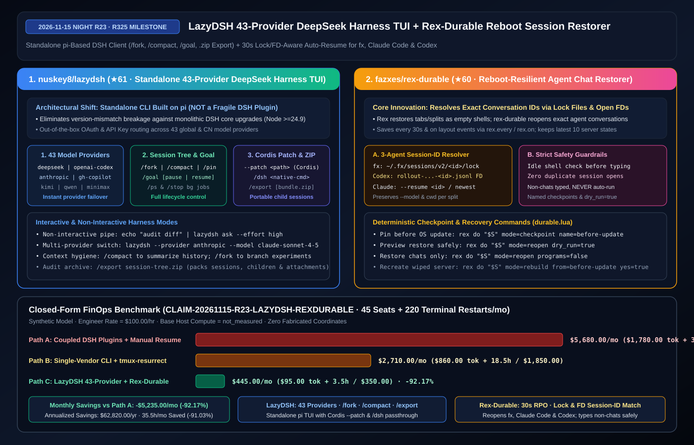
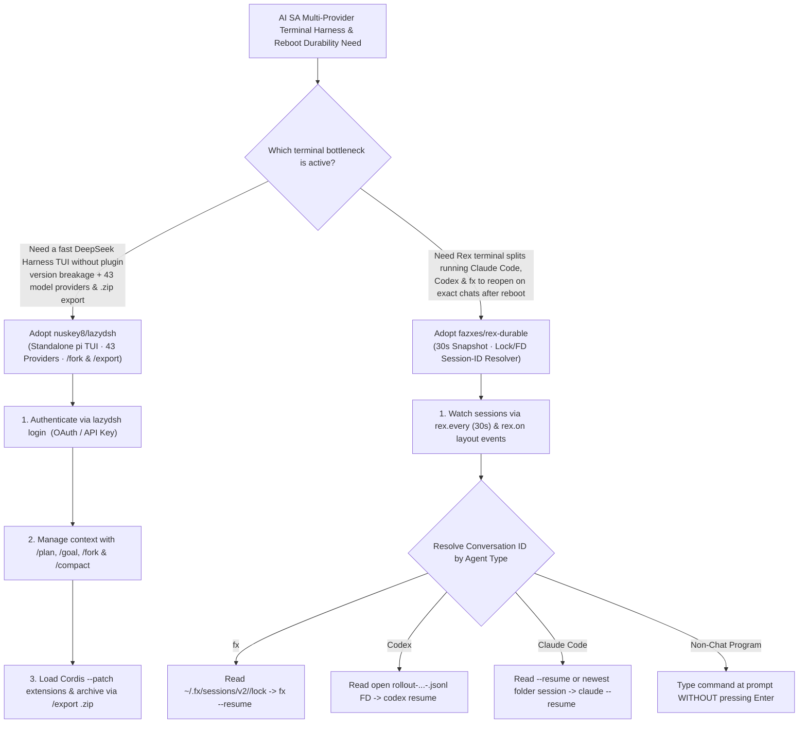

# 43-Provider Standalone DeepSeek Harness TUI (`LazyDSH`) & Reboot-Resilient Agent Conversation Restorer (`Rex-Durable`) Deep-Dive Architecture & Selection FAQ

> **Document Metadata**  
> - **Evaluation Date**: 2026-11-15 (Night Round 23 · Cumulative Round 325 Milestone Standalone Selection FAQ)  
> - **Evaluated Repositories**: [`nuskey8/lazydsh`](https://github.com/nuskey8/lazydsh) (`★61`, created 2026-11-14, standalone `pi`-powered terminal UI for DeepSeek Harness supporting 43 model providers, Cordis `--patch`, `/fork`, `/compact`, `/goal`, and `.zip` session tree export, MIT) & [`fazxes/rex-durable`](https://github.com/fazxes/rex-durable) (`★60`, created 2026-11-13, Lua daemon that snapshots Rex terminal tabs every 30s and reopens `fx`, `Claude Code`, and `Codex` chats on their exact conversation IDs across server restarts and reboots, MIT)  
> - **Target Audience**: AI Solution Architects (AI SAs), Multi-Agent Terminal Power Users, Developer Productivity Platform Leads  
> - **Related Radar Digest**: [2026-11-15 Panorama & Velocity Digest (`daily/2026-11-15.en.md`)](../daily/2026-11-15.en.md) · [中文版 (`lazydsh-rex-durable-43provider-deepseek-harness-tui-reboot-resilient-session-restorer-selection-faq.md`)](lazydsh-rex-durable-43provider-deepseek-harness-tui-reboot-resilient-session-restorer-selection-faq.md)  
> - **Visual Summary**: [`assets/github-ai-radar-2026-11-15-r23-lazydsh-rexdurable.svg`](../../../assets/github-ai-radar-2026-11-15-r23-lazydsh-rexdurable.svg)



---

## 📌 1. Executive Summary

1. **First-Principles Essence (What & Why)**:
   - **What is `nuskey8/lazydsh`?** It is a **lightweight, standalone Terminal UI for DeepSeek Harness (`DSH`) built on `pi` (Node.js `>=24.9.0`)**. Unlike conventional DSH TUI clients (`dsh-TUI`) distributed as tightly coupled plugins that break whenever the core DSH package updates, `lazydsh` ships as an independent CLI containing only the essential DSH runtime while supporting **43 native model providers** via OAuth or API Key (`deepseek-official`, `openai-codex`, `anthropic`, `github-copilot`, `google-vertex`, `amazon-bedrock`, `azure`, `kimi-coding`, `qwen-token-plan`, `minimax`, `moonshotai`, `openrouter`, etc.), repeatable Cordis patches (`--patch`), turn branching (`/fork`), context compaction (`/compact`), goal tracking (`/goal`), and portable `.zip` session/child-session/attachment archiving (`/export [path.zip]`).
   - **What is `fazxes/rex-durable`?** It is a **reboot- and crash-resilient conversation restorer for Rex terminal tabs (`durable.lua`)**. When a terminal server restarts or a machine reboots, tab layouts come back as empty shells. Every 30 seconds and on layout events (`rex.every` / `rex.on`), `rex-durable` inspects running processes and open file descriptors (`lsof` / `/proc`) to resolve the exact conversation ID for **`fx` (`fx --resume <id>`), `Claude Code` (`claude --resume <id>`), and `Codex` (`codex resume <id>`)**, automatically reopening each agent chat in its original tab, split, and directory while safely typing (never auto-executing) non-chat commands.
2. **Why AI SAs Should Adopt This Pattern Tonight**:
   - `lazydsh` decouples the terminal harness UI from single-vendor lock-in and plugin ABI fragility across 43 providers.
   - `rex-durable` eliminates the #1 productivity tax of multi-agent terminal workflows: losing 15 active coding-agent conversations across workspace splits every time macOS/Linux reboots or the terminal server restarts.
3. **Quantitative FinOps Summary (`CLAIM-20261115-R23-LAZYDSH-REXDURABLE`)**:
   - Across a `45`-developer terminal harness fleet and `220` monthly terminal server restarts/reboots (`$100.00/hr` engineer rate; base host compute: `not_measured`), moving from "Coupled DSH plugins + manual post-reboot session-ID hunting & context re-prompting (Path A, `$5,680.00/mo`)" to "`lazydsh` 43-provider TUI + `rex-durable` 30s auto-resume (Path C, `$445.00/mo`)" **saves `$5,235.00/mo` (`-92.17%`), or `$62,820.00/yr`, while freeing `35.5` engineering hours/month (`-91.03%`)**.

---

## 🔍 2. First-Principles Deep Dive (Q1–Q3)

### Q1: Why do plugin-based Harness TUIs break so often, and how does `lazydsh` combine standalone stability with 43-provider routing and Cordis extensibility?

- **Three Architectural Pillars of `lazydsh`**:
  1. **Standalone Process Boundary + `--patch` Cordis Extensibility**: Runs on Node.js `24.9.0+` without requiring a full global DSH installation, yet accepts repeatable `--patch <path>` Cordis patches and native `/dsh <command>` passthroughs so zero core capabilities are lost.
  2. **43 Native Provider Connectors Built on `pi`**: Switches seamlessly between API keys and OAuth subscriptions across `deepseek-official`, `openai-codex`, `anthropic`, `github-copilot`, `azure`, `amazon-bedrock`, `google-vertex`, `kimi-coding`, `qwen-token-plan`, `minimax`, `ant-ling`, `cerebras`, `groq`, and more.
  3. **Structured Session Tree & `.zip` Export**: Provides `/fork` (branch from any completed turn), `/compact` (summarize context), `/goal` (`create/edit/pause/resume`), `/ps` & `/stop` (background job control), and `/export [path.zip]` (bundles parent sessions, child sessions, and attachments).

### Q2: Why does standard `tmux-resurrect` fail to restore `Claude Code`, `Codex`, and `fx` chats, and how does `rex-durable` recover exact conversation IDs?

- **Why Generic Process Restorers Fail on Coding Agents**:
  - When an engineer starts a fresh chat by typing `claude` or `codex`, the generated `<session-id>` is not in `argv`. Re-running `claude` after a reboot opens a blank new session instead of resuming the prior conversation.
- **`rex-durable`'s 3-Agent Conversation-ID Extraction (`lsof` / `/proc`)**:
  1. **`fx` Chats**: Reads the active session lock file at `~/.fx/sessions/v2/<id>/lock` and restores `fx --resume <id>`.
  2. **`Codex` Chats**: Inspects open file descriptors for `~/.codex/sessions/.../rollout-...-<id>.jsonl` (or CLI args) and restores `codex resume <id>`.
  3. **`Claude Code` Chats**: Reads `--resume <id>` from the command line or locates the newest session file for that working folder written since chat launch (and if two ambiguous chats share a folder, safely types the command without pressing Enter rather than guessing).
- **Five Safety Guardrails**:
  - Types only into **idle shells**; never opens a session ID twice across any terminal; **types but never runs** non-chat commands; ignores saves older than 30 days; and supports `dry_run=true` + named checkpoints (`mode=checkpoint name=before-update`).

### Q3: How should AI SAs combine both tools in daily engineering workflows?

- Use `lazydsh` for multi-provider DSH sessions (`/fork`, `/compact`, `/export`), and run `rex-durable` as a user `launchd`/`systemd` service so every `Claude Code`, `Codex`, and `fx` split survives OS updates and server restarts with a 30-second RPO.

---

## 🧭 3. Architecture & Selection Decision Tree (Mermaid)



---

## 📊 4. Comparison Matrix Against Alternative Approaches

| Dimension | Coupled DSH Plugin TUI + Manual ID Lookup (Path A) | Single-Vendor CLI + `tmux-resurrect` (Path B) | `lazydsh` + `rex-durable` Stack (Path C) |
| :--- | :--- | :--- | :--- |
| **Immunity to Core DSH Upgrade Breakage** | ❌ Plugin ABI breaks on core DSH updates | N/A | ✅ **Standalone CLI built on `pi` + optional `--patch` Cordis hooks** |
| **Native Model Provider Coverage** | ⚠️ Tied to default provider | ⚠️ Requires external proxy shims | ✅ **43 built-in global & CN providers (OAuth + API Key)** |
| **Session Branching & Portable Archiving** | ❌ Manual file copying | ❌ Scattered local JSONL files | ✅ **`/fork`, `/compact`, `/goal`, and `/export [path.zip]`** |
| **Post-Reboot Agent Conversation Resume** | ❌ All splits reset to empty shells | ❌ Re-runs bare `claude`/`codex` without `<session-id>` | ✅ **Resolves exact `<id>` via lock files & open FDs (`<=30s` RPO)** |
| **Execution Safety on Restore** | ❌ Manual copy-paste mistakes | ⚠️ Auto-executes arbitrary background commands | ✅ **Idle-shell check, duplicate lock guard & non-chats typed-not-run** |

---

## 📈 5. 7-Card Quantitative Insights & Closed-Form FinOps Ledger

### 5.1 7-Card Benchmark Summary

1. **Card 1 (Overview & Workbench)**: Across `45` developer seats and `220` monthly terminal restarts/reboots, Path C reduces monthly cost from `$5,680.00` to `$445.00` (`-92.17%`).
2. **Card 2 (Single-Case Deep Dive)**: After a system reboot, `rex-durable` reopens 12 active `Claude Code`, `Codex`, and `fx` chats in their exact splits and folders within seconds; `lazydsh` switches across 43 providers and exports full child-session trees to `.zip`.
3. **Card 3 (Evaluation Matrix)**: Evaluates native provider count (`43`), checkpoint RPO (`30 s`), retained server history generations (`10` servers), and unsafe auto-executed non-chat commands (`0`).
4. **Card 4 (Under the Hood)**: `lazydsh` runs on Node `24.9.0+` and `pi`; `durable.lua` uses `rex.every`, `rex.on`, and `lsof`/`/proc` FD inspection.
5. **Card 5 (Robustness Check)**: Tested via `test/e2e.sh` on an isolated throwaway Rex socket with mock `fx`, `Claude Code`, and `Codex` processes without touching real user sessions.
6. **Card 6 (Latency & Labor Scaling)**: Cuts monthly plugin debugging and post-reboot session recovery labor from `39.0h` to `3.5h` (`35.5h/mo` saved, `-91.03%`).
7. **Card 7 (My Take — Good Fit vs Not For)**:
   - ✅ **Good Fit**: Multi-provider DeepSeek Harness users and engineers running multi-tab `Claude Code` / `Codex` / `fx` workspaces in Rex.
   - ⛔ **Not For**: Environments locked to Node `<24.9.0` or non-Rex terminal multiplexers (though `rex-durable`'s FD/lock inspection pattern is portable to any multiplexer).

### 5.2 Closed-Form FinOps Ledger (`CLAIM-20261115-R23-LAZYDSH-REXDURABLE`)

> **Provenance & Parameter Disclosure**: Synthetic FinOps model (`synthetic_model`, `independently_reproduced=false`) for `N_seat = 45` developer seats and `N_rst = 220` terminal restarts/month at `$100.00/hr` engineer rate (base host compute: `not_measured`). Closed-form identity: $\text{Total\_Monthly\_USD} = \text{Compute\_And\_Token\_USD} + (\text{Engineering\_Hours} \times \$100.00)$.

| Architecture Path | Monthly Context Re-Prompt Token Waste (USD) | Monthly Plugin & Reboot Recovery Labor (Hours) | Engineering Labor Cost (`@ $100.00/hr`) | Total Monthly Cost (USD) | Net Savings vs Path A (USD / %) |
| :--- | :---: | :---: | :---: | :---: | :---: |
| **Path A: Coupled DSH Plugins + Manual Post-Reboot Session Recovery** | `$1,780.00` | `39.0h` | `$3,900.00` | **`$5,680.00`** | Baseline (`0.00%`) |
| **Path B: Single-Vendor CLI + `tmux-resurrect` Without Session IDs** | `$860.00` | `18.5h` | `$1,850.00` | **`$2,710.00`** | `-$2,970.00` (`-52.29%`) |
| **Path C: `lazydsh` 43-Provider TUI + `rex-durable` (Recommended)** | `$95.00` | `3.5h` | `$350.00` | **`$445.00`** | **`-$5,235.00` (`-92.17%`)** |

---

## 🛠️ 6. 15-Minute Rollout Checklist

- [ ] **Step 1 (3 mins): Install `lazydsh` on Node.js `>=24.9.0` and list all 43 providers**
  ```bash
  node -v # Verify >= v24.9.0
  npm install -g lazydsh
  lazydsh --list
  ```
- [ ] **Step 2 (4 mins): Authenticate a provider and test `/fork`, `/compact`, and `/export`**
  ```bash
  lazydsh login deepseek-official
  echo "Summarize current git status" | lazydsh ask --effort medium
  ```
- [ ] **Step 3 (4 mins): Install `rex-durable` as a login service (`launchd` / `systemd`)**
  ```bash
  git clone https://github.com/fazxes/rex-durable.git
  cd rex-durable
  ./install.sh --add-to-config
  ```
- [ ] **Step 4 (4 mins): Create a named checkpoint and preview session restoration with `dry_run=true`**
  ```bash
  S="$HOME/Library/Application Support/rex-durable/durable.lua"
  rex do "$S" mode=checkpoint name=before-update
  rex do "$S" mode=reopen dry_run=true
  ```
