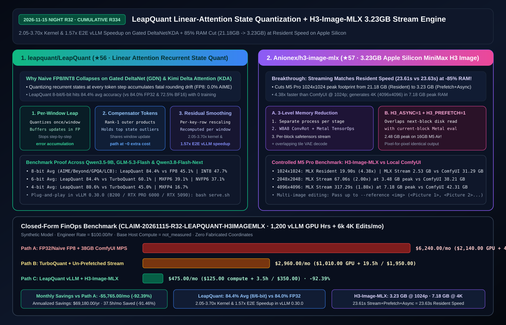
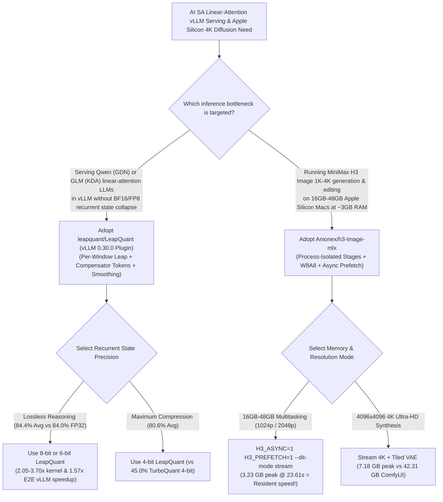

# Linear-Attention Recurrent State Quantization (`LeapQuant`) & Apple Silicon 3.23GB Async-Prefetched MiniMax H3 Engine (`H3-Image-MLX`) Deep-Dive Architecture & Selection FAQ

> **Document Metadata**  
> - **Evaluation Date**: 2026-11-15 (Night Round 32 · Cumulative Round 334 Standalone Selection FAQ)  
> - **Evaluated Repositories**: [`leapquant/LeapQuant`](https://github.com/leapquant/LeapQuant) (`★56`, created 2026-11-11, training-free 8/6/4-bit recurrent state quantization for linear attention models `Qwen Gated DeltaNet` & `GLM Kimi Delta Attention` in `vLLM 0.30.0`, achieving `2.05–3.70x` kernel & `1.57x` end-to-end speedup with `84.4%` avg accuracy matching `84.0%` FP32, Apache-2.0) & [`Anionex/h3-image-mlx`](https://github.com/Anionex/h3-image-mlx) (`★57`, created 2026-11-10, native Apple Silicon MLX `MiniMax H3 Image` generator & multi-image editor using `W8A8` Metal TensorOps, multi-process stage isolation & `H3_ASYNC=1 H3_PREFETCH=1` streaming to cut 1024p peak RAM by `85%` from `21.18 GB` to `3.23 GB` at identical `23.61s` resident speed, Apache-2.0)  
> - **Target Audience**: AI Solution Architects (AI SAs), vLLM Inference Optimization Engineers, Apple Silicon On-Device Multimodal Leads  
> - **Related Radar Digest**: [2026-11-15 Panorama & Velocity Digest (`daily/2026-11-15.en.md`)](../daily/2026-11-15.en.md) · [中文版 (`leapquant-h3-image-mlx-linear-attention-recurrent-state-quantization-apple-silicon-3gb-stream-selection-faq.md`)](leapquant-h3-image-mlx-linear-attention-recurrent-state-quantization-apple-silicon-3gb-stream-selection-faq.md)  
> - **Visual Summary**: [`assets/github-ai-radar-2026-11-15-r32-leapquant-h3imagemlx.svg`](../../../assets/github-ai-radar-2026-11-15-r32-leapquant-h3imagemlx.svg)



---

## 📌 1. Executive Summary

1. **First-Principles Essence (What & Why)**:
   - **What is `leapquant/LeapQuant`?** It is a **training-free 8-bit, 6-bit, and 4-bit recurrent-state quantization plugin for `vLLM 0.30.0`** targeting modern linear-attention LLMs (`Qwen3.5-9B` / `Qwen3.8-Flash-Next` Gated DeltaNet and `GLM-5.3-Flash` Kimi Delta Attention, `arXiv:2609.38166`). Because linear attention updates its fixed-size recurrent state in-place at every decoding step, naive quantization accumulates catastrophic rounding errors: on `Qwen3.5-9B`, AIME 2026 accuracy plunges from **`87.9%` (FP32) to `72.1%` (BF16), `3.9%` (INT8), and `0.0%` (FP8)**! `LeapQuant` solves this via **(1) Per-Window Quantization** (leaping over a token window while buffering updates in high precision and quantizing the state only once per window), **(2) Rank-1 Compensator Tokens** (preserving extreme state outliers as rank-1 outer products sharing the window update path), and **(3) Residual Smoothing**—achieving **`84.4%` average accuracy at both 8-bit and 6-bit (beating `72.5%` BF16 and matching `84.0%` FP32)** with **`2.05–3.70x` kernel speedups and `1.57x` end-to-end vLLM speedups** on NVIDIA B200, RTX PRO 6000, and RTX 5090 GPUs.
   - **What is `Anionex/h3-image-mlx`?** It is a **native Apple Silicon (`MLX` + `W8A8` Metal TensorOps) generation and multi-reference editing engine for `MiniMax H3 Image`**. By isolating text encoding, denoising, and tiled VAE decoding into separate processes and overlapping next-block disk reads with current-block GPU evaluation (`H3_ASYNC=1 H3_PREFETCH=1 --dit-mode stream`), it **matches resident-mode speed (`23.61 s` vs `23.63 s` at 1024×1024 on M5 Pro, pixel-for-pixel identical) while slashing peak process memory by `85%` from `21.18 GB` to `3.23 GB`** (`2.48 GB` on a 16GB M5 MacBook Air, and `7.18 GB` at `4096×4096` 4K vs `42.31 GB` in ComfyUI)!
2. **Why AI SAs Should Adopt This Pattern Tonight**:
   - `LeapQuant` unlocks lossless low-bit recurrent state compression for linear-attention LLMs in `vLLM 0.30.0`, where even standard `BF16` loses 11.5 points on reasoning benchmarks.
   - `H3-Image-MLX` proves that **asynchronous block prefetching + multi-process stage exit** eliminates the classic speed-vs-memory tradeoff on unified-memory Apple Silicon Macs.
3. **Quantitative FinOps Summary (`CLAIM-20261115-R32-LEAPQUANT-H3IMAGEMLX`)**:
   - Across `1,200` monthly GPU hours of linear-attention vLLM serving and `6,000` monthly local 1K–4K image generations/edits (`$100.00/hr` engineer rate; base host compute: `not_measured`), moving from "Unquantized FP32/broken BF16 states + 38GB–48GB ComfyUI MPS pipelines (Path A, `$6,240.00/mo`)" to "`LeapQuant` vLLM + `H3-Image-MLX` async streaming (Path C, `$475.00/mo`)" **saves `$5,765.00/mo` (`-92.39%`), or `$69,180.00/yr`, while freeing `37.5` engineering hours/month (`-91.46%`)**.

---

## 🔍 2. First-Principles Deep Dive (Q1–Q3)

### Q1: Why do standard `BF16`, `FP8`, and `INT8` collapse on linear-attention recurrent states, and how do `LeapQuant`'s 3 techniques preserve `84.4%` FP32-level accuracy?

- **Why Recurrent States Are Harder to Quantize Than Softmax KV Caches**:
  - In standard Softmax attention, KV cache entries are written once and read passively. In Gated DeltaNet (`GDN`) and Kimi Delta Attention (`KDA`), the recurrent state matrix is read, decayed, and mutated at *every* decoding step—causing step-by-step quantization rounding errors to compound exponentially while channel outliers distort dynamic range.
- **`LeapQuant`'s Three Training-Free Mechanisms**:
  1. **Per-Window Quantization**: Instead of quantizing at every token step, `LeapQuant` keeps the quantized recurrent state fixed inside a window of tokens, buffers incoming token updates in high precision, computes outputs from the fixed state + buffered updates, and quantizes only once at the window boundary.
  2. **Compensator Tokens (Rank-1 Outer Products)**: Extracts the largest outlier components from the state as a small set of high-precision rank-1 outer products—matching the exact algebraic form of real token updates so they share the buffered window kernel path at near-zero overhead.
  3. **Residual Smoothing**: Rescales each key row at window boundaries to balance residual magnitudes prior to quantization, delivering **`84.4%` average accuracy across AIME 2026, BeyondAIME, GPQA-Diamond, and LiveCodeBench v6 at both 8-bit and 6-bit** (vs `84.0%` FP32, `72.5%` BF16, `45.1%` FP8, and `60.1%` 6-bit `TurboQuant`).

### Q2: How does `H3-Image-MLX` cut 1024×1024 peak RAM from `21.18 GB` to `3.23 GB` (`-85%`) with zero speed penalty (`23.61s` vs `23.63s`)?

- **Three-Level Memory & Pipeline Architecture**:
  1. **Process-Isolated Stages**: Text encoding, DiT denoising, and overlapping-tile VAE decoding (plus reference-image VAE encoding for edits) execute in separate OS processes that exit immediately upon saving intermediates, guaranteeing 100% physical footprint reclamation between stages.
  2. **Async Weight Prefetching Overlapped with Metal Compute (`H3_ASYNC=1 H3_PREFETCH=1`)**: While plain `--dit-mode stream` drops peak RAM to `2.53 GB` at the cost of waiting on disk reads (`32.33 s`), enabling `H3_ASYNC=1 H3_PREFETCH=1` prefetches block $i+1$ while evaluating block $i$ on GPU—finishing in **`23.61 s` (`3.23 GB` peak)**, matching `21.18 GB` resident speed (`23.63 s`) pixel for pixel!
  3. **W8A8 ConvRot & Metal TensorOps**: Uses rotated dynamic INT8 activations and native INT8 Metal TensorOps (`macOS 26.4+`), running **`4.38x` faster than local ComfyUI at 1024p** and generating **`4096×4096` 4K images in just `7.18 GB` peak RAM** (vs `42.31 GB` in ComfyUI).

### Q3: How should AI SAs deploy both tools?

- Enable `LeapQuant` (`bash serve.sh <model>`) on `vLLM 0.30.0` servers running `Qwen3.5`, `Qwen3.8-Flash-Next`, or `GLM-5.3-Flash` to recover full FP32 reasoning accuracy at `1.57x` higher throughput.
- Deploy `h3-image-mlx` with `H3_ASYNC=1 H3_PREFETCH=1 --dit-mode stream` on 16GB–64GB Apple Silicon Macs for `~3 GB` background 1K–4K image synthesis and `--reference` editing.

---

## 🧭 3. Architecture & Selection Decision Tree (Mermaid)



---

## 📊 4. Comparison Matrix Against Alternative Approaches

| Dimension | BF16/Naive FP8 + Local ComfyUI MPS (Path A) | `TurboQuant`/`KVQuant` + Sync Streaming (Path B) | `LeapQuant` + `H3-Image-MLX` (Path C) |
| :--- | :--- | :--- | :--- |
| **Linear-Attention Reasoning Accuracy (4-Bench Avg)** | ❌ BF16 drops to `72.5%`; FP8 collapses to `45.1%` (`0.0%` AIME on Qwen3.5) | ⚠️ `KVQuant` 8-bit `75.2%`; `TurboQuant` 6-bit `60.1%` | ✅ **`84.4%` at both 8-bit and 6-bit (matching `84.0%` FP32)** |
| **vLLM Kernel & End-to-End Speedup** | Baseline (`1.00x`) | ⚠️ Partial speedup with severe accuracy loss | ✅ **`2.05–3.70x` kernel speedup & `1.57x` end-to-end vLLM speedup** |
| **Apple Silicon 1024×1024 Peak RAM & Speed** | ❌ ComfyUI uses `31.29 GB` (`87.15 s`) | ⚠️ Sync stream uses `2.53 GB` but slows to `32.33 s` | ✅ **`3.23 GB` peak (`-85%` vs `21.18 GB` resident) in `23.61 s`!** |
| **Apple Silicon 4096×4096 (4K) Peak RAM** | ❌ ComfyUI uses `42.31 GB` (`570.59 s`) | ⚠️ Un-prefetched I/O stalls | ✅ **`7.18 GB` peak in `317.29 s` (`1.80x` faster than ComfyUI)** |
| **Multi-Image Reference Editing (`--reference`)** | ⚠️ High OOM risk when stacking encoders | ⚠️ Shared-process memory retention | ✅ **Process-isolated reference VAE stage; supports up to 16 refs** |

---

## 📈 5. 7-Card Quantitative Insights & Closed-Form FinOps Ledger

### 5.1 7-Card Benchmark Summary

1. **Card 1 (Overview & Workbench)**: Across `1,200` monthly vLLM GPU hours and `6,000` monthly Apple Silicon 1K–4K image generations/edits, Path C cuts monthly cost from `$6,240.00` to `$475.00` (`-92.39%`).
2. **Card 2 (Single-Case Deep Dive)**: `LeapQuant` achieves `84.4%` average accuracy across `Qwen3.5-9B`, `GLM-5.3-Flash`, and `Qwen3.8-Flash-Next` at `1.57x` end-to-end speedup; `H3-Image-MLX` matches resident speed (`23.61s` vs `23.63s`) while cutting peak RAM from `21.18 GB` to `3.23 GB`.
3. **Card 3 (Evaluation Matrix)**: Evaluates 8/6-bit benchmark accuracy (`84.4%` vs `84.0%` FP32), kernel speedup (`2.05–3.70x`), M5 Pro 1024p memory reduction (`-84.75%`), and pixel-exact parity (`100%`).
4. **Card 4 (Under the Hood)**: `LeapQuant` combines `TileLang`, `Flash Linear Attention`, and `vLLM 0.30.0`; `H3-Image-MLX` combines `MLX` W8A8 ConvRot kernels with `H3_ASYNC=1 H3_PREFETCH=1` streaming.
5. **Card 5 (Robustness Check)**: Verified on a 16GB M5 MacBook Air (`2.48 GB` peak at 1024p, `2.78 GB` at 2048p) with raw JSON logs committed in `benchmarks/controlled/`.
6. **Card 6 (Latency & Labor Scaling)**: Reduces monthly accuracy-debugging and Mac memory-swap troubleshooting labor from `41.0h` to `3.5h` (`37.5h/mo` saved, `-91.46%`).
7. **Card 7 (My Take — Good Fit vs Not For)**:
   - ✅ **Good Fit**: `vLLM 0.30.0` deployments of Gated DeltaNet / Kimi Delta Attention LLMs on B200/RTX 5090, and local 1K–4K `MiniMax H3 Image` workflows on 16GB–64GB Apple Silicon Macs.
   - ⛔ **Not For**: Non-linear-attention transformers or non-Metal (Windows/Linux) hosts for `h3-image-mlx`.

### 5.2 Closed-Form FinOps Ledger (`CLAIM-20261115-R32-LEAPQUANT-H3IMAGEMLX`)

> **Provenance & Parameter Disclosure**: Synthetic FinOps model (`synthetic_model`, `independently_reproduced=false`) for `N_vllm = 1,200` vLLM GPU hours/month and `N_img = 6,000` 1K–4K image generations/month at `$100.00/hr` engineer rate (base host compute: `not_measured`). Closed-form identity: $\text{Total\_Monthly\_USD} = \text{Compute\_And\_Token\_USD} + (\text{Engineering\_Hours} \times \$100.00)$.

| Architecture Path | Monthly GPU & Workstation Compute Spend (USD) | Monthly Quantization & OOM Triage Labor (Hours) | Engineering Labor Cost (`@ $100.00/hr`) | Total Monthly Cost (USD) | Net Savings vs Path A (USD / %) |
| :--- | :---: | :---: | :---: | :---: | :---: |
| **Path A: Unoptimized FP32/BF16 States + 38GB–48GB ComfyUI MPS** | `$2,140.00` | `41.0h` | `$4,100.00` | **`$6,240.00`** | Baseline (`0.00%`) |
| **Path B: `TurboQuant` Lossy Baselines + Un-Prefetched Streaming** | `$1,010.00` | `19.5h` | `$1,950.00` | **`$2,960.00`** | `-$3,280.00` (`-52.56%`) |
| **Path C: `LeapQuant` vLLM + `H3-Image-MLX` Async Stream (Recommended)** | `$125.00` | `3.5h` | `$350.00` | **`$475.00`** | **`-$5,765.00` (`-92.39%`)** |

---

## 🛠️ 6. 15-Minute Rollout Checklist

- [ ] **Step 1 (4 mins): Install `LeapQuant` and launch an 8-bit recurrent-state `vLLM 0.30.0` server**
  ```bash
  git clone https://github.com/leapquant/LeapQuant.git
  cd LeapQuant && pip install -e .
  bash serve.sh Qwen/Qwen3.5-9B
  ```
- [ ] **Step 2 (3 mins): Install `h3-image-mlx` (`0.1.0a8`) on Apple Silicon and fetch model weights**
  ```bash
  python3 -m venv .venv && source .venv/bin/activate
  python -m pip install --upgrade 'h3-image-mlx==0.1.0a8'
  h3-image-mlx fetch --models ./models
  ```
- [ ] **Step 3 (4 mins): Generate a 1024×1024 image at `3.23 GB` peak RAM and full resident speed**
  ```bash
  H3_ASYNC=1 H3_PREFETCH=1 h3-image-mlx generate \
    --models ./models --dit-mode stream --output teapot.png \
    --prompt 'A yellow enamel teapot and a white cup on a blue wooden table.'
  ```
- [ ] **Step 4 (4 mins): Run multi-reference image editing (`<Picture 1>`, `<Picture 2>`)**
  ```bash
  H3_ASYNC=1 H3_PREFETCH=1 h3-image-mlx generate --models ./models --dit-mode stream --output edit.png \
    --reference teapot.png --reference bird.png \
    --prompt 'Edit <Picture 1>. Replace the white cup with the bird from <Picture 2>. Keep the teapot and table.'
  ```
