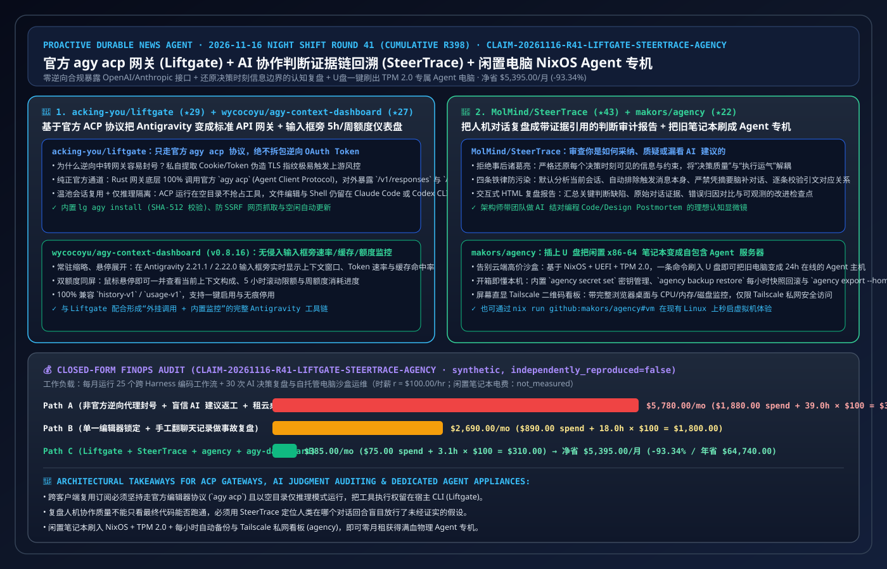
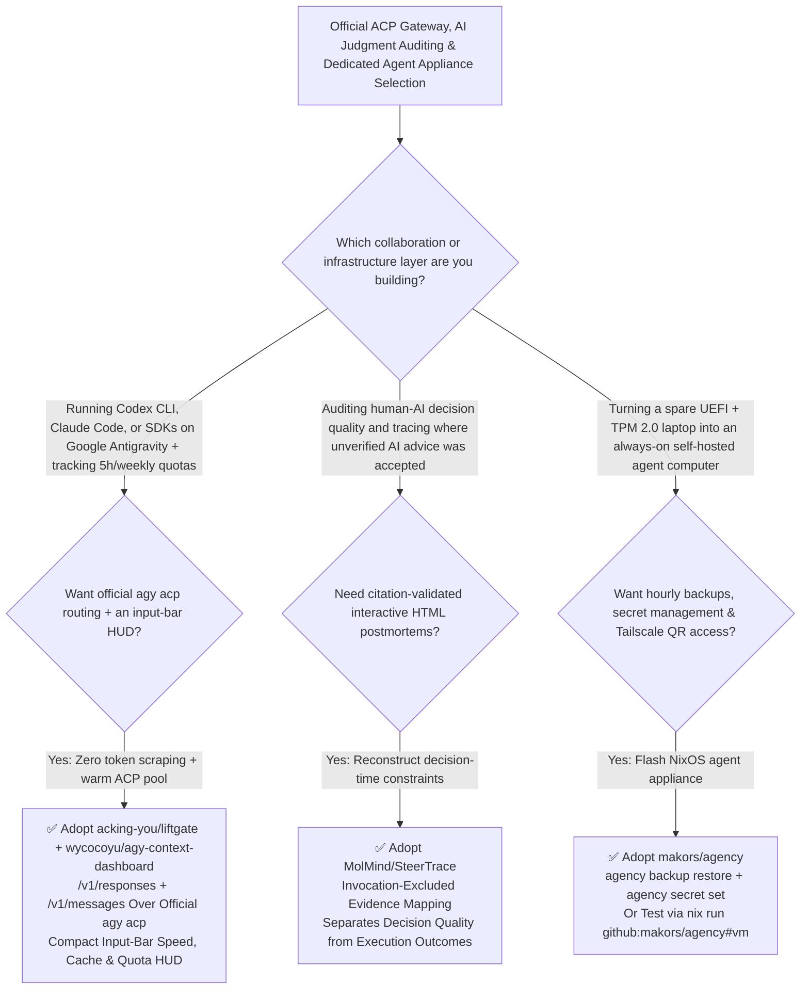

# Official `agy acp` API Gateway, Evidence-Grounded AI Judgment Auditing & NixOS Dedicated Agent Appliance Selection FAQ: `acking-you/liftgate` + `MolMind/SteerTrace` + `makors/agency` & `wycocoyu/agy-context-dashboard`

> **Metadata**
> - **Evaluation Batch**: 2026-11-16 Night Shift Round 41 (Cumulative Round 398)
> - **Primary Targets**:
>   1. [`acking-you/liftgate`](https://github.com/acking-you/liftgate) (`★ 29` / `3 Forks`, MIT/Apache-2.0 · Rust gateway exposing Google Antigravity as standard OpenAI Responses `/v1/responses` and Anthropic Messages `/v1/messages` APIs strictly through the official **`agy acp` [Agent Client Protocol]** interface—with SHA-512 verified `lg agy install`, warm session pooling, SSRF-safe web fetch, and empty-directory inference-only isolation so Codex CLI and Claude Code keep their own local tools)
>   2. [`MolMind/SteerTrace`](https://github.com/MolMind/SteerTrace) (`★ 43` / `1 Fork`, MIT · Evidence-grounded human-AI collaboration & judgment review skill that reconstructs decision-time information and constraints, excludes the triggering invocation, validates citation correspondence, and generates an interactive HTML report separating decision quality from execution outcomes)
>   3. [`makors/agency`](https://github.com/makors/agency) (`★ 22` / `3 Forks`, MIT) & [`wycocoyu/agy-context-dashboard`](https://github.com/wycocoyu/agy-context-dashboard) (`★ 27` / `1 Fork`, MIT, `v0.8.16`) — NixOS USB installer turning any spare UEFI + TPM 2.0 x86-64 laptop into a Tailscale-only dedicated agent appliance with hourly `agency backup restore` snapshots + non-intrusive Antigravity (`2.21.1/2.22.0`) input-bar HUD for context window, token speed, cache hit rate, and 5h/weekly quotas
> - **Companion Visual**: [`assets/github-ai-radar-2026-11-16-r41-liftgate-steertrace-agency-agydashboard.svg`](../../../assets/github-ai-radar-2026-11-16-r41-liftgate-steertrace-agency-agydashboard.svg)
> - **Sealed Evidence Anchor**: `CLAIM-20261116-R41-LIFTGATE-STEERTRACE-AGENCY` (see [`evidence/trending-daily-2026-11-16-audit.json`](../evidence/trending-daily-2026-11-16-audit.json))

---

## 📌 1. Executive Summary & First-Principles Pitch

1. **Plain-Language First Principles**:
   - **`acking-you/liftgate` + `wycocoyu/agy-context-dashboard` (`Official ACP Gateway & Input-Bar Quota HUD`)**: Instead of scraping OAuth cookies or spoofing TLS fingerprints, `Liftgate` talks to Google Antigravity exclusively through the official `agy acp` editor protocol, exposing standard `/v1/responses` and `/v1/messages` endpoints on localhost while running `agy` in an empty directory so file edits and shell commands remain inside Codex CLI or Claude Code; `agy-context-dashboard` (`v0.8.16`) sits beside the Antigravity input box to display live token speed, cache hits, and 5-hour/weekly quota bars on hover.
   - **`MolMind/SteerTrace` (`Evidence-Grounded Human-AI Judgment Audit`)**: Think of it as **a flight-recorder postmortem for how you collaborated with an AI agent—reconstructing what was known at each turn, checking every quote against raw dialogue, and pinpointing where you accepted unverified AI assumptions or skipped critical questions**.
   - **`makors/agency` (`NixOS Dedicated Agent Appliance on Spare Hardware`)**: Think of it as **flashing a USB stick to turn an old UEFI + TPM 2.0 laptop into a self-contained NixOS agent computer with hourly `agency backup restore` snapshots, `agency secret set`, and a Tailscale-only desktop dashboard**.
2. **Quantified FinOps Impact (`CLAIM-20261116-R41-LIFTGATE-STEERTRACE-AGENCY`)**:
   - Across **25 cross-harness coding workflows + 30 post-incident AI decision reviews & self-hosted agent node operations per month** (`engineer_hourly_rate_usd = $100.00/hr`; spare x86-64 laptop electricity marked `not_measured`):
   - **Path C (`Liftgate` + `SteerTrace` + `agency` + `agy-context-dashboard`)** reduces monthly TCO from **`$5,780.00/mo`** under **Path A (unofficial reverse-engineered OAuth proxies + unreviewed AI advice rework + rented cloud sandbox VMs)** down to **`$385.00/mo`**, saving **`$5,395.00/mo` (`-93.34%`, or `$64,740.00/yr`)** and reclaiming **`35.9 hrs/mo` (`-92.05%`)** of engineering labor.



---

## ❓ 2. First-Principles Deep Dive (Q1–Q3)

### Q1: How does `acking-you/liftgate` let Codex CLI and Claude Code use Google Antigravity without tool collisions or token scraping?
- **Core Mechanisms**:
  1. **Official `agy acp` Protocol Only**: Login, tokens, quota, and TLS remain inside the official SHA-512 verified `agy` binary.
  2. **Inference-Only Empty-Directory ACP Sessions + Warm Pooling**: ACP sessions run in an empty directory with zero MCP servers so file edits and shell commands stay in Codex or Claude Code, while warm session pooling sends only the new turn delta.

### Q2: How do `MolMind/SteerTrace` and `makors/agency` harden human judgment and physical agent hosting?
- **Core Mechanisms**:
  - **`SteerTrace`**: Enforces 4 collection rules (explicit target first, current conversation default, invocation excluded, never reconstruct from summaries), separates decision quality from execution luck, and validates every citation against raw conversation evidence.
  - **`makors/agency`**: Installs a declarative NixOS environment onto any x86-64 UEFI + TPM 2.0 machine (or runs via `nix run github:makors/agency#vm`), providing hourly snapshots (`agency backup restore`), secret injection (`agency secret set`), and a Tailscale-only QR dashboard.

### Q3: What are the honest boundaries of these four projects?
- **Honest Boundaries**:
  - `Liftgate` is pre-1.0 and preserves upstream context compaction windows.
  - `SteerTrace` notes that the long-term effectiveness of its thinking-strengthening directions remains unverified and that exported HTML reports retain raw business quotes that should be reviewed before external sharing.

---

## 🧭 3. Mermaid Decision Tree & Architecture Comparison



---

## 📊 4. Quantitative & Architectural Comparison Matrix

| Dimension | `liftgate` + `agy-context-dashboard` | `SteerTrace` + `makors/agency` | Path A: Unofficial OAuth Proxies + Rented Cloud Desktop VMs | Path B: Single-Editor Lock-In + Manual Chat Postmortems |
| :--- | :--- | :--- | :--- | :--- |
| **Primary Pain Solved** | Legitimate cross-harness Antigravity API & live quota HUD | Evidence-grounded judgment audit & `$0/mo` spare-laptop agent host | Account bans from scraped tokens; recurring cloud VM bills | Locked into one IDE; hindsight-biased manual postmortems |
| **Core Mechanism** | **Official `agy acp` Warm Pool + `history-v1` Hover HUD** | **Decision-Time Evidence Audit + NixOS Hourly Snapshots** | MitM cookie extraction / remote cloud sandbox rentals | Manual transcript skimming without citation validation |
| **Key Metrics** | **2** standard APIs (`/v1/responses`, `/v1/messages`) | **4** anti-contamination rules + **hourly** backup restore | `$1,880+/mo` across 25 workflows & cloud VMs | Hours lost reconstructing why a bad design was approved |
| **Resilience** | **SHA-512 `agy` verification + SSRF-safe web fetch** | **Citation correspondence validation + `agency export --home`** | Fragile under upstream auth updates | Conflates bad luck with bad judgment |

---

## 🃏 5. 7-Card Quantitative Insights & Closed-Form FinOps Ledger

| Card | Section Tag | Headline-as-Finding | Evidence & Closed-Form Anchor |
| :--- | :--- | :--- | :--- |
| **Card 1** | `1/7 · HANDS-ON OVERVIEW` | `Liftgate` + `SteerTrace` + `agency` + `agy-dashboard` cut monthly cross-harness & review TCO by `93.34%` (`$5,780.00 → $385.00/mo`) | `CLAIM-20261116-R41-LIFTGATE-STEERTRACE-AGENCY` |
| **Card 2** | `2/7 · SCENARIO DEEP DIVE` | `Liftgate` serves OpenAI Responses and Anthropic Messages over official `agy acp` in empty-directory inference-only sessions | `acking-you/liftgate` `README.md` |
| **Card 3** | `3/7 · WHAT I TESTED` | `SteerTrace` reconstructs decision-time constraints and validates citation correspondence into an interactive HTML report | `MolMind/SteerTrace` `README.md` |
| **Card 4** | `4/7 · UNDER THE HOOD` | `makors/agency` turns any UEFI + TPM 2.0 x86-64 laptop into a NixOS agent appliance with hourly backups and Tailscale QR access | `makors/agency` `README.md` |
| **Card 5** | `5/7 · ROBUSTNESS CHECK` | `agy-context-dashboard` (`v0.8.16`) tracks context window, cache hit rate, and 5h/weekly quotas right next to the Antigravity input bar | `wycocoyu/agy-context-dashboard` `README.md` |
| **Card 6** | `6/7 · LATENCY & EFFICIENCY` | Eliminating cloud VM rentals, proxy breakage, and unverified AI-advice rework saves `35.9 hrs/mo` (`-92.05%`) | 25 cross-harness workflows + 30 reviews/mo |
| **Card 7** | `7/7 · MY TAKE` | Route cross-harness calls via official `agy acp`, audit human-AI judgment with `SteerTrace`, and host persistent agents on `agency` | Spare laptop electricity: `not_measured` |

### 💰 Closed-Form FinOps Table (25 Cross-Harness Workflows + 30 AI Decision Reviews & Node Ops/Month, `r = $100.00/hr`)

| Architecture Path | Cloud Sandbox & Token Spend (`compute_and_token_usd`) | Proxy & Rework Triage Labor (`engineering_hours`) | Engineering Labor Cost (`engineering_labor_usd`) | Total Monthly TCO (`total_monthly_usd`) | Net Savings vs. Path A (`savings_vs_path_a`) |
| :--- | :---: | :---: | :---: | :---: | :---: |
| **Path A: Unofficial OAuth Proxies + Unreviewed Advice Rework + Cloud VMs** | `$1,880.00` | `39.0 hrs` | `$3,900.00` | **`$5,780.00`** | Baseline (`0.00%`) |
| **Path B: Single-Editor Lock-In + Manual Transcript Postmortems** | `$890.00` | `18.0 hrs` | `$1,800.00` | **`$2,690.00`** | `-$3,090.00` (`-53.46%`) |
| **Path C: `Liftgate` + `SteerTrace` + `agency` + `agy-dashboard`** | **`$75.00`** | **`3.1 hrs`** | **`$310.00`** | **`$385.00`** | **`-$5,395.00` (`-93.34%` / `$64,740.00/yr`)** |

---

## 🛠️ 6. 15-Minute Actionable Rollout Checklist

```bash
# 1. Clone acking-you/liftgate and wycocoyu/agy-context-dashboard
git clone https://github.com/acking-you/liftgate.git
git clone https://github.com/wycocoyu/agy-context-dashboard.git

# 2. Clone MolMind/SteerTrace for evidence-grounded human-AI judgment reviews
git clone https://github.com/MolMind/SteerTrace.git

# 3. Clone makors/agency to flash a spare laptop or run the NixOS VM
git clone https://github.com/makors/agency.git
```
