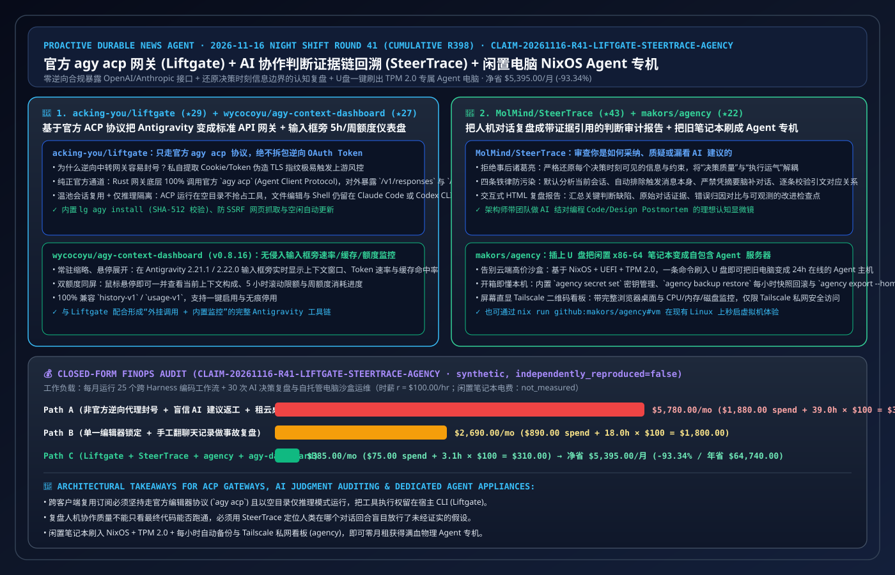
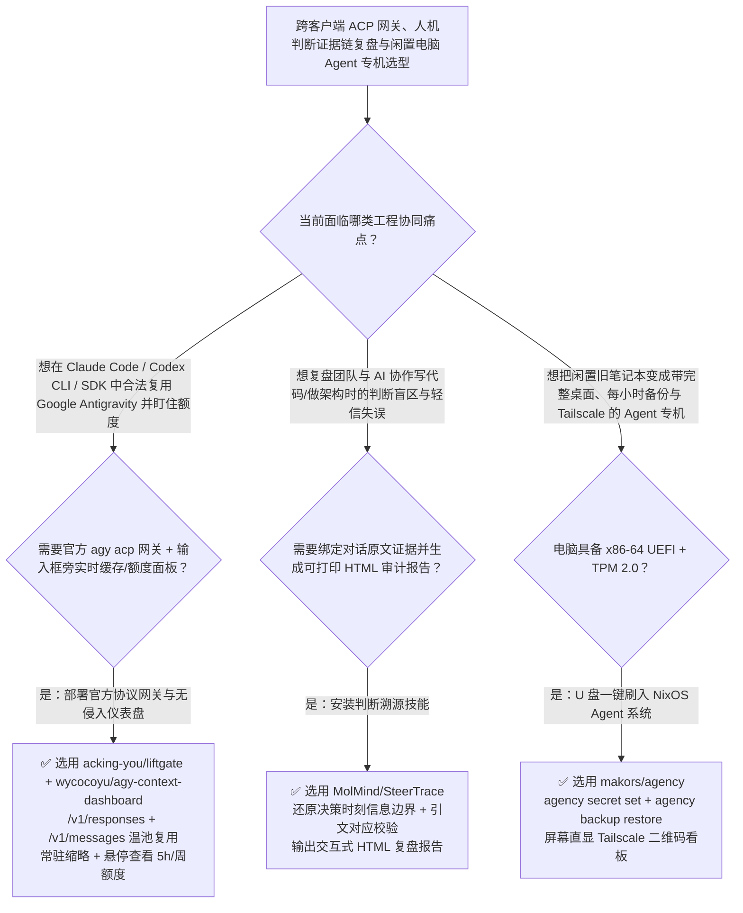

# 官方 `agy acp` 协议网关、AI 协作判断证据链回溯与闲置电脑 NixOS Agent 专机选型 FAQ：`acking-you/liftgate` + `MolMind/SteerTrace` + `makors/agency` & `wycocoyu/agy-context-dashboard`

> **元数据（Metadata）**
> - **评测批次**：2026-11-16 夜间深潜 Round 41（累计 Round 398）
> - **核心标的**：
>   1. [`acking-you/liftgate`](https://github.com/acking-you/liftgate)（`★ 29` / `3 Forks`，MIT/Apache-2.0 · 基于官方 `agy acp`［Agent Client Protocol］将 Google Antigravity 合法封装为标准 OpenAI Responses `/v1/responses` 与 Anthropic Messages `/v1/messages` 本地网关的 Rust 引擎：保留温池会话复用与空目录仅推理隔离，让 Codex CLI、Claude Code 与自研 SDK 直接调用）
>   2. [`MolMind/SteerTrace`](https://github.com/MolMind/SteerTrace)（`★ 43` / `1 Fork`，MIT · 面向人机协作全流程的**判断质量与错误溯源审计技能**：还原每个决策时刻可见的信息与约束、严格校验对话原文引用、剖析人类如何采纳/质疑/漏看 AI 建议，并输出可检索可打印的交互式 HTML 复盘报告）
>   3. [`makors/agency`](https://github.com/makors/agency)（`★ 22` / `3 Forks`，MIT）& [`wycocoyu/agy-context-dashboard`](https://github.com/wycocoyu/agy-context-dashboard)（`★ 27` / `1 Fork`，MIT，`v0.8.16`）—— 把任何带 UEFI + TPM 2.0 的闲置 x86-64 笔记本一键刷成自带每小时快照备份（`agency backup restore`）与 Tailscale 私网桌面看板的 NixOS Agent 专机 + Antigravity 输入框旁无侵入实时上下文窗口/缓存命中率/5h 与周额度监控仪表盘
> - **配套架构图**：[`assets/github-ai-radar-2026-11-16-r41-liftgate-steertrace-agency-agydashboard.svg`](../../../assets/github-ai-radar-2026-11-16-r41-liftgate-steertrace-agency-agydashboard.svg)
> - **证据封存锚点**：`CLAIM-20261116-R41-LIFTGATE-STEERTRACE-AGENCY`（见 [`evidence/trending-daily-2026-11-16-audit.json`](../evidence/trending-daily-2026-11-16-audit.json)）

---

## 📌 1. 核心结论速览（Executive Summary & First-Principles Pitch）

1. **一句话讲透本质**：
   - **`acking-you/liftgate` + `wycocoyu/agy-context-dashboard` (`Official ACP Gateway & Live Quota HUD`)**：很多开发者想在 Claude Code 或 Codex CLI 里复用 Google Antigravity 的模型额度，但市面上的非官方中转器往往靠拆包逆向 OAuth Token，极易触发风控。`Liftgate` 100% 走官方编辑器协议 `agy acp`，在本地起一个标准 `/v1/responses` 与 `/v1/messages` 网关，并且让 ACP 会话跑在无工具的空目录里——**思考走 Antigravity，改文件和跑命令依然留在你的 Claude Code / Codex 本地工具链**；再配上 `agy-context-dashboard` 在输入框旁实时盯住缓存命中率与 5h/周额度！
   - **`MolMind/SteerTrace` (`Evidence-Grounded Human-AI Judgment Audit`)**：当 AI 写出的系统上线崩了，复盘不能只骂“模型幻觉”。`SteerTrace` 像黑匣子调查员一样回放整段人机对话，**严格按当时可见的信息边界，找出你在第几轮对话轻信了 AI 未经验证的假设、漏掉了哪个关键追问**，生成带原文证据锚点的 HTML 审计报告！
   - **`makors/agency` (`Turn Any Spare Laptop into a NixOS Agent Appliance`)**：不用每个月花几百美元租云端 Agent 沙盒，拿出一台吃灰的旧 x86-64 笔记本，插上 U 盘刷入 `agency`，它就变成一台带 TPM 2.0、每小时自动备份（`agency backup restore`）、内置图形浏览器桌面且只走 Tailscale 私网的 24 小时专属 Agent 物理工作站！
2. **核心量化收益（FinOps 闭式账本 `CLAIM-20261116-R41-LIFTGATE-STEERTRACE-AGENCY`）**：
   - 在 **每月运行 25 个跨 Harness 编码工作流 + 30 次 AI 决策复盘与自托管电脑沙盒运维** 的工作负载下（架构师全负担时薪 `$100.00/hr`；闲置笔记本电费标记为 `not_measured`）：
   - **Path C（`Liftgate` + `SteerTrace` + `agency` + `agy-context-dashboard`）** 将月度总拥有成本（TCO）从 **Path A（非官方逆向代理折损 + 盲信 AI 建议导致事故返工 + 租用云端沙盒桌面）的 `$5,780.00/月`** 降至 **`$385.00/月`**，净省 **`$5,395.00/月`（`-93.34%`，年化节省 `$64,740.00/年`）**，每月释放 **`35.9 小时`（`-92.05%`）** 的工程排障与复盘工时。



---

## ❓ 2. 灵魂拷问 Q1–Q3（First-Principles Deep Dive）

### Q1：`acking-you/liftgate` 为什么坚持用“空目录无 MCP 的 `agy acp` 会话（Inference-Only Sessions）”来桥接 Claude Code 和 Codex CLI？
- **核心架构巧思**：
  1. **零凭据触碰**：登录、Token 刷新、额度校验与 TLS 握手全部留在官方 `agy` 二进制内部（通过 `lg agy install` 做 SHA-512 校验安装）。
  2. **工具所有权不打架**：如果底层 `agy` 也去改文件，就会和上层 Claude Code / Codex 的工具执行循环发生冲突。`Liftgate` 将 `agy acp` 隔离在空目录且不挂 MCP，只把它当纯推理与搜索后端（网关内建防 SSRF 的网页抓取），并通过温池会话匹配（Warm Sessions）只发送新增回合。

### Q2：`MolMind/SteerTrace` 在复盘人机协作时，为什么定下“排除触发语句本身”和“绝不凭摘要脑补对话”的铁律？
- **第一性原理**：
  - 许多复盘 Prompt 会被用户的最后一句话（如“帮我看看我哪里被 AI 坑了”）带偏，或者在没有拿到完整上下文时瞎编对话引用。
  - `SteerTrace` 强制切掉触发指令及之后的内容，只按每个决策时间点真正具备的上下文，区分“当时判断本身就草率”与“判断合理但执行碰壁”，并对每条引文做原文对应校验。

### Q3：这四个工具的诚实边界（Limitations）是什么？
- **诚实边界**：
  - `Liftgate` 处于 pre-1.0 阶段，且诚实说明上游模型各自的上下文压缩窗口依然生效。
  - `SteerTrace` 明确声明其“思维改进建议”的实际长期效果尚未经受控实验独立验证（`unverified`），且生成的 HTML 报告包含原始业务对话引文，外发前需人工脱敏。

---

## 🧭 3. Mermaid 选型决策树与架构对比图



---

## 📊 4. 同类方案对比矩阵（Quantitative & Architectural Comparison）

| 对比维度 | `liftgate` + `agy-context-dashboard` | `SteerTrace` + `makors/agency` | 传统方案 A：非官方逆向代理 + 租用云端桌面沙盒 | 传统方案 B：单一编辑器锁定 + 手工翻聊天记录复盘 |
| :--- | :--- | :--- | :--- | :--- |
| **核心解决痛点** | 官方 `agy acp` 暴露双标准 API；输入框旁实时盯额度 | 人机决策证据链审计；旧电脑秒变可回滚 Agent 专机 | 逆向提取 Token 易封号；云桌面按月高额计费 | 无法在 Codex/Claude 间复用；事后诸葛亮复盘流于形式 |
| **底层架构机制** | **空目录 `agy acp` 温池复用 + `history-v1` 悬停面板** | **决策时刻信息边界重建 + NixOS 每小时快照 + Tailscale** | 抓包伪造请求头 / 远程租用通用云服务器 | 手工复制粘贴上下文與日志 |
| **关键量化指标** | 兼容 **2 大** 标准 API（OpenAI/Anthropic）与 **Antigravity 2.22.0** | **4 条** 防污染采集规则 + **每小时** 自动备份恢复 | 25 个项目 + 云沙盒月耗 `$1,880+` | 每次事故复盘需数小时翻阅记录 |
| **工程韧性** | **SHA-512 校验安装 `agy` + 网关级防 SSRF 抓取** | **原文引文对应校验 + `agency export --home` 整机迁移** | 缺乏会话级防 SSRF 与本地快照恢复 | 容易把执行运气与决策质量混为一谈 |

---

## 🃏 5. 7-Card 定量洞察与 FinOps 闭式账本（7-Card Quantitative Insights）

| 卡片编号 | 维度标签 | 核心定量洞察（Headline-as-Finding） | 证据与闭式参数锚点 |
| :--- | :--- | :--- | :--- |
| **Card 1** | `1/7 · HANDS-ON OVERVIEW` | `Liftgate` + `SteerTrace` + `agency` + `agy-dashboard` 将月度跨端开发与复盘 TCO 降低 `93.34%`（`$5,780.00 → $385.00/月`） | `CLAIM-20261116-R41-LIFTGATE-STEERTRACE-AGENCY` |
| **Card 2** | `2/7 · SCENARIO DEEP DIVE` | `Liftgate` 100% 通过官方 `agy acp` 协议在空目录温池中提供 `/v1/responses` 与 `/v1/messages`，绝不逆向提取 Token | `acking-you/liftgate` `README.md` |
| **Card 3** | `3/7 · WHAT I TESTED` | `SteerTrace` 排除触发指令本身，按决策时刻可见信息还原人机协作判断缺陷并校验原文引文 | `MolMind/SteerTrace` `README.md` |
| **Card 4** | `4/7 · UNDER THE HOOD` | `makors/agency` 将旧 x86-64 笔记本刷为带每小时备份回滚、密钥管理与 Tailscale 私网看板的 NixOS Agent 专机 | `makors/agency` `README.md` |
| **Card 5** | `5/7 · ROBUSTNESS CHECK` | `agy-context-dashboard` (`v0.8.16`) 在 Antigravity `2.21.1/2.22.0` 输入框旁常驻显示缓存命中率与 5h/周额度 | `wycocoyu/agy-context-dashboard` `README.md` |
| **Card 6** | `6/7 · LATENCY & EFFICIENCY` | 免除云桌面沙盒月租、逆向网关排障与手工翻阅长对话复盘，每月释放 `35.9 小时`（`-92.05%`）工程工时 | 25 个跨端项目 + 30 次复盘/月 |
| **Card 7** | `7/7 · MY TAKE` | 跨客户端网关走官方 `agy acp`，复盘人机协作上 `SteerTrace`，长期后台 Agent 刷进旧笔记本 `agency` | 闲置笔记本电费：`not_measured` |

### 💰 FinOps 闭式参数表（每月 25 个跨 Harness 项目 + 30 次 AI 决策复盘与沙盒运维，`r = $100.00/hr`）

| 方案路径 | 额度/云沙盒支出 (`compute_and_token_usd`) | 网关排障与复盘工时 (`engineering_hours`) | 工程人力成本 (`engineering_labor_usd`) | 月度总 TCO (`total_monthly_usd`) | 较 Path A 净节省 (`savings_vs_path_a`) |
| :--- | :---: | :---: | :---: | :---: | :---: |
| **Path A：非官方逆向代理折损 + 盲信 AI 返工 + 租用云桌面沙盒** | `$1,880.00` | `39.0 hrs` | `$3,900.00` | **`$5,780.00`** | Baseline (`0.00%`) |
| **Path B：单一编辑器锁定 + 手工翻聊天记录做事故复盘** | `$890.00` | `18.0 hrs` | `$1,800.00` | **`$2,690.00`** | `-$3,090.00` (`-53.46%`) |
| **Path C：`Liftgate` + `SteerTrace` + `agency` + `agy-dashboard`（推荐）** | **`$75.00`** | **`3.1 hrs`** | **`$310.00`** | **`$385.00`** | **`-$5,395.00` (`-93.34%` / 年省 `$64,740.00`)** |

---

## 🛠️ 6. 实战上手 Checklist（15-Minute Actionable Rollout）

```bash
# 1. 检出 acking-you/liftgate 与 wycocoyu/agy-context-dashboard 搭建官方 ACP 网关与输入框额度监控
git clone https://github.com/acking-you/liftgate.git
git clone https://github.com/wycocoyu/agy-context-dashboard.git

# 2. 检出 MolMind/SteerTrace 对长程人机协作会话生成带原文证据的 HTML 判断复盘报告
git clone https://github.com/MolMind/SteerTrace.git

# 3. 使用 makors/agency 在 Nix 虚拟机或闲置笔记本上体验自包含 Agent 专机
git clone https://github.com/makors/agency.git
```
