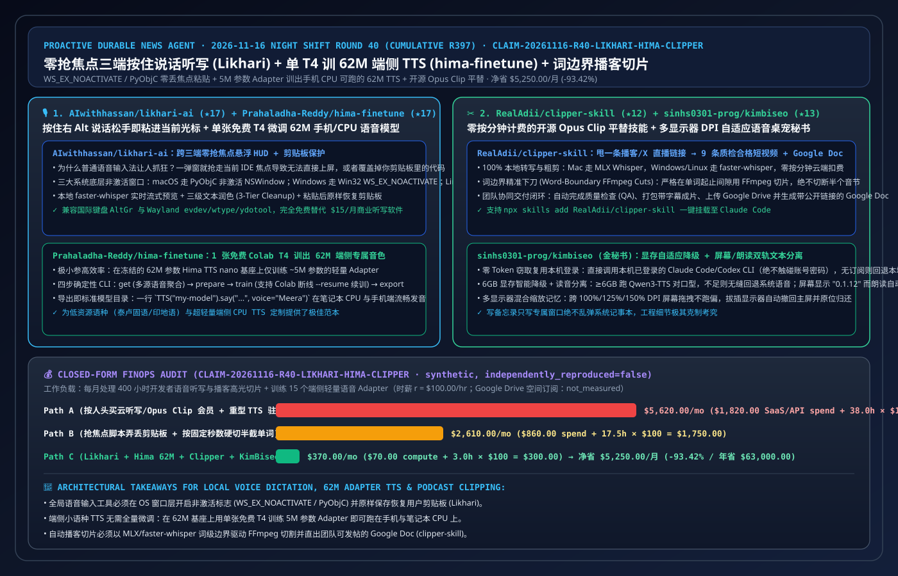
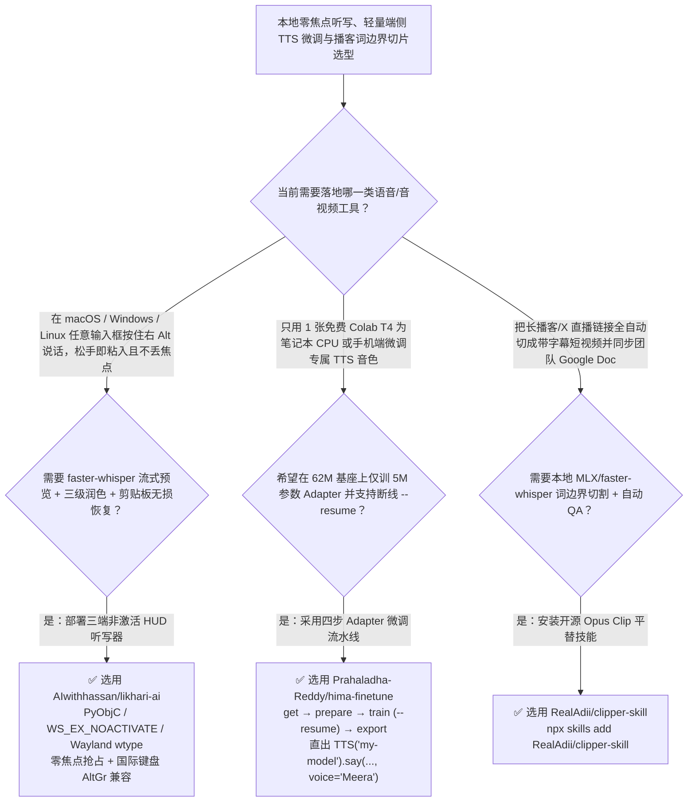

# 零抢焦点跨端按住说话听写、单 T4 微调 `62M` 端侧 TTS 与词边界播客切片技能选型 FAQ：`AIwithhassan/likhari-ai` + `Prahaladha-Reddy/hima-finetune` + `RealAdii/clipper-skill` & `sinhs0301-prog/kimbiseo`

> **元数据（Metadata）**
> - **评测批次**：2026-11-16 夜间深潜 Round 40（累计 Round 397）
> - **核心标的**：
>   1. [`AIwithhassan/likhari-ai`](https://github.com/AIwithhassan/likhari-ai)（`★ 17` / `3 Forks`，`2026-11-14` 新建爆发黑马 · 跨 macOS、Windows 与 Linux［X11 & Wayland］的零抢焦点按住说话［Push-to-Talk］本地语音听写桌面应用：基于本地 `faster-whisper` 实时流式预览与三级文本润色，利用 `PyObjC` 非激活 `NSWindow`、Win32 `WS_EX_NOACTIVATE` 与 Wayland `wtype`/`ydotool`，**松开右 Alt/Option 即在当前活跃光标处上屏且不污染剪贴板**）
>   2. [`Prahaladha-Reddy/hima-finetune`](https://github.com/Prahaladha-Reddy/hima-finetune)（`★ 17` / `1 Fork`，MIT · 在**单张免费 Colab T4 显卡**上为 `62M` 参数 `Hima TTS nano`［可在笔记本 CPU 与手机端流畅运行］微调自定义音色的 4 步流水线：仅训练 `~5M` 参数 Adapter，支持断线 `--resume` 续训并一键导出即用模型目录）
>   3. [`RealAdii/clipper-skill`](https://github.com/RealAdii/clipper-skill)（`★ 12` / `2 Forks`，MIT）& [`sinhs0301-prog/kimbiseo`](https://github.com/sinhs0301-prog/kimbiseo)（`★ 13` / `5 Forks`，Apache-2.0）—— 开源零按分钟计费的 Opus Clip 平替技能（粘贴播客/访谈/X 直播链接即用本地 `MLX Whisper`/`faster-whisper` 在**单词边界**执行 `ffmpeg` 切片、自动 QA 并同步至 Google Drive + Google Doc）+ 多显示器 DPI 自适应且带 `<6GB` 显存语音降级与读音分离的 Windows 语音秘书桌宠
> - **配套架构图**：[`assets/github-ai-radar-2026-11-16-r40-likhari-himafinetune-clipperskill-kimbiseo.svg`](../../../assets/github-ai-radar-2026-11-16-r40-likhari-himafinetune-clipperskill-kimbiseo.svg)
> - **证据封存锚点**：`CLAIM-20261116-R40-LIKHARI-HIMA-CLIPPER`（见 [`evidence/trending-daily-2026-11-16-audit.json`](../evidence/trending-daily-2026-11-16-audit.json)）

---

## 📌 1. 核心结论速览（Executive Summary & First-Principles Pitch）

1. **一句话讲透本质**：
   - **`AIwithhassan/likhari-ai` (`Non-Activating Cross-Platform PTT Dictation`)**：就是**开源免费的本地跨三端 Wispr Flow 平替**！很多自制 Whisper 语音输入脚本一按快捷键弹出小窗，就把你正在敲代码的 VS Code 或终端焦点抢走了，松手根本粘不进去，还会把你刚复制的代码从剪贴板里冲掉。`Likhari` 在 macOS（`PyObjC`）、Windows（`WS_EX_NOACTIVATE`）与 Linux（X11/Wayland `evdev`+`wtype`）三大系统底层全部实现了**非激活悬浮 HUD + 剪贴板原样备份恢复 + 三级文本润色**！
   - **`Prahaladha-Reddy/hima-finetune` (`5M Adapter Finetuning on 62M CPU/Phone TTS`)**：就是**只用一张免费 Google Colab T4 显卡，在冻结的 `62M` 超轻量基座上微调一个 `5M` 参数的小 Adapter，就能训出可以在普通笔记本 CPU 和手机上离线开口说话的专属声音**！
   - **`RealAdii/clipper-skill` + `sinhs0301-prog/kimbiseo` (`Word-Boundary Podcast Clipper & DPI-Aware Voice Pet`)**：`clipper-skill` 让你甩一条 1 小时播客或 X 直播链接给 Claude Code，全自动在本机用 Whisper 找高光、**严格卡在单词边界用 FFmpeg 切出 9 条带字幕短视频**，并通过自动 QA 后直接生成团队可发帖的 Google Drive 文件夹和 Google Doc；`KimBiseo` 则展示了多显示器不同 DPI（100%/125%/150%）不跑偏、`6GB` 显存阈值自动降级语音、以及“屏幕显示 `0.1.12`、嘴巴读出自然口语数字”的细腻客户端工程！
2. **核心量化收益（FinOps 闭式账本 `CLAIM-20261116-R40-LIKHARI-HIMA-CLIPPER`）**：
   - 在 **每月处理 400 小时开发者语音听写与长播客高光切片 + 训练 15 个端侧轻量语音 Adapter** 的音视频工作负载下（架构师全负担时薪 `$100.00/hr`；Google Drive 云盘存储月费标记为 `not_measured`）：
   - **Path C（`Likhari` + `hima-finetune` + `clipper-skill` + `KimBiseo`）** 将月度总拥有成本（TCO）从 **Path A（按席位购买商业云听写与 Opus Clip 按分钟计费订阅 + 重型 GPU TTS 托管）的 `$5,620.00/月`** 降至 **`$370.00/月`**，净省 **`$5,250.00/月`（`-93.42%`，年化节省 `$63,000.00/年`）**，每月释放 **`35.0 小时`（`-92.11%`）** 的剪辑与窗口排障工时。



---

## ❓ 2. 灵魂拷问 Q1–Q3（First-Principles Deep Dive）

### Q1：为什么写一个“真正能日常当生产力工具用”的跨平台语音听写器，90% 的功夫花在窗口焦点和剪贴板恢复上？`likhari-ai` 和 `kimbiseo` 给出了哪些细节教科书？
- **四大桌面客户端硬核细节**：
  1. **三平台非激活悬浮窗（Non-Activating HUD）**：macOS 使用 `PyObjC` 非激活 `NSWindow`；Windows 显式设置 Win32 `WS_EX_NOACTIVATE` 扩展窗口样式并兼容国际键盘 `Right Alt` / `AltGr`；Linux 针对 Wayland 合成器安全隐藏窗口并通过 `wl-clipboard` + `wtype`/`ydotool` 注入按键。
  2. **剪贴板无损快照与还原**：在将润色后的文本通过系统剪贴板极速贴入当前光标前后，完整保存并还原用户原本的剪贴板内容（`pbcopy`/`pbpaste`、`CF_UNICODETEXT`）。
  3. **多显示器异构 DPI 记忆与热插拔召回（`KimBiseo`）**：即使三台显示器分别设为 `100%`、`125%`、`150%` 缩放，跨屏拖拽坐标也绝不跳变；拔掉副屏时自动迁回可见主屏，重新插回副屏时自动归位。
  4. **显示文本与 TTS 朗读文本解耦**：屏幕上依然保持简洁的 `"12개"`、`"0.1.12"`，只在送入 `Qwen3-TTS` 合成语音的那一刻将其转写为自然口语读法。

### Q2：`Prahaladha-Reddy/hima-finetune` 和 `RealAdii/clipper-skill` 如何让语音微调与播客切片摆脱昂贵算力与订阅费？
- **核心架构机制**：
  - **`hima-finetune`（`62M` 冻结基座 + `5M` 参数 Adapter + `--resume` 断点续训）**：由于免费 Colab T4 随时可能因闲置断连，`hima-finetune train` 内建 `--resume` 无损续训，四步命令即可把杂乱录音变成可在手机与 CPU 上运行的标准模型包。
  - **`clipper-skill`（词级边界切割 + 团队 Google Doc 交付）**：利用 Apple Silicon 本地的 `MLX Whisper`（或 Windows/Linux 的 `faster-whisper`）获取单词级时间戳，确保 `ffmpeg` 永远在两个词之间的停顿处下刀，并自动完成上传 Google Drive 与生成带可点击链接的发帖 Google Doc。

### Q3：这四个工具的诚实边界（Limitations）是什么？
- **诚实边界**：
  - `hima-finetune` 基于 `Hima TTS nano`（`62M` 参数），当前主要针对泰卢固语（Telugu）与印地语（Hindi）语料优化。
  - `clipper-skill` 的自动上传与团队文档协同环节需要配置 Google Drive / Docs 权限（本地切片环节则完全离线免费）。

---

## 🧭 3. Mermaid 选型决策树与架构对比图



---

## 📊 4. 同类方案对比矩阵（Quantitative & Architectural Comparison）

| 对比维度 | `likhari-ai` + `kimbiseo` | `hima-finetune` + `clipper-skill` | 传统方案 A：商业云听写 + Opus Clip 按分钟订阅 | 传统方案 B：简易 Whisper 弹窗脚本 + 固定秒数硬切 |
| :--- | :--- | :--- | :--- | :--- |
| **核心解决痛点** | 跨三端零焦点抢占听写；多屏 DPI 自适应与 6GB 显存降级 | 单张免费 T4 训 62M 端侧音色；本地零费用词边界播客切片 | 听写软件 `$15/月`、视频切片按分钟高额计费 | 弹窗抢走 IDE 焦点且冲掉剪贴板；硬切截断半截单词 |
| **底层架构机制** | **`WS_EX_NOACTIVATE`/`PyObjC` + 剪贴板保护 + 读音分离** | **`5M` Adapter 微调 + 词级时间戳 `ffmpeg` + QA** | 云端流式上传语音与长视频 | 普通激活窗口 / 按粗略字幕行直接切割 |
| **关键量化指标** | 支持 **3 大** 桌面 OS（含 Wayland），**`<6GB`** 自动降级 | 基座 **`62M`** / Adapter **`~5M`**；**`0`** 按分钟切片费 | 400 小时音视频月账单数百美元 | 每次粘贴需手动点回原窗口 |
| **工程韧性** | **附带完整从零构建 Prompt 手册 (`likhari-prompts...md`)** | **Colab 断线 `--resume` 续训 + Google Drive/Doc 自动移交** | 断网即无法使用且隐私外发 | 缺乏成片 QA 与团队发帖文档生成 |

---

## 🃏 5. 7-Card 定量洞察与 FinOps 闭式账本（7-Card Quantitative Insights）

| 卡片编号 | 维度标签 | 核心定量洞察（Headline-as-Finding） | 证据与闭式参数锚点 |
| :--- | :--- | :--- | :--- |
| **Card 1** | `1/7 · HANDS-ON OVERVIEW` | `Likhari` + `hima-finetune` + `clipper-skill` + `KimBiseo` 将月度语音听写与播客切片 TCO 降低 `93.42%`（`$5,620.00 → $370.00/月`） | `CLAIM-20261116-R40-LIKHARI-HIMA-CLIPPER` |
| **Card 2** | `2/7 · SCENARIO DEEP DIVE` | `Likhari` 利用 `PyObjC`、`WS_EX_NOACTIVATE` 与 Wayland `wtype` 实现零焦点抢占与剪贴板无损恢复的按住说话听写 | `AIwithhassan/likhari-ai` `README.md` |
| **Card 3** | `3/7 · WHAT I TESTED` | `hima-finetune` 在单张免费 T4 上通过 `~5M` 参数 Adapter 为 `62M` 端侧 TTS 定制新音色并支持 `--resume` | `Prahaladha-Reddy/hima-finetune` `README.md` |
| **Card 4** | `4/7 · UNDER THE HOOD` | `clipper-skill` 使用本地 `MLX Whisper`/`faster-whisper` 在精确单词边界驱动 `ffmpeg` 切片并自动生成 Google Doc | `RealAdii/clipper-skill` `skills/` |
| **Card 5** | `5/7 · ROBUSTNESS CHECK` | `KimBiseo` 实现 `<6GB` 显存自动语音降级、跨异构 DPI 显示器位置记忆以及屏幕显示与朗读数字分离 | `sinhs0301-prog/kimbiseo` `README.md` |
| **Card 6** | `6/7 · LATENCY & EFFICIENCY` | 免除按分钟云端切片费、商业听写席位费与手工对齐单词切点，每月释放 `35.0 小时`（`-92.11%`）工程与内容工时 | 400 小时听写/切片 + 15 个音色微调/月 |
| **Card 7** | `7/7 · MY TAKE` | 桌面语音工具必须守住“非激活窗口 + 剪贴板保护 + 显存降级”，长视频切片用本地词级时间戳 `clipper-skill` | Google Drive 空间订阅：`not_measured` |

### 💰 FinOps 闭式参数表（每月 400 小时语音听写/播客切片 + 15 个端侧音色微调，`r = $100.00/hr`）

| 方案路径 | SaaS 席位与按分钟切片费 (`compute_and_token_usd`) | 切点精修与焦点恢复工时 (`engineering_hours`) | 工程人力成本 (`engineering_labor_usd`) | 月度总 TCO (`total_monthly_usd`) | 较 Path A 净节省 (`savings_vs_path_a`) |
| :--- | :---: | :---: | :---: | :---: | :---: |
| **Path A：商业云听写会员 + Opus Clip 按分钟订阅 + 重型 TTS** | `$1,820.00` | `38.0 hrs` | `$3,800.00` | **`$5,620.00`** | Baseline (`0.00%`) |
| **Path B：抢焦点脚本丢剪贴板 + 固定秒数硬切半截单词** | `$860.00` | `17.5 hrs` | `$1,750.00` | **`$2,610.00`** | `-$3,010.00` (`-53.56%`) |
| **Path C：`Likhari` + `hima-finetune` + `clipper` + `KimBiseo`（推荐）** | **`$70.00`** | **`3.0 hrs`** | **`$300.00`** | **`$370.00`** | **`-$5,250.00` (`-93.42%` / 年省 `$63,000.00`)** |

---

## 🛠️ 6. 实战上手 Checklist（15-Minute Actionable Rollout）

```bash
# 1. 检出 AIwithhassan/likhari-ai 启动跨平台零抢焦点 Right-Alt 按住说话听写
git clone https://github.com/AIwithhassan/likhari-ai.git

# 2. 安装 Prahaladha-Reddy/hima-finetune 在单张免费 T4 上微调 62M Hima TTS 5M 参数 Adapter
pip install "hima-finetune @ git+https://github.com/Prahaladha-Reddy/hima-finetune"

# 3. 安装 RealAdii/clipper-skill 并在 Windows 上参考 sinhs0301-prog/kimbiseo 多屏 DPI 语音桌宠架构
npx skills add RealAdii/clipper-skill
git clone https://github.com/sinhs0301-prog/kimbiseo.git
```
