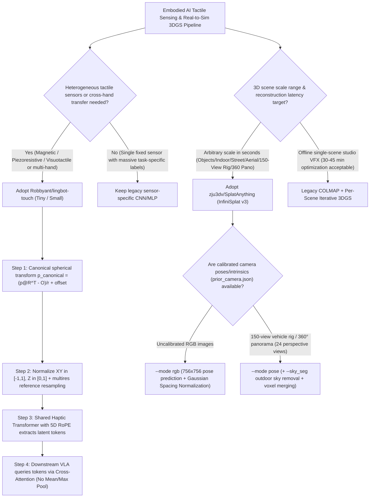

# Heterogeneous Tactile Foundation Models (5D-RoPE Tactile JEPA) & Arbitrary-Scale Feed-Forward 3DGS (Gaussian Spacing Normalization) Selection FAQ: `Robbyant/lingbot-touch` + `zju3dv/SplatAnything` Deep-Dive

> **Positioning**: This standalone guide is **Round 15 of the 2026-11-11 Night Shift (Cumulative Guide #60)**, written in the plain-language, first-principles, closed-form FinOps style of `ib-vs-ethernet-roce-selection-faq.md` for Embodied AI and Spatial Computing Solution Architects evaluating two breakout robotics and 3D reconstruction repositories:
> 1. **`Robbyant/lingbot-touch` (`160★`, `arXiv:2611.12806`, Apache-2.0)**: A tactile foundation model via masked representation prediction (JEPA) in latent space using modality-specific tokenizers and a shared **Haptic Transformer with 5D RoPE**, unifying 3-axis `magnetic`, scalar `piezoresistive`, and optical `visuotactile` signals with zero-shot transfer to Sharpa Wave and XHand dexterous robotic hands;
> 2. **`zju3dv/SplatAnything` (`143★`, `arXiv:2611.08264`, ZJU-3DV InfiniSplat v3)**: A feed-forward 3D Gaussian Splatting (3DGS) architecture powered by **Gaussian Spacing Normalization**, reconstructing tabletop objects, indoor rooms, street scenes, aerial views, 150-camera autonomous driving rigs (`Rig-Recon`), and 360° VR equirectangular panoramas (`Pano-Recon`) with a single model.
>
> **中文版 FAQ**: [lingbot-touch-splatanything-tactile-jepa-3dgs-selection-faq.md](lingbot-touch-splatanything-tactile-jepa-3dgs-selection-faq.md) · **Architecture Summary SVG**: [`assets/github-ai-radar-2026-11-11-r15-lingbot-splatanything.svg`](../../../assets/github-ai-radar-2026-11-11-r15-lingbot-splatanything.svg)

---

## 📌 1. Executive Summary

1. **In plain English, what problems do these two repositories actually solve?**
   - **Breaking the "Tower of Babel" in Robotic Tactile Sensing (`Robbyant/lingbot-touch`)**: Dexterous robotic manipulation relies heavily on touch, yet hardware sensors are fragmented across 3-axis Hall-effect **magnetic arrays (`magnetic`: 24–96 taxels/finger)**, scalar **piezoresistive arrays (`piezoresistive`: 9–61 taxels/finger, 124 on thumb)**, and high-density **visuotactile skins (`visuotactile`: 32–200 taxels/finger, such as Sharpa Wave and XHand)**. Previously, swapping a robotic hand or tactile sensor meant training a new sensor-specific encoder from scratch. `LingBot-Touch` introduces **Canonical Fingertip Spherical Geometry Normalization (`p_canonical`)**, modality-specific tokenizers, and a **Shared Haptic Transformer with 5D RoPE** trained via **JEPA masked latent prediction**, transferring zero-shot across unseen tactile sensors and real-world dexterous hands without retraining.
   - **Eliminating Per-Scene COLMAP Optimization and Scale Collapse in 3DGS (`zju3dv/SplatAnything`)**: Classic 3D Gaussian Splatting takes 15–45 minutes of COLMAP SfM and iterative per-scene optimization, while earlier feed-forward 3DGS networks suffer severe primitive collapse or explosion when moving from $0.5\text{m}$ tabletop objects to $500\text{m}$ street/aerial scenes or 150-view vehicle rigs. `SplatAnything` (InfiniSplat v3) introduces **Gaussian Spacing Normalization** alongside `WorldMirror-2` geometry weights (`worldmirror2.safetensors`) and `skyseg.onnx` sky segmentation to reconstruct arbitrary-scale scenes in a single feed-forward pass under both pose-free (`--mode rgb`) and calibrated (`--mode pose`) settings.
2. **Closed-Form FinOps Verdict (`CLAIM-20261111-R15-LINGBOT-SPLATANYTHING`)**:
   - For an Embodied AI & Sim-to-Real Manipulation Lab maintaining **4 dexterous hand sensor SKUs** and reconstructing **300 real-to-sim 3DGS training scenes/month** (`$3.50/GPU-hr`, engineer loaded rate `$80.00/hr`; physical robotic hand hardware and tactile sensor consumables: `not_measured`):
   - Upgrading from **Path A (Per-sensor scratch encoders + iterative per-scene COLMAP 3DGS, `$5,635.00/mo`)** to **Path C (`LingBot-Touch` zero-shot 5D-RoPE Tactile JEPA + `SplatAnything` feed-forward Gaussian Spacing Normalization, `$800.00/mo`)** saves **`$4,835.00/mo` (`-85.80%`, `$58,020.00/yr`)** and reduces monthly engineering calibration and debugging labor from `42.0 hrs` to `6.5 hrs` (**`-84.52%`**).

---

## 🎯 2. Three Core Architectural Questions (Q1 / Q2 / Q3 Deep-Dive)

### Q1: How does `LingBot-Touch` unify 3-axis magnetic, scalar piezoresistive, and dense visuotactile sensors into one shared Transformer—and why must downstream policies never use Mean/Max Pooling on its output tokens?
- **First-Principles Breakdown**:
  1. **Canonical Fingertip Spherical Transform (`data_interfaces/geometry.py`)**:
     - Every taxel $p \in \mathbb{R}^3$ on each finger is mapped into a canonical spherical fingertip coordinate frame using fixed geometric calibration parameters (`rotation`, `coordinate_origin`, `radius`, `offset_xyz` derived from reference templates rather than noisy live signals):
       $$p_{\text{canonical}} = \frac{p \cdot R^\top - O_{\text{coord}}}{r} + \Delta_{xyz}$$
     - Next, `prepare_sensor_input` normalizes tangential shear $XY \in [-1, 1]$ and normal force $Z \in [0, 1]$ (mapping scalar visuotactile/piezoresistive measurements into $[0, 0, \text{clip}(Z/255, 0, 1)]$) and optionally resamples taxel layouts via `multires_references_v1.json` (`96/76/64/48/32/24` magnetic, `61[124 thumb]/16/9` piezoresistive, `200/96/32` visuotactile).
  2. **JEPA Latent Masked Prediction with 5D RoPE (`tactile_jepa_inference`)**:
     - Reconstructing raw taxel values (MAE style) forces the model to memorize sensor-specific thermal drift and hysteresis. Instead, `LingBot-Touch` predicts masked spatiotemporal embeddings produced by an EMA target encoder (`LingBot-Touch-Tiny` / `LingBot-Touch-Small`) using **5D Rotary Position Embedding (time step $t$, finger index, and 3D canonical position $x, y, z$)**.
  3. **Why Mean/Max Pooling Fails (The Cross-Attention Mandate)**:
     - After self-attention inside the shared Haptic Transformer, each output token integrates spatiotemporal context from neighboring fingers and time steps rather than holding an isolated single-taxel reading. Slicing tokens by address or applying `mean`/`max` pooling scrambles multi-finger contact dynamics. Downstream VLA/manipulation policies must use **learnable or task-conditioned cross-attention queries** over all output tokens.

### Q2: What fundamental bottleneck in feed-forward 3D Gaussian Splatting does `zju3dv/SplatAnything`'s Gaussian Spacing Normalization solve?
- **First-Principles Breakdown**:
  1. **Scale-Induced Gaussian Degeneration**: Feed-forward 3DGS networks regress 3D Gaussian centers $\mu_i$, scales $s_i$, rotations $q_i$, and opacities $\alpha_i$ directly from 2D image tokens. When switching from a $0.5\text{m}$ tabletop object to a $500\text{m}$ street or aerial scene, the physical 3D spacing between back-projected adjacent pixels shifts by $10^3\times$, causing fixed-scale regressors to either over-pack foreground primitives or tear distant geometry into sparse holes.
  2. **Gaussian Spacing Normalization + `WorldMirror-2`**: `SplatAnything` normalizes local Gaussian scale predictions relative to inter-primitive 3D spacing, backed by `worldmirror2.safetensors` geometry priors and optional `skyseg.onnx` sky removal, producing clean `gaussians.ply` and `points.ply` in one feed-forward pass at `756×756` (multiples of 14, up to 1K+).
  3. **Unified `Rig-Recon` (150 Surround Views) & `Pano-Recon` (360° Equirectangular to 24 Views)**:
     - In autonomous driving (`examples/rig`), `--mode pose --resolution 504 504` ingests `prior_camera.json` to fuse all **150 calibrated surround-view camera frames** in a single pass;
     - In AR/VR (`examples/pano`), `scripts/convert_panorama.py` converts a 360° equirectangular image into **24 calibrated perspective views**, which `inference.py --mode pose` immediately turns into a 3D Gaussian scene.

### Q3: When should an Embodied AI team combine `LingBot-Touch + SplatAnything`, and what production guardrails apply?
- **Synergy**: In Real-to-Sim-to-Real dexterous manipulation pipelines, `SplatAnything` turns rapid multi-view/360° workspace captures into photorealistic 3DGS environments in seconds, while frozen `LingBot-Touch` checkpoints provide zero-shot tactile tokens across diverse robotic hands during policy execution.
- **Production Guardrails**:
  1. **Never Double-Normalize `Sharpa` or `XHand` Geometry**: Included `sample_data/sharpa/` tensors already store canonical spherical coordinates, and `infer_xhand` applies fixed target coordinate mappings (with raw-signal point selection before normalization and clipping). Only new custom taxel layouts require `--calibration`.
  2. **Enforce Multiples of 14 & Sky Segmentation in `SplatAnything`**: Always set `--resolution W H` to positive multiples of 14 (`756 756` default, `504 504` for 150-view rigs) and enable `--sky_seg` on outdoor street/aerial captures to prevent floating sky Gaussians.

---

## 🧭 3. Mermaid Decision Tree & Dual-Engine Pipeline

---

## 📊 4. Architectural Comparison Matrix

| Evaluation Dimension | Path A: Legacy Per-Sensor MLP + Iterative COLMAP 3DGS | Path B: Single-Modality Visuotactile + Early Feed-Forward 3DGS | **Path C (Recommended): `Robbyant/lingbot-touch` + `zju3dv/SplatAnything`** |
| :--- | :--- | :--- | :--- |
| **Tactile Modality Coverage** | Single sensor only; magnetic, piezo, and visuotactile isolated | Optical visuotactile images only; fails on magnetic/piezo | **Unified 3-modality space (`magnetic` 24–96, `piezoresistive` 9–61/124, `visuotactile` 32–200 pts)** |
| **Cross-Hand Zero-Shot Transfer** | None; changing hands requires tens of thousands of new grasps | Requires adapter fine-tuning; degrades under taxel layout shifts | **`p_canonical` spherical transform + 5D RoPE enables zero-shot transfer to Sharpa & XHand** |
| **Downstream Token Readout** | Naive concatenation or global Mean/Max Pooling | Single-frame pooling or fixed channel projection | **Preserves 5D spatiotemporal addresses; queried via Task-Conditioned Cross-Attention** |
| **3DGS Cross-Scale Generalization** | Per-scene optimization; no cross-scale prior | Restricted to tabletop or indoor rooms; breaks on aerial/street scales | **Gaussian Spacing Normalization handles objects, rooms, streets, and aerial views in one model** |
| **Multi-Camera Rig & 360° Pano** | 150-view COLMAP frequently fails matching and takes >40 min | Limited view count (<16 views); no 360° equirectangular support | **Native 150-view `Rig-Recon` (`504×504`) and 24-view `Pano-Recon` in seconds** |
| **Monthly Total Cost (TCO)** | **`$5,635.00 / mo`** (`$2,275` GPU + `$3,360` labor) | **`$2,780.00 / mo`** (`$980` GPU + `$1,800` labor) | **`$800.00 / mo` (Saves `$4,835.00/mo` · `-85.80%`)** |

---

## 🧪 5. Closed-Form FinOps Example & 7-Card Insights (`CLAIM-20261111-R15-LINGBOT-SPLATANYTHING`)

### 5.1 Workload & Scope Boundary
- **Workload**: An Embodied AI & Autonomous Driving Simulation Lab supporting **4 heterogeneous tactile hand SKUs (Sharpa Wave, XHand, etc.)** and reconstructing **300 Real-to-Sim 3DGS scenes per month**.
- **Rates**: GPU compute at **`$3.50 / GPU-hr`**; robotics/3D vision engineer loaded rate at **`$80.00 / hr`**.
- **Explicit Scope Boundary**: Physical robotic hand hardware procurement, elastomer tactile skin consumables, and capture vehicle depreciation are marked **`not_measured`**.

### 5.2 Closed-Form Monthly Cost Breakdown

| Cost Component | Path A: Per-Sensor Scratch Encoders + Iterative COLMAP 3DGS | Path B: Single-Modality Pretraining + Early Feed-Forward 3DGS | **Path C: `LingBot-Touch` + `SplatAnything` (Recommended)** |
| :--- | :--- | :--- | :--- |
| **GPU Compute (`$3.50/hr`)** | `650 GPU-hrs × $3.50` = **`$2,275.00`** | `280 GPU-hrs × $3.50` = **`$980.00`** | `80 GPU-hrs × $3.50` = **`$280.00`** |
| **Engineering Calibration & QA (`$80/hr`)** | `42.0 hrs × $80.00` = **`$3,360.00`** | `22.5 hrs × $80.00` = **`$1,800.00`** | `6.5 hrs × $80.00` = **`$520.00`** |
| **Total Monthly TCO** | **`$5,635.00 / mo`** | **`$2,780.00 / mo`** (`-50.67%`) | **`$800.00 / mo`** |
| **Net Savings vs. Path A** | Baseline | Saves `$2,855.00 / mo` | **Saves `$4,835.00 / mo` (`-85.80%` · `$58,020.00/yr`)** |
| **Physical Hardware & Consumables** | `not_measured` | `not_measured` | `not_measured` |

---

## 🛠️ 6. Production Verification Checklist

- [ ] **1. `LingBot-Touch` Environment & Exact Pin Verification**: Install `python=3.12.13`, `torch==2.11.0`, and `numpy==2.4.4`, place `config.json` and `encoder.pt` under `checkpoints/lingbot-touch-tiny/` or `small/`, and run `python -m pip check`.
- [ ] **2. Canonical Geometry Anti-Double-Transform Check**: Verify that `Sharpa` (`[1,16,5,200]`) and `XHand` (`[1,16,5,120]`) adapters run without redundant `normalize_positions` calls, and confirm new sensor layouts satisfy `p_canonical = (p @ rotation.T - coordinate_origin) / radius + offset_xyz` with `XY in [-1,1]` and `Z in [0,1]`.
- [ ] **3. Cross-Attention Readout Enforcement**: Audit downstream VLA/policy networks to ensure `LingBot-Touch` token outputs are queried via learnable/task-conditioned Multi-Head Cross-Attention rather than per-token linear projection or `mean`/`max` pooling.
- [ ] **4. `SplatAnything` Checkpoint & Multiple-of-14 Resolution Gate**: Confirm `SplatAnything.ckpt`, `worldmirror2.safetensors`, and `skyseg.onnx` exist in `checkpoints/`, and enforce multiples of 14 for `--resolution W H` (`756 756` default; `504 504` for 150-view `examples/rig`).
- [ ] **5. 360° Panorama Slicing & Opacity Thresholding**: Run `python scripts/convert_panorama.py --input data/panorama.jpg --output data/my_pano` to generate 24 perspective views before running `python inference.py --input_path data/my_pano --mode pose --sky_seg` with `--opacity_thresh` filtering.
