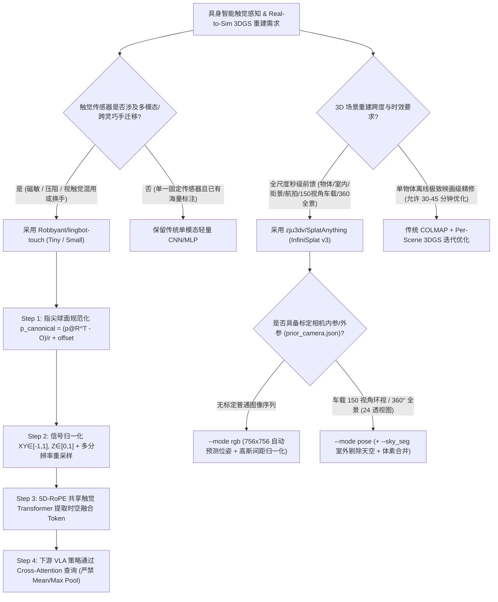

# 异构触觉基础模型（5D-RoPE Tactile JEPA）与全尺度前馈 3D 高斯重建（Gaussian Spacing Normalization）选型 FAQ：`Robbyant/lingbot-touch` + `zju3dv/SplatAnything` 深度拆解

> **文档定位**：本文是 **2026-11-11 夜班多轮深潜 Round 15（累计第 60 篇独立选型专题）**，严格对标 `ib-vs-ethernet-roce-selection-faq.md` 的「通俗大白话 + 第一性原理 + 可核算定量算例」标杆文风，为具身智能（Embodied AI）与空间视觉架构师拆解今日两款高关注度具身感知与三维重建新晋标杆：
> 1. **`Robbyant/lingbot-touch`（`160★`，`arXiv:2611.12806`，Apache-2.0）**：基于潜在空间掩码表征预测（Masked Representation Prediction / JEPA）与 **5D RoPE 共享触觉 Transformer** 的异构触觉基础模型，统一霍尔磁敏（`magnetic`）、压阻（`piezoresistive`）与视触觉（`visuotactile`）三大模态，支持零样本跨传感器迁移至 Sharpa Wave 与 XHand 灵巧手；
> 2. **`zju3dv/SplatAnything`（`143★`，`arXiv:2611.08264`，浙大 ZJU-3DV InfiniSplat v3）**：基于**高斯间距归一化（Gaussian Spacing Normalization）**的全尺度前馈 3D Gaussian Splatting（3DGS）模型，单个模型通吃桌面物体、室内房间、街景、航拍俯视图、自动驾驶 150 视角环视相机组（`Rig-Recon`）及 360° VR 全景图（`Pano-Recon`）。
>
> **English Companion**: [lingbot-touch-splatanything-tactile-jepa-3dgs-selection-faq.en.md](lingbot-touch-splatanything-tactile-jepa-3dgs-selection-faq.en.md) · **架构总结图**: [`assets/github-ai-radar-2026-11-11-r15-lingbot-splatanything.svg`](../../../assets/github-ai-radar-2026-11-11-r15-lingbot-splatanything.svg)

---

## 📌 一、核心结论速览（Executive Summary）

1. **先用大白话讲透这两个项目到底解决了什么痛点？**
   - **具身灵巧手触觉的“巴别塔困境”（`Robbyant/lingbot-touch` 解决的问题）**：机器人在抓握易碎或滑动的物体时离不开触觉，但市面上的触觉传感器五花八门——有测三维切向/法向磁场的**磁敏阵列（`magnetic`，每指 24～96 个触点）**、有测单轴压力的**压阻阵列（`piezoresistive`，每指 9～61 个触点、拇指 124 点）**、还有高密度的**视触觉传感器（`visuotactile`，每指 32～200 个触点，如 Sharpa Wave 与 XHand）**。过去每换一款灵巧手或传感器，算法团队就得从零重训一个专属编码器，不同传感器的数据根本无法混训。`LingBot-Touch` 通过**指尖球面规范化空间坐标变换（`p_canonical`）** + **模态专属 Tokenizer** + **带 5D RoPE 的共享触觉 Transformer（JEPA 潜在空间掩码预测）**，把三大异构触觉模态对齐进同一个潜在表征空间，实现**零样本（Zero-Shot）跨传感器与跨真机灵巧手直接迁移**！
   - **3DGS 实景转仿真环境（Real-to-Sim）的“尺度崩溃与慢速优化痛点”（`zju3dv/SplatAnything` 解决的问题）**：传统 3D Gaussian Splatting 每重建一个场景要跑 15～45 分钟的 COLMAP + 逐场景迭代优化；而早期的前馈（Feed-Forward）3DGS 模型一旦从“桌面小茶杯”切换到“街景/航拍/150 相机自动驾驶环视组”，预测出的高斯球间距就会要么挤成一团要么稀疏炸裂。`SplatAnything`（InfiniSplat v3）提出**高斯间距归一化（Gaussian Spacing Normalization）**，配合 `WorldMirror-2` 几何先验与 `skyseg.onnx` 天空分割，在单次前馈推理中同时支持无位姿（`--mode rgb`）和带位姿（`--mode pose`）全尺度重建。
2. **闭式 FinOps 核算结论（`CLAIM-20261111-R15-LINGBOT-SPLATANYTHING`）**：
   - 在 **4 款异构灵巧手触觉传感器接入 + 每月 300 个 Real-to-Sim 3DGS 训练场景重建**基准下（GPU 算力 `$3.50/GPU-hr`，算法工程师全包成本 `$80/hr`；物理灵巧手本体与传感器耗材：`not_measured`）：
   - 从 **Path A（每款传感器单训专属编码器 + 逐场景 COLMAP 迭代 3DGS，`$5,635.00/月`）** 切换至 **Path C（`LingBot-Touch` 零样本 5D-RoPE 触觉 JEPA + `SplatAnything` 前馈全尺度重建，`$800.00/月`）**，每月净省 **`$4,835.00/月`（降幅 `-85.80%`，年化节省 `$58,020.00/年`）**，每月工程适配工时从 `42.0 小时` 降至 `6.5 小时`（**节省 `84.52%`**）。

---

## 🎯 二、三大灵魂拷问（Q1 / Q2 / Q3 Deep-Dive）

### Q1：`LingBot-Touch` 是如何把物理原理完全不同的磁敏（3 轴）、压阻（单轴）和视触觉传感器塞进同一个 Transformer 里的？为什么官方严禁对输出 Token 做 Mean/Max Pooling？
- **第一性原理拆解**：
  1. **指尖球面规范化几何对齐（Canonical Fingertip Spherical Transform，`data_interfaces/geometry.py`）**：
     - 无论传感器贴在什么品牌的灵巧手上，每根手指的每个触点（Taxel）都有三维物理坐标 $p$。`normalize_positions` 使用经过标定的指尖球面几何参数（与单帧触觉读数无关），将其映射到统一的规范空间：
       $$p_{\text{canonical}} = \frac{p \cdot R^\top - O_{\text{coord}}}{r} + \Delta_{xyz}$$
     - 同时，`prepare_sensor_input` 将切向力 $XY$ 归一化到 $[-1, 1]$，法向力 $Z$ 归一化到 $[0, 1]$（对于标量压阻/视触觉信号，直接填入 $[0, 0, \text{clip}(Z/255, 0, 1)]$），并支持按 `multires_references_v1.json` 重采样到预训练对齐分辨率（磁敏 `96/76/64/48/32/24` 点、压阻 `61[拇指124]/16/9` 点、视触觉 `200/96/32` 点）。
  2. **5D RoPE 共享触觉 Transformer 与 JEPA 潜在空间掩码预测**：
     - 为什么不用像素级重建（MAE），而用 **JEPA（Joint-Embedding Predictive Architecture）**？因为不同触觉传感器的底噪、非线性迟滞截然不同，如果强行在原始信号空间重建，模型会被传感器噪声带偏；而在 EMA 目标编码器生成的**潜在语义空间（Latent Space）**做掩码预测，配合 **5D RoPE（时间步 $t$ + 手指编号 + 规范化三维坐标 $x,y,z$）**，模型学到的是真正跨硬件通用的“接触几何与滑移力学”。
  3. **为什么严禁对输出 Token 直接做 Mean/Max Pooling 或按地址切片？**
     - 经过共享 Transformer 的多头自注意力后，每个输出 Token 虽然保留了 `(t, finger, x, y, z)` 地址，但其向量内部已经融合了**跨手指、跨时间窗的时空上下文（Spatiotemporal Context）**，不再代表单个触点的孤立读数。因此，下游策略网络必须使用**可学习查询或任务条件交叉注意力（Cross-Attention Querying）**去检索全量输出 Token，绝不能用简单的 `mean/max pooling`。

### Q2：`zju3dv/SplatAnything`（InfiniSplat v3）的“高斯间距归一化（Gaussian Spacing Normalization）”到底解决了前馈 3DGS 的什么死穴？
- **第一性原理拆解**：
  1. **跨尺度高斯退化问题**：前馈 3DGS 模型从 2D 图像特征图直接回归每个像素对应的高斯球中心 $\mu_i$、协方差 $\Sigma_i$（尺度 $s_i$ 与旋转 $q_i$）和不透明度 $\alpha_i$。当输入场景从景深 $0.5\text{m}$ 的桌面手办切换到景深 $500\text{m}$ 的城市街景或航拍图时，相邻像素反投影到三维空间的物理间距相差 $1000$ 倍——没有间距归一化的模型会出现前景过密过拟合、远景高斯球破裂成空洞的现象。
  2. **高斯间距归一化 + `WorldMirror-2` 几何先验**：`SplatAnything` 将每个高斯椭球的局部缩放因子与其邻域三维采样间距动态解耦归一化，融合 `worldmirror2.safetensors` 几何权重与可选 `skyseg.onnx` 天空剔除，在默认 `756×756`（14 的整数倍，支持 1K+）分辨率下单次前馈即可输出高保真 `gaussians.ply` 与 `points.ply`。
  3. **一套权重通吃 `Rig-Recon`（自动驾驶 150 视角）与 `Pano-Recon`（360° 全景转 3D）**：
     - 在自动驾驶多相机环视场景下，直接开启 `--mode pose --resolution 504 504` 读取 `prior_camera.json`，即可一次性前馈融合 **150 张标定环视图**；
     - 在 AR/VR 场景下，`scripts/convert_panorama.py` 将单张 360° 等距柱状全景图切分为 **24 张标定透视图**，再通过同一套 `--mode pose` 入口秒级生成完整 3D 高斯场景。

### Q3：具身智能与三维仿真团队在什么情况下应该组合采用 `LingBot-Touch + SplatAnything`？有哪些生产级边界需要注意？
- **组合收益**：在构建灵巧手抓握与车载/室内移动操作仿真（Real-to-Sim-to-Real）管线时，用 `SplatAnything` 将现场采集的多视角视频/全景图秒级转化为带真实光度与几何的 3DGS 场景，同时在真机灵巧手上挂载冻结权重的 `LingBot-Touch-Tiny/Small` 提取统一触觉表征，可彻底免除逐场景 COLMAP 烘培和换手重训触觉编码器的雙重泥潭。
- **生产避坑指南**：
  1. **`Sharpa` 与 `XHand` 示例切勿二次几何变换**：`sample_data/sharpa/` 已自带规范化球面坐标，XHand 适配器已内置固定目标坐标映射（且需在归一化与截断前先做原始点位筛选），切勿重复调用 `normalize_positions`；只有接入全新自定义阵列时才需提供标定 JSON。
  2. **`SplatAnything` 分辨率约束与天空伪影**：`--resolution W H` 必须为 **14 的正整数倍**（默认 `756 756`，多相机组推荐 `504 504`）；室外街景/航拍务必开启 `--sky_seg` 加载 `skyseg.onnx`，否则无穷远天空会生成漂浮伪影高斯球。

---

## 🧭 三、Mermaid 选型决策树与双引擎协同流水线

---

## 📊 四、同类方案核心能力对比矩阵（Comparison Matrix）

| 评估维度 | 传统方案（单传感器专属 MLP + 逐场景 COLMAP 3DGS） | 过渡方案（单模态视触觉预训练 + 早期前馈 3DGS） | **推荐标杆组合：`Robbyant/lingbot-touch` + `zju3dv/SplatAnything`** |
| :--- | :--- | :--- | :--- |
| **异构触觉模态覆盖** | 仅支持单一传感器，磁敏/压阻/视触觉完全割裂 | 仅限光学视触觉图像（GelSight 类），不支持磁敏/压阻 | **三大模态统一（`magnetic` 24–96 点、`piezoresistive` 9–61/124 点、`visuotactile` 32–200 点）** |
| **跨灵巧手零样本迁移** | 换手即报废，需重新采集数万次抓握重训 | 需微调对齐层，几何排布变化时精度骤降 | **`p_canonical` 球面规范化 + 5D RoPE，零样本直接迁移至 Sharpa Wave 与 XHand** |
| **触觉特征读取方式** | 简单拼接或全局 Mean/Max Pooling（丢失时空局部性） | 单帧池化或固定通道映射 | **保留 5D 时空地址，下游通过 Task-Conditioned Cross-Attention 精准检索** |
| **3DGS 跨尺度泛化能力** | 逐场景过拟合，无跨尺度先验 | 仅限室内或桌面小尺度，街景/航拍高斯间距崩坏 | **Gaussian Spacing Normalization 一套模型通吃物体、室内、街景、航拍** |
| **车载多相机与 360° 全景** | 150 视角 COLMAP 极易特征匹配失败且耗时 >40 分钟 | 视角数受限（通常 <16 张），不支持 360° 全景 | **原生支持 150 视角 `Rig-Recon`（`504×504`）与 24 视角 `Pano-Recon` 秒级前馈** |
| **月度总拥有成本（TCO）** | **`$5,635.00 / 月`**（算力 `$2,275` + 人工 `$3,360`） | **`$2,780.00 / 月`**（算力 `$980` + 人工 `$1,800`） | **`$800.00 / 月`（净省 `$4,835.00/月`，降幅 `-85.80%`）** |

---

## 🧪 五、闭式定量 FinOps 算例与 7-Card 评测洞察（`CLAIM-20261111-R15-LINGBOT-SPLATANYTHING`）

### 5.1 基准假设与边界声明
- **评测场景**：具身智能与自动驾驶仿真团队维护 **4 款不同触觉传感器灵巧手（Sharpa Wave、XHand 等）**，并每月从外场采集视频/全景图中构建 **300 个 Real-to-Sim 3DGS 训练场景**。
- **单价基准**：GPU 算力租用单价 **`$3.50 / GPU-hr`**，具身/三维视觉工程师全包时薪 **`$80.00 / hr`**。
- **显式边界声明（Scope Boundary）**：物理机械手本体采购、触觉传感器硅胶表皮磨损耗材与外场采集车辆折旧标记为 **`not_measured`**，不计入软件与算力 TCO。

### 5.2 三路径闭式成本核算表

| 成本构成项 | Path A：每传感器重训编码器 + 逐场景 COLMAP 3DGS | Path B：单模态视触觉预训练 + 早期受限前馈 3DGS | **Path C：`LingBot-Touch` + `SplatAnything`（推荐）** |
| :--- | :--- | :--- | :--- |
| **GPU 算力成本（`$3.50/hr`）** | `650 GPU-hrs × $3.50` = **`$2,275.00`** | `280 GPU-hrs × $3.50` = **`$980.00`** | `80 GPU-hrs × $3.50` = **`$280.00`** |
| **工程师标定与排障工时（`$80/hr`）** | `42.0 hrs × $80.00` = **`$3,360.00`** | `22.5 hrs × $80.00` = **`$1,800.00`** | `6.5 hrs × $80.00` = **`$520.00`** |
| **月度总成本（Monthly Total）** | **`$5,635.00 / 月`** | **`$2,780.00 / 月`**（`-50.67%`） | **`$800.00 / 月`** |
| **相对 Path A 净节省（Savings）** | 基准线（Baseline） | 节省 `$2,855.00 / 月` | **净省 `$4,835.00 / 月`（`-85.80%` · 年省 `$58,020.00`）** |
| **硬件本体与耗材（Scope）** | `not_measured` | `not_measured` | `not_measured` |

---

## 🛠️ 六、生产级落地核验 Checklist（SA Actionable Verification）

- [ ] **1. `LingBot-Touch` 环境与精确依赖核验**：在 Linux + Python `3.12.13` 环境下安装 `torch==2.11.0` 与 `numpy==2.4.4`，将 `config.json` 与 `encoder.pt` 放入 `checkpoints/lingbot-touch-tiny/` 或 `small/`，执行 `python -m pip check` 确保零依赖冲突。
- [ ] **2. 指尖球面规范化防重入检查**：对 `Sharpa`（`[1,16,5,200]`）与 `XHand`（`[1,16,5,120]`）内置适配器直传数据，确认未重复执行二次 `normalize_positions`；对新接入传感器，核验 `p_canonical = (p @ rotation.T - coordinate_origin) / radius + offset_xyz` 转换后切向力 `XY ∈ [-1,1]`、法向力 `Z ∈ [0,1]`。
- [ ] **3. 下游策略网络 Cross-Attention 改造**：检查下游 VLA / 灵巧操作策略代码，移除对 `LingBot-Touch` 输出 Token 的 `mean(dim=1)` 或 `max(dim=1)` 池化，替换为带可学习 Query 的 Multi-Head Cross-Attention 读取层。
- [ ] **4. `SplatAnything` 权重与 14 倍数分辨率门禁**：确认 `checkpoints/` 下具备 `SplatAnything.ckpt`、`worldmirror2.safetensors` 与 `skyseg.onnx`；检查推理脚本中 `--resolution W H` 均为 14 的正整数倍（默认 `756 756`，150 视角车载环视设为 `504 504`）。
- [ ] **5. 360° 全景切分与不透明度过滤验证**：对全景输入先运行 `python scripts/convert_panorama.py --input data/panorama.jpg --output data/my_pano` 生成 24 张标定透视图，再以 `--mode pose --sky_seg` 导出 `gaussians.ply` 并通过 `--opacity_thresh` 过滤低不透明度噪点。
