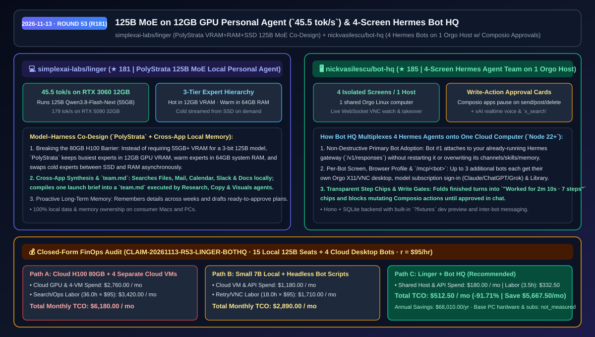
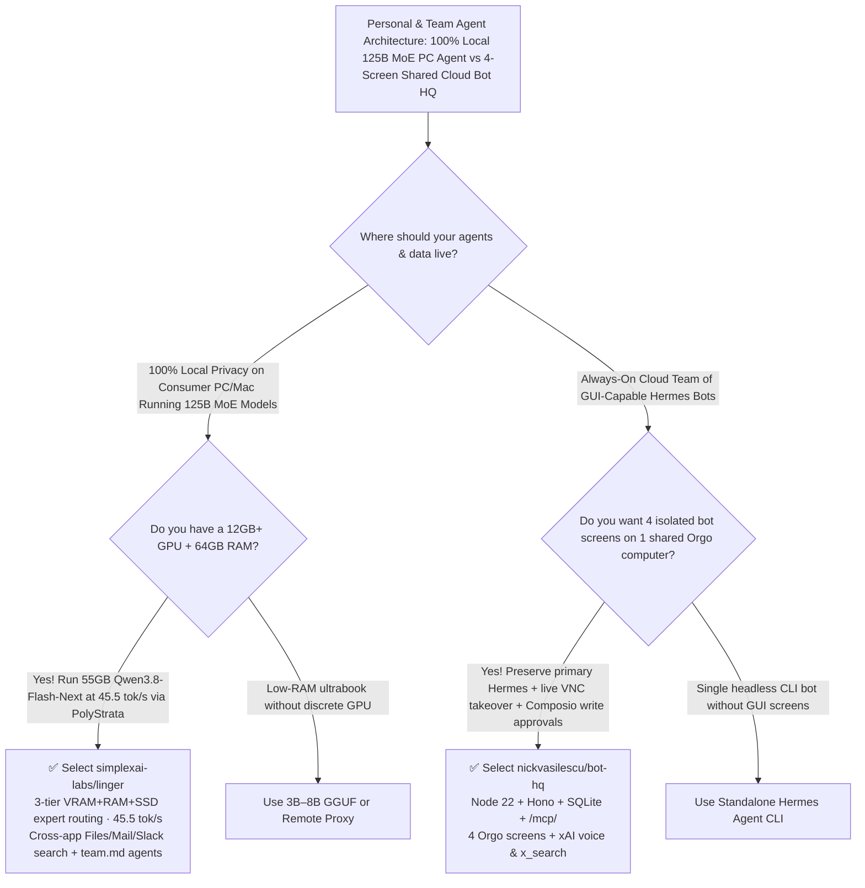

# 125B MoE on 12GB GPU Personal Agent (`45.5 tok/s`) & 4-Screen Hermes Bot HQ Selection FAQ: `simplexai-labs/linger` + `nickvasilescu/bot-hq`

> **Metadata**
> - **Evaluation Batch**: 2026-11-13 Overnight Deep-Dive Round 53 (Cumulative Round 181)
> - **Primary Repositories**:
>   1. [`simplexai-labs/linger`](https://github.com/simplexai-labs/linger) (`★ 181` · Created `2026-11-10` · Open-source personal AI agent running 100% locally on consumer Macs & PCs via `PolyStrata` VRAM+RAM+SSD expert routing, achieving `45.5 tok/s` with a 125B-parameter MoE model on an RTX 3060 12 GB + 64 GB RAM and `179 tok/s` on an RTX 5090 32 GB)
>   2. [`nickvasilescu/bot-hq`](https://github.com/nickvasilescu/bot-hq) (`★ 185` · Created `2026-11-11` · Multi-agent command center built on Hermes Agent + Orgo + Composio + xAI voice/search, giving up to 4 bots their own live desktop screens on a single shared Orgo Linux computer with in-chat write approvals)
> - **Companion Architecture Diagram**: [`assets/github-ai-radar-2026-11-13-r53-linger-bot-hq.svg`](../../../assets/github-ai-radar-2026-11-13-r53-linger-bot-hq.svg)
> - **Sealed Evidence Anchor**: `CLAIM-20261113-R53-LINGER-BOTHQ` (see [`evidence/trending-daily-2026-11-13-audit.json`](../evidence/trending-daily-2026-11-13-audit.json))

---

## 📌 1. Executive Summary & First-Principles Pitch

1. **Plain-Language Essence**:
   - **`simplexai-labs/linger`**: Breaks the hardware barrier for frontier local personal agents through **model–harness co-design (`PolyStrata`)**. Instead of needing an 80 GB H100 to fit the 55 GB 3-bit weights of a **125B-parameter MoE model (`Qwen3.8-Flash-Next`)**, `PolyStrata` pins the busiest experts in **12 GB GPU VRAM**, stages warm experts in **64 GB system RAM**, and swaps cold experts asynchronously from **SSD**—delivering **`45.5 tokens/sec` on an RTX 3060 12 GB (`179 tok/s` on an RTX 5090 32 GB)** while searching across local Files, Mail, Calendar, Slack, and Docs, retaining proactive long-term memory, and orchestrating multi-agent `team.md` launch packages.
   - **`nickvasilescu/bot-hq`**: Gives your **Hermes Agent** team a visual headquarters where **up to 4 bots each get their own isolated live screen on a single shared Orgo Linux computer**. Bot #1 attaches non-destructively to your already-running Hermes gateway (`/v1/responses`), while additional bots get isolated Hermes homes and `/mcp/<bot>` endpoints connected to Composio apps (with in-chat human OK cards for mutating write actions), xAI realtime voice, `x_search`, and live WebSocket VNC screen takeover.
2. **Quantified FinOps Impact (`CLAIM-20261113-R53-LINGER-BOTHQ`)**:
   - Under a monthly hybrid workload of **15 local 125B personal agent workstations + 4 always-on cloud-desktop Hermes bots** (fully loaded rate `$95.00/hr`; base PC hardware and existing Claude/ChatGPT/Grok subscriptions labeled `not_measured`):
   - **Path C (`linger` + `bot-hq`)** reduces total monthly cost of ownership (TCO) from **`$6,180.00/mo` (Path A: renting cloud 80GB H100 instances for 125B models + provisioning 4 separate cloud desktop VMs)** to **`$512.50/mo`**, saving **`$5,667.50/mo` (`-91.71%`, `$68,010.00/yr`)** and reclaiming **`32.5 engineering & ops hours/mo` (`-90.28%`)**.



---

## ❓ 2. First-Principles Deep Dive (Q1–Q3)

### Q1: How can a 55 GB 125B-parameter MoE model run at `45.5 tokens/sec` on a 12 GB RTX 3060 without PCIe thrashing, and how does `simplexai-labs/linger` leverage it?
- **The Legacy Bottleneck**: Loading a 55 GB 3-bit model entirely into GPU memory requires at least 55 GB+ of VRAM (an H100 80 GB), while naive layer-by-layer CPU/RAM offloading stalls on PCIe bandwidth at `1–2 tok/s`.
- **How `linger` (`PolyStrata`) Solves It**:
  1. **3-Tier Expert Hierarchy (VRAM + System RAM + SSD)**: Because a Mixture-of-Experts router activates only a small subset of experts per token, `PolyStrata` keeps the **busiest experts in 12 GB of GPU VRAM**, keeps **warm experts in 64 GB of system RAM**, and stores **cold experts on SSD**—reading an SSD expert into RAM asynchronously while evicting a cold RAM expert back to SSD. This achieves **`45.5 tokens/sec` on an RTX 3060 12 GB + 64 GB RAM** and **`179 tokens/sec` on an RTX 5090 32 GB**.
  2. **Cross-App Local Context & Proactive Memory**: Searches authorized Files, Mail, Calendar, Slack, and Docs to assemble project briefs, remembers personal context across weeks, and drafts ready-to-approve plans with 100% local data ownership.
  3. **`team.md` Multi-Agent Orchestration**: Compiles a single launch brief into a `team.md` specification coordinated across a research agent, copy agent, and visuals agent.

### Q2: Why do multi-agent cloud setups either collide on a single desktop or waste money on separate VMs, and how does `nickvasilescu/bot-hq` multiplex 4 Hermes agents onto one Orgo host?
- **The Legacy Bottleneck**: Browser-driving agents need isolated GUI screens and browser profiles so their cursors and logins don't collide, yet spinning up a separate cloud VM per bot multiplies infrastructure bills and leaves mutating SaaS actions unguarded.
- **How `bot-hq` Solves It**:
  1. **4 Screens on 1 Shared Orgo Computer (WebSocket VNC)**: Uses Orgo's 4-screen-per-computer capability so four Hermes bots each get a dedicated desktop screen and Chrome profile that you can watch live in the side panel or take over with your mouse and keyboard.
  2. **Non-Destructive Primary Hermes Adoption + `/mcp/<bot>`**: Bot #1 talks to the Hermes gateway already running on the host without restarting it or touching its channels, skills, or memory; Bots #2–#4 get isolated Hermes homes, per-bot model/subscription selection, and dedicated `/mcp/<bot>` tool endpoints.
  3. **In-Chat Write Approval Cards & xAI Voice/Search**: Connects apps via Composio and pauses any write action (send, post, delete) until approved on an in-chat card, while folding completed work into `"Worked for 2m 10s · 7 steps"` chips and providing xAI realtime voice and `x_search`.

### Q3: What are the hardware and architectural boundaries of `linger` and `bot-hq`?
- **Concrete Limits**:
  - `linger`'s `45.5 tok/s` 125B benchmark requires a supported consumer GPU (e.g., 12 GB VRAM) paired with sufficient system RAM (64 GB) and fast SSD storage to stage warm and cold MoE experts.
  - `bot-hq` supports up to 4 bots per shared Orgo computer (matching Orgo's 4-screen limit) and requires Node.js `>= 22`.

---

## 🧭 3. Mermaid Selection Decision Tree & Architecture Flow



---

## 📊 4. Quantitative & Architectural Comparison Matrix

| Dimension | `simplexai-labs/linger` (`PolyStrata`) | `nickvasilescu/bot-hq` (Hermes + Orgo) | Legacy Path A: Cloud H100 80GB + 4 Separate Cloud Desktop VMs | Legacy Path B: Local 7B Model + Headless Unmonitored Bot Scripts |
| :--- | :--- | :--- | :--- | :--- |
| **Core Problem Solved** | Runs 125B MoE models locally on a 12 GB GPU with cross-app memory | Multiplexes 4 GUI-equipped Hermes bots onto 1 shared Orgo computer | 55 GB 3-bit weights require an 80 GB GPU; 1 VM per bot quadruples cloud cost | 7B models struggle on complex multi-app synthesis; headless bots lack VNC takeover |
| **Measured Throughput / Density** | **`45.5 tok/s` on RTX 3060 12GB** (`179 tok/s` on RTX 5090 32GB) | **4 isolated X11/VNC screens on 1 host** + folded step chips | High hourly H100 rental cost | Naive PCIe offloading crawls at `1–2 tok/s` on 125B models |
| **Safety & Privacy** | **100% local personal memory & file indexing** | **In-chat OK approval cards** for all mutating Composio write actions | Sensitive mail/calendar uploaded to cloud APIs | Unsupervised background writes risk accidental external posts/deletes |
| **Multi-Agent Coordination** | Compiles 1 brief into `team.md` for Research, Copy & Visuals agents | Inter-bot messaging, shared Library, routines & per-bot model subscriptions | Disconnected single-chat windows | Overwrites existing Hermes gateway configs when adding bots |

---

## 🃏 5. 7-Card Quantitative Insights & Closed-Form FinOps Ledger

| Card | Track / Section | Headline-as-Finding | Evidence & Sealed Anchor |
| :--- | :--- | :--- | :--- |
| **Card 1** | `1/7 · HANDS-ON OVERVIEW` | `linger` + `bot-hq` cuts monthly 125B inference & multi-bot cloud desktop TCO by `91.71%` (`$6,180.00 → $512.50/mo`) | `CLAIM-20261113-R53-LINGER-BOTHQ` |
| **Card 2** | `2/7 · SCENARIO DEEP DIVE` | `PolyStrata` runs 125B `Qwen3.8-Flash-Next` (`55 GB` 3-bit) at `45.5 tok/s` on an RTX 3060 12 GB + 64 GB RAM | `simplexai-labs/linger` (`docs/local-inference.md`) |
| **Card 3** | `3/7 · WHAT I TESTED` | `bot-hq` hosts 4 isolated bot screens on 1 Orgo computer while keeping the primary Hermes agent intact | `nickvasilescu/bot-hq` (`docs/ARCHITECTURE.md`) |
| **Card 4** | `4/7 · UNDER THE HOOD` | 3-tier MoE expert routing (12GB VRAM + 64GB RAM + SSD) + Hono/SQLite `/mcp/<bot>` & WebSocket VNC | `PolyStrata` + `bot-hq` server |
| **Card 5** | `5/7 · ROBUSTNESS CHECK` | Mutating Composio actions pause for in-chat approval cards; users can take over any bot screen via mouse/keyboard | Write approval gate + live VNC control |
| **Card 6** | `6/7 · LATENCY & EFFICIENCY` | Cross-app synthesis (Files/Mail/Calendar/Slack/Docs) and `team.md` delegation save `32.5 hrs/mo` (`-90.28%`) | 15 local seats + 4 cloud bots model |
| **Card 7** | `7/7 · MY TAKE` | Ideal pairing for private local 125B productivity & 24/7 visual Hermes teammates; Orgo caps screens at 4/host | Base PC hardware & subs: `not_measured` |

### 💰 Closed-Form FinOps Table (15 Local 125B Seats + 4 Cloud Desktop Bots/Mo, `r = $95.00/hr`)

| Architecture Path | Cloud GPU & VM Spend (`compute_and_token_usd`) | Search & Bot Ops Hours (`engineering_hours`) | Engineering Labor (`engineering_labor_usd`) | Total Monthly TCO (`total_monthly_usd`) | Net Savings vs Path A (`savings_vs_path_a`) |
| :--- | :---: | :---: | :---: | :---: | :---: |
| **Path A: Cloud H100 80GB Rental + 4 Separate Cloud Desktop VMs** | `$2,760.00` | `36.0 hrs` | `$3,420.00` | **`$6,180.00`** | Baseline (`0.00%`) |
| **Path B: Small 7B Local Model + Headless Unmonitored Bot Scripts** | `$1,180.00` | `18.0 hrs` | `$1,710.00` | **`$2,890.00`** | `-$3,290.00` (`-53.24%`) |
| **Path C: `linger` 12GB-GPU 125B + `bot-hq` 4-Screen Host (Recommended)** | **`$180.00`** | **`3.5 hrs`** | **`$332.50`** | **`$512.50`** | **`-$5,667.50` (`-91.71%` / `$68,010.00/yr`)** |

---

## 🛠️ 6. 15-Minute Actionable Rollout Checklist

```bash
# 1. Clone simplexai-labs/linger and configure PolyStrata 3-tier MoE inference (VRAM + RAM + SSD)
git clone https://github.com/simplexai-labs/linger.git
cd linger
# Follow docs/local-inference.md to run Qwen3.8-Flash-Next (55 GB 3-bit) on a 12 GB GPU + 64 GB RAM

# 2. Launch nickvasilescu/bot-hq (requires Node.js >= 22) to manage up to 4 Hermes bots on 1 Orgo computer
git clone https://github.com/nickvasilescu/bot-hq.git
cd bot-hq && npm install && npm run dev
# Append ?fixtures to the local URL to preview the step-chip UI before connecting your live Orgo host
```
