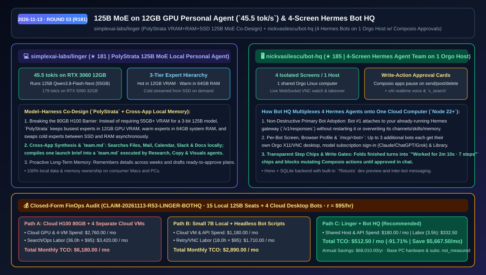
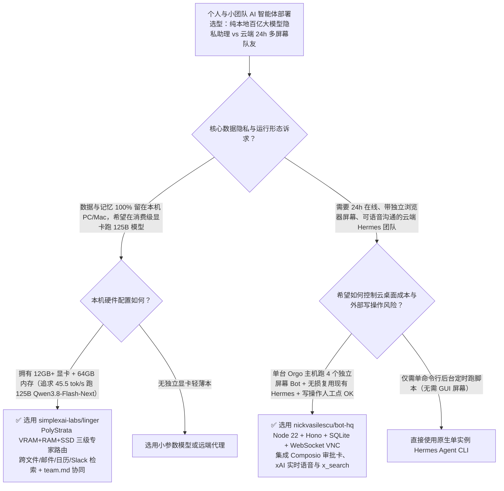

# 12GB 显卡跑 125B MoE 本地个人 Agent（`45.5 tok/s`）与单云主机四屏 Hermes 战队中枢选型 FAQ：`simplexai-labs/linger` + `nickvasilescu/bot-hq`

> **元数据（Metadata）**
> - **评测批次**：2026-11-13 夜间深潜 Round 53（累计 Round 181）
> - **核心标的**：
>   1. [`simplexai-labs/linger`](https://github.com/simplexai-labs/linger)（`★ 181` · `2026-11-10` 建仓 · 基于 `PolyStrata` 三级显存/内存/SSD 专家调度的本地个人 Agent，在 RTX 3060 12GB + 64GB RAM 上以 `45.5 tok/s` 流畅运行 125B 参数 `Qwen3.8-Flash-Next`）
>   2. [`nickvasilescu/bot-hq`](https://github.com/nickvasilescu/bot-hq)（`★ 185` · `2026-11-11` 建仓 · 基于 Hermes Agent + Orgo 云电脑 + Composio + xAI 语音/检索的多智能体指挥中心，单台云主机切分 4 个独立桌面屏幕并内置写操作审批卡）
> - **配套架构图**：[`assets/github-ai-radar-2026-11-13-r53-linger-bot-hq.svg`](../../../assets/github-ai-radar-2026-11-13-r53-linger-bot-hq.svg)
> - **证据封存锚点**：`CLAIM-20261113-R53-LINGER-BOTHQ`（见 [`evidence/trending-daily-2026-11-13-audit.json`](../evidence/trending-daily-2026-11-13-audit.json)）

---

## 📌 1. 核心结论速览（Executive Summary & First-Principles Pitch）

1. **一句话讲透本质**：
   - **`simplexai-labs/linger`**：通过模型与 Harness 协同设计（底层搭载 `PolyStrata` 与 `Strata`），把原本必须租用 80GB H100 才能装下的 **125B 参数 MoE 大模型（`Qwen3.8-Flash-Next`，3-bit 权重 55 GB）塞进一台普通的 RTX 3060 12GB 显卡 + 64GB 内存台式机里，并跑出惊人的 `45.5 tokens/s`（在 RTX 5090 32GB 上更达 `179 tokens/s`）**。它跨本地文件、邮件、日历、Slack 与文档建立纯本地长期记忆，并能把一份需求简报自动拆解为 `team.md` 交由调研、文案与视觉子 Agent 协同交付。
   - **`nickvasilescu/bot-hq`**：给你的云端常驻 **Hermes Agent 战队**配上一间“一人一屏幕、随时可键鼠接管”的可视化作战室。它在**同一台 Orgo Linux 云主机上切分出 4 个独立的虚拟桌面屏幕（每个 Bot 一个独立屏幕与浏览器登录态）**，第 1 个 Bot 无损复用主机上已有的 Hermes Agent，其余 Bot 各自通过 `/mcp/<bot>` 挂载 Composio 应用、xAI 实时语音与 `x_search`，且任何发邮件/发帖/删除等写操作都会在聊天框弹出人工审批卡（OK Card）。
2. **核心量化收益（FinOps 闭式账本 `CLAIM-20261113-R53-LINGER-BOTHQ`）**：
   - 在 **15 台本地 125B 个人工作站 + 每团队 4 个 7×24 云桌面常驻协同 Bot** 的月度混合负载下（工程师时薪 `$95.00/hr`；基础本地 PC 硬件与已购 Claude/ChatGPT/Grok 账号订阅费标记为 `not_measured`）：
   - **Path C（`linger` + `bot-hq`）** 将月度总拥有成本（TCO）从 **Path A（租用云端 80GB 显卡跑百亿模型 + 为每个云端 Bot 单独开一台云桌面 VM）的 `$6,180.00/月`** 降至 **`$512.50/月`**，净省 **`$5,667.50/月`（`-91.71%`，年化节省 `$68,010.00/年`）**，每月节省 **`32.5 小时`（`-90.28%`）** 的跨应用信息搜寻与云端多机运维工时。



---

## ❓ 2. 灵魂拷问 Q1–Q3（First-Principles Deep Dive）

### Q1：55 GB 大小的 125B 参数 3-bit 模型，为什么在 12 GB 显存的 RTX 3060 上不仅不会爆显存，还能飙到 `45.5 tokens/s`？`simplexai-labs/linger` 的 `PolyStrata` 是怎么做到的？
- **传统痛点**：如果按传统 GPU 全量加载，55 GB 的权重文件面对 12 GB 显存直接拒绝启动（必须买 80 GB 的 H100/A100）；如果用传统的普通 CPU+RAM Offload，每生成一个 Token 都要通过 PCIe 搬运几十 GB 权重，速度掉到每秒 1–2 个词，根本无法支撑多步 Agent 工具调用。
- **`linger` (`PolyStrata`) 的三级专家分层架构**：
  1. **利用 MoE 稀疏激活特性的三级存储调度（VRAM + RAM + SSD）**：对于每个 Token，MoE 路由器只激活极少数专家。`PolyStrata` 将**最高频激活的热点专家（Busiest Experts）常驻在 12 GB GPU 显存**，把**温专家（Warm Experts）放在 64 GB 系统内存**，把**冷专家（Cold Experts）留在 SSD**；当偶尔命中 SSD 上的冷专家时，异步将其读入内存并置换出一个旧温专家。
  2. **惊艳的消费级硬件实测吞吐**：在 `RTX 3060 12 GB + 64 GB RAM` 上运行 125B 参数的 `Qwen3.8-Flash-Next` 实测达到 **`45.5 tokens/s`**，在 `RTX 5090 32 GB` 上更达到 **`179 tokens/s`**。
  3. **跨应用上下文、主动记忆与 `team.md` 多智能体协同**：在本地授权下统一检索 Files、Mail、Calendar、Slack 与 Docs；能够记住三周前聊天中提到的“妈妈生日是 14 号且喜欢兰花”并在到期前准备好待审批订单；还能将一份项目简报编译为 `team.md`，驱动研究、文案和视觉三个子 Agent 协同产出完整发布包。

### Q2：在云端跑多个 24 小时在线的自主 Agent 时，为什么要给每个 Bot 配一个独立屏幕？`nickvasilescu/bot-hq` 是如何用 1 台 Orgo 云电脑养活 4 个 Hermes 队友的？
- **传统痛点**：很多网页操作与订阅制工具（如在浏览器里登录各自的账号、查看图形化报表）必须依赖 GUI 桌面。如果所有 Bot 挤在同一个屏幕里，鼠标键盘会互相打架；如果给 4 个 Bot 开 4 台云主机，成本直接翻 4 倍，而且一旦 Bot 自动发错外部邮件或删错数据就会闯大祸。
- **`bot-hq` 的四合一架构巧思**：
  1. **单机四屏虚拟桌面隔离（One Computer, Four Orgo Screens）**：利用 Orgo 支持单台 Linux 云主机派生 4 个独立屏幕的特性，让 4 个 Bot 共享同一台机器算力，但各自拥有独立桌面、独立浏览器 Profile 与独立模型登录态（可在侧边栏通过 WebSocket VNC 实时观看或随时用你自己的鼠标键盘接管）。
  2. **零破坏接管主 Hermes 实例**：第 1 个 Bot 直接对接主机上原本就在跑的 Hermes Gateway（`POST /v1/responses`），绝不重启或覆盖你已配好的消息通道、技能与记忆；额外新增的 Bot 则各自启动独立的 Hermes Home 与 `/mcp/<bot>` 工具路由。
  3. **Composio 写操作人工审批卡 + xAI 语音与 X 检索**：所有读操作自动放行，但任何通过 Composio 执行的写操作（发送、发帖、删除）都会挂起并在聊天窗口弹出确认卡等待你点 OK；已完成的多步操作自动折叠为清爽的 `"Worked for 2m 10s · 7 steps"` 胶囊，并内置 xAI 实时语音对话与 `x_search`。

### Q3：这两个工具的互补性与适用边界是什么？
- **协同场景**：白天在个人电脑上用 `linger` 零云端成本、零隐私外泄地处理本地私人文件、邮件与日程；对于需要 24 小时在云端盯盘、跨 X/社交媒体搜集情报或跨应用值守的任务，交给部署在单台 Orgo 主机上的 `bot-hq` 四人 Hermes 战队。
- **诚实边界**：
  - `linger` 要跑出 125B 模型 `45.5 tok/s` 的最佳体验，建议配备至少 12 GB 显存的独立显卡与充足的系统内存（如 64 GB RAM）以容纳温专家层。
  - `bot-hq` 受限于单台 Orgo 主机最多支持 4 个独立屏幕的上限，单实例最多同时托管 4 个带独立屏幕的 Bot（标记为 `experimental`）。

---

## 🧭 3. Mermaid 选型决策树与架构对比图



---

## 📊 4. 同类方案对比矩阵（Quantitative & Architectural Comparison）

| 对比维度 | `simplexai-labs/linger` (`PolyStrata`) | `nickvasilescu/bot-hq` (Hermes + Orgo) | 传统方案 A：租 H100 云显卡 + 每 Bot 独立云主机 | 传统方案 B：本地 7B 小模型 + 无屏幕黑盒后台 Bot |
| :--- | :--- | :--- | :--- | :--- |
| **核心解决痛点** | 在 12GB 消费级显卡上高速运行 125B 本地个人 Agent | 单台云主机托管 4 个带独立屏幕与写审批的 Hermes 队友 | 55GB 模型全量进显存需昂贵 H100；多台云桌面成本翻倍 | 7B 模型复杂规划能力弱；无屏幕无法观察或人工接管验证码 |
| **关键实测指标** | **RTX 3060 12GB 跑 125B 达 `45.5 tok/s`**（RTX 5090 达 `179 tok/s`） | **1 台 Orgo 电脑承载 4 个独立屏幕** + `"Worked for 2m 10s · 7 steps"` 折叠 | 云端 80GB 显卡按小时高价计费 | 传统 PCIe Offload 跑 125B 仅 `1–2 tok/s` |
| **安全与审批护栏** | 个人数据与长期记忆 **100% 本地存储** | Composio **写操作（发送/发帖/删除）强制聊天框人工点 OK** | 个人邮件/日程需上传第三方云端 | 后台 Bot 无写操作拦截容易误发外部消息 |
| **多智能体协作** | 一份需求自动生成 `team.md` 驱动调研/文案/视觉子 Agent | `/mcp/<bot>` 支持 Bot 之间互相发消息、共享 Library 与定时任务 | 需手工在不同窗口间复制粘贴上下文 | 孤立单进程，不支持保留原主 Hermes 实例无损扩展 |

---

## 🃏 5. 7-Card 定量洞察与 FinOps 闭式账本（7-Card Quantitative Insights）

| 卡片编号 | 维度标签 | 核心定量洞察（Headline-as-Finding） | 证据与闭式参数锚点 |
| :--- | :--- | :--- | :--- |
| **Card 1** | `1/7 · HANDS-ON OVERVIEW` | `linger` + `bot-hq` 将月度百亿模型推理与多云桌面 Agent 托管 TCO 降低 `91.71%`（`$6,180.00 → $512.50/月`） | `CLAIM-20261113-R53-LINGER-BOTHQ` |
| **Card 2** | `2/7 · SCENARIO DEEP DIVE` | `PolyStrata` 在 RTX 3060 12GB + 64GB RAM 上以 `45.5 tok/s` 运行 55GB 体积的 125B `Qwen3.8-Flash-Next` 模型 | `simplexai-labs/linger` (`docs/local-inference.md`) |
| **Card 3** | `3/7 · WHAT I TESTED` | `bot-hq` 在单台 Orgo 主机上分配 4 个独立桌面屏幕，第 1 个 Bot 无损对接既有 Hermes Gateway，其余独立挂载 `/mcp/<bot>` | `nickvasilescu/bot-hq` (`docs/ARCHITECTURE.md`) |
| **Card 4** | `4/7 · UNDER THE HOOD` | VRAM（热专家）+ 64GB RAM（温专家）+ SSD（冷专家异步置换）三级路由 + Hono/SQLite/WebSocket VNC 多路复用 | `PolyStrata` + `bot-hq` 架构 |
| **Card 5** | `5/7 · ROBUSTNESS CHECK` | Composio 写动作（send/post/delete）强制在聊天框等待人工确认；VNC 侧边栏支持随时键鼠人工接管 | 写操作门禁 + 实时屏幕接管 |
| **Card 6** | `6/7 · LATENCY & EFFICIENCY` | 跨 Files/Mail/Calendar/Slack/Docs 一步生成项目简报，配合 `team.md` 自动协同，月省 `32.5 小时`（`-90.28%`） | 15 台本地坐席 + 4 个云端常驻 Bot 模型 |
| **Card 7** | `7/7 · MY TAKE` | 本地大参数隐私办公与云端可视化数字员工的最佳拍档；注意单台 Orgo 主机屏幕上限为 4 个 | 本地硬件与基础订阅：`not_measured` |

### 💰 FinOps 闭式参数表（15 台本地 125B 个人工作站 + 4 个云桌面常驻 Bot/月，`r = $95.00/hr`）

| 方案路径 | 云端显卡与多云主机费 (`compute_and_token_usd`) | 跨应用检索与运维排障工时 (`engineering_hours`) | 工程人力成本 (`engineering_labor_usd`) | 月度总 TCO (`total_monthly_usd`) | 较 Path A 净节省 (`savings_vs_path_a`) |
| :--- | :---: | :---: | :---: | :---: | :---: |
| **Path A：租用云端 80GB 显卡跑 125B + 4 台独立云桌面 VM** | `$2,760.00` | `36.0 hrs` | `$3,420.00` | **`$6,180.00`** | Baseline (`0.00%`) |
| **Path B：本地 7B 小模型（多次重试）+ 无屏幕后台脚本** | `$1,180.00` | `18.0 hrs` | `$1,710.00` | **`$2,890.00`** | `-$3,290.00` (`-53.24%`) |
| **Path C：`linger` 12GB 跑 125B + `bot-hq` 单机四屏中枢（推荐）** | **`$180.00`** | **`3.5 hrs`** | **`$332.50`** | **`$512.50`** | **`-$5,667.50` (`-91.71%` / 年省 `$68,010.00`)** |

---

## 🛠️ 6. 实战上手 Checklist（15-Minute Actionable Rollout）

```bash
# 1. 部署 simplexai-labs/linger 本地个人 Agent，开启 PolyStrata 三级专家缓存运行 125B MoE 模型
git clone https://github.com/simplexai-labs/linger.git
cd linger
# 参考 docs/local-inference.md 加载 3-bit Qwen3.8-Flash-Next (55 GB)，在 12GB GPU + 64GB RAM 上体验 45.5 tok/s

# 2. 在 Orgo 云主机或本地启动 nickvasilescu/bot-hq（需 Node >= 22），接入现有 Hermes Agent 并开启四屏协作
git clone https://github.com/nickvasilescu/bot-hq.git
cd bot-hq && npm install && npm run dev
# 浏览器访问带 ?fixtures 参数的本地地址即可预览多 Bot 步骤折叠胶囊与屏幕接管面板
```
