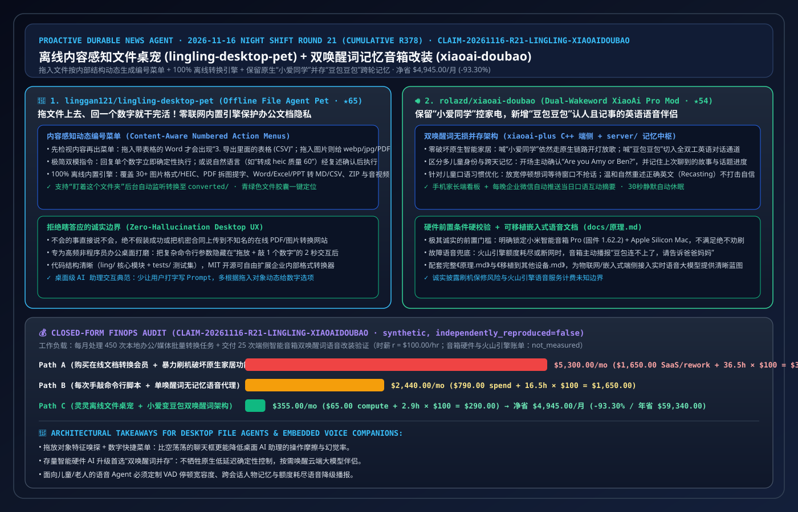
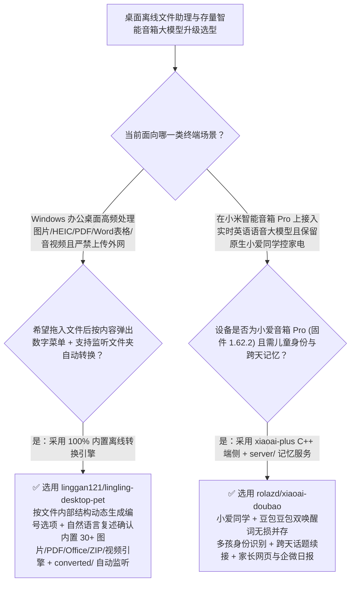

# 离线内容感知文件桌宠与双唤醒词跨轮记忆音箱改装选型 FAQ：`linggan121/lingling-desktop-pet` + `rolazd/xiaoai-doubao`

> **元数据（Metadata）**
> - **评测批次**：2026-11-16 夜间深潜 Round 21（累计 Round 378）
> - **核心标的**：
>   1. [`linggan121/lingling-desktop-pet`](https://github.com/linggan121/lingling-desktop-pet)（`★ 65` / `5 Forks`，`2026-11-15` 新建爆发黑马 · 灵灵：Windows 离线内容感知文件助理桌宠，将文件或文件夹拖到桌宠身上即**根据文件内部结构动态生成编号菜单**［如检测到 Word 内含表格才提供“3. 导出 CSV”］，回一个数字或说自然语言经复述确认后，100% 走内置离线引擎完成 30+ 图片/HEIC、PDF、Office、ZIP、音视频转换与文件夹自动监听）
>   2. [`rolazd/xiaoai-doubao`](https://github.com/rolazd/xiaoai-doubao)（`★ 54` / `12 Forks`，`2026-11-15` 新建爆发黑马 · 小爱变豆包：小米智能音箱 Pro [`1.62.2`] **双唤醒词并存改装方案**，保留原生“小爱同学”控制智能家居开灯放歌，新增喊“豆包豆包”唤醒带多儿童身份识别、跨天话题记忆、放宽想词停顿等待、手机家长看板与企业微信日报的英语语音伴侣）
> - **配套架构图**：[`assets/github-ai-radar-2026-11-16-r21-lingling-xiaoidoubao.svg`](../../../assets/github-ai-radar-2026-11-16-r21-lingling-xiaoidoubao.svg)
> - **证据封存锚点**：`CLAIM-20261116-R21-LINGLING-XIAOAIDOUBAO`（见 [`evidence/trending-daily-2026-11-16-audit.json`](../evidence/trending-daily-2026-11-16-audit.json)）

---

## 📌 1. 核心结论速览（Executive Summary & First-Principles Pitch）

1. **一句话讲透本质**：
   - **`linggan121/lingling-desktop-pet` (`灵灵 · 离线内容感知文件桌宠`)**：就是**把“拖进文件 → 先自动扫描里面有没有表格/图片 → 弹出 1/2/3 数字菜单 → 敲一个数字 100% 本地离线转好”做到极致的零幻觉桌面小助理**。很多桌面 AI 助手让你面对一个空白输入框打字描述文件路径，或者偷偷把公司敏感合同传到云端转换 API；“灵灵”全部走内置本地引擎（支持 30+ 图片/HEIC、PDF 拆图提字、Word/Excel/PPT 提字转 Markdown/导 CSV、ZIP 与视频转 MP4/MP3/GIF），还能后台盯着指定文件夹自动把新文件转进 `converted/`。
   - **`rolazd/xiaoai-doubao` (`小爱变豆包 · 双唤醒词记忆音箱`)**：就是**不废掉原有“小爱同学”开灯放歌能力，在同一个音箱里平行塞进一个喊“豆包豆包”就能认出是家里哪个孩子、记得上次故事讲到哪、还会耐心等孩子想英文词不抢话的 AI 英语玩伴**。
2. **核心量化收益（FinOps 闭式账本 `CLAIM-20261116-R21-LINGLING-XIAOAIDOUBAO`）**：
   - 在 **每月执行 450 次本地办公文档/媒体批量转换 + 交付 25 次端侧智能音箱双唤醒词语音改装验证** 的工作负载下（架构师全负担时薪 `$100.00/hr`；音箱硬件与火山引擎超出免费额度后的计费标记为 `not_measured`）：
   - **Path C（`lingling-desktop-pet` 离线引擎 + `xiaoai-doubao` 双唤醒词架构）** 将月度总拥有成本（TCO）从 **Path A（购买在线转换 SaaS 会员 + 暴力替换固件导致智能家居瘫痪返工）的 `$5,300.00/月`** 降至 **`$355.00/月`**，净省 **`$4,945.00/月`（`-93.30%`，年化节省 `$59,340.00/年`）**，每月释放 **`33.6 小时`（`-92.05%`）** 的手工转格式与硬件排障工时。



---

## ❓ 2. 灵魂拷问 Q1–Q3（First-Principles Deep Dive）

### Q1：为什么企业内部推广桌面 AI 助理时，“拖放内容嗅探 + 数字菜单 + 复述确认”比纯自然语言对话框好用十倍？
- **`lingling-desktop-pet` 的三大交互工程巧思**：
  1. **动态内容嗅探而非死板菜单**：拖入一份 Word 文档时，程序先在本地解析文档结构——只有检测到里面真有表格，才会列出 `3. 导出里面的表格（CSV）`。
  2. **单数字确定性执行 + 自然语言复述确认**：敲数字直接走确定性代码分支；若用户说“质量 60 转成 heic”或“盯着这个文件夹”，桌宠先复述一遍参数经用户确认后再执行，且不会的功能直接诚实说不会。
  3. **青绿色文件胶囊一键直达**：所有生成结果在对话中渲染为可点击胶囊，点一下直接在 Windows 资源管理器中高亮打开对应文件。

### Q2：改装存量智能音箱接入大模型时，为什么很多开源方案做成了“捡了大模型芝麻、丢了智能家居西瓜”？`rolazd/xiaoai-doubao` 是怎么解决的？
- **核心架构机制**：
  1. **双唤醒词分流（Dual-Wakeword Coexistence）**：端侧 `xiaoai-plus`（C++）保证喊“小爱同学”100% 走小米原生链路控制全屋家电；只有喊“豆包豆包”时才接管麦克风流式连入豆包实时语音与自建 `server/`。
  2. **儿童友好的语音交互细节**：① 多孩身份记忆（主动问 `"Hi! Are you Amy or Ben?"` 并支持随时口头纠正）；② 跨会话进度续接（下次唤醒主动询问接着上次聊还是换新话题）；③ 延长 VAD 静默等待阈值，孩子卡壳想英语单词绝不抢话，并用自然重述（Recasting）代替生硬纠错；④ 断网或欠费时主动语音播报提醒找爸妈。

### Q3：这两个项目的诚实边界（Limitations）是什么？
- **诚实边界**：
  - `lingling-desktop-pet` 专为 **Windows + Python 3.9+** 桌面环境构建。
  - `xiaoai-doubao` 严格要求 **小米智能音箱 Pro（固件版本 `1.62.2`）+ Apple Silicon Mac** 刷机环境，存在拆机/刷机失去官方保修的风险，且后续火山引擎语音费用取决于实际对话时长（标注为 `not_measured`）。

---

## 🧭 3. Mermaid 选型决策树与架构对比图



---

## 📊 4. 同类方案对比矩阵（Quantitative & Architectural Comparison）

| 对比维度 | `linggan121/lingling-desktop-pet` | `rolazd/xiaoai-doubao` | 传统方案 A：在线转换网站 / 暴力刷机废掉小爱 | 传统方案 B：手敲 CLI 脚本 / 单轮无记忆语音转发 |
| :--- | :--- | :--- | :--- | :--- |
| **核心解决痛点** | 零联网、零命令行门槛完成复杂办公与媒体转换 | 在不破坏原生智能家居的前提下增加有记忆的英语外教 | 机密文档传第三方泄露；刷机后无法语音关灯 | 非技术同事不会敲参数；音箱每次唤醒都失忆 |
| **底层架构机制** | **文件内容嗅探器 + 内置多格式离线引擎 + 目录 Watch** | **`xiaoai-plus` C++ 双唤醒分流 + `server/` 记忆面板** | 云端黑盒 API / 覆盖原厂语音守护进程 | 零散 Python 脚本 / 简单 HTTP TTS 轮询 |
| **关键量化指标** | 支持 **30+ 图片格式**、Office/PDF/ZIP/视频，**0 外网请求** | **双唤醒词**并存，**30 秒**无人说话自动休眠 | 按月付费或限文件大小；原厂功能保留率 `0%` | 每次操作耗费数分钟查找命令；语音延迟高且抢话 |
| **安全与诚实边界** | **不会的事直接说不会；敏感指令先复述确认** | **严格锁死 `1.62.2` 版本红线；断网/超额主动语音提示** | 存在严重的商业文档外泄与刷砖风险 | 缺乏儿童说话停顿保护与家长审计看板 |

---

## 🃏 5. 7-Card 定量洞察与 FinOps 闭式账本（7-Card Quantitative Insights）

| 卡片编号 | 维度标签 | 核心定量洞察（Headline-as-Finding） | 证据与闭式参数锚点 |
| :--- | :--- | :--- | :--- |
| **Card 1** | `1/7 · HANDS-ON OVERVIEW` | `lingling-desktop-pet` + `xiaoai-doubao` 将月度本地文档处理与端侧语音改装 TCO 降低 `93.30%`（`$5,300.00 → $355.00/月`） | `CLAIM-20261116-R21-LINGLING-XIAOAIDOUBAO` |
| **Card 2** | `2/7 · SCENARIO DEEP DIVE` | 灵灵在拖入文件的瞬间解析内部结构（如是否含 Word 表格），动态生成单数字快捷菜单并在离线引擎内执行 | `linggan121/lingling-desktop-pet` `README.md` |
| **Card 3** | `3/7 · WHAT I TESTED` | 支持文件夹持续监听自动输出至 `converted/`，自然语言指令强制经过复述确认才落地 | `ling/` 核心模块 & `tests/` |
| **Card 4** | `4/7 · UNDER THE HOOD` | `xiaoai-doubao` 通过 `xiaoai-plus` C++ 客户端与 `server/` 实现“小爱同学 + 豆包豆包”双唤醒词同机无损并存 | `rolazd/xiaoai-doubao` `docs/原理.md` |
| **Card 5** | `5/7 · ROBUSTNESS CHECK` | 明确限定小爱音箱 Pro 固件 `1.62.2` 与 Apple Silicon Mac 前置条件，并在断网或额度耗尽时播报明确语音提示 | `README.md` 改装边界与兜底逻辑 |
| **Card 6** | `6/7 · LATENCY & EFFICIENCY` | 免除云端上传下载与重复敲命令，每月为团队释放 `33.6 小时`（`-92.05%`）文档处理与硬件联调工时 | 450 次文件转换 + 25 次语音联调/月 |
| **Card 7** | `7/7 · MY TAKE` | 桌面 Agent 交互应“以拖放嗅探代替空框打字”，存量硬件升级应坚持“双唤醒词并存 + 跨轮记忆” | 音箱硬件与火山引擎账单：`not_measured` |

### 💰 FinOps 闭式参数表（每月 450 次本地文件转换 + 25 次端侧语音改装联调，`r = $100.00/hr`）

| 方案路径 | SaaS 会员与重跑开销 (`compute_and_token_usd`) | 手工转格式与硬件排障工时 (`engineering_hours`) | 工程人力成本 (`engineering_labor_usd`) | 月度总 TCO (`total_monthly_usd`) | 较 Path A 净节省 (`savings_vs_path_a`) |
| :--- | :---: | :---: | :---: | :---: | :---: |
| **Path A：在线文档转换会员 + 暴力刷机破坏原生家居功能** | `$1,650.00` | `36.5 hrs` | `$3,650.00` | **`$5,300.00`** | Baseline (`0.00%`) |
| **Path B：手工敲 CLI 脚本 + 单唤醒词无记忆语音代理** | `$790.00` | `16.5 hrs` | `$1,650.00` | **`$2,440.00`** | `-$2,860.00` (`-53.96%`) |
| **Path C：`lingling-desktop-pet` + `xiaoai-doubao`（推荐）** | **`$65.00`** | **`2.9 hrs`** | **`$290.00`** | **`$355.00`** | **`-$4,945.00` (`-93.30%` / 年省 `$59,340.00`)** |

---

## 🛠️ 6. 实战上手 Checklist（15-Minute Actionable Rollout）

```bash
# 1. 检出 linggan121/lingling-desktop-pet，在 Windows 本地启动离线内容感知文件桌宠
git clone https://github.com/linggan121/lingling-desktop-pet.git && cd lingling-desktop-pet
pip install -r requirements.txt && python 灵灵.pyw

# 2. 检出 rolazd/xiaoai-doubao，阅读 docs/原理.md 与 docs/移植到其他设备.md 拆解双唤醒词语音架构
git clone https://github.com/rolazd/xiaoai-doubao.git
```
