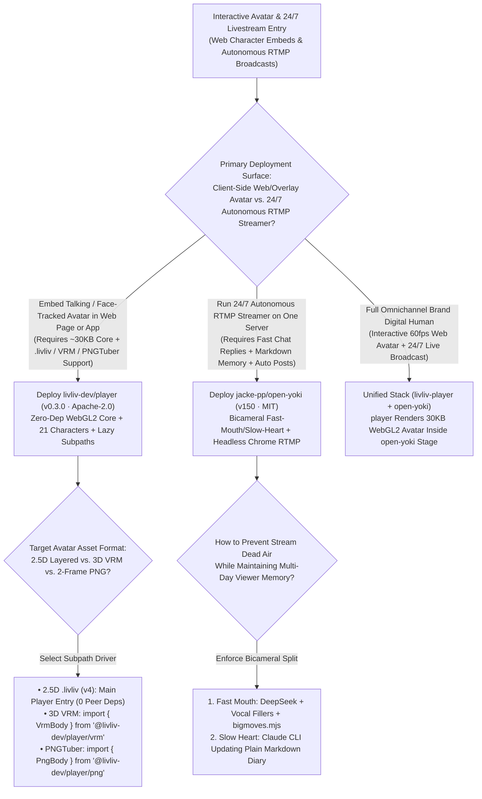

# 30KB Zero-Dependency WebGL2 2.5D Character Player & Single-Server Bicameral AI Livestream Host Selection FAQ: `livliv-dev/player` (`v0.3.0`) + `jacke-pp/open-yoki` (`v150`) vs. Cloud Pixel-Streaming & Heavy OBS Workstations

> **Document Scope**: A first-principles architecture and FinOps selection guide for AI Solution Architects, Interactive Digital-Human Frontend Leads, and 24/7 Autonomous Livestreaming Engineering Teams. Focusing on two standout digital-character and autonomous broadcasting repositories from the `2026-11-09` GitHub AI Radar — **`livliv-dev/player`** (`@livliv-dev/player v0.3.0`, TypeScript + WebGL2, Apache-2.0, **1,393 Stars** / **1,394 Stars** live API in 5 days, **`232 Stars/day`** lifecycle velocity, `stars_today = not_measured`) and **`jacke-pp/open-yoki`** (`v150` production cut, JavaScript, MIT, **1,698 Stars** in 12 days, **`142 Stars/day`** lifecycle velocity, `stars_today = not_measured`) — this guide dissects how a **Zero-Dependency `~30 KB` Gzipped WebGL2 Core Unifying `.livliv` (`v4`), VRM, and PNGTuber Characters** and a **Single-Server Bicameral ("Fast Mouth + Slow Markdown Heart") Headless Chrome RTMP Host** eliminate per-minute WebRTC avatar streaming bills and multi-GPU OBS workstation overhead.
>
> **Navigation**: [中文版 (`livliv-player-open-yoki-avatar-livestream-selection-faq.md`)](./livliv-player-open-yoki-avatar-livestream-selection-faq.md) · [2026-11-09 Daily Radar](../daily/2026-11-09.en.md) · [Back to Radar Index](../README.en.md)

---

## 📌 1. Executive Summary

1. **First-Principles Definition**:
   - **`livliv-dev/player` (`@livliv-dev/player v0.3.0`, WebGL2, Apache-2.0)** is a lightweight 2.5D/3D character player for web pages, apps, and stream overlays. Its core WebGL2 runtime has **zero dependencies and weighs `~30 KB` gzipped (`sideEffects: false`)**, playing **LivLiv (`.livliv` / `model.json` v4), 3D VRM (`@pixiv/three-vrm`), and PNGTuber** characters through a single unified API alongside **21 ready-to-use featured characters (`characters/`)**. Browser-native lip sync (`./voice`) and MediaPipe webcam face tracking (`./tracking`) are exposed as modular subpath exports so optional heavy libraries (`@mediapipe/tasks-vision`, `three`) load only when imported.
   - **`jacke-pp/open-yoki` (`v150` production cut, Node.js + Headless Chrome + FFmpeg, MIT)** is a **single-server 24/7 autonomous AI live-stream host**. It splits cognition into a **Bicameral ("Fast Mouth + Slow Heart") Architecture**: the **Fast Mouth** (`DeepSeek` via OpenRouter) replies to live chat within seconds using conversational fillers (`"嗯嗯"`, `"啊这"`), dynamic voice tones, and cue-triggered action clips (`bigmoves.mjs`); the **Slow Heart** (`Claude Code CLI` or `DeepSeek`) lives inside a folder of plain Markdown files (`heart-template/`), maintaining her mood, daily diary, notes on regular viewers, bidirectional external-world memories (`app/server/town.mjs`), and autonomous social posts (`ops/square_post.py`, `xreply.mjs`), while Headless Chrome composites a 16:9 broadcast feed pushed over RTMP via FFmpeg.
2. **Core Architectural Insight (Why Cloud WebRTC Avatars & Monolithic OBS Rigs Bleed Money)**:
   - **Failure Mode #1 (Per-Minute Cloud WebRTC Avatar Taxes vs. Multi-MB Frontend Bundle Bloat)**: Streaming cloud-rendered WebRTC avatars to 500,000 web visitors (`750,000` minutes/mo at `$0.004/min`) costs **`$3,000/mo`**, whereas bundling monolithic Unity WebGL or unsplit Three.js + MediaPipe into a landing page adds multi-megabyte initial load delays. `@livliv-dev/player` renders locally on the visitor's WebGL2 GPU in **`~30 KB` gzipped at `$0.00/min`**.
   - **Failure Mode #2 (Dead Air from Monolithic Agent Loops & Heavy Windows GPU OBS Instances)**: Forcing one heavy agent loop to both answer real-time chat and manage long-term persona memory causes 10-second dead air on stream. `open-yoki` decouples fast chat reflexes (with filler words) from slow asynchronous Markdown memory consolidation, and drops to voice-only `radio.mjs` between shows on a single Linux server.
3. **30-Second Selection Rule**:
   - Choose **`livliv-dev/player` (`v0.3.0`)** when embedding **interactive 2.5D `.livliv`, 3D VRM, or PNGTuber characters with lip sync and webcam tracking into web apps or overlays with a `~30 KB` core budget**.
   - Choose **`jacke-pp/open-yoki` (`v150`)** when running **24/7 autonomous RTMP live streams with persistent viewer memory, diary evolution, and cross-platform social posting on a single server**.

---

## 🎯 2. Architect's First-Principles Deep Dive (Q1 / Q2 / Q3)

### Q1: How does `livliv-dev/player` (`v0.3.0`) keep its WebGL2 core at `~30 KB` gzipped while supporting `.livliv`, 3D VRM, PNGTuber, lip sync, and MediaPipe face tracking?

Inspecting `package.json` (`v0.3.0`), `FORMAT.md`, and `API.md` in `livliv-dev/player` reveals three clean engineering decisions:

1. **6 Tree-Shakable Subpath Exports & Optional Peer Dependencies**:
   - Splits `exports` into `.` (zero-dependency `~30 KB` gzipped WebGL2 2.5D core), `./voice` (`createSpeech`), `./tracking` (`startFaceTracking`), `./body` (`BodyPlayer`), `./png` (`PngBody`), and `./vrm` (`VrmBody`).
   - Marks `@mediapipe/tasks-vision` (`1.1.1`), `three` (`>=0.170.0`), and `@pixiv/three-vrm` (`^3.5.5`) as **`optional: true` peer dependencies**, so standard 2.5D `.livliv` deployments pay zero byte overhead for 3D or webcam libraries.
2. **JSON-Schema Validated `.livliv` (`model.json` v4) & Untrusted File Sandbox Limits**:
   - Validates character packages against `schema/` (`model.json` v4 with backward compatibility for v3 in `FORMAT-v3.md`), enforces strict texture/vertex limits on untrusted files, and runs automated Playwright smoke tests across Chromium, Firefox, and WebKit (`test:engines`).

### Q2: How does `jacke-pp/open-yoki` (`v150`)'s Bicameral ("Fast Mouth + Slow Heart") architecture and `town.mjs` World Door sustain a lifelike 24/7 streamer on one server?

Inspecting `README.en.md`, `app/`, `heart-template/`, and `ops/` in `jacke-pp/open-yoki` highlights three architectural pillars:

1. **The Fast Mouth (Low-Latency Chat Reflexes + Fillers + `bigmoves.mjs`)**:
   - Uses a fast model (DeepSeek via OpenRouter by default) to reply to live chat within seconds, emitting short vocal fillers (`"嗯嗯"`, `"啊这"`) while thinking and triggering pre-made action clips (`bigmoves.mjs`) on semantic cues.
2. **The Slow Heart (`heart-template/` Plain-Markdown Long-Term Memory)**:
   - A long-running background agent (Claude Code CLI or DeepSeek) operating over a directory of plain Markdown files. It records her mood, daily diary, notes on regular viewers, and evolving personality, queuing autonomous posts into `想发的动态/` for publication via `ops/square_post.py` and `xreply.mjs`.
3. **The Bidirectional World Door (`app/server/town.mjs`) & Headless Chrome RTMP Stage**:
   - `app/server/town.mjs` exposes a two-way memory bridge: external AI worlds (such as TwinOasis) read who she is and how she feels today, and events she experiences there flow back into her Markdown heart.
   - A single Headless Chrome instance renders the 16:9 broadcast layout (avatar, captions, market panels, gift alerts, music) streamed via FFmpeg over RTMP, switching to `radio.mjs` between shows.

### Q3: How do `livliv-dev/player` and `jacke-pp/open-yoki` combine into a unified digital-human stack?

- **Embed `@livliv-dev/player` inside `open-yoki`'s Headless Chrome Stage and Web Room**: Use `@livliv-dev/player` (`~30 KB` WebGL2) to render `.livliv` or VRM avatars driven directly by `open-yoki`'s `createSpeech(player)` audio stream and mood expressions — eliminating pre-rendered video loops while keeping server CPU/GPU usage minimal.

---

## 🧭 3. Mermaid Decision Tree & Execution Sequence

### 3.1 Web Avatar Player & Autonomous Livestream Decision Tree

### 3.2 End-to-End Execution Sequence (`livliv-dev/player` + `open-yoki` Bicameral Host)

```mermaid
sequenceDiagram
    autonumber
    participant Viewer as Live Viewer / Web Visitor
    participant Mouth as open-yoki Fast Mouth<br/>(DeepSeek Low-Latency Reflex)
    participant Heart as open-yoki Slow Heart<br/>(Claude CLI · Markdown Diary)
    participant Stage as Headless Chrome 16:9 Stage<br/>+ @livliv-dev/player (30KB WebGL2)
    participant RTMP as FFmpeg RTMP & Social APIs<br/>(Square / X / Telegram)

    Viewer->>Heart: 1. Regular viewer posts chat message in stream
    Heart-->>Mouth: 2. Supply viewer's Markdown memory notes & current host mood
    Mouth->>Stage: 3. Play immediate vocal filler ("嗯嗯") & drive createSpeech(player) lip sync
    Mouth->>Stage: 4. Deliver full spoken reply + trigger player.setExpression('smile') & bigmoves.mjs
    Stage->>RTMP: 5. Composite 16:9 frame in Headless Chrome & push via FFmpeg RTMP

    rect rgb(42, 16, 38)
    Note over Heart,RTMP: Slow Heart Asynchronous Memory & Social Loop
    Heart->>Heart: 6. Update regular viewer notes, write daily diary & sync via town.mjs
    Heart->>RTMP: 7. Publish autonomous posts via ops/square_post.py & xreply.mjs
    Stage->>RTMP: 8. Switch to low-bandwidth radio.mjs between scheduled shows
    end
```

---

## 📊 4. Comparison Matrix Across Avatar & Livestream Architectures

| Dimension | `livliv-dev/player` (`v0.3.0`, Apache-2.0) | `jacke-pp/open-yoki` (`v150`, MIT) | Cloud WebRTC Avatar SaaS (HeyGen / D-ID Live Streaming) | Legacy Windows OBS + Unity/Live2D Rigs |
| :--- | :--- | :--- | :--- | :--- |
| **Core Role** | **`~30 KB` zero-dep WebGL2 player for `.livliv`, VRM & PNGTuber** | **Single-server 24/7 bicameral AI live-stream & social host** | Cloud GPU video synthesis streamed over WebRTC | Manual Windows GPU workstation running OBS + game engine |
| **Bundle & Bandwidth Footprint** | **`~30 KB` gzipped**; renders at 60fps on client GPU | Single FFmpeg RTMP outbound stream + `radio.mjs` off-hours | Continuous high-bitrate WebRTC video per viewer | 20–50 MB Unity WebGL bundles or dedicated GPU VM |
| **Format Interoperability** | **Unified API for `.livliv` (v4), VRM & PNGTuber** + 21 characters | Web-composable 16:9 stage + `bigmoves.mjs` + `town.mjs` | Locked to vendor-hosted cloud avatars | Separate incompatible SDKs for Live2D vs. VRM |
| **Memory & Persona Evolution** | Client-side rendering, lip sync & MediaPipe face tracking | **Slow-Heart Markdown folder**: diary, regulars, auto-posts | Stateless per-session chat | Static scripted loops without autonomous social memory |
| **Licensing & Marginal Cost** | **Apache-2.0 Free & Open Source (`$0.00/min`)** | **MIT Free & Open Source** (runs on 1 server) | **`$0.004–$0.05 / minute`** per active viewer session | High monthly GPU VM rent + human operator shifts |

---

## 🧪 5. Closed-Form FinOps Worked Example & 7-Card Insights

### 5.1 Monthly 500K Web Avatar Sessions & 2-Channel 24/7 Livestream Cost Model (`synthetic (independently_reproduced=false)`)

> **Provenance Notice**: This closed-form calculation is a synthetic architectural model (`synthetic (independently_reproduced=false)`) comparing **Path A (Cloud WebRTC Pixel-Streamed Avatar SaaS + 2 Windows GPU OBS Workstations + Human Stream/Social Operators)** against **Path B (`@livliv-dev/player` v0.3.0 `30 KB` Client-Side WebGL2 + `jacke-pp/open-yoki` Single-Server Bicameral Host)**. Custom character illustration commissions and commercial voice-cloning API subscriptions are explicitly marked `not_measured`.

**Workload Parameters**:
- **Web Avatar Sessions**: **`500,000` interactive web sessions/month** averaging `1.5 minutes` = **`750,000` avatar minutes/month**.
- **24/7 Autonomous Livestream Channels**: **`2` continuous 24/7 channels** (`1,440` streaming hours/month); human stream moderation and social scheduling labor valued at **`$45.00 / hour`**.

| Cost Component | Path A: Cloud WebRTC Avatar SaaS + OBS GPU VMs | Path B: `livliv-dev/player` + `open-yoki` 1-Server | Governing Engineering Mechanism |
| :--- | :--- | :--- | :--- |
| **1. 500K Web Avatar Sessions (`750,000` min/mo)** | **$3,000.00 / mo** (`750,000 min` × `$0.004/min` cloud WebRTC stream) | **$15.00 / mo** (`~30 KB` WebGL2 client-side GPU render; static CDN egress only) | Client-side WebGL2 rendering eliminates per-minute cloud pixel-streaming bills (**-99.5%**) |
| **2. 2 24/7 Livestream Channels Server & LLM Compute** | **$900.00 / mo** (`2 Windows GPU VMs` running OBS/Unity × `$450.00/mo`) | **$320.00 / mo** (`2 single-server hosts` + Fast/Slow LLM tokens = `$160.00/ch`) | Headless Chrome + FFmpeg RTMP + `radio.mjs` off-peak mode replace GPU workstations |
| **3. Stream Moderation & Social Posting Labor (`@$45/hr`)** | **$2,700.00 / mo** (`60.0 hours/mo` manual host supervision & social posts × `$45`) | **$270.00 / mo** (Autonomous Markdown Heart + `square_post.py` = **`6.0 hours/mo`**) | Bicameral Slow-Heart diary/regulars memory saves **`54.0 hours/mo` (-90.0% labor)** |
| **4. Custom Character Art & Commercial Voice-Cloning APIs** | `not_measured` | `not_measured` | Custom artwork and third-party TTS voice subscriptions are decoupled and never fabricated |
| **Total Modeled Monthly Cost** | **$6,600.00 / mo** | **$605.00 / mo** | **Net Savings: `$5,995.00 / mo` (`-90.83%` cost reduction, `10.91x` efficiency, `54.0 hours` saved)** |

### 5.2 Key Frontend & Bicameral Invariants

- **Subpath Tree-Shaking Invariant**: Importing `@livliv-dev/player` loads only the zero-dependency `~30 KB` WebGL2 core; `@mediapipe/tasks-vision` and `@pixiv/three-vrm` are never bundled unless `./tracking` or `./vrm` is explicitly imported.
- **Fast-Mouth / Slow-Heart Separation Invariant**: In `jacke-pp/open-yoki`, the Fast Mouth reads distilled Markdown state synchronously for sub-second chat responses, while the Slow Heart asynchronously updates diaries, regular-viewer notes, and external world state (`town.mjs`).

---

## 🛠️ 6. Actionable Production Checklist

- [ ] **1. Import `@livliv-dev/player` Subpaths Lazily**: Load `Player` from `@livliv-dev/player` (`~30 KB` gzipped) on initial page paint and dynamically import `@livliv-dev/player/voice` or `@livliv-dev/player/tracking` only when audio or webcam interaction begins.
- [ ] **2. Validate `.livliv` (`model.json` v4) Packages Against `schema/`**: Enforce JSON Schema validation and untrusted-file texture/vertex bounds before loading user-supplied character packages.
- [ ] **3. Initialize `open-yoki` with `heart-template/` Markdown Memory**: Copy `heart-template/` to provision the Slow Heart's mood, diary, regulars notes, and `想发的动态/` outbound post queue.
- [ ] **4. Configure Conversational Fillers & `bigmoves.mjs` Cues**: Set up short thinking fillers so the Fast Mouth responds immediately while generating multi-sentence replies, and map semantic triggers in `bigmoves.mjs`.
- [ ] **5. Automate RTMP Scheduling (`deploy/set-square.sh`) & `radio.mjs` Off-Hours**: Schedule automatic on-air/off-air transitions and enable `radio.mjs` voice-only mode between prime-time shows.
