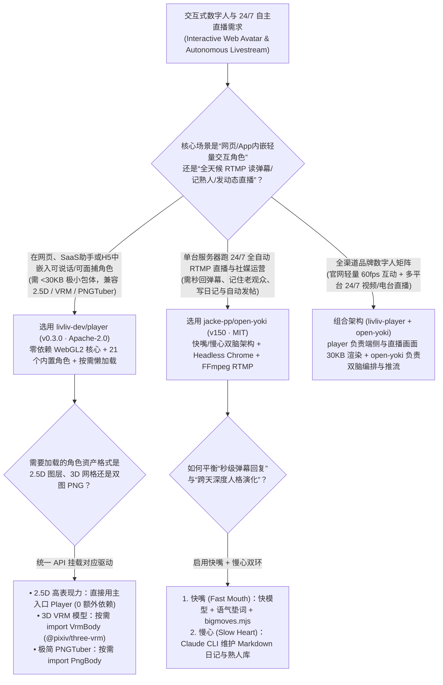

# 30KB 零依赖 WebGL2 2.5D 角色播放器与单机双脑 AI 直播系统选型 FAQ：`livliv-dev/player` (`v0.3.0`) + `jacke-pp/open-yoki` (`v150`) vs 云端像素流数字人与重型 OBS 工作站

> **文档定位**：面向 AI Solution Architect（AI 解决方案架构师）、交互式数字人前端负责人与 24/7 无人值守直播工程团队的第一性原理选型指南。聚焦 `2026-11-09` GitHub 新仓爆发追踪中的两大数字人与自主直播标杆——**`livliv-dev/player`**（`@livliv-dev/player v0.3.0`，TypeScript + WebGL2，Apache-2.0，建仓 5 天揽下 **1,393 Stars** / **1,394 Stars** 实时 API，日均斜率 **`232 Stars/day`**，`stars_today = not_measured`）与 **`jacke-pp/open-yoki`**（`v150` 生产快照，JavaScript，MIT，建仓 12 天揽下 **1,698 Stars**，日均斜率 **`142 Stars/day`**，`stars_today = not_measured`），深度拆解如何用 **“仅 `~30 KB` gzipped 的零依赖 WebGL2 核心统一驱动 `.livliv` / VRM / PNGTuber 三类模型”** 与 **“快嘴（秒回弹幕 + 语气垫词）+ 慢心（Markdown 长期记忆与自主发帖）的单服务器无头 Chrome RTMP 直播架构”** 彻底取代按分钟计费的云端 WebRTC 数字人 API 与昂贵的 Windows OBS 显卡推流机。
>
> **阅读导航**：[English Version (`livliv-player-open-yoki-avatar-livestream-selection-faq.en.md`)](./livliv-player-open-yoki-avatar-livestream-selection-faq.en.md) · [2026-11-09 全景日报](../daily/2026-11-09.md) · [返回雷达首页](../README.md)

---

## 📌 1. 核心结论速览（Executive Summary）

1. **一句话本质定义**：
   - **`livliv-dev/player`（`@livliv-dev/player v0.3.0`，WebGL2 原生渲染，Apache-2.0）** 是专为网页、应用与直播图层打造的**超轻量 2.5D/3D 角色播放器**。其核心引擎 **零外部依赖、Gzip 后仅约 `30 KB`**，通过同一套简洁 API 兼容 **LivLiv（`.livliv` / `model.json` v4）、3D VRM（`@pixiv/three-vrm`）与 PNGTuber** 三种主流数字人格式，自带 **21 个开箱即用的精品角色（`characters/`）**；口型同步（麦克风/音频/视频）与摄像头面部追踪（MediaPipe）全部在浏览器本地完成且通过 6 个子路径导出（`./voice`、`./tracking`、`./vrm` 等）实现**按需懒加载**。
   - **`jacke-pp/open-yoki`（截取自生产环境 `v150` 版本，Node.js + Headless Chrome + FFmpeg，MIT）** 是**只需一台普通服务器就能 7×24 小时全自动运行的 AI 直播主播底座**。它独创了 **“快嘴 + 慢心”双脑解耦架构（Bicameral Host Architecture）**：**快嘴（Fast Mouth）** 用高响应模型（如 DeepSeek）在几秒内带语气垫词（“嗯嗯”、“啊这”）回复弹幕并按语义触发预设动作片段（`bigmoves.mjs`）；**慢心（Slow Heart）** 则是一个常驻在纯 Markdown 文件夹（`heart-template/`）里的长程 Agent（Claude Code CLI 或 DeepSeek），负责写日记、记住常客印象、通过 `app/server/town.mjs` 与外部 AI 世界双向同步记忆，并自主向广场与 X 发帖（`ops/square_post.py`、`xreply.mjs`），最终由无头 Chrome 合成 16:9 画面经 FFmpeg 推流至任意 RTMP 平台。
2. **核心架构洞察（为什么商业 WebRTC 云渲染数字人与传统 OBS + Unity 无人直播间账单居高不下？）**：
   - **痛点一（云端视频流数字人按分钟收 `$0.004–$0.05/min` 过路费，而传统前端塞入 Three.js/Live2D 动辄数 MB 首屏阻塞）**：在产品官网或 AI 伴侣页面嵌入数字人时，若走云端像素流（Pixel Streaming），50 万次访问（每次 1.5 分钟）每月就要烧掉 `$3,000+`；若直接全量打包 Three.js + MediaPipe，首屏 JS 体积膨胀超 2 MB。`@livliv-dev/player` 将核心 WebGL2 播放器压到 **`~30 KB` gzipped**（`sideEffects: false`），全部渲染在用户浏览器本地 GPU 完成，**云端渲染成本为 `$0.00`**。
   - **痛点二（单一大模型既回弹幕又管长期人设记忆会导致直播间冷场 10 秒以上，且重型 OBS 需专人值守）**：`open-yoki` 将毫秒级反应与深度思考彻底剥离——快模型先垫词接话不冷场，慢模型在后台异步维护 Markdown 记忆与社媒运营；非直播时段自动切换为极省带宽的静态图语音电台（`radio.mjs`），一台单机服务器即可包揽全天候播出。
3. **30 秒选型口诀**：
   - 需要**在 Web 页面、SaaS 助手浮窗、移动端 H5 或 OBS 浏览器源中以 `<30 KB` 首屏开销嵌入支持口型同步与面捕的 2.5D / VRM / PNGTuber 角色** → 选 **`livliv-dev/player` (`v0.3.0`)**。
   - 需要**用一台 Linux 服务器跑起具备长期常客记忆、日记演化、自动发帖与多路 RTMP 推流的 24/7 自主 AI 主播** → 选 **`jacke-pp/open-yoki` (`v150`)**。

---

## 🎯 2. 架构师灵魂拷问（Q1 / Q2 / Q3 First-Principles Deep Dive）

### Q1：`livliv-dev/player` (`v0.3.0`) 是如何把 WebGL2 2.5D 角色引擎做到零依赖 `~30 KB` gzipped，同时又无缝兼容 3D VRM 与 MediaPipe 面部追踪的？

检视 `livliv-dev/player` 的 `package.json`（`v0.3.0`）、`FORMAT.md` 与 `API.md`，其前端工程设计堪称教科书级别：

1. **6 子路径严格分包与可选 Peer Dependencies 按需懒加载**：
   - 在 `package.json` 的 `exports` 字段中，库被精细切分为 6 个独立入口：`.`（核心 WebGL2 2.5D 播放器，**0 依赖，gzipped 约 `30 KB`**）、`./voice`（口型驱动 `createSpeech`）、`./tracking`（摄像头面捕 `startFaceTracking`）、`./body`、`./png`（PNGTuber 驱动）与 `./vrm`（3D VRM 驱动）。
   - 重型依赖 `@mediapipe/tasks-vision`（`1.1.1`）、`three`（`>=0.170.0`）与 `@pixiv/three-vrm`（`^3.5.5`）全部被声明为 **`optional: true` 的 `peerDependencies`**。如果业务页面只需要播放 `.livliv` 2.5D 角色并做音频口型同步（`player.params.mouthOpen = 0..1`），构建产物里完全不会混入半行 Three.js 或 MediaPipe 代码！
2. **统一的 `.livliv` (`model.json` v4) 格式规范与非信任文件沙盒限制**：
   - 提供完整的 JSON Schema（`schema/`）校验 `model.json` v4（同时向后兼容 `FORMAT-v3.md`），并在加载外部不可信角色包时强制检查纹理尺寸、网格顶点数与路径越界（`the limits on untrusted files`），且通过 Playwright 在 Chromium、Firefox 与 WebKit 三大内核跑通冒烟测试（`test:engines`）。

### Q2：`jacke-pp/open-yoki` (`v150`) 的“快嘴（Fast Mouth）+ 慢心（Slow Heart）”双脑架构与 `town.mjs` 世界门接口，是如何解决 AI 主播“失忆”与“卡顿”矛盾的？

拆解 `jacke-pp/open-yoki` 的 `README.en.md`、`app/`、`heart-template/` 与 `ops/` 目录：

1. **快脑（Fast Mouth）：秒级弹幕反射弧 + 思考垫词 + 动作触发（`bigmoves.mjs`）**：
   - 直播间最忌讳观众发完弹幕后主播沉默 8 秒。`open-yoki` 的快脑默认调用高吞吐模型（如经 OpenRouter 路由的 DeepSeek），在思考复杂回答前**先实时播放一句自然的思考垫词（`"嗯嗯"`、`"啊这"`）**填补空白；同时根据台词语义自动从 `bigmoves.mjs` 中触发预渲染好的高表现力动作片段（跳舞、挥手、按名字迎客与道别）。
2. **慢脑（Slow Heart）：纯 Markdown 文件夹构成的可生长长期记忆（`heart-template/`）**：
   - 慢脑是一个独立运行的 Claude Code CLI（或 DeepSeek）进程，居住在一个纯 Markdown 文件夹中。它不参与毫秒级抢答，而是持续整理主播的**当前心情、每日日记、对直播间老熟人（Regulars）的印象笔记、自身性格的缓慢演变**，并将想要分享的内容写入 `想发的动态/` 目录，由后台脚本（`ops/square_post.py`、`xreply.mjs`）自动发布到广场与 X，或通过 `tg.mjs` / `family.mjs` 在 Telegram 粉丝群互动。
3. **双向记忆互通的“世界之门”（`app/server/town.mjs`）与单机无头合成**：
   - `app/server/town.mjs` 定义了极简的双向状态接口：外部虚拟世界（如 TwinOasis 或企业自有元宇宙社区）可以通过该接口读取主播今日的人设与心情，而主播在外部世界经历的事件又会通过该接口写回她的 Markdown “慢心”中，成为直播时聊天的话题。
   - 整个 16:9 直播画面（数字人、实时字幕、数据面板、礼物感谢弹窗、BGM）全部由单台服务器上的 **Headless Chrome** 渲染，并由 FFmpeg 经 RTMP 推流；两场直播之间则可零成本切换为 `radio.mjs` 电台模式。

### Q3：如何将 `livliv-dev/player` 与 `open-yoki` 组合成一套极低成本的企业级数字人互动与直播系统？

- **直接用 `@livliv-dev/player` 作为 `open-yoki` 无头 Chrome 直播间与网页端的渲染层**：在 `open-yoki` 的 Headless Chrome 16:9 舞台页面与对外 Web 直播间中嵌入 `~30 KB` 的 `@livliv-dev/player`（加载 `.livliv` 2.5D 角色或 VRM 模型），由 `open-yoki` 的 TTS 音频流直接驱动 `createSpeech(player)` 口型同步与 `player.setExpression()` 表情切换，既省去重型视频切片，又能让观众在网页端获得 60fps 原生矢量渲染体验！

---

## 🧭 3. Mermaid 选型决策树与双脑直播架构图（Decision Tree & Architecture Flow）

### 3.1 Web 数字人播放器与无人直播架构选型决策树

### 3.2 `livliv-dev/player` 渲染 + `open-yoki` 快嘴/慢心双脑直播时序图

```mermaid
sequenceDiagram
    autonumber
    participant Viewer as 直播间观众 / 网页访客
    participant Mouth as open-yoki 快嘴 (Fast Mouth)<br/>(DeepSeek 秒级弹幕反射)
    participant Heart as open-yoki 慢心 (Slow Heart)<br/>(Claude CLI · Markdown 日记库)
    participant Stage as Headless Chrome 16:9 舞台<br/>+ @livliv-dev/player (30KB WebGL2)
    participant RTMP as FFmpeg RTMP 推流 & 社媒<br/>(直播平台 / X / Telegram)

    Viewer->>Heart: 1. 老观众进入直播间发弹幕提问
    Heart-->>Mouth: 2. 注入该常客历史印象笔记与主播今日心情 (来自 Markdown 文件夹)
    Mouth->>Stage: 3. 立即触发思考垫词 ("嗯嗯") 并调用 createSpeech(player) 驱动口型 (mouthOpen)
    Mouth->>Stage: 4. 几秒内生成正式回答 + 触发 player.setExpression('smile') & bigmoves.mjs 动作
    Stage->>RTMP: 5. Headless Chrome 合成 16:9 画面 → FFmpeg 实时推流至 RTMP 直播间

    rect rgb(42, 16, 38)
    Note over Heart,RTMP: 慢心 (Slow Heart) 异步记忆沉淀与跨平台自主运营
    Heart->>Heart: 6. 更新老观众印象档案、撰写今日直播日记并通过 town.mjs 同步外部世界经历
    Heart->>RTMP: 7. 将《想发的动态/》自动发布至广场与 X (square_post.py / xreply.mjs)
    Stage->>RTMP: 8. 休播时段自动切入 radio.mjs 静态图语音电台模式
    end
```

---

## 📊 4. 同类数字人渲染与无人直播方案对比矩阵（Comparison Matrix）

| 评估维度 | `livliv-dev/player` (`v0.3.0`, Apache-2.0) | `jacke-pp/open-yoki` (`v150`, MIT) | 商业云端 WebRTC 数字人 API（HeyGen / D-ID 实时流） | 传统 Windows OBS + Unity/Live2D 直播机 |
| :--- | :--- | :--- | :--- | :--- |
| **核心能力定位** | **浏览器端 `~30 KB` 零依赖 WebGL2 2.5D/VRM/PNG 角色播放器** | **单台 Linux 服务器全自动双脑 AI 直播与社媒运营系统** | 云端 GPU 实时合成视频流并通过 WebRTC 推给前端 | 需独立显卡 Windows 主机人工开 OBS 推流 |
| **首屏体积与带宽开销** | **核心仅 `~30 KB` gzipped**，用户端本地 GPU 60fps 渲染 | 单路 FFmpeg RTMP 推流 + 休播期轻量 `radio.mjs` 电台 | 持续占用双向高清视频流带宽，弱网极易花屏卡顿 | 网页嵌入 Unity WebGL 包体高达 20–50 MB |
| **多格式兼容与扩展** | **一套 API 兼容 `.livliv` (v4)、VRM 与 PNGTuber**，附 21 个角色 | 支持任意 Web 舞台、预制切片（`bigmoves.mjs`）与 `town.mjs` 接口 | 锁定厂商私有云端形象库 | 格式割裂，VRM 与 Live2D 需完全不同的工程栈 |
| **记忆深度与人格连续性** | 专注于前端渲染、口型同步与 MediaPipe 面捕 | **慢心 Markdown 档案库**：记住常客、写日记、自主发帖与跨世界互通 | 无状态单次会话问答，下播即失忆 | 仅能照念固定话术稿，缺乏自主社媒联动 |
| **授权与边际运行成本** | **Apache-2.0 免费开源**（客户端渲染 **`$0.00/分钟`**） | **MIT 免费开源**（单台轻量服务器即可 24/7 运行） | **`$0.004–$0.05 / 分钟`** 按时长高额计费 | 需昂贵云端 Windows GPU 实例 + 专人倒班值守 |

---

## 🧪 5. 定量 FinOps 算例与 7-Card 评测洞察（Closed-Form Quantitative Model）

### 5.1 封闭式月度 50 万次网页数字人交互与双频道 24/7 自主直播成本算例（`synthetic (independently_reproduced=false)`）

> **口径声明**：本算例为合成架构基准模型（`synthetic (independently_reproduced=false)`），用于量化对比 **Path A（按分钟计费的商业云端 WebRTC 数字人流 + 2 台云端 Windows GPU OBS 推流机 + 人工场控与社媒代运营）** 与 **Path B（`@livliv-dev/player` v0.3.0 `30 KB` 端侧 WebGL2 渲染 + `jacke-pp/open-yoki` 单机双脑自主直播）**。定制美术角色原画外包费与商业闭源声音克隆 API 订阅费均显式标记为 `not_measured`。

**基准工作负载设定**：
- **网页端交互式数字人访问规模**：每月 **`500,000` 次网页/应用数字人会话**，平均每次停留互动 `1.5 分钟`，合计 **`750,000` 互动分钟/月**。
- **24/7 全天候品牌/社区直播间规模**：常驻运行 **`2` 个全天候直播频道**（每月共 `1,440` 直播小时）；人工场控与社媒发帖运营综合时薪按 **`$45.00 / 小时`** 计。

| 成本分项 | Path A：商业 WebRTC 数字人云 + Windows GPU 推流机 | Path B：`livliv-dev/player` + `open-yoki` 单机双脑 | 核心工程机制差异说明 |
| :--- | :--- | :--- | :--- |
| **1. 50 万次网页数字人渲染成本（750,000 分钟/月）** | **$3,000.00 / 月** （云端 WebRTC 视频流按最低 `$0.004/分钟` × `750,000 分钟`） | **$15.00 / 月** （`~30 KB` WebGL2 在用户浏览器本地渲染，仅需静态 CDN 流量费） | 客户端原生 WebGL2 渲染彻底消除云端按分钟计费的像素流算力税（省 **99.5%**） |
| **2. 2 个 24/7 全天候直播频道服务器与模型推理费** | **$900.00 / 月** （2 台云端 Windows GPU 工作站跑 OBS + Unity × `$450.00/台`） | **$320.00 / 月** （2 台单机服务器跑 Headless Chrome + 快慢双脑 LLM Token = `$160.00/台`） | `open-yoki` 单机架构配合休播期 `radio.mjs` 电台模式省去重型 GPU 推流工作站 |
| **3. 直播场控、常客维护与社媒发帖人工成本（@$45/hr）** | **$2,700.00 / 月** （人工值守开下播、记熟人与发动态 **`60.0 小时/月`** × `$45.00`） | **$270.00 / 月** （慢心 Markdown 自动记熟人/写日记/`square_post.py` 发帖 = **`6.0 小时/月`** 巡检） | 快嘴+慢心双脑与定时开下播每月净省 **`54.0 小时`（-90.0% 运营工时）** |
| **4. 角色美术原画定制与商业声音克隆 API** | `not_measured` | `not_measured` | 美术资产设计与第三方音色克隆因品牌要求而异，严禁捏造或归零 |
| **月度可建模总成本（Modeled Total）** | **$6,600.00 / 月** | **$605.00 / 月** | **月度净节省 `$5,995.00`（总成本直降 `-90.83%`，综合成本效率提升 `10.91x`，月省 `54.0 小时`）** |

### 5.2 关键前端与双脑架构不变量（Key Invariants）

- **子路径按需树摇不变量（Subpath Tree-Shaking Invariant）**：在集成 `@livliv-dev/player` (`v0.3.0`) 时，主入口 `@livliv-dev/player` 永远保持零依赖（`~30 KB` gzipped）；只有显式导入 `@livliv-dev/player/tracking` 或 `@livliv-dev/player/vrm` 时才会触发 `@mediapipe/tasks-vision` 或 `three` 的加载。
- **快慢双脑读写隔离不变量（Fast-Mouth / Slow-Heart Decoupling Invariant）**：在 `jacke-pp/open-yoki` 中，快嘴（Fast Mouth）仅以只读方式消费慢心（Slow Heart）整理好的 Markdown 熟人档案与心情摘要以确保秒级回话；所有长耗时联网搜索（`web.mjs`）、日记撰写与跨世界记忆同步（`town.mjs`）均由慢心在后台异步完成。

---

## 🛠️ 6. 生产落地核验清单（Actionable Production Checklist）

- [ ] **1. 使用子路径按需导入 `@livliv-dev/player` 保持首屏 `<30 KB`**：在前端工程中仅在主包导入 `import { Player } from '@livliv-dev/player'`，将 `./voice`、`./tracking` 与 `./vrm` 置于用户点击交互后的动态 `import()` 中。
- [ ] **2. 对外部上传的 `.livliv` (`model.json` v4) 包执行 Schema 与边界校验**：使用仓库 `schema/` 下的 JSON Schema 校验角色包，并开启 `API.md` 中针对非信任文件的纹理与顶点上限保护。
- [ ] **3. 初始化 `open-yoki` 的 `heart-template/` Markdown 记忆目录**：部署 `open-yoki` 时，从 `heart-template/` 复制主播初始人设、日记与 `想发的动态/` 目录结构，并验证慢心 Agent（Claude Code CLI 或 DeepSeek）具备读写权限。
- [ ] **4. 配置快嘴思考垫词与 `bigmoves.mjs` 动作映射**：针对直播间弹幕延迟，配置符合主播人设的短垫词音频，并在 `bigmoves.mjs` 中绑定欢迎、感谢礼物与道别的触发动作。
- [ ] **5. 启用 `deploy/set-square.sh` 推流管理与休播期 `radio.mjs` 电台**：配置定时开下播时间表，在非视频黄金时段自动切换为 `radio.mjs` 静态图语音电台模式以最大化节省服务器 CPU 与带宽开销。
