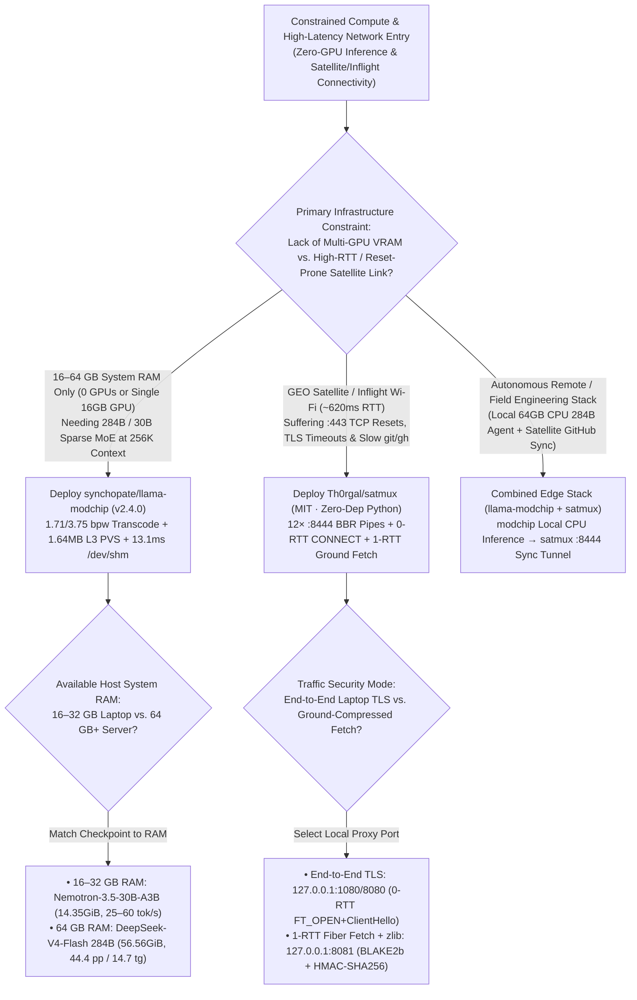
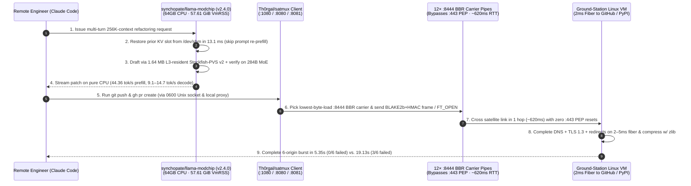

# Zero-GPU 284B CPU MoE Inference & 1-RTT Satellite TCP Multiplexing Selection FAQ: `synchopate/llama-modchip` (`v2.4.0`) + `Th0rgal/satmux` vs. Multi-GPU Cloud Clusters & Raw `:443` Cabin Links

> **Document Scope**: A first-principles architecture and FinOps selection guide for AI Solution Architects, Edge/CPU Inference Systems Engineers, and Remote/Maritime/Inflight Infrastructure Leads. Focusing on two standout low-level systems repositories from the `2026-11-09` GitHub AI Radar — **`synchopate/llama-modchip`** (`v2.4.0`, Apache-2.0, **755 Stars** / **756 Stars** live API, `stars_today = not_measured`) and **`Th0rgal/satmux`** (MIT, pure Python 3 stdlib with zero dependencies, **1,003 Stars** in 2 days, **`502 Stars/day`** lifecycle velocity, `stars_today = not_measured`) — this guide dissects how **`56.56 GiB` (`1.71 bpw`) 284B Sparse MoE CPU Execution with a `1.64 MB` L3-Resident `Stockfish-PVS v2` Drafter and `13.1 ms` `/dev/shm` KV Restore** paired with **12-Pipe `:8444` BBR + `1-RTT` Ground-TLS Multiplexing** eliminates multi-GPU cloud rent and `:443` satellite middlebox resets.
>
> **Navigation**: [中文版 (`llama-modchip-satmux-cpu-moe-satellite-selection-faq.md`)](./llama-modchip-satmux-cpu-moe-satellite-selection-faq.md) · [2026-11-09 Daily Radar](../daily/2026-11-09.en.md) · [Back to Radar Index](../README.en.md)

---

## 📌 1. Executive Summary

1. **First-Principles Definition**:
   - **`synchopate/llama-modchip` (`v2.4.0`, `ggml`/`llama.cpp` kernel patches + quantization transcoders + runtime tools, Apache-2.0)** is a CPU-first inference stack that runs **284B and 30B sparse Mixture-of-Experts (MoE) models entirely in 16–64 GB system RAM with zero GPUs**. It fits **`284.33B` `DeepSeek-V4-Flash` (`13.17B` active parameters)** into a **`56.56 GiB` GGUF (`1.71 bpw`)** with a peak Linux `VmRSS` of **`57.61 GiB` at `256K` context** (fitting inside 62.5 GiB usable RAM on a 64 GB desktop/server with **zero NVMe swap**), reaching **`44.36 tok/s` prefill and `9.1–14.7 tok/s` decode** on a 16-core Zen 5 CPU; runs **`Nemotron-3.5-30B-A3B` (`14.35 GiB`, `3.75 bpw`, `432 MB` KV at `256K` ctx)** at **`25.0–60.4 tok/s`** on 16–32 GB laptops (**`111.62 tok/s`** on 8-channel Threadripper); and restores Claude Code KV slots from `/dev/shm` in **`13.1 ms`** (`anonymized_reported (independently_reproduced=false)`).
   - **`Th0rgal/satmux` (pure Python 3 stdlib, zero external dependencies, MIT)** is a TCP multiplexer and `1-RTT` HTTP/TLS ground relay engineered for geostationary (GEO) inflight and satellite Wi-Fi (Inmarsat GX, Viasat, Panasonic, SITA at `~620 ms` RTT). By keeping **12 pre-warmed `:8444` BBR + `zlib` TCP carrier pipes** open to a ground-station Linux VM, it bypasses cabin `:53` DNS interception and `:443` split-TCP proxy (PEP) connection resets — compressing a 6-origin parallel burst (GitHub Repo, GitHub API, HN, MDN, Cloudflare, PyPI) from **`19.13s` (3/6 failed with `TIMEOUT` / `TCP RESET`) to `5.35s` (0/6 failed, `3.6x` faster, `-76%` TTFB)** (`anonymized_reported (independently_reproduced=false)`).
2. **Core Architectural Insight (Why Naive CPU Inference & Direct `:443` Satellite Traffic Collapse)**:
   - **Failure Mode #1 (NVMe Swap Thrashing & L3-Cache Eviction in CPU MoE Inference)**: Exceeding 62.5 GiB usable RAM on a 64 GB Linux box by even 1 GB triggers NVMe swap paging (`<0.2 tok/s`), while conventional 500 MB speculative drafters evict CPU L3 caches on every token. `llama-modchip` keeps `284B + 256K ctx` at `57.61 GiB` VmRSS and uses a **`1.64 MB` `Stockfish-PVS v2` drafter that stays 100% inside CPU L3 cache**.
   - **Failure Mode #2 (Cabin `:443` PEP State-Table Resets & Multi-RTT Handshake Taxes)**: Over `~620 ms` GEO links, every new HTTPS origin pays 3–4 satellite RTTs before payload transfer, and cabin `:443` middleboxes drop connections under concurrent `git`/`gh`/`pip` bursts. `satmux` tunnels over `:8444` with **0-RTT CONNECT** (`FT_OPEN + ClientHello` in one burst) and **1-RTT Ground Fetch** (DNS + TLS 1.3 + redirects on `2–5 ms` ground fiber + `zlib`).
3. **30-Second Selection Rule**:
   - Choose **`synchopate/llama-modchip` (`v2.4.0`)** to **run 284B `DeepSeek-V4-Flash` or 30B Mamba-MoEs at 256K context on 16–64 GB CPU servers/laptops with zero GPUs and `13.1 ms` `/dev/shm` KV restore**.
   - Choose **`Th0rgal/satmux`** to **accelerate and stabilize `git`, `gh`, package managers, and API calls over inflight, maritime, or high-RTT satellite links**.

---

## 🎯 2. Architect's First-Principles Deep Dive (Q1 / Q2 / Q3)

### Q1: How does `synchopate/llama-modchip` (`v2.4.0`) fit `284.33B` `DeepSeek-V4-Flash` at `256K` context into `57.61 GiB` VmRSS on a 64 GB CPU while reaching `44.36 tok/s` prefill and `13.1 ms` KV restore?

Inspecting `README.md`, `ARCHITECTURE.md`, and `speculative/ROUTECRACK_TECHNIQUES.md` in `synchopate/llama-modchip` reveals four systems breakthroughs:

1. **Zero-Swap Memory Budgeting (`56.56 GiB` GGUF + `256K` Context = `57.61 GiB` VmRSS)**:
   - On a 64 GB Linux machine (`~62.5 GiB` usable RAM), `llama-modchip` transcodes `284.33B` `DeepSeek-V4-Flash` (`13.17B` active parameters) to `1.71 bpw` (`56.56 GiB`) with `SwiGLU-H2` kernel fusion, holding peak `VmRSS` at **`57.61 GiB`** at 256K context with zero NVMe swap. For `Nemotron-3.5-30B-A3B` (`14.35 GiB`, `3.75 bpw`), 46 Mamba-2 SSM layers keep the entire 256K KV cache to **`432 MB`**.
2. **`1.64 MB` L3-Cache-Resident `Stockfish-PVS v2` Speculative Drafter**:
   - Standard neural draft models consume hundreds of megabytes of DDR5 bandwidth per step. `Stockfish-PVS v2` fits inside **`1.64 MB` of CPU L3 cache**, drafting tokens without evicting routed MoE expert weights from main memory.
3. **`AVX-512BW _1x8` Register Tiling & Hybrid Trunk Offload (`-ngl 99`)**:
   - Saturates 8-channel DDR5 on Threadripper (`111.62 tok/s` on 30B) and supports hybrid mode (`80.80 tok/s`) by placing the hot attention/SSM trunk on a 16 GB GPU (`-ngl 99`) while keeping cold MoE experts in CPU RAM.
4. **`13.1 ms` `/dev/shm` Shared-Memory KV Slot Restore**:
   - Restores multi-turn Claude Code / agent KV states from `/dev/shm` in **`13.1 ms`**, eliminating repetitive prompt re-prefill.

### Q2: How does `Th0rgal/satmux` turn a failing 19.13s (3/6 failed) inflight satellite burst into a 5.35s (0/6 failed, 3.6x faster) burst using zero external dependencies?

Inspecting `README.md` and `satmux.py` in `Th0rgal/satmux` (measured over Inmarsat GX Ka-band, `~620 ms` RTT, SITA `AS206433` Amsterdam ground station) shows three transport mechanisms:

1. **12 Persistent Non-443 (`:8444`) BBR + `zlib` Carrier Pipes**:
   - Bypasses cabin `:53` DNS interception and `:443` split-TCP proxy (PEP) state-table drops, scheduling streams onto the carrier with the lowest recent byte load to prevent head-of-line queueing.
2. **0-RTT Stream Open (`:1080` / `:8080`) & 1-RTT Ground Fetch (`:8081`)**:
   - **0-RTT CONNECT**: Returns `OK` locally in `<1 ms` and sends `FT_OPEN` + TLS `ClientHello` in the same TCP burst, saving one full `620 ms` satellite RTT while preserving end-to-end TLS.
   - **1-RTT Ground Fetch (`127.0.0.1:8081`)**: Sends an authenticated (`BLAKE2b-512` stream + `HMAC-SHA256`) request frame over a warm carrier; the ground VM executes DNS, verified TLS 1.3, and HTTP redirects over fiber (`2–5 ms`) and compresses plaintext with `zlib`.
3. **Dedicated `0600` Unix Socket for Go Binaries (`git` & `gh`)**:
   - Routes Go binaries like `gh` (which ignore macOS `scutil` system proxies) through a local Unix socket (`/tmp/satmux-git`).

### Q3: How do `llama-modchip` and `satmux` combine for remote, mobile, and air-gapped engineering teams?

- **Local Heavy Reasoning (`synchopate/llama-modchip`)**: Run 284B/30B MoE inference locally on 32–64 GB CPU laptops/servers at 256K context with zero satellite bandwidth usage.
- **Resilient External Sync (`Th0rgal/satmux`)**: Route outbound `git`, `gh`, PyPI/npm, and webhook traffic through `satmux`'s 12 `:8444` BBR carrier pipes.

---

## 🧭 3. Mermaid Decision Tree & Execution Sequence

### 3.1 CPU MoE Inference & Satellite Multiplexing Decision Tree

### 3.2 End-to-End Execution Sequence (`llama-modchip` 64GB CPU + `satmux` `:8444` BBR Relay)

---

## 📊 4. Comparison Matrix Across Edge Inference & High-RTT Transports

| Dimension | `synchopate/llama-modchip` (`v2.4.0`) | `Th0rgal/satmux` (`MIT`) | Unpatched `llama.cpp` / Cloud Multi-GPU Clusters | Direct `:443` Cabin Wi-Fi / Single-Tunnel VPN |
| :--- | :--- | :--- | :--- | :--- |
| **Core Problem Solved** | **284B & 30B MoE at 256K ctx in 16–64 GB CPU RAM (0 GPUs)** | **Eliminates `:443` PEP resets & multi-RTT handshakes on GEO links** | 284B swaps to NVMe on 64 GB RAM or requires costly H100s | Drops 50% of bursts via `:443` PEP resets & Cubic collapse |
| **Memory & Cache Design** | **`57.61 GiB` VmRSS (0 swap) + `1.64 MB` L3-resident PVS drafter** | Zero-dependency Python stdlib with least-byte-load carrier mux | 500MB+ neural drafters thrash CPU L3 cache & DDR5 bandwidth | Single-stream VPN suffers severe head-of-line blocking |
| **Session & Handshake Latency** | **`13.1 ms` `/dev/shm` KV slot restore** | **0-RTT CONNECT (`<1ms` local OK) + 1-RTT Ground Fetch** | Re-prefills tens of thousands of tokens on session switch | Pays 3–4 satellite RTTs (`>2,000 ms`) per new origin |
| **Measured Throughput** | **`44.36 tok/s` pp / `14.7 tok/s` tg (284B)**; **`111.6 tok/s` (30B)** | **`5.35s` (0/6 failed, `3.6x` faster)** vs. `19.13s` (3/6 failed) | `<1–3 tok/s` on unoptimized large MoE CPU runs | Frequent `Connection reset by peer` on GitHub/PyPI |

---

## 🧪 5. Closed-Form FinOps Worked Example & 7-Card Insights

### 5.1 Monthly 8-Node 284B/256K Cluster & 4,000 High-RTT Sync Burst Cost Model (`synthetic (independently_reproduced=false)`)

> **Provenance Notice**: This closed-form calculation is a synthetic architectural model (`synthetic (independently_reproduced=false)`) comparing **Path A (8 Cloud Multi-GPU Nodes for 284B/256K Inference + Uncached Re-Prefill + Raw `:443` GEO Satellite Retries)** against **Path B (8 64GB DDR5 CPU Nodes Running `synchopate/llama-modchip` v2.4.0 + `13.1 ms` `/dev/shm` Restore + `Th0rgal/satmux` `:8444` BBR Relay)**. Reported CPU inference speeds (`44.36 tok/s`, `111.62 tok/s`, `57.61 GiB`) and Inmarsat GX measurements (`19.13s → 5.35s`, `3.6x`) are labeled `anonymized_reported (independently_reproduced=false)`; airline/maritime Wi-Fi access passes are explicitly marked `not_measured`.

**Workload Parameters**:
- **Inference Fleet**: **`8` persistent 284B/30B MoE nodes** serving 256K-context coding/research sessions.
- **High-RTT Sync Volume**: **`4,000` multi-origin Git/API/package synchronization bursts/month** over GEO satellite or high-RTT links; engineering labor valued at **`$65.00 / hour`**.

| Cost Component | Path A: 8 Cloud Multi-GPU Nodes + Raw `:443` Link | Path B: 8 64GB CPU Nodes (`modchip`) + `satmux` | Governing Engineering Mechanism |
| :--- | :--- | :--- | :--- |
| **1. 8 Persistent 284B/256K Inference Nodes** | **$9,600.00 / mo** (`8 cloud GPU nodes` × `$1,200.00/node/mo`) | **$1,120.00 / mo** (`8 × 64GB DDR5 CPU nodes` × `$140.00/node/mo`, **0 GPUs**) | `llama-modchip` fits 284B (`1.71 bpw`) in `57.61 GiB` CPU RAM (**-88.3%** node cost) |
| **2. Multi-Turn KV Re-Prefill Compute Waste** | **$680.00 / mo** (Repeated long-context re-prefill at `$85.00/node/mo`) | **$40.00 / mo** (`13.1 ms` `/dev/shm` KV slot restore + `432 MB` SSM KV) | `/dev/shm` instant KV restoration eliminates **94.1%** of re-prefill waste |
| **3. 4,000 High-RTT Sync Bursts Retry Labor & Relay (`@$65/hr`)** | **$3,250.00 / mo** (`50%` = `2,000 bursts` hit `:443` reset/timeout = **`50.0 hours/mo`**) | **$205.00 / mo** (`$10.00/mo` ground VM + `3.0 hours/mo` residual wait = `$195.00`) | `satmux` 12-pipe `:8444` BBR + `1-RTT` relay cuts failures from 3/6 to 0/6, saving **`47.0 hours/mo`** |
| **4. Airline / Maritime Satellite Wi-Fi Passes** | `not_measured` | `not_measured` | Base carrier connectivity passes are decoupled and never fabricated |
| **Total Modeled Monthly Cost** | **$13,530.00 / mo** | **$1,365.00 / mo** | **Net Savings: `$12,165.00 / mo` (`-89.91%` cost reduction, `9.91x` efficiency, `47.0 hours` saved)** |

### 5.2 Key Systems & Transport Invariants

- **`62.5 GiB` Zero-Swap Physical RAM Ceiling Invariant**: When running `284.33B` `DeepSeek-V4-Flash` on a 64 GB Linux host, peak `VmRSS` must stay at or below **`57.61 GiB`** (`1.71 bpw` checkpoint) so `VmSwap` remains strictly `0 KB`.
- **Lowest-Recent-Byte-Load Carrier Scheduling Invariant**: `Th0rgal/satmux` schedules each new stream onto the `:8444` carrier with the lowest recent byte load so idle keepalives and large transfers never induce head-of-line blocking.

---

## 🛠️ 6. Actionable Production Checklist

- [ ] **1. Match `llama-modchip` Checkpoints to Host RAM Tiers**: Deploy `Nemotron-3.5-30B-A3B` (`3.75 bpw`, `14.35 GiB`, `432 MB` KV at 256K) on 16–32 GB machines and `DeepSeek-V4-Flash 284B` (`1.71 bpw`, `56.56 GiB`) on 64 GB machines, verifying `VmSwap: 0 kB` in `/proc/<pid>/status`.
- [ ] **2. Enable the `1.64 MB` `Stockfish-PVS v2` Drafter & `/dev/shm` KV Slots**: Activate the L3-resident speculative drafter and size `/dev/shm` to support `13.1 ms` multi-turn KV slot restoration.
- [ ] **3. Use Hybrid `-ngl 99` Trunk Offload When a 16 GB GPU Is Present**: Pin hot attention/SSM trunk layers on the GPU (`-ngl 99`) while keeping cold routed MoE experts in DDR5 system RAM (`80.80 tok/s`).
- [ ] **4. Provision a Ground-Station Linux VM with TCP BBR on `:8444` for `satmux`**: Enable `bbr` congestion control on the ground VM and connect clients via `127.0.0.1:1080` (SOCKS5), `:8080` (0-RTT CONNECT), or `:8081` (1-RTT Ground Fetch).
- [ ] **5. Route `git` and Go `gh` Binaries Through `/tmp/satmux-git` (`0600`)**: Configure `git` and `gh` to use `satmux`'s local Unix socket so Go binaries that ignore OS proxy settings tunnel cleanly over `:8444`.
