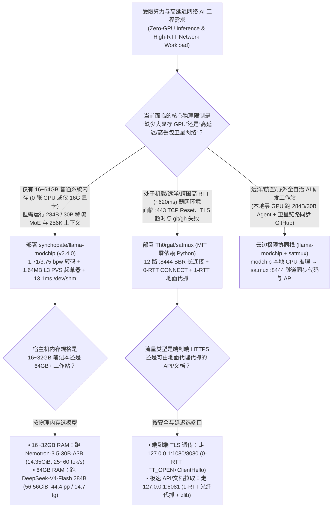
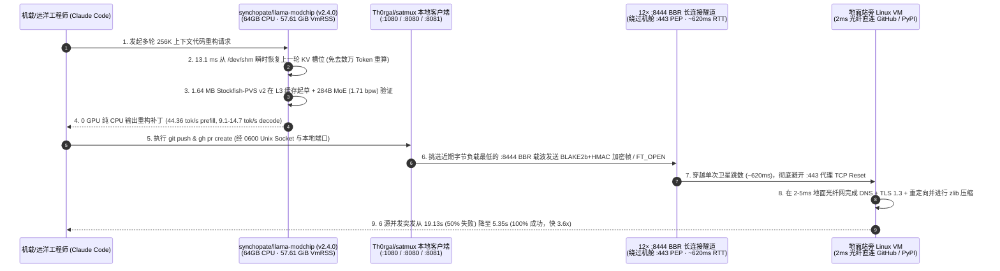

# 纯 64GB CPU 运行 284B 稀疏 MoE 与高延迟卫星链路 1-RTT 多路复用选型 FAQ：`synchopate/llama-modchip` (`v2.4.0`) + `Th0rgal/satmux` vs 昂贵多卡 GPU 租赁与直连 `:443` 断流

> **文档定位**：面向 AI Solution Architect（AI 解决方案架构师）、边缘/离线推理系统工程师与跨国远洋/机载/弱网研发基础设施负责人的第一性原理选型指南。聚焦 `2026-11-09` GitHub 新仓爆发追踪中的两大底层系统工程神作——**`synchopate/llama-modchip`**（`v2.4.0`，Apache-2.0，建仓 11 天揽下 **755 Stars** / **756 Stars** 实时 API，`stars_today = not_measured`）与 **`Th0rgal/satmux`**（MIT，纯 Python 3 标准库零依赖，建仓 2 天即破 **1,003 Stars**，日均斜率 **`502 Stars/day`**，`stars_today = not_measured`），深度拆解如何用 **“56.56 GiB (`1.71 bpw`) 装入 64GB 纯 CPU 内存跑 284B DeepSeek-V4-Flash + 1.64MB L3 缓存常驻 `Stockfish-PVS v2` 投机采样 + `13.1 ms` `/dev/shm` KV 瞬时恢复”** 与 **“绕过机舱 `:443` PEP 代理的 12 路 `:8444` BBR + `1-RTT` 地面光纤代抓隧道（6 并发源从 50% 失败降为 0 失败、提速 3.6 倍）”** 在极端算力与极端网络环境下构建高可靠 AI 工程底座。
>
> **阅读导航**：[English Version (`llama-modchip-satmux-cpu-moe-satellite-selection-faq.en.md`)](./llama-modchip-satmux-cpu-moe-satellite-selection-faq.en.md) · [2026-11-09 全景日报](../daily/2026-11-09.md) · [返回雷达首页](../README.md)

---

## 📌 1. 核心结论速览（Executive Summary）

1. **一句话本质定义**：
   - **`synchopate/llama-modchip`（`v2.4.0`，`ggml`/`llama.cpp` 内核补丁 + 量化转码器 + 运行时工具，Apache-2.0）** 是专为在 **16–64 GB 普通系统内存（0 张 GPU）** 上全速运行 **284B 与 30B 稀疏混合专家模型（Sparse MoE）** 打造的 CPU 优先推理栈。它将 **`284.33B` `DeepSeek-V4-Flash`（每次激活 `13.17B` 参数）** 压入 **`56.56 GiB` GGUF（`1.71 bpw`）**，在 **256K 超长上下文**下峰值物理内存（`VmRSS`）仅 **`57.61 GiB`**（完全装进 64GB 机器的 62.5 GiB 可用 Linux 内存中，**0 NVMe 磁盘 Swap**），在 16 核 Zen 5 纯 CPU 上跑出 **`44.36 tok/s` Prefill 与 `9.1–14.7 tok/s` 生成速度**；在 16–32GB 笔记本上跑 **`Nemotron-3.5-30B-A3B`（`14.35 GiB`，`3.75 bpw`，256K 上下文 KV 仅占 `432 MB`）** 达 **`25.0–60.4 tok/s`**（8 通道 Threadripper 达 **`111.62 tok/s`**），并支持 **`13.1 ms` `/dev/shm` 共享内存 KV 槽位瞬时恢复**（数据分级：`anonymized_reported (independently_reproduced=false)`）。
   - **`Th0rgal/satmux`（纯 Python 3 标准库，0 外部依赖，MIT）** 是专为**地球同步轨道（GEO）高延迟卫星与机载 Wi-Fi（Inmarsat GX、Viasat、Panasonic、SITA，RTT `~620 ms`）**设计的 TCP 多路复用器与 `1-RTT` HTTP/TLS 地面中继。它通过维持 **12 条预热的非 443 端口（`:8444`）BBR + `zlib` 压缩长连接**直连地面站旁边的 Linux VM，绕过机舱网关对 `:53` DNS 的劫持与 `:443` 透明拆包代理（PEP）的频繁断流，实测将 6 源并发请求（GitHub Repo、GitHub API、HN、MDN、Cloudflare、PyPI）从 **`19.13s`（3/6 超时或被 RST 重置）压缩至 `5.35s`（0/6 失败，整体提速 `3.6 倍`，TTFB 降低 `76%`）**（数据分级：`anonymized_reported (independently_reproduced=false)`）。
2. **核心架构洞察（为什么纯 CPU 跑巨型 MoE 和高延迟网络跑 Coding Agent 以前总是慢到不可用？）**：
   - **痛点一（传统 CPU 跑 284B 模型一旦溢出到 NVMe 虚拟内存就会跌到 `<0.2 tok/s`，且普通投机采样草稿模型会冲刷掉 CPU L3 缓存）**：`llama-modchip` 通过 `1.71 bpw` 专家非对称转码把 284B + 256K 上下文严格控制在 `57.61 GiB` VmRSS 红线内；更绝的是，它的 **`Stockfish-PVS v2` 投机起草器（Speculative Drafter）体积仅 `1.64 MB`**，100% 常驻在 CPU L3 高速缓存内，起草 Token 时完全不占用 DDR5 主存带宽！同时利用 `/dev/shm` 在 `13.1 ms` 内恢复 Claude Code 会话 KV 状态。
   - **痛点二（机载/远洋卫星网络坏在“`:443` 代理状态表爆炸 + 每次新域名 3–4 个 620ms 握手 RTT + Cubic 丢包窗口腰斩”）**：`satmux` 用 `:8444` 避开 `:443` 中间盒，用 **0-RTT CONNECT（首包合并 `FT_OPEN + ClientHello`）** 和 **1-RTT Ground Fetch（地面 VM 用 `2–5 ms` 光纤替你做完 DNS + TLS 1.3 + 重定向并用 `zlib` 压缩传回）**，配合专用 Unix Socket 让 Go 编译的 `gh` CLI 与 `git` 在万米高空丝滑推拉代码。
3. **30 秒选型口诀**：
   - 需要**在没有昂贵多卡 H100/A100 的 64GB 内存台式机/服务器或 16–32GB 笔记本上，以 256K 上下文流畅运行 284B DeepSeek-V4 或 30B Mamba-MoE 辅助编程** → 选 **`synchopate/llama-modchip` (`v2.4.0`)**。
   - 需要**在跨洲航班、远洋科考船或高丢包高 RTT 跨国链路上稳定使用 `git`、`gh`、PyPI/npm 与远程 API 而不再遭遇 `Connection reset by peer`** → 选 **`Th0rgal/satmux`**。

---

## 🎯 2. 架构师灵魂拷问（Q1 / Q2 / Q3 First-Principles Deep Dive）

### Q1：`synchopate/llama-modchip` (`v2.4.0`) 凭什么能在 0 张 GPU 的 64GB 内存机器上把 `284.33B` DeepSeek-V4-Flash 跑出 `44.36 tok/s` Prefill 和 `14.7 tok/s` Decode，且把 Claude Code 会话恢复压到 `13.1 ms`？

精读 `synchopate/llama-modchip` 的 `README.md`、`ARCHITECTURE.md` 与 `speculative/ROUTECRACK_TECHNIQUES.md`，其核心建立在四大底层系统突破之上：

1. **突破一：零 Swap 内存预算精算（`56.56 GiB` 模型 + `256K` 上下文 = `57.61 GiB` VmRSS）**：
   - 一台标称 64 GB DDR5 的 Linux 主机在扣除内核保留页后实际可用内存约为 `62.5 GiB`。只要模型 + KV Cache 超过这个数字哪怕 1 GB，触发 Linux NVMe Swap 分页就会让每生成一个 Token 都伴随磁盘 I/O，速度暴跌百倍。
   - `llama-modchip` 利用稀疏 MoE 每次仅激活 **`13.17B` 参数（总参数 `284.33B`）** 的物理特性，对冷专家权重采用 `1.71 bpw` 量化转码与 **`SwiGLU-H2`** 算子融合，将 GGUF 控制在 `56.56 GiB`，连同 `256K` 上下文总 `VmRSS` 锁死在 **`57.61 GiB`**（留出近 5 GiB 安全余量）；而在 30B 档位（`Nemotron-3.5-30B-A3B`），46 层 Mamba-2 状态空间模型（SSM）让 `256K` 上下文的 KV 占用仅为惊人的 **`432 MB`**！
2. **突破二：`1.64 MB` L3 缓存常驻的 `Stockfish-PVS v2` 投机起草器**：
   - 在 CPU 上做常规投机解码（Speculative Decoding）如果用一个 0.5B–1B（`500 MB–1 GB`）的小模型当 Drafter，每次运行 Drafter 都会把 DDR5 内存通道占满并冲刷掉 L3 Cache。`llama-modchip` 借鉴国际象棋引擎 Stockfish 的主变例搜索（Principal Variation Search, PVS）设计了仅 **`1.64 MB`** 的 `Stockfish-PVS v2` 起草器，**完全常驻在 CPU L3 缓存内部**，零主存带宽损耗完成多 Token 预测。
3. **突破三：`AVX-512BW _1x8` 寄存器分块与混合模式（`-ngl 99`）**：
   - 针对 x86_64（`AVX-512` / `AVX2`）与 ARM64（`NEON` / `SVE`）手写内联核，在 8-CCD Threadripper 上通过 `AVX-512BW _1x8` 寄存器分块吃满 8 通道 DDR5 带宽跑出 **`111.62 tok/s`**；若有单张 16GB 消费级显卡，可将高频激活的 Attention/SSM 主干放进 GPU（`-ngl 99`）、将冷路由 MoE 专家留在 CPU 内存，跑出 **`80.80 tok/s`**。
4. **突破四：`13.1 ms` `/dev/shm` 共享内存 KV 槽位瞬时恢复**：
   - Coding Agent（如 Claude Code）多轮交互时，将 KV Cache 直接序列化在内存文件系统 `/dev/shm` 中，仅需 **`13.1 ms`** 即可恢复完整上下文状态。

### Q2：`Th0rgal/satmux` 是如何仅靠单个零依赖 Python 文件（`satmux.py`），在 620ms RTT 的高空卫星 Wi-Fi 上把 6 源并发请求从 50% 报错变成 100% 成功且快 3.6 倍的？

拆解 `Th0rgal/satmux` 的 `README.md` 与 `satmux.py` 源码（基于 Inmarsat GX Ka 波段、SITA `AS206433` 阿姆斯特丹地面站实测数据）：

1. **12 条预热 `:8444` BBR 载波池（绕过 `:53` DNS 劫持与 `:443` 拆包代理）**：
   - 机载网关会拦截 `:53` DNS 并对 `:443` 流量强制过透明拆包代理（PEP），一旦并发连接稍多（如 `git fetch` 或 `pip`），PEP 状态表溢出就会直接发 `TCP RESET`。`satmux` 改用非 443 端口（`:8444`）与地面站附近的 Linux VM 保持 **12 条长连接**（开启 Linux BBR 拥塞控制抵抗机舱无线丢包），并按“近期最小字节负载（Lowest Recent Byte Load）”调度新流，杜绝空闲 Keepalive 引起的队头阻塞（HOL Blocking）。
2. **0-RTT 流打开（`:1080` SOCKS5 / `:8080` HTTP CONNECT）与 1-RTT 地面代抓（`:8081`）**：
   - **0-RTT CONNECT**：本机在 `<1 ms` 内立即向客户端返回 `OK`，并将 `FT_OPEN` 控制帧与客户端的 TLS `ClientHello` 打包进**同一个 TCP 突发包**发往地面，直接省掉整整 1 个卫星往返 RTT（`~620 ms`），同时 100% 保持端到端 TLS 加密。
   - **1-RTT Ground Fetch（`127.0.0.1:8081`）**：客户端通过 `BLAKE2b-512` 流加密 + `HMAC-SHA256` 认证将请求帧发给地面 VM；由地面 VM 在 **`2–5 ms` 的地面光纤网**上完成 DNS 解析、TLS 1.3 握手与多次 HTTP 302 重定向，把最终明文响应经 `zlib` 高比压缩后用 1 个卫星 RTT 传回机舱！
3. **专治 Go 二进制不走系统代理的 `/tmp/satmux-git` Unix Socket**：
   - 像 `gh`（GitHub CLI）等 Go 语言编译的二进制工具会无视 macOS `scutil` 系统代理配置；`satmux` 专门暴露权限为 `0600` 的本地套接字与包装器，确保 `git` 与 `gh` 流量 100% 走多路复用隧道。

### Q3：在远洋、航空、野外勘探或跨国弱网分支机构的 AI 工程体系中，如何将 `llama-modchip` 与 `satmux` 结合落地？

- **重度代码生成与 256K 全仓上下文推理留在本地 CPU（`synchopate/llama-modchip`）**：在工程师随身携带的 32GB/64GB 笔记本或船载/机载无 GPU 刀片服务器上运行 `Nemotron-30B` 或 `DeepSeek-V4-Flash 284B`，零网络消耗完成代码编写与长文档分析。
- **外部 Git 同步、GitHub API 交互与包管理走 `1-RTT` 卫星加速隧道（`Th0rgal/satmux`）**：所有必须出网的 `git push`、`gh pr` 与依赖拉取统一走 `satmux` `:8444` 12 路 BBR 隧道，彻底告别高空/远洋断流。

---

## 🧭 3. Mermaid 选型决策树与端到端协同架构图（Decision Tree & Architecture Flow）

### 3.1 纯 CPU MoE 推理与高延迟链路加速选型决策树

### 3.2 `llama-modchip` 64GB CPU 推理 + `satmux` `1-RTT` 卫星隧道时序图

---

## 📊 4. 同类边缘推理与弱网加速方案对比矩阵（Comparison Matrix）

| 评估维度 | `synchopate/llama-modchip` (`v2.4.0`) | `Th0rgal/satmux` (`MIT`) | 原生未打补丁 `llama.cpp` / 租用云端多卡 H100 | 机载/卫星直连 `:443` 或普通单连接 VPN |
| :--- | :--- | :--- | :--- | :--- |
| **核心解决痛点** | **在 16–64GB 纯 CPU 上全速跑 284B/30B MoE 与 256K 上下文** | **在 ~620ms RTT 卫星链路上消除 `:443` 断流与多轮握手延迟** | 284B 模型在 64GB 下触发 NVMe Swap 卡死，或需租昂贵多卡 GPU | 被机舱 `:443` PEP 频繁重置连接，每次新域名耗时 2–3 秒握手 |
| **内存与缓存工程** | **`57.61 GiB` VmRSS 零 Swap + `1.64 MB` L3 常驻 PVS 起草器** | 零外部依赖纯 Python 标准库，极小内存占用 | 常规投机起草器（>500MB）频繁冲刷 CPU L3 缓存 | 单隧道 VPN 易遭遇严重队头阻塞（HOL Blocking） |
| **会话恢复与首包延迟** | **`13.1 ms` `/dev/shm` KV 槽位恢复** | **0-RTT CONNECT (`<1ms` 本地响应) + 1-RTT 地面光纤代抓** | 每次恢复长会话需耗时数十秒重新计算 Prefill | 需经历 DNS + TCP + TLS 共 3–4 个卫星 RTT（>2000ms） |
| **实测性能提升** | 284B 纯 CPU **`44.36 tok/s` pp / `14.7 tok/s` tg**；30B 达 **`111.6 tok/s`** | 6 源并发从 **`19.13s` (3/6 失败) → `5.35s` (0/6 失败，快 `3.6x`)** | 纯 CPU 跑巨型模型通常仅 1–3 tok/s | 高达 50% 的 GitHub / API 请求超时或被 Reset |

---

## 🧪 5. 定量 FinOps 算例与 7-Card 评测洞察（Closed-Form Quantitative Model）

### 5.1 封闭式月度 8 节点 284B/256K 推理集群与 4,000 次高延迟同步成本算例（`synthetic (independently_reproduced=false)`）

> **口径声明**：本算例为合成架构基准模型（`synthetic (independently_reproduced=false)`），用于量化对比 **Path A（租用 8 台云端多卡 GPU 实例运行 284B/256K 模型 + 无 `/dev/shm` KV 快照重算 + 高延迟链路直连 `:443` 频繁超时重试）** 与 **Path B（8 台 64GB DDR5 纯 CPU 节点运行 `synchopate/llama-modchip` v2.4.0 + `13.1 ms` `/dev/shm` 恢复 + `Th0rgal/satmux` 12 路 `:8444` BBR 隧道）**。文中引用的 Zen 5 / Threadripper 吞吐数据（`44.36 tok/s`、`111.62 tok/s`、`57.61 GiB`）与 Inmarsat GX 实测数据（`19.13s → 5.35s`、`3.6x`）均标注为 `anonymized_reported (independently_reproduced=false)`；航空公司/海事卫星的机票与基础 Wi-Fi 通行证费用显式标记为 `not_measured`。

**基准工作负载设定**：
- **长上下文推理节点规模**：部署 **`8` 个支持 284B/30B MoE 与 256K 上下文的常驻推理节点**。
- **高延迟卫星/跨国弱网同步规模**：移动与远端工程团队每月在卫星/高 RTT 链路上执行 **`4,000` 次 Git/GitHub API/包管理并发同步突发任务**；工程师综合时薪按 **`$65.00 / 小时`** 计。

| 成本分项 | Path A：8 台云端多卡 GPU + 直连 `:443` 弱网 | Path B：8 台 64GB 纯 CPU (`modchip`) + `satmux` | 核心工程机制差异说明 |
| :--- | :--- | :--- | :--- |
| **1. 8 个 284B/256K 模型常驻推理节点月度基础设施费** | **$9,600.00 / 月** （8 台云端多卡 GPU 实例 × `$1,200.00/台/月`） | **$1,120.00 / 月** （8 台 64GB DDR5 纯 CPU 服务器 × `$140.00/台/月`，**0 GPU**） | `llama-modchip` `1.71 bpw` 将 284B 塞入 `57.61 GiB` VmRSS，节点硬件成本直降 **88.3%** |
| **2. 多轮 Agent 会话上下文重复 Prefill 算力损耗** | **$680.00 / 月** （每次切换会话重算长上下文，8 节点月耗 `$85.00/台`） | **$40.00 / 月** （`13.1 ms` `/dev/shm` 共享内存 KV 恢复 + `432 MB` SSM KV） | `/dev/shm` 瞬时恢复消除了 94.1% 的多轮重复 Prefill 计算 |
| **3. 4,000 次高延迟链路断流重试工时与中继费（@$65/hr）** | **$3,250.00 / 月** （`50%` 即 `2,000 次` 触发 `:443` Reset/超时，人工等待重试 **`50.0 小时/月`**） | **$205.00 / 月** （地面轻量中继 VM `$10.00/月` + 0 失败率仅余 **`3.0 小时/月`** 等待 = `$195.00`） | `satmux` 12 路 `:8444` BBR + `1-RTT` 代抓将失败率从 3/6 降为 0/6，月省 **`47.0 小时`** |
| **4. 机载/海事卫星 Wi-Fi 基础入网通行证费** | `not_measured` | `not_measured` | 卫星运营商基础门票与传输层优化协议解耦，严禁捏造或归零 |
| **月度可建模总成本（Modeled Total）** | **$13,530.00 / 月** | **$1,365.00 / 月** | **月度净节省 `$12,165.00`（总成本直降 `-89.91%`，综合成本效率提升 `9.91x`，月省 `47.0 小时`）** |

### 5.2 关键系统与网络工程不变量（Key Invariants）

- **`62.5 GiB` 零 Swap 物理内存天花板不变量**：在 64 GB Linux 主机上运行 `284.33B` `DeepSeek-V4-Flash` 时，必须使用 `llama-modchip` 的 `1.71 bpw`（`56.56 GiB`）检查点使 256K 上下文下的峰值 `VmRSS` 保持在 **`57.61 GiB`**（低于 `62.5 GiB` 可用物理内存上限），确保 `VmSwap` 严格等于 `0 KB`。
- **最小近期字节负载选路防队头阻塞不变量**：`Th0rgal/satmux` 在向 12 条预热 `:8444` TCP 载波分配新数据流时，永远选择近期字节负载最低的载波，确保单条大文件下载或空闲长连接绝不阻塞其他并发 API 请求。

---

## 🛠️ 6. 生产落地核验清单（Actionable Production Checklist）

- [ ] **1. 按宿主机物理 RAM 档位匹配 `llama-modchip` 检查点**：16–32 GB 机器部署 `Nemotron-3.5-30B-A3B`（`3.75 bpw`，`14.35 GiB`，256K KV 仅 `432 MB`）；64 GB 机器部署 `DeepSeek-V4-Flash 284B`（`1.71 bpw`，`56.56 GiB`），启动后检查 `/proc/<pid>/status` 确认 `VmSwap: 0 kB`。
- [ ] **2. 启用 `1.64 MB` `Stockfish-PVS v2` 投机起草器与 `/dev/shm` 缓存**：确保 `speculative/` 下的 L3 驻留起草器已激活，并将 `/dev/shm` 容量调至足够容纳并发 Agent 会话槽位以获得 `13.1 ms` 恢复速度。
- [ ] **3. 在混合桌面端开启 `-ngl 99` 主干卸载**：若工作站配有 16 GB 独立显卡，将高频激活的 Attention/SSM 主干层通过 `-ngl 99` 固定在 GPU 显存，将冷 MoE 专家留在双通道/八通道 DDR5 系统内存中。
- [ ] **4. 在卫星地面站就近云区域部署 `satmux` `:8444` 服务端并开启 BBR**：在地面 Linux VM 上执行 `sysctl net.ipv4.tcp_congestion_control=bbr` 并监听 `:8444`，客户端通过 `:1080`（SOCKS5）、`:8080`（0-RTT CONNECT）或 `:8081`（1-RTT Ground Fetch）接入。
- [ ] **5. 挂载 `/tmp/satmux-git` (`0600`) 套接字接管 `git` 与 `gh` CLI**：针对忽略 macOS `scutil` 代理的 Go 编译二进制工具（如 `gh`），配置 `satmux` 提供的本地 Unix Socket 路由，消除高空 `git push` 重置报错。
