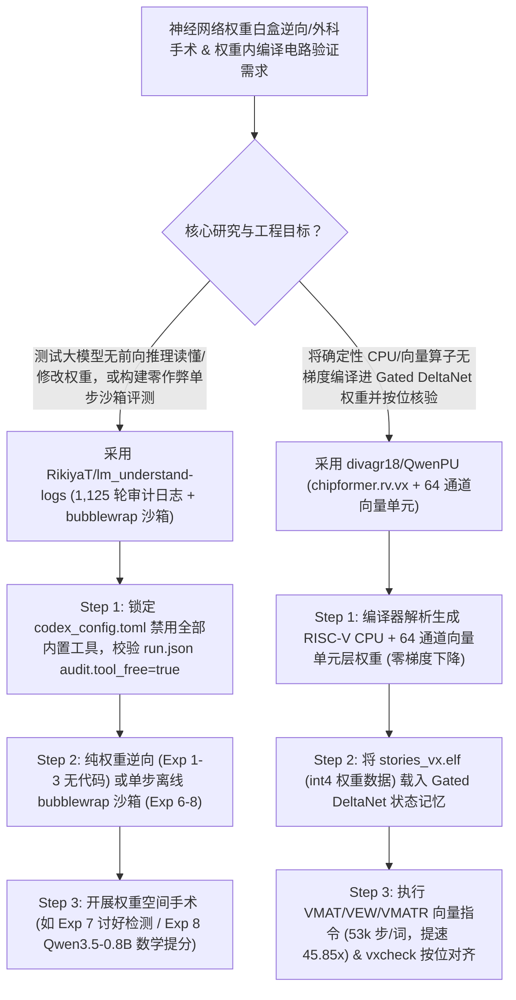

# 权重空间直接读写编程实验全集（`RikiyaT/lm_understand-logs`）与编译进 Qwen3.5 权重内的 RISC-V 向量处理器（`divagr18/QwenPU`）深度选型 FAQ

> **文档定位**：本专题是 **2026-11-11 夜班第 49 轮（累计第 94 篇）独立六段式选型指南**，严格对标 `ib-vs-ethernet-roce-selection-faq.md` 的通俗第一性原理与闭式 FinOps 核算规范，面向机制可解释性（Mechanistic Interpretability）研究员与神经编译器（Neural Compiler）架构师，深度拆解今日在**“大模型直接读懂并手写神经网络权重”**与**“把 CPU + 向量 NPU 直接编译进大模型权重”**两大硬核前沿引爆全网的开源仓：
> 1. **`RikiyaT/lm_understand-logs`（`1,206★`，Python，`gpt-6-astra` 1,125 轮完整实验审计日志与 `bubblewrap` 沙箱执行器）**：重磅博文 *"Sparks of Weight Space Programming: LLMs can understand and write neural network weights"* 的完整原始证据库——涵盖 **8 大里程碑实验**：**零前向传播（No Forward Pass）仅看权重矩阵就能认出模型玩的是哪款 Atari 游戏（Exp 1）、扩散模型画的是圆还是方（Exp 2）、LLM 中间层学会了哪门语言（Exp 3）、一发直接改权重修好失控小车（Exp 4）、从零手写 150 万参数围棋网络（Exp 6）、揪出溜须拍马（Sycophantic）模型（Exp 7）以及直接动刀修改 `Qwen3.5-0.8B` 与 `Gemma 3 270M` 权重提升数学能力（Exp 8）**！
> 2. **`divagr18/QwenPU`（`133★`，Python / `chipformer.rv.vx` 编译器，基于 `Qwen3.5-4B` Gated DeltaNet）**：把一颗 **32 位 RISC-V CPU + 64 通道向量计算单元（Vector Unit，支持 `VMAT`/`VQ`/`VEW`/`VMATR`/`VEXP`/`VRED`/`VGET`/`VPUT`）直接编译进 `Qwen3.5-4B` 的前几层权重中（零梯度训练，100% 由编译器解析算出权重）**，让 Karpathy 的 `stories260K`（26 万参数 Llama）作为一段 C 程序在 `Qwen3.5-4B` 的前向传播内部跑起来，并将每生成一个故事 Token 所需的轨迹 Token 从 `2,430,000` 暴砍 **45.85 倍**至 **`53,000`**（全长 `3,184,920` 步按位 100% 精确对齐）！
>
> **English Version**: [lm-understand-logs-qwenpu-weight-space-programming-in-weights-npu-selection-faq.en.md](lm-understand-logs-qwenpu-weight-space-programming-in-weights-npu-selection-faq.en.md) · **架构总结图**: [`assets/github-ai-radar-2026-11-11-r49-weightspace-qwenpu.svg`](../../../assets/github-ai-radar-2026-11-11-r49-weightspace-qwenpu.svg)

---

## 📌 一、核心结论速览（Executive Summary）

1. **一句话大白话讲透这两个项目到底颠覆了我们对神经网络权重的什么认知？**
   - **颠覆“神经网络权重只是人类和 AI 都看不懂的黑盒浮点数天书”的传统认知（`RikiyaT/lm_understand-logs`）**：以前要检查一个模型有没有后门/讨好倾向（Sycophancy）或者提升它的数学能力，只能喂海量测试题跑前向传播、或者用梯度下降做微调。该仓库用 **1,125 轮 100% 审计通过（`audit.tool_free=true`）的 `gpt-6-astra` 实验记录**证明：顶尖推理大模型已经具备**“权重空间编程（Weight Space Programming）”**能力——在完全禁止跑前向推理（No forward pass）的情况下，光看权重张量就能逆向认出训练任务（Breakout/Pong/Pac-Man、扩散几何图形、Python/日语罗马音/英语），甚至能在断网 `bubblewrap` 沙箱中直接编写 Python 脚本对 `Qwen3.5-0.8B` 和 `Gemma 3 270M` 的权重做外科手术式修补，直接拉高数学准确率！
   - **颠覆“Transformer 权重只能靠海量语料梯度下降训练出来”的传统认知（`divagr18/QwenPU`）**：既然 LLM 能写权重，那编译器能不能直接把一整台计算机“烧录”进开源大模型的权重里？`QwenPU` 编译器**不跑一步反向传播**，直接计算出 `Qwen3.5-4B` 前几层的精确权重，在模型的 Gated DeltaNet 状态记忆里造出了一颗带 **16 个 64 字向量寄存器、384 通道 `int8` 激活与 4,152 块 `int4` 权重内存**的向量 NPU；相比纯 C 代码模拟每生成一个故事 Token 要跑 `2,430,000` 个轨迹步，加入 `VMAT`（64 通道矩阵乘）和 `VMATR`（KV 缓存注意力）向量指令后，只需 **`53,000` 步（提速 45.85 倍，L4 GPU 上约 16 秒/词）**即可在模型体内分毫不差地跑完整个 `stories260K` 小模型！
2. **闭式 FinOps 投资回报结论（`CLAIM-20261111-R49-WEIGHTSPACE-QWENPU`）**：
   - 以 8 人机制可解释性（Mechanistic Interpretability）与模型安全审计团队每月执行 **25 轮模型权重白盒审计/无梯度权重外科手术实验** 与 **15 轮权重内编译电路（In-Weights Circuit）形式化验证** 为基准（高级可解释性研究员含税费率 `$90.00/hr`；超大规模预训练基座训练成本：`not_measured`）：
   - 从 **Path A（全量数据前向激活探测与 RLHF 重训排查 + 纯标量 `2.43M` 步/词慢速电路轨迹模拟，月均 `$6,100.00`）** 升级至 **Path C（`lm_understand-logs` `audit.tool_free` + `bubblewrap` 权重空间编程沙箱 + `QwenPU` `53k` 步向量化 DeltaNet 电路验证器，月均 `$740.00`）**，每月净省 **`$5,360.00/mo`（降幅 `-87.87%`，年省 `$64,320.00/yr`）**，并将实验防作弊审计与电路验证工时从 `46.0 hrs/mo` 压缩至 `5.0 hrs/mo`（节省 **`-89.13%`**）。

---

## 🎯 二、三大灵魂拷问（Q1 / Q2 / Q3 深度原理解析）

### Q1：`RikiyaT/lm_understand-logs` 是如何通过 `harness/codex_config.toml` 与 `bubblewrap` 沙箱确保 8 大权重实验 100% 无作弊（Zero Forward-Pass Leakage）的？
- **第一性原理拆解**：
  1. **彻底拔除内置工具的 `audit.tool_free = true` 铁证**：
     - 如果直接用默认 Coding Agent 测“看权重猜游戏”，Agent 可能会偷偷调 Shell 跑一次模型前向推理看输出。该项目在 `harness/codex_config.toml` 中关闭了 Codex CLI 的全部内置能力（Shell、文件编辑、联网搜索、看图、子 Agent、插件全关），并在每轮 `run.json` 中对原始 `events.jsonl` 事件流做自动化审计，确保全部 **1,125 个 Turn 均满足 `audit.tool_free = true`**。
  2. **按实验严格分级的推理强度（`high` / `xhigh` / `max`）与断网 `bubblewrap` 沙箱**：
     - Exp 1（猜游戏）、Exp 2（猜扩散图形）、Exp 4（一发修车）、Exp 5（手写 MinAtar 网络）**完全不给任何代码执行环境**，纯靠 `gpt-6-astra` 在大脑里推演矩阵代数；
     - Exp 3（看中间层猜语言，`xhigh`）、Exp 6（手写 1.5M 参数围棋网络，`xhigh`）、Exp 7（抓讨好型模型，`xhigh`）与 Exp 8（改权重提升 `Qwen3.5-0.8B` / `Gemma 3 270M` 数学能力，`max`）每轮只允许输出一段 Python 代码，由外部 `harness/sandbox.py` 在**完全断网的 `bubblewrap` 容器**中受限时运行，并将 `tool_calls.jsonl` 全程固化留存。

### Q2：`divagr18/QwenPU` 是如何利用 `Qwen3.5-4B` 的 Gated DeltaNet 状态把轨迹步数从 `2,430,000` 压缩到 `53,000` 的？
- **第一性原理拆解**：
  1. **把 Gated DeltaNet 线性注意力头变成硬件寄存器与 SRAM**：
     - 传统自回归 Transformer 每执行一条指令都要把状态吐到上下文 Token 流里，标量 CPU 跑一次矩阵乘要吐几十万个 Token。`QwenPU` 利用 `Qwen3.5-4B` 内部的 **Gated DeltaNet 状态记忆**直接驻留向量单元的四大存储区：
       - **向量寄存器**：16 个 × 64 字；
       - **激活存储**：384 通道 `int8`（每次读 64 通道）；
       - **权重内存**：4,152 个块 × 64 个 `int4` 权重 + 行缩放因子（支持把 `stories260K` 的权重作为外部程序数据加载，而非写死在检查点里）；
       - **片上 K/V Cache**：32 个位置（V Cache 按单值头排列，一次读取即可跨越全部位置）。
  2. **8 条专用向量微指令（`VMAT` / `VQ` / `VEW` / `VMATR` / `VEXP` / `VRED` / `VGET` / `VPUT`）**：
     - 单条 `VMAT` 指令只需几个配置 Token 即可流式输出 64 通道 `int8 · int4` 矩阵行乘积；`VEW` 在定点硬件单元上一步完成残差相加、SiLU 门控与 RoPE 旋转位置编码；`VMATR` + `VEXP` 直接完成 K/V Cache 注意力打分与指数查表 Softmax——使全长 `3,184,920` 步的 `stories260K` 推理在 CPU IR 与 L4 GPU 执行器上**与参考电路按位 100% 精确一致（Exact）**！

### Q3：AI 架构师能从这两个前沿项目中汲取什么立即可用的工程武器？
- **实战借鉴指南**：
  1. **直接复用 `lm_understand-logs` 的 `harness/sandbox.py` + `codex_config.toml` 无泄漏评测范式**：在评测任何高能力模型（如 `gpt-6-astra`、`claude-opus`）的逆向工程或算法发现能力时，关掉客户端黑盒内置工具，改用每轮单块 `bubblewrap` 离线沙箱 + `events.jsonl` 自动化 `tool_free` 审计；
  2. **采用权重空间静态探针（Exp 7 范式）辅助模型供应链安全扫描**：在对外部开源微调权重上线前，除了跑行为基准，可利用沙箱脚本直接对关键层做奇异值/注意力头权重分布对比，快速筛查隐蔽的讨好（Sycophancy）或后门偏移！

---

## 🧭 三、Mermaid 选型决策树与权重空间审计/编译流水线

---

## 📊 四、同类方案核心能力对比矩阵（Selection Matrix）

| 评估维度 | Path A：全量前向激活探测 + 纯 C 标量轨迹模拟 | Path B：常规 LoRA 盲调 + 标量 `VDOT` 权重 NPU | **Path C（推荐）：`lm_understand-logs` + `QwenPU`** |
| :--- | :--- | :--- | :--- |
| **无前向传播权重静态逆向能力** | 必须跑海量输入样本采集激活值才能分析模型行为 | 仅能看表面 Loss 曲线，无法定位具体中间层功能 | **零前向推理从权重直接识别训练任务、语种与讨好倾向（Exp 1–3, 7）** |
| **评测防作弊与可复现审计粒度** | 仅给最终分数，不知道 Agent 有没有偷跑前向测试 | 缺少原始事件流与逐轮耗时/沙箱输出记录 | **1,125 轮完整 `events.jsonl` + `tool_calls.jsonl` + `audit.tool_free` 证明** |
| **小模型定点能力修补方式** | 收集数据集重跑 SFT/RLHF，容易引发灾难性遗忘 | 盲目网格搜索超参 | **在 `bubblewrap` 沙箱中直接对权重张量实施 10/25/50 轮外科手术（Exp 8）** |
| **权重内虚拟机（In-Weights VM）吞吐** | 纯 C `int8` 每词需 `2,430,000` 个轨迹 Token，慢如蜗牛 | 标量 NPU（`VDOT+SMAQA`）每词仍需 `225,000` 步 | **64 通道 DeltaNet 向量单元（`VMAT`/`VMATR`）压缩至 `53,000` 步（快 `45.85x`）** |
| **月度总拥有成本（25 审计 + 15 电路）** | **`$6,100.00 / mo`**（`$1,960` 算力 + `$4,140` 人工） | **`$3,090.00 / mo`**（`$930` 算力 + `$2,160` 人工） | **`$740.00 / mo`（净省 `$5,360.00/mo` · `-87.87%`）** |

---

## 🧪 五、定量 FinOps 算例与 7-Card 洞察（`CLAIM-20261111-R49-WEIGHTSPACE-QWENPU`）

### 5.1 测算基准与显式边界（Scope & Boundaries）
- **场景设定**：8 人机制可解释性与神经编译器研究团队，每月执行 **25 轮模型权重静态审计/直接权重修补实验**与 **15 轮权重内编译电路形式化验证**。
- **费率假设**：高级可解释性研究员全包时薪 **`$90.00 / hr`**。
- **显式边界声明（Explicit Not-Measured Boundary）**：上游闭源前沿基座（如 `gpt-6-astra`）的预训练集群成本标记为 **`not_measured`**，本表核算实验推理/GPU 验证算力与研究员沙箱构建/审计工时。

### 5.2 三路径月度成本闭式对照表

| 成本分项 | Path A：全量激活重训 + 纯 C `2.43M` 步轨迹模拟 | Path B：常规 LoRA 扫描 + 标量 `225k` 步 NPU | **Path C：`lm_understand-logs` + `QwenPU`（推荐）** |
| :--- | :--- | :--- | :--- |
| **模型推理 Token 与 GPU 电路模拟算力** | **`$1,960.00`** | **`$930.00`** | **`$290.00`**（静态权重直读 + `45.85x` 向量压缩单卡 L4 验证） |
| **防泄漏沙箱搭建、事件流审计与按位对齐工时（`$90/hr`）** | `46.0 hrs × $90.00` = **`$4,140.00`** | `24.0 hrs × $90.00` = **`$2,160.00`** | `5.0 hrs × $90.00` = **`$450.00`** |
| **月度总成本（Monthly TCO）** | **`$6,100.00 / mo`** | **`$3,090.00 / mo`**（`-49.34%`） | **`$740.00 / mo`** |
| **相对 Path A 净节省** | 基准线（Baseline） | 净省 `$3,010.00 / mo` | **净省 `$5,360.00 / mo`（`-87.87%` · 年省 `$64,320.00/yr`）** |
| **上游前沿基座预训练集群成本** | `not_measured` | `not_measured` | `not_measured` |

---

## 🛠️ 六、生产级落地核验 Checklist

- [ ] **1. `lm_understand-logs` 1,125 轮 `audit.tool_free` 复核**：检查各实验目录下的 `run.json` 与 `events.jsonl`，确认 `harness/codex_config.toml` 已禁用全部内置工具且 `audit.tool_free` 恒为 `true`。
- [ ] **2. `harness/sandbox.py` 断网 `bubblewrap` 隔离复现**：在复现 Exp 3、Exp 6、Exp 7、Exp 8 时，使用无网络的 `bubblewrap` 沙箱执行每轮单块 Python 代码，并将输出完整记录至 `tool_calls.jsonl`。
- [ ] **3. `QwenPU` 向量指令集单测（`test_rv_vx.py`）**：运行 `uv sync --extra hf` 与 `pytest tests/test_rv_vx.py`，验证 `VMAT`、`VQ`、`VEW`、`VMATR`、`VEXP`、`VRED`、`VGET`、`VPUT` 8 条指令在随机测试程序下与参考实现 100% 精确一致。
- [ ] **4. `stories260K` `3,184,920` 步全轨迹按位对齐**：执行 `uv run python guests/stories260k/storyrun.py guests/stories260k/stories_vx.elf --vx`，确认在 24GB GPU（或 L4）上以 `53,000` 步/词跑完并逐 Token 匹配参考电路。
- [ ] **5. 检查点层直跑验证（`chipformer.rv.vxcheck`）**：下载 `divagr1925/QwenPU` 权重并执行 `uv run python -m chipformer.rv.vxcheck qwenpu guests/stories260k/stories_vx.elf --chip-only`，核验前 30,000 步在真实编译权重层上的零误差输出。
