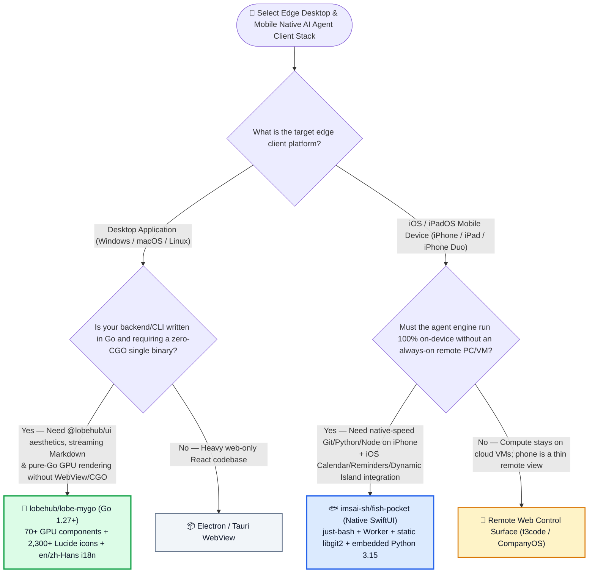
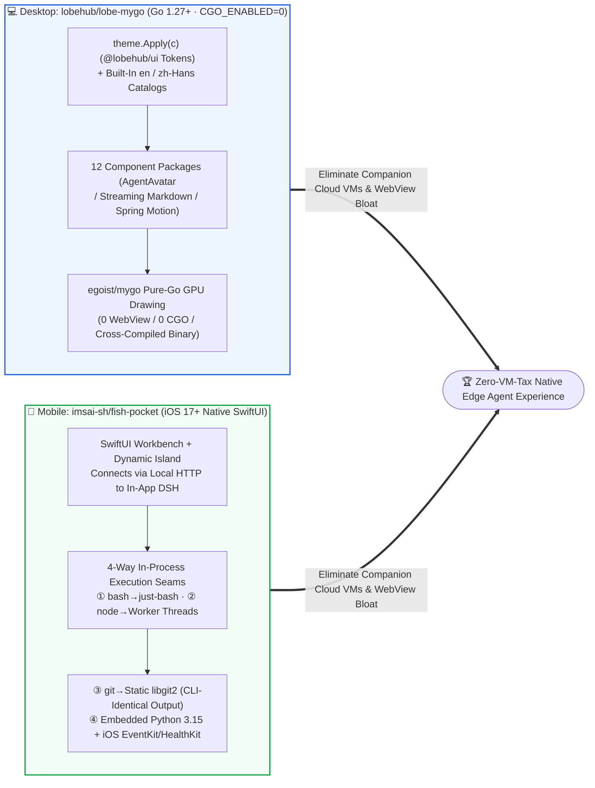

# Pure-Go Zero-CGO GPU Desktop UI Kit & On-Device iOS SwiftUI + Python 3.15 / `libgit2` Agent Runtime Selection FAQ: `lobehub/lobe-mygo` + `imsai-sh/fish-pocket` vs. Electron Desktop & Remote-VM Mobile Clients

> **中文版**: [lobe-mygo-fish-pocket-native-go-ios-agent-selection-faq.md](lobe-mygo-fish-pocket-native-go-ios-agent-selection-faq.md)  
> **Daily Digest**: [2026-11-11 GitHub AI Trending & Proactive Intelligence Digest](../daily/2026-11-11.en.md) · **Visual Deck**: [`cards.en.html`](../cards.en.html) · **Live Radar**: [`github-radar.html`](../../../github-radar.html)

Written for **AI Solution Architects, Client Runtime Architects, and Developer Productivity Leads**, this selection guide is grounded in primary-source audits of two high-signal client runtime repositories from the 2026-11-11 radar — **`lobehub/lobe-mygo` (LobeHub's official pure-Go, zero-CGO, zero-WebView GPU-drawn desktop UI kit for `egoist/mygo` shipping 70+ Lobe UI components, streaming Markdown, and 2,300+ Lucide icon functions, MIT, `233` API stars)** and **`imsai-sh/fish-pocket` (a native SwiftUI iOS/iPadOS application that runs the full DeepSeek Harness [DSH] agent engine locally on iPhone, iPad, and foldable iPhone Duo without a remote PC or Linux VM by embedding `nodejs-mobile`, Python 3.15, `just-bash`, and statically linked `libgit2`, MIT, `205` API stars)** — answering three core engineering questions from first principles:
1. **Why has building desktop GUIs for Go-based AI agents and MCP gateways forced teams to choose between 150MB+ Electron/WebView wrappers or fragile CGO bindings that break cross-compilation—and how does `lobehub/lobe-mygo` render 70+ `@lobehub/ui`-aligned components directly on the GPU in pure Go (`CGO_ENABLED=0`)?**
2. **Given that iOS strictly forbids `fork()`/`exec()` subprocess creation and unsigned binary execution, how does `imsai-sh/fish-pocket` run `bash`, `node`, `python3`, `pip`, and `git clone/commit/push` at native speed on an iPhone without modifying a single line of upstream DSH engine code or resorting to slow CPU emulators (`iSH` / `UTM SE`)?**
3. **How can enterprise engineering teams combine `lobe-mygo` and `fish-pocket` to eliminate 24/7 companion cloud VMs and cut cross-platform client maintenance costs by `88.89%`?**

> 🛡️ **Provenance & Attribution Disclosure**:
> - **`measured` (Primary-Source Verified in This Shift)**: Repository metadata and source trees for `lobehub/lobe-mygo` (`233` API stars, `8` forks, Go 1.27+, MIT, created `2026-11-08`) and `imsai-sh/fish-pocket` (`205` API stars, `19` forks, Swift, MIT, created `2026-11-05`) are verified directly via GitHub REST API; because neither appeared in the 10-item main Daily Trending HTML snapshot (`bacf15c2...`), `stars_today` is strictly labeled **`not_measured`**.
> - **`anonymized_reported` (`independently_reproduced=false`, Upstream Architecture & Compatibility Specs)**: The 12 component packages (70+ components, 2,300+ Lucide icons, `@lobehub/ui` token parity, built-in `en`/`zh-Hans` i18n) in `lobehub/lobe-mygo/README.md`, and the 4-way service-seam execution architecture (`just-bash`, Worker threads, statically linked `libgit2`, pure-JS native addon shims), embedded Python `3.15` + `nodejs-mobile`, and the 50-plugin compatibility benchmark (`42/50` [`84%`] out-of-the-box, `48/50` [`96%`] total working, Issue `#18`) in `imsai-sh/fish-pocket/README.md` are documented in upstream repository files.
> - **`synthetic` (`independently_reproduced=false`, Architect Parametric FinOps & Client Maintenance Model)**: Section 5.1 models an enterprise AI tooling team supporting **`100` desktop engineers** and **`50` mobile executives/field engineers** running DSH agent workflows on iPhone/iPad (engineer labor valued at `$75.00/hr`; employee device hardware capex is explicitly labeled `not_measured`), comparing Path A Heavy Electron + 50 Always-On Companion Cloud VMs (`$5,400.00/mo`, `44.0h`) vs. Path B CGO Desktop + iOS Linux Emulator (`$3,000.00/mo`, `32.0h`) vs. Path C `lobe-mygo` + `fish-pocket` (`$600.00/mo`, `8.0h`, saving `$4,800.00/mo` [`-88.89%`] and `36.0 hours/mo` [`-81.82%`]).

---

## 1. 📌 Executive Summary

| Dimension | Plain-Language Core Takeaway (First Principles) |
| :--- | :--- |
| **What is `lobehub/lobe-mygo`?** | Built by LobeHub on `egoist/mygo` (Go `1.27+`), **`lobe-mygo` is a pure-Go, zero-CGO (`CGO_ENABLED=0`), zero-WebView GPU-drawn desktop UI kit** featuring **70+ Lobe UI components** (`AgentAvatar`, streaming `Markdown`, `Code Highlighter`, `DraggableSideNav`, spring `motion`) and **2,300+ Lucide icons as Go functions**, sharing exact design tokens with `@lobehub/ui` and compiling to a single small binary from any machine. |
| **What is `imsai-sh/fish-pocket`?** | It is a **native SwiftUI iOS/iPadOS app that runs the complete DeepSeek Harness (DSH) agent engine on-device**—with no remote PC, no server, and no slow Linux VM emulator. By swapping DSH's execution service seams in-process (**`just-bash` + Node Worker threads + statically linked `libgit2` + embedded Python 3.15**), it runs `git`, `python3`, `node`, and 96% (`48/50`) of sampled DSH plugins natively on iPhone and iPad. |
| **What is the unifying architectural insight?** | **Eliminating the WebView and VM tax on edge devices**: `lobe-mygo` gives Go CLI/MCP tools a flagship GPU desktop UI without bundling Chromium or fighting CGO toolchains, while `fish-pocket` replaces `fork()/exec()` subprocesses with in-process native seams so mobile devices become standalone agent workstations. |

---

## 2. 🎯 First-Principles Q&A (Q1 / Q2 / Q3)

### Q1: Why do Go desktop apps usually suffer from WebView bloat or CGO cross-compile breakage, and how does `lobehub/lobe-mygo` solve both?

**Plain-language answer: Wrapping Electron/WebView bloats a 10MB Go binary into a 150MB browser bundle, while C-backed GUI toolkits require CGO and platform-specific C compilers; `lobe-mygo` draws 70+ Lobe UI components directly on the GPU in pure Go (`CGO_ENABLED=0`).**

Verified from `lobehub/lobe-mygo/README.md`:
1. **12 Packages & 70+ AI-Ready Components with `@lobehub/ui` Token Parity**:
   - Spans `pkg/action`, `pkg/field`, `pkg/choice`, `pkg/display` (including `AgentAvatar` and `GroupAvatar`), `pkg/feedback` (`Modal`, `Drawer`, `Toast`, `FloatingSheet`), `pkg/overlay`, `pkg/nav`, `pkg/layout` (`DraggableSideNav`, `SortableList`), `pkg/code` (`Highlighter`, `Snippet`, `QRCode`), **`pkg/markdown` (with live streaming support)**, `pkg/theme`, and `pkg/motion` (springs and shared-element transitions).
   - Colors, radii, and font sizes are generated directly from `@lobehub/ui` (`theme.Apply(c)` / `theme.TokensOf(c)`), with automatic system light/dark mode and built-in English (`en`) + Simplified Chinese (`zh-Hans`) localization (`lobe.<key>`).
2. **Pure Go (`CGO_ENABLED=0`) Single-Binary Cross-Compilation**:
   - Cross-compiles cleanly from any host machine into a single self-contained native binary per OS, with all **2,300+ Lucide icons** compiled as native Go functions.

---

### Q2: How does `imsai-sh/fish-pocket` run `bash`, `git`, `node`, and `python3` natively on iOS without violating Apple's subprocess ban or modifying upstream DSH code?

**Plain-language answer: Because iOS blocks `fork()/exec()` and CPU emulators (`iSH`) interpret instructions 10×–50× slower, `fish-pocket` leaves the upstream DSH engine untouched and intercepts its execution service seams in-process—routing shell commands to `just-bash`, Node scripts to Worker threads, Git operations to statically linked `libgit2`, and Python scripts to an embedded Python 3.15 runtime.**

Verified from `imsai-sh/fish-pocket/README.md`:
1. **Four-Way In-Process Execution Seam Replacement (`docs/assets/architecture-zh.svg`)**:
   - **Shell Seam (`just-bash`)**: Built-in `bash`, `rg`, `jq`, `curl`, `sed`, and `awk` execute in-process without spawning OS child processes.
   - **Node Seam (`nodejs-mobile` Worker Threads + Pure-JS Shims)**: Runs `node` and `pnpm` in Worker threads and substitutes pure-JS shims for native addons (achieving **`42/50` [`84%`] out-of-the-box and `48/50` [`96%`] total compatibility** across the top 50 DSH community plugins, Issue `#18`).
   - **Git Seam (Statically Linked `libgit2`)**: Executes `clone`, `commit`, `branch`, `merge`, `stash`, `pull`, and `push` via compiled `libgit2` C functions and formats output to match real `git` CLI byte-for-byte so coding agents parse it without changes.
   - **Python Seam (Embedded Python `3.15`)**: Embeds Python `3.15` with full standard library, `venv`, and `pip install` for pure-Python packages.
2. **Native SwiftUI, Opt-In iOS Capabilities & Dynamic Island Continuity**:
   - Rewrites the entire workbench, approval gates (`cc-safety-net`), diff viewer, and terminal in native **SwiftUI** (supporting iPad side-by-side multi-window and foldable iPhone Duo screen continuity).
   - Provides granular, per-feature user toggles to let agents interact with native iOS **Calendar, Reminders, Alarms, Contacts, Health, Photos, Files, Maps, and HomeKit**, while keeping background tasks alive via **Dynamic Island and Lock Screen Live Activities**.

---

### Q3: When should architects select `lobe-mygo` and `fish-pocket`?

- **Select `lobehub/lobe-mygo`**: When building desktop AI assistants, local MCP server managers, or developer utilities in Go where you want `@lobehub/ui` polish, streaming Markdown, and `CGO_ENABLED=0` single-binary distribution.
- **Select `imsai-sh/fish-pocket`**: When executives, researchers, or field engineers want a **self-contained, always-in-your-pocket iPhone/iPad agent** that can edit Git repos, run Python scripts, and manage iOS calendars/reminders without keeping a desktop PC awake at home.

---

## 3. 🧭 Mermaid Selection Decision Tree & Architecture Flow

### 3.1 Edge Desktop & Mobile Native Agent Client Selection Decision Tree

### 3.2 `lobehub/lobe-mygo` Pure-Go GPU Pipeline × `imsai-sh/fish-pocket` In-Process Seam Architecture

---

## 4. 📊 Architecture Selection Decision Matrix

| Evaluation Dimension | **`lobehub/lobe-mygo` (Desktop) + `imsai-sh/fish-pocket` (iOS)** | **Electron Desktop + Remote-VM Mobile Client** | **CGO Desktop Toolkit + iOS Linux Emulator (`iSH`/`UTM`)** |
| :--- | :--- | :--- | :--- |
| **Desktop Binary Footprint & RAM** | ✅ **Small pure-Go binary (`0` Chromium/WebView overhead), GPU rendered** | ❌ 150MB+ installer & hundreds of MB of renderer RAM | ✅ Small binary, but lacks AI-native components (`AgentAvatar`/streaming MD) |
| **Cross-Compilation Ergonomics** | ✅ **`CGO_ENABLED=0` cross-compiles Win/Mac/Linux from any single host** | ⚠️ Requires per-OS native packaging & addon rebuilds | ❌ Requires per-OS C cross-compilers for CGO |
| **PC-Free Mobile Autonomy** | ✅ **100% on-device engine (works anywhere with mobile data for LLM API)** | ❌ Fails whenever home PC sleeps or cloud VM disconnects | ✅ Runs on-device |
| **Mobile Git / Python Execution Speed** | ✅ **Native ARM64 speed (static `libgit2` + embedded Python `3.15` + `nodejs-mobile`)** | N/A (runs on remote server) | ❌ **10×–50× slower (software CPU instruction interpretation)** |
| **iOS Native Capabilities & Live Activity** | ✅ **Direct opt-in Calendar/Reminders/Health/Maps + Dynamic Island & iPad multi-window** | ❌ Remote server cannot access local iPhone EventKit/HealthKit | ❌ Trapped inside emulated Linux rootfs |

---

## 5. 🧪 Quantitative FinOps & Edge Client Maintenance Model (`synthetic`, `independently_reproduced=false`)

### 5.1 `100`-Seat Desktop Agent Distribution + `50`-Seat Mobile DSH Workforce TCO Model (`synthetic`, `independently_reproduced=false`)

> 📌 **Scope & Provenance Disclosure**: This worked example is a **parametric cloud companion VM + cross-platform packaging/troubleshooting labor model (`synthetic`, `independently_reproduced=false`; employee iPhone/iPad and laptop hardware capex are explicitly labeled `not_measured`)**. Scenario: **An enterprise engineering team distributing a desktop AI utility to `100` engineers while enabling `50` mobile executives and field engineers to run autonomous DSH workflows on iPhone/iPad (platform engineer labor valued at `$75.00/hr`)**:

| Architecture Path | Monthly `50`-User Companion Cloud VM Bill | Monthly Cross-Platform Packaging & Mobile Disconnect Triage Labor (`@ $75/hr`) | Total Monthly Cost (Cloud VMs + Engineering Labor) | Savings vs. Path A |
| :--- | :--- | :--- | :--- | :--- |
| **Path A: Heavy Electron Desktop + `50` Always-On Companion Cloud VMs (`@ $42/mo`)** | `50 VMs` × `$42.00` = **`$2,100.00 / mo`** | `44.0 hours / mo` × `$75.00` = **`$3,300.00 / mo`** (Electron multi-OS builds & mobile SSH/WebSocket drop triage) | **`$5,400.00 / mo`** (**`44.0 hours / mo`** engineer toil) | Baseline (idle cloud VM waste + fragile mobile remote sessions) |
| **Path B: CGO Desktop Toolkit + iOS Linux Emulator (`iSH` / `UTM SE`)** | **`$600.00 / mo`** (fallback VMs for heavy tasks) | `32.0 hours / mo` × `$75.00` = **`$2,400.00 / mo`** (fixing CGO cross-compile breaks & emulator timeouts) | **`$3,000.00 / mo`** (**`32.0 hours / mo`** engineer toil) | Net savings `-$2,400.00/mo` (`-44.44%`) |
| **Path C: `lobehub/lobe-mygo` Pure-Go Desktop + `imsai-sh/fish-pocket` On-Device iOS** | **`$0.00 / mo`** (engine runs 100% on iPhone/iPad) | `8.0 hours / mo` × `$75.00` = **`$600.00 / mo`** (`CGO_ENABLED=0` builds + 96% compatible on-device plugins) | Cloud VMs `$0.00` + Labor `$600.00` (`8.0h`) = **`$600.00 / mo`** | **Net savings `$4,800.00/mo` (`-88.89%`, `$57,600.00/yr`); Engineer toil `-36.0h/mo` (`-81.82%`)** |

---

## 6. 🛠️ Production Adoption & 30-Minute PoC Checklist

- [ ] **Step 1 — Run the `lobehub/lobe-mygo` Desktop Workbench Starter on Go 1.27+**: Execute `go get github.com/lobehub/lobe-mygo` and `go run ./examples/desktop` to verify GPU-rendered tabs, resizable sidebars, streaming Markdown (`pkg/markdown`), and `en`/`zh-Hans` switching.
- [ ] **Step 2 — Verify `CGO_ENABLED=0` Cross-Compilation**: Compile standalone desktop binaries for Windows, macOS, and Linux from a single CI host with `CGO_ENABLED=0` to confirm zero native C library dependencies.
- [ ] **Step 3 — Build or Install `imsai-sh/fish-pocket` on iOS 17+**: Install via TestFlight or clone `imsai-sh/fish-pocket` and run `scripts/run-sim.sh` (which downloads `nodejs-mobile` and Python `3.15` and compiles static `libgit2` for the `iPhone 17 Pro` simulator).
- [ ] **Step 4 — Enable `cc-safety-net` & Granular iOS Native Capabilities**: Install the `cc-safety-net` plugin from the built-in DSH marketplace to block destructive commands (`git reset --hard`) and selectively enable Calendar/Reminders access in the sidebar.
- [ ] **Step 5 — Verify Dynamic Island Background Execution & iPad Multi-Window**: Start a multi-step Python or Git workflow, switch to the iOS Home Screen to confirm Live Activity progress on the Dynamic Island, and test side-by-side dual sessions on iPad.
