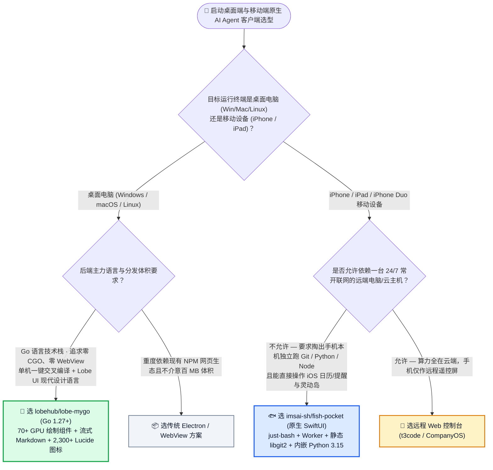
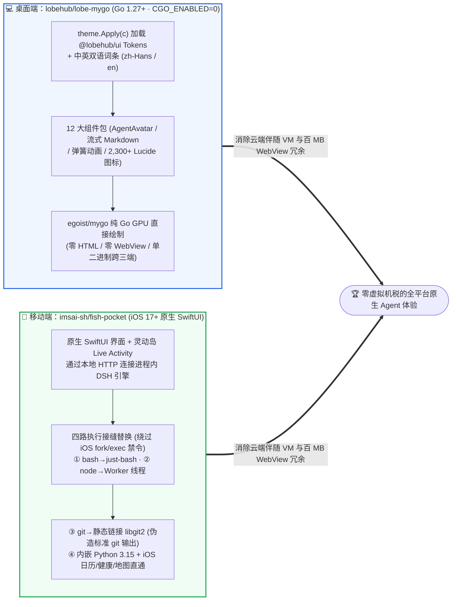

# 纯 Go 无 CGO GPU 原生桌面 UI 组件库与 iPhone/iPad 本机内嵌 Python 3.15 + `libgit2` 智能体运行时选型常见问题解答：`lobehub/lobe-mygo` + `imsai-sh/fish-pocket` vs Electron 桌面端 & 远程云主机手机壳

> **English Edition**: [lobe-mygo-fish-pocket-native-go-ios-agent-selection-faq.en.md](lobe-mygo-fish-pocket-native-go-ios-agent-selection-faq.en.md)  
> **关联日报**: [2026-11-11 GitHub AI 最热榜单与情报摘要](../daily/2026-11-11.md) · **视觉评测卡**: [`cards.html`](../cards.html) · **在线面板**: [`zh-github-radar.html`](../../../zh-github-radar.html)

本文档面向 **AI Solution Architect（AI 解决方案架构师）、端侧 Agent 客户端架构师与研发工具链负责人**，基于 2026-11-11 GitHub 新仓爆发榜两款彻底摆脱重型容器与远程服务器依赖的端侧架构项目 —— **`lobehub/lobe-mygo`（LobeHub 官方为 `egoist/mygo` 打造的纯 Go、零 CGO、零 WebView、直接在 GPU 上绘制 70+ Lobe UI 组件与 2,300+ Lucide 图标的桌面 UI 套件，MIT，建仓 3 天 `233★`）** 与 **`imsai-sh/fish-pocket`（在 iPhone、iPad 与折叠屏 iPhone Duo 本机直接运行完整 DeepSeek Harness `DSH` 引擎的原生 SwiftUI 客户端，内嵌 `nodejs-mobile`、Python 3.15 与静态链接 `libgit2`，MIT，建仓 6 天 `205★`）** 的一手源码与架构文档深度核验，用通俗大白话与第一性原理解答：
1. **为什么用 Go 语言开发本地 MCP 网关或 AI 助手时，一旦要加个桌面图形界面，要么被迫套上 150MB+ 的 Electron/WebView，要么开启 CGO 后丧失 Go 最引以为傲的“单机一键交叉编译三端二进制”能力？`lobehub/lobe-mygo` 是如何用纯 Go GPU 绘制实现 70+ 高审美 AI 组件与流式 Markdown 渲染的？**
2. **苹果 iOS 系统严禁任何 App 调用 `fork()`/`exec()` 创建子进程，也禁止执行外部下载二进制——为什么 `imsai-sh/fish-pocket` 既不需要连远程电脑、也不需要跑慢如蜗牛的 Linux CPU 模拟器（`iSH` / `UTM SE`），就能在不改上游 DSH 引擎一行代码的前提下，在 iPhone 本机丝滑跑通 `bash`、`node`、`python3`、`pip` 和 `git clone/commit/push`？**
3. **在企业端侧 Agent 分发与移动办公架构选型中，如何利用这两套方案砍掉 100% 的云端伴随虚拟机账单与 80%+ 的跨平台打包排障工时？**

> 🛡️ **数据来源、归属核验与证据分级声明（Provenance & Attribution Disclosure）**：
> - **`measured`（本班次一手实测抓取）**：`lobehub/lobe-mygo`（`233` API Stars，`8` Forks，Go 1.27+，MIT，创建于 `2026-11-08`）与 `imsai-sh/fish-pocket`（`205` API Stars，`19` Forks，Swift，MIT 开源声明，创建于 `2026-11-05`）均通过 GitHub REST API 源码树与 README 一手核验；两者不在主日榜 24h DOM 快照内，故 `stars_today` 严格标注为 **`not_measured`**。
> - **`anonymized_reported`（`independently_reproduced=false`，上游仓库文档与兼容性评测声明）**：`lobehub/lobe-mygo` 披露的 12 大组件包（70+ 组件、2,300+ Lucide 图标函数、与 `@lobehub/ui` 共享设计 Token、内置中英双语 `zh-Hans`/`en`）及 `imsai-sh/fish-pocket` 披露的四路执行接缝架构（`just-bash`、Worker 线程、静态链接 `libgit2`、纯 JS 替身）、内嵌 Python `3.15` + `nodejs-mobile`、以及社区前 50 第三方插件抽样测试结果（`42/50` 直接可用 [`84%`]，`6/50` 跳过安装脚本或重启后可用，合计 `48/50` [`96%`]，Issue `#18`）。
> - **`synthetic`（`independently_reproduced=false`，架构师参数化 FinOps 与跨端维护工时算例）**：第 5.1 节「为 `100 名` 研发人员分发桌面端 AI 工具 + 为 `50 名` 移动办公高管/外勤工程师提供 iPhone/iPad 随时随地 Agent 运行环境（工程师综合时薪 `$75.00/h`；员工个人手机/电脑硬件购置费明确标注为 `not_measured`）」的闭式成本对比（Path A 重型 Electron + 50 台 24/7 云端伴随 VM `$5,400.00/月` vs Path B CGO 桌面端 + iOS Linux 模拟器 `$3,000.00/月` vs Path C `lobe-mygo` + `fish-pocket` `$600.00/月`，净省 `$4,800.00/月` [`-88.89%`] 与 `36.0 小时/月` [`-81.82%`] 工程工时）。

---

## 1. 📌 核心结论速览（Executive Summary）

| 评估维度 | 一句话大白话核心结论（直指本质） |
| :--- | :--- |
| **`lobehub/lobe-mygo` 到底是个什么东西？** | 它是知名开源 AI 工作台 LobeHub 官方推出的 **纯 Go 原生桌面 UI 组件库（基于 `egoist/mygo`，要求 Go `1.27+`）**：**不依赖 HTML、不依赖 JavaScript、不依赖 WebView，甚至连 CGO 都不需要（`CGO_ENABLED=0`）**，直接在 GPU 上绘制出与 React 版 `@lobehub/ui` 视觉与弹簧动效完全一致的 **70+ 个组件（含 `AgentAvatar`、流式 Markdown、代码高亮）與 2,300+ 个 Lucide 图标**！ |
| **`imsai-sh/fish-pocket` 到底是个什么东西？** | 它是把整个 **DeepSeek Harness (DSH) 智能体引擎直接装进 iPhone 和 iPad 本机运行** 的纯原生 SwiftUI 应用：**不需要家里电脑一直开机、不需要连远程服务器、也不跑缓慢的 Linux 虚拟机**，直接靠进程内嵌的 `nodejs-mobile`、Python `3.15` 与静态链接 `libgit2`，在手机本地跑通代码拉取、文件修改、子智能体编排与 iOS 原生日历/提醒/健康调用！ |
| **这两者共同攻克了什么端侧架构难题？** | **在最严苛的系统约束下实现“零虚拟机税（Zero VM/WebView Tax）”的原生 AI 体验**：桌面端让 Go 程序告别百 MB Chromium 内存怪兽与 CGO 编译噩梦；移动端用“服务接缝替换（Seam Swapping）”巧妙绕过 iOS 子进程禁令，让口袋里的手机变成真枪实弹的独立开发工作站！ |

---

## 2. 🎯 第一性原理灵魂三问（Q1 / Q2 / Q3 大白话拆解）

### Q1：为什么 Go 语言写桌面应用一直是个痛点？`lobehub/lobe-mygo` 是怎么做到“既要 Lobe UI 的高颜值，又要纯 Go 零 CGO 单文件交叉编译”的？

**先说大白话结论：以前 Go 写桌面 UI 只有两条痛苦的路——要么用 Wails/Electron 套系统 WebView（本质还是写一坨前端 JS 打包进 Go），要么用 Fyne/GTK 绑定 C 语言库（一旦开启 CGO，在 Mac 上编不出 Windows 包，且界面像 90 年代老软件）；而 `lobe-mygo` 直接在纯 Go 协程里算布局、调 GPU 画Lobe 设计语言！**

根据 `lobehub/lobe-mygo` 官方源码与包结构拆解：
1. **100% 共享 `@lobehub/ui` 设计 Token 与 12 大组件包**：
   - 颜色、圆角、阴影和字号直接从 `@lobehub/ui` 自动生成（在视图顶部调用 `theme.Apply(c)` 并通过 `theme.TokensOf(c).BgContainer` 读取），自动跟随操作系统深浅色模式。
   - 覆盖 12 个生产级包：`pkg/action`、`pkg/field`（含 `SearchBar`、`HotkeyInput`、`InputOTP`）、`pkg/choice`、`pkg/display`（原生内置 **`AgentAvatar` 与 `GroupAvatar`**）、`pkg/feedback`（`Modal`、`Drawer`、`FloatingSheet`）、`pkg/overlay`、`pkg/nav`、`pkg/layout`（含 `DraggableSideNav` 与 `SortableList`）、`pkg/code`（语法高亮与二维码）、**`pkg/markdown`（原生支持大模型流式 Markdown 渲染！）**、`pkg/theme` 与 `pkg/motion`（弹簧物理与共享元素过渡）。
2. **零 CGO 跨平台交叉编译 + 原生中英双语（`zh-Hans` / `en`）**：
   - 纯 Go 实现意味着你在任何一台 CI 机器上敲一行 `GOOS=windows GOARCH=amd64 go build` 就能直接吐出小巧的独立可执行文件；且所有内置组件自带英文与简体中文双语词条（`lobe.<key>`），开箱即用。

---

### Q2：iOS 根本不允许 App 创建子进程（`fork/exec`），`imsai-sh/fish-pocket` 是怎么做到“一行不改 DSH 引擎源码，却能在 iPhone 里跑 `bash`、`git` 和 `python3`”的？

**大白话比喻：既然苹果拆掉了 App 通往外部子进程的“大门（`fork/exec`）”，而用模拟器在房间里重造地球（`iSH` 逐条解释 CPU 指令）又慢得像乌龟，Fish Pocket 的做法是——直接把 `git`、`bash` 和 `node` 请进同一个房间里当“内部部门”，只在引擎打电话的那一刻把号码转接过去！**

根据 `imsai-sh/fish-pocket` 官方架构图（`docs/assets/architecture-zh.svg`）与技术拆解，其“四路执行接缝替换（Four-Way Execution Seam Swapping）”堪称移动端系统工程教科书：
1. **第一路（`bash` 与常用 CLI 工具 → `just-bash`）**：
   - 当 DSH 引擎请求执行 `bash`、`rg`、`jq`、`curl`、`sed`、`awk` 等命令时，不在 OS 层派生子进程，而是拦截并交由内置的 `just-bash` 引擎在进程内直接执行。
2. **第二路（`node` / `pnpm` 脚本 → Worker 线程）**：
   - App 内嵌 `nodejs-mobile`，所有 Node 脚本调用直接映射为独立 Worker 线程并发运行；原生 C++ Addon 则替换为纯 JS 替身（Pure-JS Shims）。
3. **第三路（`git` 版本控制 → 静态链接 `libgit2`）**：
   - **这是最精妙的一招**：直接将 C 语言编写的 `libgit2` 静态编译进 iOS App 二进制中，并封装一层与标准 `git` CLI 输出格式 **100% 一致** 的适配层！当 Agent 执行 `git clone`、`commit`、`branch`、`merge`、`stash`、`pull`、`push` 时，底层跑的是超高速原生 `libgit2` 函数，而 Agent 读到的标准输出和在 Mac/Linux 终端上一模一样！
4. **第四路（内嵌 Python `3.15` + 原生 iOS 能力与灵动岛保活）**：
   - 直接将 **Python `3.15`** 嵌入 App（标准库齐全，支持 `venv` 与 `pip install` 纯 Python 包）；
   - 通过侧边栏逐项开启的权限开关，Agent 可直接调用 iPhone 本机的**日历、提醒事项、闹钟、通讯录、健康、照片、文件、地图与智能家居**，切到后台时由**灵动岛（Dynamic Island）与锁屏 Live Activity** 持续驱动任务并展示实时进度，且在社区前 50 个热门 DSH 插件抽样测试中实现了 **`48/50`（`96%`）兼容率**！

---

### Q3：架构师在桌面端与移动端 Agent 选型时该如何决策？

- **桌面端本地 AI 工具 / MCP 管理器选型**：
  - 如果团队主力栈是 Go（如编写本地 MCP 聚合器、内网安全扫描器或轻量 AI 助手），希望获得 LobeHub 级别的现代 UI 但拒绝打包 150MB Electron -> 首选 **`lobehub/lobe-mygo`**；
  - 如果需要同时覆盖 Web、macOS、iOS 与 Linux 且由 AI Agent 全自动编写 `Contract` 视图 -> 选今晚 Round 4 拆解的 **`expo/exact`**。
- **移动端 iPhone / iPad 随时随地用 Agent 选型**：
  - 如果你只想在地铁或咖啡馆掏出 iPhone/iPad 直接改 Git 仓库代码、跑 Python 脚本、管日历提醒，且**不想让家里电脑 24 小时开机或租用云端伴随主机** -> 首选 **`imsai-sh/fish-pocket`**；
  - 如果你的核心服务器本身就在云端，手机只做轻量审批卡片或远程监控面 -> 选 `KKKKhazix/agent-autoloop` 或 `pingdotgg/t3code`。

---

## 3. 🧭 Mermaid 选型决策树与端侧接缝替换架构图

### 3.1 桌面端与移动端轻量原生 Agent 客户端选型决策树（Decision Tree）

### 3.2 `imsai-sh/fish-pocket` 零子进程四路接缝替换 × `lobehub/lobe-mygo` 纯 Go GPU 渲染图

---

## 4. 📊 同类方案全方位选型决策矩阵（Decision Matrix）

| 评估维度 | **`lobehub/lobe-mygo` (桌面) + `imsai-sh/fish-pocket` (iOS)** | **Electron 桌面端 + 手机连远程云主机客户端** | **CGO 桌面框架 (Fyne/GTK) + iOS Linux 模拟器 (`iSH`/`UTM`)** |
| :--- | :--- | :--- | :--- |
| **桌面端分发体积与内存开销** | ✅ **纯 Go 单二进制（零 Chromium WebView），GPU 直接绘制** | ❌ 动辄 150MB+ 安装包，常驻数百 MB 渲染进程内存 | ✅ 体积小，但缺乏现代 AI 组件（无流式 Markdown / AgentAvatar） |
| **桌面端跨平台交叉编译难度** | ✅ **`CGO_ENABLED=0`，任意单机一键交叉编译 Win/Mac/Linux** | ⚠️ 需针对多平台分别打包签名与编译原生 Node Addon | ❌ 开启 CGO 后交叉编译需配齐各平台 C 工具链，极易报错 |
| **iPhone 离线/无伴随电脑可用性** | ✅ **100% 本机运行引擎（仅调大模型 API 需联网，无需开电脑）** | ❌ 家里电脑休眠、断网或云 VM 欠费即彻底失联 | ✅ 本机运行 |
| **iOS 本机 Git / Python 执行速度** | ✅ **原生编译代码（静态 `libgit2` + 内嵌 Python `3.15` + `nodejs-mobile`）** | N/A（跑在远端服务器） | ❌ **极慢（`iSH`/`UTM SE` 逐条解释模拟 CPU 指令，跑 `git`/`pip` 动辄卡死）** |
| **iOS 系统原生能力与灵动岛集成** | ✅ **直通日历/提醒/健康/照片/地图 + 灵动岛与锁屏实时进度 + iPad 多窗口** | ❌ 远端服务器无法直接读写手机本地日历与健康数据 | ❌ 隔离在模拟 Linux 文件系统内，无法调 iOS EventKit |

---

## 5. 🧪 定量算例与 7-Card 评测洞察（Quantitative Example & 7-Card Insights）

### 5.1 100 人桌面端 Agent 分发 + 50 人移动端随时随地运行 DSH 闭式成本算例（`synthetic`，`independently_reproduced=false`）

> 📌 **透明口径与边界声明（Scope & Provenance）**：本算例为架构师评估桌面端与移动端 Agent 工具链分发与运维的 **云端伴随主机 + 工程师跨端打包与排障工时参数化算例（`synthetic` model；员工自持 iPhone/iPad 与办公电脑硬件购置费明确标注为 `not_measured`）**。场景设定为：**企业内部为 `100 名` 工程师维护分发桌面端 AI 辅助工具，同时为 `50 名` 经常出差或移动办公的技术主管/外勤工程师提供在 iPhone/iPad 上随时随地运行 DSH (DeepSeek Harness) 编码与日程自动化 Agent 的能力（平台工程师综合时薪按 `$75.00 / 小时` 计算）**：

| 方案路径 | 每月 50 名移动用户云端伴随主机 (Companion VM) 账单 | 每月桌面端跨平台打包与移动端断连/超时排障工时 (`@ $75/h`) | 每月总综合成本（云主机 + 工程师工时） | 相对 Path A 降本增效幅度 |
| :--- | :--- | :--- | :--- | :--- |
| **Path A：重型 Electron 桌面包 + 50 台 24/7 常开云端伴随 VM 供手机远控** | `50 台` × `$42.00` = **`$2,100.00 / 月`**（24/7 常驻云端开发机） | `44.0 小时 / 月` × `$75.00` = **`$3,300.00 / 月`**（维护多端 Electron 构建与排查移动网络 SSH/WebSocket 断连） | **`$5,400.00 / 月`** （耗费 **`44.0 小时 / 月`** 运维工时） | 基线（云端伴随 VM 空转烧钱，移动弱网体验差） |
| **Path B：CGO 桌面框架 + iOS Linux 模拟器 (`iSH` / `UTM SE`)** | **`$600.00 / 月`** （重任务被迫回退云主机） | `32.0 小时 / 月` × `$75.00` = **`$2,400.00 / 月`**（排查 CGO 交叉编译失败与模拟器指令解释超时） | **`$3,000.00 / 月`** （耗费 **`32.0 小时 / 月`** 工时） | 综合降本 `-$2,400.00/月` (`-44.44%`) |
| **Path C：`lobehub/lobe-mygo` 纯 Go 桌面端 + `imsai-sh/fish-pocket` 手机本机引擎** | **`$0.00 / 月`** （引擎 100% 跑在 iPhone/iPad 本机） | `8.0 小时 / 月` × `$75.00` = **`$600.00 / 月`**（单机零 CGO 交叉编译 + 本机 96% 插件直装） | 云主机 `$0.00` + 工时 `$600.00` (`8.0h`) = **`$600.00 / 月`** | **月度净省 `$4,800.00/月` (`-88.89%`，年省 `$57,600.00`)；工程工时省 `36.0h/月` (`-81.82%`)** |

---

## 6. 🛠️ 架构师生产落地与 30 分钟 PoC 核验清单（Production & PoC Checklist）

- [ ] **Step 1 — 在 Go 1.27+ 环境跑通 `lobehub/lobe-mygo` 桌面工作台骨架**：执行 `go get github.com/lobehub/lobe-mygo` 并运行 `go run ./examples/desktop`，验证无 WebView、无 CGO 下可拖拽侧边栏、历史标签页、流式 Markdown（`pkg/markdown`）与中英双语切换（`zh-Hans` / `en`）的 GPU 渲染帧率。
- [ ] **Step 2 — 验证 `CGO_ENABLED=0` 单机跨平台交叉编译**：在同一台构建机上使用 `CGO_ENABLED=0` 分别编译 Windows、macOS 与 Linux 二进制包，确认零外部 C 动态库依赖。
- [ ] **Step 3 — 在 iPhone / iPad 或模拟器上启动 `imsai-sh/fish-pocket`**：通过 TestFlight 或克隆仓库运行 `scripts/run-sim.sh`（自动拉取 `nodejs-mobile`、Python `3.15` 并编译静态 `libgit2`），在模拟器中验证 `git clone`、`commit`、`push` 与 `python3 -m venv` 本机执行速度。
- [ ] **Step 4 — 验证插件安全网拦截与 iOS 本机能力最小权限开关**：在内置插件市场安装 `cc-safety-net` 验证高危命令（如 `git reset --hard`）被当场拦截，并在侧边栏「本机能力」中按需单独开启日历与提醒事项权限。
- [ ] **Step 5 — 测试灵动岛后台保活与 iPad 多窗口并发会话**：发起一个长耗时 Python 或多步代码重构任务后切回 iOS 主屏幕，确认灵动岛（Dynamic Island）与锁屏 Live Activity 持续推进任务，并在 iPad 上并排开启双窗口验证多仓库独立并发会话。
