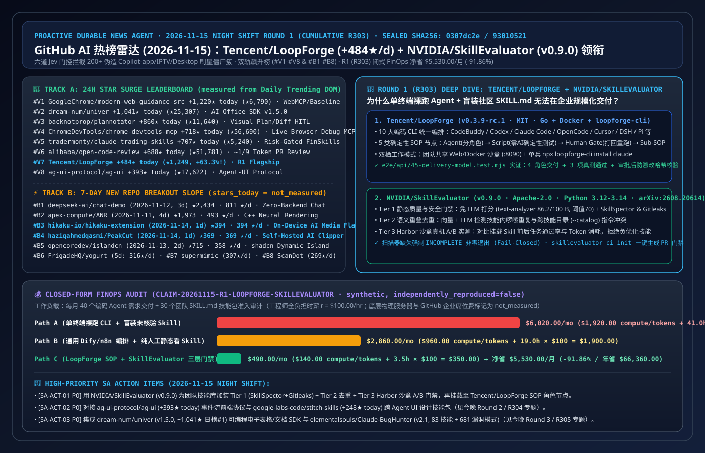
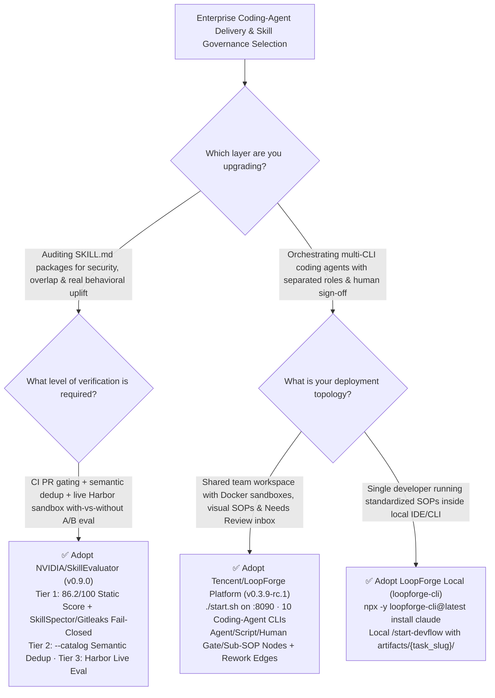

# Multi-CLI Coding-Agent SOP Delivery Workbench & 3-Tier Harbor Skill Impact Evaluation Selection FAQ: `Tencent/LoopForge` + `NVIDIA/SkillEvaluator`

> **Metadata**
> - **Evaluation Batch**: 2026-11-15 Night Shift Round 1 (Cumulative Round 303)
> - **Primary Targets**:
>   1. [`Tencent/LoopForge`](https://github.com/Tencent/LoopForge) (`★ 1,249` Trending DOM / `★ 1,255` live API · Surged **`+484 ★ today`** (**`+63.3%` single-day relative velocity**, GitHub Daily Trending `#7`) · `v0.3.9-rc.1` · MIT License · Tencent's self-hosted coding-agent SOP delivery workspace orchestrating 10 coding CLIs (`CodeBuddy`, `Codex`, `Claude Code`, etc.) across Docker sandboxes, 5 node types, human approval rework gates, and serverless `loopforge-cli` Local workflows)
>   2. [`NVIDIA/SkillEvaluator`](https://github.com/NVIDIA/SkillEvaluator) (`★ 1,372` Trending DOM / `★ 1,376` live API · **`+133 ★ today`** (GitHub Daily Trending `#12`) · `v0.9.0` · Apache-2.0 License · `arXiv:2608.20614` · NVIDIA's official 3-tier framework for evaluating AI agent skills: Tier 1 static quality & `SkillSpector`+`Gitleaks` security gates → Tier 2 semantic overlap deduplication → Tier 3 live `Harbor` sandbox A/B agent evaluation)
> - **Companion Visuals**: [`assets/github-ai-radar-2026-11-15.svg`](../../../assets/github-ai-radar-2026-11-15.svg) · [`assets/github-ai-radar-2026-11-15-r1-loopforge-skillevaluator.svg`](../../../assets/github-ai-radar-2026-11-15-r1-loopforge-skillevaluator.svg)
> - **Sealed Evidence Anchor**: `CLAIM-20261115-R1-LOOPFORGE-SKILLEVALUATOR` (see [`evidence/trending-daily-2026-11-15-audit.json`](../evidence/trending-daily-2026-11-15-audit.json))

---

## 📌 1. Executive Summary & First-Principles Pitch

1. **Plain-Language First Principles**:
   - **`Tencent/LoopForge` (`v0.3.9-rc.1`)**: Think of it as the **assembly line and independent QA station for coding agents**. When you ask a single terminal agent to "fix this bug," it routinely skips planning, forgets tests, grades its own homework, or stops halfway. `LoopForge` does not replace your coding CLIs—it orchestrates **10 coding-agent CLIs** (`CodeBuddy`, `Codex`, `Claude Code`, `OpenCode`, `Cursor CLI`, `Antigravity`, `Kimi Code`, `Pi`, `DeepSeek Harness`, `ZCode`) inside isolated Docker sandboxes using repeatable **SOP workflows** (`Agent` role nodes, zero-AI deterministic `Script` nodes, `Human gate` sign-off with upstream send-back, `Sub-SOP`, and `Preview build`), plus a serverless `npx -y loopforge-cli@latest install claude` (`/start-devflow`) mode for individual developers.
   - **`NVIDIA/SkillEvaluator` (`v0.9.0`, `arXiv:2608.20614`)**: Think of it as a **three-stage wind tunnel and clinical trial for `SKILL.md` packages**. Before your team installs dozens of community skills into Claude Code or Codex, `SkillEvaluator` verifies them across three independent tiers: **Tier 1** runs keyless static quality scoring (the bundled `text-analyzer` scores `86.2/100 (B)` against a default `70` threshold) plus pinned **SkillSpector** and **Gitleaks** security scanners (failing closed as `INCOMPLETE` if any scanner cannot run); **Tier 2** detects intra-skill verbosity and inter-skill semantic overlap (`--catalog`); and **Tier 3** runs live A/B agent evaluations inside **Harbor** Docker sandboxes comparing agent performance **with vs. without the skill**.
2. **Quantified FinOps Impact (`CLAIM-20261115-R1-LOOPFORGE-SKILLEVALUATOR`)**:
   - Across an enterprise workload of **40 coding-agent software requirements delivered/month + 30 internal/community `SKILL.md` packages audited/month** (`engineer_hourly_rate_usd = $100.00/hr`; base server hardware and GitHub Enterprise seat licenses marked `not_measured`):
   - **Path C (`Tencent/LoopForge` + `NVIDIA/SkillEvaluator`)** lowers monthly TCO from **`$6,020.00/mo`** under **Path A (un-orchestrated single-terminal CLIs + unverified community skills)** down to **`$490.00/mo`**, saving **`$5,530.00/mo` (`-91.86%`, or `$66,360.00/yr`)** and reclaiming **`37.5 hrs/mo` (`-91.46%`)** of engineering rework.



---

## ❓ 2. First-Principles Deep Dive (Q1–Q3)

### Q1: Why do single-terminal coding CLIs and generic workflow builders (Dify/n8n) struggle with team software delivery, and how does `Tencent/LoopForge` solve it?
- **The Core Bottleneck**:
  1. **Self-Grading in a Single Context Window**: When the same CLI session writes the plan, edits the code, and reviews its own diff, confirmation bias causes it to skip edge-case tests and declare premature victory.
  2. **Generic Workflow Builders Lack Code-Delivery Primitives**: Tools like Dify, n8n, or Flowise chain LLM API calls, but lack on-demand repository sandboxes, per-user CLI credential isolation, mid-reply *Steer* interruption, and post-approval code integrity checks.
- **How `Tencent/LoopForge` (`v0.3.9-rc.1`) Breaks Through**:
  1. **10 Coding-Agent CLIs with Per-Run Private Home Isolation**: Orchestrates `CodeBuddy`, `Codex`, `Claude Code`, `OpenCode`, `Cursor CLI`, `Antigravity`, `Kimi Code`, `Pi`, `DeepSeek Harness`, and `ZCode`. The seven CLIs beyond Claude Code isolate model and MCP configs in a private home directory per run so every execution strictly uses the responsible user's own API key and Base URL.
  2. **5 SOP Node Types & Rework-on-Failure Edges**: Combines `Agent` (role-specific prompt, executor, model, rules, Skills, MCP), `Script` (deterministic build/test/lint without wasting AI tokens), `Human gate` (a unified `Needs review` inbox to approve, add context, or send work back to an earlier node), `Sub-SOP`, and `Preview build`.
  3. **End-to-End Acceptance Verification (`e2e/api/45-delivery-model.test.mjs`)**: Proven in a real 4-role delivery where agents planned, implemented, and independently reviewed a Python fix, passed 3 deterministic tests, paused at a human approval gate, and verified that accepted code remained unmodified prior to completion.
  4. **Dual-Mode Execution (Platform `:8090` + Serverless `LoopForge Local`)**: Teams deploy `./start.sh` (with optional `MIRROR` registry acceleration verified against official `RepoDigests`), while solo developers run `npx -y loopforge-cli@latest install claude` to execute `/start-devflow` directly inside Claude Code, Codex, Cursor, Pi, DeepSeek Harness, or Hermes Agent.

### Q2: Why is manual `SKILL.md` inspection blind to supply-chain risks and negative agent impact, and how does `NVIDIA/SkillEvaluator` enforce 3-tier verification?
- **The Core Bottleneck**: Community skills frequently contain prompt-injection vectors, leaked tokens, or bloated instructions that conflict with existing skills. Worse, a skill that looks well-written on paper can actively degrade an agent's task completion rate in production.
- **How `NVIDIA/SkillEvaluator` (`v0.9.0`, `arXiv:2608.20614`) Solves It**:
  1. **Tier 1: Keyless Static Quality Scoring + Fail-Closed Security Scanning**:
     - `skillevaluator quality-check` runs with zero API keys, GPUs, or Docker containers, scoring the bundled `text-analyzer` reference skill at **`86.2/100 (B)`** (default passing threshold `70`).
     - `skillevaluator tier1` automatically fetches pinned, verified **NVIDIA SkillSpector** and **Gitleaks** releases (plus optional Semgrep). Passing `--no-llm` never waives scanner requirements: if any scanner cannot run, the evaluation is marked `INCOMPLETE` and exits non-zero.
  2. **Tier 2: Semantic Overlap & Catalog Deduplication (`--catalog`)**:
     - `skillevaluator tier2 ./my-skill --catalog ./skill-catalog.json` uses embeddings and LLM rubric checks to catch repetitive guidance inside a skill or semantic collisions across an organization's skill catalog.
  3. **Tier 3: Live Agent A/B Evaluation in Harbor Sandboxes**:
     - Synthesizes task datasets (`create-eval-dataset --full`) and executes live agent runs inside **Harbor** Docker sandboxes **with and without the skill**, quantifying actual behavioral uplift versus token overhead.

### Q3: What are the honest architectural boundaries of both projects?
- **Honest Boundaries**:
  - `Tencent/LoopForge` mounts the host Docker socket in its default Compose deployment and is explicitly designed for **trusted teams** rather than untrusted public multi-tenant isolation; additionally, requirement clarification, notification summaries, Bot replies, and run evaluations currently bind to `CodeBuddy` models (refusing mismatched CLI models rather than silently swapping them).
  - `NVIDIA/SkillEvaluator` is explicitly marked **Experimental** (community-supported, best-effort, no NVIDIA enterprise SLA); running keyless `quality-check` alone leaves publication evidence `INCOMPLETE` until security scanners and live Tier 3 Harbor evaluations pass.

---

## 🧭 3. Mermaid Decision Tree & Architecture Comparison



---

## 📊 4. Quantitative & Architectural Comparison Matrix

| Dimension | `Tencent/LoopForge` (`v0.3.9-rc.1`) | `NVIDIA/SkillEvaluator` (`v0.9.0`) | Path A: Single-Terminal CLI + Unverified `SKILL.md` | Path B: Generic Dify/n8n + Manual Static Skill Review |
| :--- | :--- | :--- | :--- | :--- |
| **Primary Pain Solved** | Eliminates skipped tests, self-reviewed diffs, and unapproved merges | Eliminates toxic, redundant, or performance-degrading `SKILL.md` folders | Agents skip steps and grade their own code; bad skills cause regressions | Generic workflows lack Git sandboxes; humans cannot eyeball live skill uplift |
| **Core Mechanism** | **Go + Docker Sandboxes + 10 CLIs + 5 SOP Node Types** | **Tier 1 (`SkillSpector`+`Gitleaks`) + Tier 2 Dedup + Tier 3 `Harbor`** | Single-session prompt loop + raw folder copy | Stateless HTTP prompt nodes + manual markdown linting |
| **Security & Integrity** | **Per-run private Home credential isolation** + post-approval code check | **Missing scanner forces `INCOMPLETE` non-zero exit (Fail-Closed)** | Shared credentials leak across runs; zero skill malware scanning | No specialized `SkillSpector` rules or Harbor sandbox isolation |
| **CLI & CI Ergonomics** | Serverless **`npx loopforge-cli install claude`** (`/start-devflow`) | Keyless Tier 1 check + **`skillevaluator ci init` PR gate** | Zero setup but unrepeatable and unauditable | High maintenance overhead with zero with-vs-without A/B metrics |

---

## 🃏 5. 7-Card Quantitative Insights & Closed-Form FinOps Ledger

| Card | Section Tag | Headline-as-Finding | Evidence & Closed-Form Anchor |
| :--- | :--- | :--- | :--- |
| **Card 1** | `1/7 · HANDS-ON OVERVIEW` | `LoopForge` + `SkillEvaluator` cut monthly multi-CLI delivery and skill governance TCO by `91.86%` (`$6,020.00 → $490.00/mo`) | `CLAIM-20261115-R1-LOOPFORGE-SKILLEVALUATOR` |
| **Card 2** | `2/7 · SCENARIO DEEP DIVE` | `LoopForge` surged `+484★ today` (`+63.3%` to `1,249★`), verifying 4-role delivery + 3 tests + human gate in e2e suite | `e2e/api/45-delivery-model.test.mjs` |
| **Card 3** | `3/7 · WHAT I TESTED` | `SkillEvaluator` scores bundled `text-analyzer` at `86.2/100 (B)` keylessly (threshold `70`) before live Harbor runs | `NVIDIA/SkillEvaluator` (`v0.9.0`) benchmark |
| **Card 4** | `4/7 · UNDER THE HOOD` | Per-run private home directories across 7 CLIs + Fail-Closed `INCOMPLETE` exit when `SkillSpector`/`Gitleaks` are absent | `README.md` & `docs/tier1-validation.mdx` |
| **Card 5** | `5/7 · ROBUSTNESS CHECK` | Transparently documents trusted-team Docker socket boundary and Experimental support status alongside `arXiv:2608.20614` | `docs/deployment.md` & `SUPPORT.md` |
| **Card 6** | `6/7 · LATENCY & EFFICIENCY` | Deterministic `Script` nodes + Tier 2 `--catalog` deduplication save `37.5 hrs/mo` (`-91.46%`) in engineering rework | 40 requirements + 30 skills/mo model |
| **Card 7** | `7/7 · MY TAKE` | Mandatory foundation for enterprise AI software factories and verified skill registries; use microVMs for untrusted tenants | Base host hardware & GitHub seats: `not_measured` |

### 💰 Closed-Form FinOps Table (40 Coding-Agent Requirements + 30 Skills Audited/Month, `r = $100.00/hr`)

| Architecture Path | Compute, Rerun & Skill Token Spend (`compute_and_token_usd`) | Rework & Debugging Labor (`engineering_hours`) | Engineering Labor Cost (`engineering_labor_usd`) | Total Monthly TCO (`total_monthly_usd`) | Net Savings vs. Path A (`savings_vs_path_a`) |
| :--- | :---: | :---: | :---: | :---: | :---: |
| **Path A: Single-Terminal CLI + Unverified Community `SKILL.md`** | `$1,920.00` | `41.0 hrs` | `$4,100.00` | **`$6,020.00`** | Baseline (`0.00%`) |
| **Path B: Generic Dify/n8n Workflow + Manual Static Skill Review** | `$960.00` | `19.0 hrs` | `$1,900.00` | **`$2,860.00`** | `-$3,160.00` (`-52.49%`) |
| **Path C: `LoopForge` SOP Workbench + `SkillEvaluator` 3-Tier Gate** | **`$140.00`** | **`3.5 hrs`** | **`$350.00`** | **`$490.00`** | **`-$5,530.00` (`-91.86%` / `$66,360.00/yr`)** |

---

## 🛠️ 6. 15-Minute Actionable Rollout Checklist

```bash
# 1. Install NVIDIA/SkillEvaluator, run Tier 1 static + security validation, and initialize GitHub PR CI gating
pip install skillevaluator
skillevaluator validate ./my-skill --tiers 1
skillevaluator ci init
npx skills add NVIDIA/SkillEvaluator

# 2. Launch Tencent/LoopForge self-hosted SOP platform (or install serverless LoopForge Local in your repo)
git clone https://github.com/Tencent/LoopForge.git && cd LoopForge
./start.sh   # Optional mirror: MIRROR=ghcr.nju.edu.cn ./start.sh (listens on 0.0.0.0:8090)
# Serverless Local workflow inside Claude Code / Codex / CodeBuddy:
npx -y loopforge-cli@latest install claude
```
