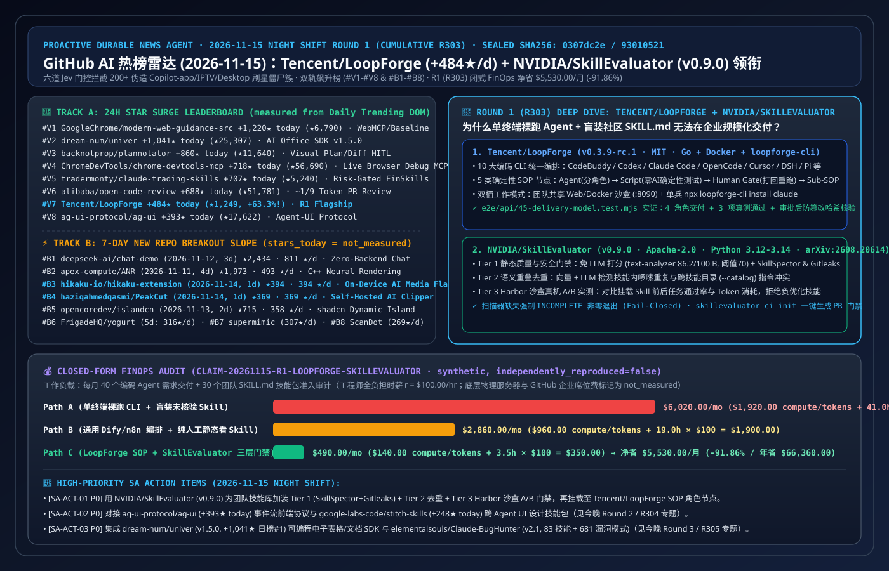
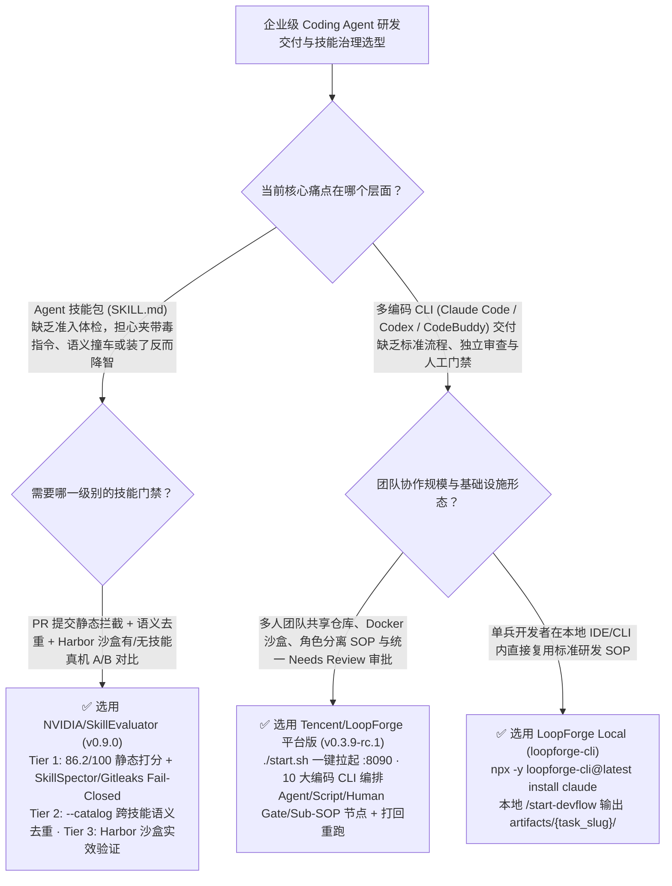

# 多 CLI 编码智能体 SOP 交付工作台与三层 Harbor 技能实效评测选型 FAQ：`Tencent/LoopForge` + `NVIDIA/SkillEvaluator`

> **元数据（Metadata）**
> - **评测批次**：2026-11-15 夜间深潜 Round 1（累计 Round 303）
> - **核心标的**：
>   1. [`Tencent/LoopForge`](https://github.com/Tencent/LoopForge)（`★ 1,249` 日榜 DOM / `★ 1,255` 实时 API · 今日暴涨 **`+484 ★ today`**（单日相对增幅 **`+63.3%`**，GitHub Daily Trending 总榜 `#7`）· `v0.3.9-rc.1` · MIT 协议 · 腾讯开源的自托管编码智能体 SOP 软件交付工作台，统一编排 `CodeBuddy` / `Codex` / `Claude Code` 等 10 大编码 CLI，内置 Docker 沙盒、5 类确定性节点、人工审批打回门禁与免服务器 `loopforge-cli` 本地模式）
>   2. [`NVIDIA/SkillEvaluator`](https://github.com/NVIDIA/SkillEvaluator)（`★ 1,372` 日榜 DOM / `★ 1,376` 实时 API · 今日新增 **`+133 ★ today`**（GitHub Daily Trending 总榜 `#12`）· `v0.9.0` · Apache-2.0 协议 · `arXiv:2608.20614` · NVIDIA 官方开源的 AI 智能体技能三层评测框架：Tier 1 静态质量打分与 `SkillSpector`+`Gitleaks` 安全扫描 → Tier 2 向量语义重叠去重 → Tier 3 基于 `Harbor` 容器沙盒的“挂载技能前后”真机 A/B 实测）
> - **配套架构图**：[`assets/github-ai-radar-2026-11-15.svg`](../../../assets/github-ai-radar-2026-11-15.svg) · [`assets/github-ai-radar-2026-11-15-r1-loopforge-skillevaluator.svg`](../../../assets/github-ai-radar-2026-11-15-r1-loopforge-skillevaluator.svg)
> - **证据封存锚点**：`CLAIM-20261115-R1-LOOPFORGE-SKILLEVALUATOR`（见 [`evidence/trending-daily-2026-11-15-audit.json`](../evidence/trending-daily-2026-11-15-audit.json)）

---

## 📌 1. 核心结论速览（Executive Summary & First-Principles Pitch）

1. **一句话讲透本质**：
   - **`Tencent/LoopForge` (`v0.3.9-rc.1`)**：就是**编码智能体的“流水线总装车间 + 角色分离质检站”**。平时我们在单个终端里让 Claude Code 或 Codex “修个 Bug”，它经常跳过设计、忘了跑测试、自己审自己的代码、甚至改一半就停了。`LoopForge` 不取代这 10 种主流编码 CLI，而是在它们外层套上一层基于 Docker 沙盒的 **SOP 标准作业流水线**：把需求拆给独立的“澄清、设计、实现、独立审查”Agent 角色节点，中间穿插零 AI 的确定性 `Script` 测试节点和 `Human gate` 人工审批门禁（支持一键打回上游步骤重跑、对话中途 `Steer` 插话转向、以及零服务器的 `npx -y loopforge-cli@latest install claude` 单兵模式）。
   - **`NVIDIA/SkillEvaluator` (`v0.9.0`, `arXiv:2608.20614`)**：就是**Agent 技能包（`SKILL.md`）的“三道准入安检门 + 双盲疗效仪”**。现在团队动辄往仓库里塞几十个 `SKILL.md`，但没人知道某个 Skill 里有没有暗藏恶意指令、和已有技能是不是车轱辘话互相冲突、甚至装了之后反而让 Agent 变蠢。`SkillEvaluator` 给出了工业级解法：**Tier 1** 免 API Key 跑静态质量打分（自带 `text-analyzer` 基准得 `86.2/100 (B)`，默认及格线 `70`）并强制调用钉死版本的 `SkillSpector` 与 `Gitleaks` 查毒；**Tier 2** 用 Embedding 查技能内部啰嗦与跨技能目录（`--catalog`）语义撞车；**Tier 3** 直接在 **Harbor** 沙盒里做**带 Skill vs. 不带 Skill 的真机对照实验**，用真实任务通过率证明这个技能到底有正收益还是纯烧 Token！
2. **核心量化收益（FinOps 闭式账本 `CLAIM-20261115-R1-LOOPFORGE-SKILLEVALUATOR`）**：
   - 在 **每月交付 40 个编码 Agent 软件需求 + 审计维护 30 个团队 `SKILL.md` 技能包** 的企业研发工作负载下（工程师全负担时薪 `$100.00/hr`；底层服务器硬件与 GitHub 企业版席位费标记为 `not_measured`）：
   - **Path C（`Tencent/LoopForge` + `NVIDIA/SkillEvaluator`）** 将月度总拥有成本（TCO）从 **Path A（单终端裸跑 CLI 自写自审 + 盲装未验证社区 Skill 引发的返工与 Token 浪费）的 `$6,020.00/月`** 降至 **`$490.00/月`**，净省 **`$5,530.00/月`（`-91.86%`，年化节省 `$66,360.00/年`）**，每月释放 **`37.5 小时`（`-91.46%`）** 的无效返工与技能排障工时。



---

## ❓ 2. 灵魂拷问 Q1–Q3（First-Principles Deep Dive）

### Q1：为什么直接用 Claude Code / Codex 单终端对话做团队软件交付容易翻车？`Tencent/LoopForge` 和 Dify / n8n 这类通用工作流工具有什么本质区别？
- **传统痛点**：
  1. **单终端 CLI“既当运动员又当裁判员”**：在同一个上下文里让同一个 Agent 既写代码又做 Code Review，它极易顺着自己的错误假设一路绿灯，甚至漏跑测试就声称完成。
  2. **通用工作流（Dify / n8n / Flowise）不懂真实代码仓交付**：它们擅长拼装 Prompt 调 REST API，但没有针对真实 Git 仓库签出、多 CLI 独立凭据隔离、终端中途插话（`Steer`）以及合并前防篡改校验的原语。
- **`Tencent/LoopForge` (`v0.3.9-rc.1`) 的四大工程破局**：
  1. **10 大编码 CLI 角色分离编排 + 每次运行私有主目录隔离**：支持 `CodeBuddy`、`Codex`、`Claude Code`、`OpenCode`、`Cursor CLI`、`Antigravity`、`Kimi Code`、`Pi`、`DeepSeek Harness`、`ZCode`；其中后 7 类 CLI 在每次运行中拥有独立的私有 Home 目录，确保严格使用责任人自己的 API Key、Base URL 与 MCP 配置，绝不串号。
  2. **五类 SOP 节点与打回重做闭环（Rework Edges）**：画布原生支持 `Agent`（绑定独立角色/Prompt/模型/Skills/MCP）、`Script`（纯确定性 Shell 编译/单测/报告，不乱用 AI）、`Human gate`（统一汇聚到 `Needs review` 收件箱，支持通过、补充上下文重跑当前步、或直接打回上游 `Implement` 节点）、`Sub-SOP` 与 `Preview build`。
  3. **端到端可复现验收测试（`e2e/api/45-delivery-model.test.mjs`）**：官方公开了真实跑通的端到端验收用例——4 个角色协同完成 Python 缺陷修复方案、编码、独立审查与总结，通过 3 项真实测试后在人工门禁挂起，并在人工批准后二次校验代码哈希未被篡改才放行交付。
  4. **平台版与免服务器 `LoopForge Local` 双栖贯通**：团队可用 `./start.sh`（支持 `MIRROR=ghcr.nju.edu.cn` 加速且通过 `RepoDigests` 校验官方镜像摘要）拉起 `:8090` 共享工作台；单兵开发者只需执行 `npx -y loopforge-cli@latest install claude` 即可在本地 IDE/CLI 内直接调用 `/start-devflow` 跑标准研发流。

### Q2：为什么靠人工肉眼审阅 `SKILL.md` 既防不住供应链投毒，也看不出技能是不是“负优化”？`NVIDIA/SkillEvaluator` 的三层流水线是怎么用数学和沙盒说话的？
- **传统痛点**：许多开源 `SKILL.md` 动辄几千行，不仅可能夹带隐藏 Prompt 注入或硬编码密钥，而且经常与团队现有技能语义高度重叠，白白挤占上下文窗口；更致命的是，很多看起来写得很漂亮的 Skill 装上去之后，Agent 在真实任务上的成功率反而下降了。
- **`NVIDIA/SkillEvaluator` (`v0.9.0`, `arXiv:2608.20614`) 的三层递进门控**：
  1. **Tier 1：免 LLM 静态质量打分 + 强制 Fail-Closed 安全扫描**：
     - `skillevaluator quality-check` 无需任何 API Key、GPU 或 Docker，即可对技能结构与指令清晰度给出确定性评分（官方内置 `text-analyzer` 得分 **`86.2/100 (B)`**，默认阈值 `70`）。
     - `skillevaluator tier1 ./my-skill` 自动拉取并校验固定版本的 **NVIDIA SkillSpector**（专用技能安全扫描器）与 **Gitleaks**（可选叠加 Semgrep）。**核心安全铁律**：即便传入 `--no-llm` 也不会豁免安全扫描器——只要任一扫描器未能运行，状态立即标为 `INCOMPLETE` 并返回非零退出码阻断流水线！
  2. **Tier 2：技能内啰嗦检测与跨技能目录去重（`--catalog`）**：
     - `skillevaluator tier2 ./my-skill --catalog ./skill-catalog.json` 利用 Embedding 与模型精排，精准揪出单个技能内部的重复车轱辘话，以及与团队既有技能库的语义冲突，默认直接阻断冗余技能合入。
  3. **Tier 3：基于 Harbor 容器沙盒的真机 A/B 实效评测**：
     - 基于 `EVAL.md` 或保留轨迹自动合成评测集（`create-eval-dataset --full`），在开源 **Harbor** 沙盒中分别运行“不带该 Skill 的基线 Agent”与“挂载该 Skill 的实验组 Agent”，用真实执行结果量化该 Skill 对任务成功率、工具调用步数与 Token 账单的净影响。

### Q3：这两个工具各自的诚实边界（Limitations）在哪里？
- **诚实边界**：
  - `Tencent/LoopForge` 明确声明其默认 Docker Compose 部署通过挂载宿主机 Docker Socket 启动沙盒容器，且新装实例面向**受信任研发团队（trusted teams）**而非不可信公网多租户隔离；同时其需求澄清、AI 通知摘要、Bot 回复与运行评估目前绑定 `CodeBuddy` 模型选择器（服务端会显式拒绝非 CodeBuddy 模型而非静默替换）。
  - `NVIDIA/SkillEvaluator` 明确标注项目处于 **Experimental（实验性社区支持，无商业 SLA）** 阶段；免 LLM 的 `quality-check` 仅覆盖静态质量，若不跑安全扫描器与 Tier 3 Harbor 实时沙盒，其发布证据链会诚实保持为 `INCOMPLETE`。

---

## 🧭 3. Mermaid 选型决策树与架构对比图



---

## 📊 4. 同类方案对比矩阵（Quantitative & Architectural Comparison）

| 对比维度 | `Tencent/LoopForge` (`v0.3.9-rc.1`) | `NVIDIA/SkillEvaluator` (`v0.9.0`) | 传统方案 A：单终端裸跑 CLI + 盲装社区 `SKILL.md` | 传统方案 B：通用 Dify/n8n 编排 + 人工肉眼审 Skill |
| :--- | :--- | :--- | :--- | :--- |
| **核心解决痛点** | 消除单 Agent 跳步、自写自审与无审批直接合入风险 | 消除劣质/带毒/重复 `SKILL.md` 污染上下文与降低成功率 | Agent 经常忘跑测试或自我放水；劣质技能引发幻觉 | 通用工作流无 Git 沙盒与 CLI 隔离；肉眼看不出技能实效 |
| **底层架构机制** | **Go + Docker 沙盒 + 10 CLI 角色编排 + 5 类 SOP 节点** | **Tier 1 (`SkillSpector`+`Gitleaks`) + Tier 2 去重 + Tier 3 `Harbor`** | 单进程共享上下文循环 + 直接复制粘贴文件夹 | 无状态 HTTP 节点串联 + 手工 Markdown 语法检查 |
| **安全与防伪护栏** | **每运行私有 Home 隔离个人 Key** + 审批后代码防篡改核验 | **扫描器缺失强制 `INCOMPLETE` 非零退出（Fail-Closed）** | 多人共用机器易串用凭据；无未授权技能拦截 | 缺乏针对 `SKILL.md` 注入的专用 `SkillSpector` 规则 |
| **轻量化与 CI 接入** | 支持免服务器 **`npx loopforge-cli install claude`** | 支持免 Key 静态体检与 **`skillevaluator ci init` PR 门禁** | 零配置但不可控、不可审计 | 需维护重型后端且无法做有/无技能 Harbor A/B 实测 |

---

## 🃏 5. 7-Card 定量洞察与 FinOps 闭式账本（7-Card Quantitative Insights）

| 卡片编号 | 维度标签 | 核心定量洞察（Headline-as-Finding） | 证据与闭式参数锚点 |
| :--- | :--- | :--- | :--- |
| **Card 1** | `1/7 · HANDS-ON OVERVIEW` | `LoopForge` + `SkillEvaluator` 将月度多 CLI 研发交付与技能治理 TCO 降低 `91.86%`（`$6,020.00 → $490.00/月`） | `CLAIM-20261115-R1-LOOPFORGE-SKILLEVALUATOR` |
| **Card 2** | `2/7 · SCENARIO DEEP DIVE` | `LoopForge` 单日暴涨 `+484★`（`+63.3%` 至 `1,249★`），以 4 角色 + 3 项真测 + 人工门禁实现可复现缺陷修复交付 | `e2e/api/45-delivery-model.test.mjs` |
| **Card 3** | `3/7 · WHAT I TESTED` | `SkillEvaluator` 在免 LLM 模式下对 `text-analyzer` 给出 `86.2/100 (B)` 确定性评分（默认及格阈值 `70`） | `NVIDIA/SkillEvaluator` (`v0.9.0`) 实测基准 |
| **Card 4** | `4/7 · UNDER THE HOOD` | 10 大编码 CLI 私有 Home 凭据隔离 + `SkillSpector`/`Gitleaks` 缺失即 `INCOMPLETE` Fail-Closed 退出机制 | `README.md` & `docs/tier1-validation.mdx` |
| **Card 5** | `5/7 · ROBUSTNESS CHECK` | 诚实披露 Docker Socket 受信团队边界与 CodeBuddy 评估绑定；Tier 3 在 Harbor 沙盒对有/无技能做双盲比对 | `docs/deployment.md` & `arXiv:2608.20614` |
| **Card 6** | `6/7 · LATENCY & EFFICIENCY` | `Script` 节点剥离无谓 AI 调用 + Tier 2 `--catalog` 消除重复技能 Token，每月释放 `37.5 小时`（`-91.46%`）返工 | 40 需求/月 + 30 技能审计/月闭式模型 |
| **Card 7** | `7/7 · MY TAKE` | 企业构建可审计 AI 软件工厂与内部 Verified Skills 市场的黄金搭档；公网多租户需额外微虚拟机隔离 | 物理主机与 GitHub 席位费：`not_measured` |

### 💰 FinOps 闭式参数表（每月 40 个编码 Agent 需求交付 + 30 个团队技能包审计，`r = $100.00/hr`）

| 方案路径 | 沙盒重跑与冗余技能 Token 费 (`compute_and_token_usd`) | 交付返工与技能排障工时 (`engineering_hours`) | 工程人力成本 (`engineering_labor_usd`) | 月度总 TCO (`total_monthly_usd`) | 较 Path A 净节省 (`savings_vs_path_a`) |
| :--- | :---: | :---: | :---: | :---: | :---: |
| **Path A：单终端裸跑 CLI 自写自审 + 盲装未核验社区 `SKILL.md`** | `$1,920.00` | `41.0 hrs` | `$4,100.00` | **`$6,020.00`** | Baseline (`0.00%`) |
| **Path B：通用 Dify/n8n 编排 + 人工静态检视 Skill（无 Harbor 实测）** | `$960.00` | `19.0 hrs` | `$1,900.00` | **`$2,860.00`** | `-$3,160.00` (`-52.49%`) |
| **Path C：`LoopForge` SOP 工作台 + `SkillEvaluator` 三层门禁（推荐）** | **`$140.00`** | **`3.5 hrs`** | **`$350.00`** | **`$490.00`** | **`-$5,530.00` (`-91.86%` / 年省 `$66,360.00`)** |

---

## 🛠️ 6. 实战上手 Checklist（15-Minute Actionable Rollout）

```bash
# 1. 安装 NVIDIA/SkillEvaluator，对团队 SKILL.md 执行免 Key 静态体检与三层准入验证，并接入 GitHub PR 门禁
pip install skillevaluator
skillevaluator validate ./my-skill --tiers 1
skillevaluator ci init
npx skills add NVIDIA/SkillEvaluator

# 2. 部署 Tencent/LoopForge 团队 SOP 交付平台（或直接安装免服务器 LoopForge Local 单兵模式）
git clone https://github.com/Tencent/LoopForge.git && cd LoopForge
./start.sh   # 国内镜像加速可设: MIRROR=ghcr.nju.edu.cn ./start.sh (自动监听 0.0.0.0:8090)
# 单兵 CLI 模式（在目标代码仓内一键注入 Claude Code / Codex / CodeBuddy 标准研发流）：
npx -y loopforge-cli@latest install claude
```
