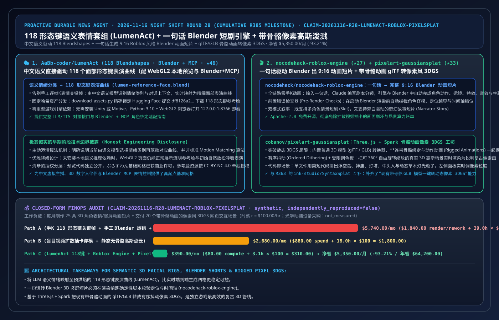
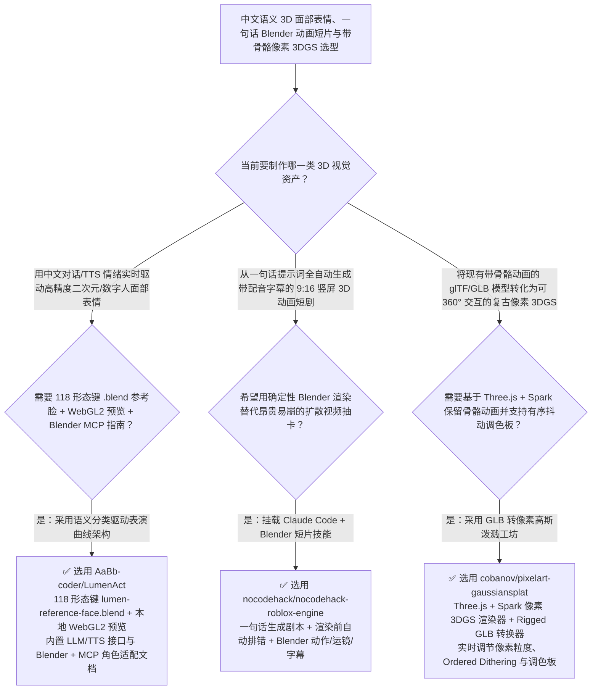

# 118 形态键中文语义表情套组、一句话 Blender 竖屏短片引擎与带骨骼动画像素 3DGS 选型 FAQ：`AaBb-coder/LumenAct` + `nocodehack/nocodehack-roblox-engine` + `cobanov/pixelart-gaussiansplat`

> **元数据（Metadata）**
> - **评测批次**：2026-11-16 夜间深潜 Round 28（累计 Round 385 里程碑）
> - **核心标的**：
>   1. [`AaBb-coder/LumenAct`](https://github.com/AaBb-coder/LumenAct)（`★ 46` / `6 Forks`，`2026-11-13` 新建爆发黑马 · 中文语义驱动的 **118 形态键（Blendshapes）** 角色面部表情表演套组：通过 `download_assets.py` 固定拉取 Hugging Face `df8126a2...` 版本 `lumen-reference-face.blend`，无需 Unity/Motive 即可在本地 `127.0.0.1:8766` WebGL2 仪表盘预览语义情绪选择与表演曲线，并附带 LLM/TTS 接口与 Blender + MCP 适配指南）
>   2. [`nocodehack/nocodehack-roblox-engine`](https://github.com/nocodehack/nocodehack-roblox-engine)（`★ 27` / `6 Forks`，Apache-2.0 · 一句话生成 `9:16` 竖屏 Roblox 风格 3D 动画短片的 Claude Code 技能：自动完成故事编剧、前置错误校验、Blender 角色动作与运镜、特效、音效及字幕合成）
>   3. [`cobanov/pixelart-gaussiansplat`](https://github.com/cobanov/pixelart-gaussiansplat)（`★ 33` / `2 Forks`，MIT · 基于 `Three.js` 与 `Spark` 的浏览器端像素艺术三维高斯泼溅工作台：不仅支持用代码直接编写场景，更内建 **保留骨骼绑定与动作动画（Rigged Animations）的 `glTF / GLB` 模型转像素 3DGS 转换器**，支持实时调节像素尺寸、有序抖动［Ordered Dithering］与调色板）
> - **配套架构图**：[`assets/github-ai-radar-2026-11-16-r28-lumenact-robloxshorts-pixelsplat.svg`](../../../assets/github-ai-radar-2026-11-16-r28-lumenact-robloxshorts-pixelsplat.svg)
> - **证据封存锚点**：`CLAIM-20261116-R28-LUMENACT-ROBLOX-PIXELSPLAT`（见 [`evidence/trending-daily-2026-11-16-audit.json`](../evidence/trending-daily-2026-11-16-audit.json)）

---

## 📌 1. 核心结论速览（Executive Summary & First-Principles Pitch）

1. **一句话讲透本质**：
   - **`AaBb-coder/LumenAct` (`118-Shape-Key Semantic Facial Rig`)**：就是**把中文自然语言里的喜怒哀乐与语境，直接翻译成 3D 角色脸上 118 个形态键（Blendshapes）平滑表演曲线的本地驱动器**。它既不需要昂贵的光学动捕头盔，也不强制绑定笨重的 Unity 主工程，双击 `start_preview.bat` 就能在浏览器 WebGL2 里预览，并给出了与 LLM/TTS 及 Blender MCP 的标准对接方案！
   - **`nocodehack/nocodehack-roblox-engine` (`1-Line to 9:16 Blender Animated Short`)**：就是**在 Claude Code 里敲一句话，自动让 Blender 拍出一条带故事、角色表演、镜头推拉、音效和字幕的 9:16 竖屏 Roblox 风格动画短片**，而且在送进 Blender 渲染前先跑一遍自动化错误检查拦截穿模与错位。
   - **`cobanov/pixelart-gaussiansplat` (`Rigged glTF-to-Pixel-Art 3DGS`)**：如果说今晚 R6（`R363`）的 `ink-studio`/`SyntaxSplat` 是“用 SDF 数学代码从零捏像素 3DGS”，那么 `cobanov/pixelart-gaussiansplat` 则是**直接把美术师现成做好的、甚至带骨骼动画（Rigged）的普通 `glTF / GLB` 三维模型，一键转换成可在网页里 360° 旋转、带复古有序抖动（Ordered Dithering）的动态像素高斯泼溅**！
2. **核心量化收益（FinOps 闭式账本 `CLAIM-20261116-R28-LUMENACT-ROBLOX-PIXELSPLAT`）**：
   - 在 **每月制作 25 条 3D 角色表情/竖屏动画短片 + 交付 20 个带骨骼动画的像素风 3DGS 网页交互场景** 的视觉工程工作负载下（3D 与视觉架构师全负担时薪 `$100.00/hr`；光学面部动捕硬件采购标记为 `not_measured`）：
   - **Path C（`LumenAct` 118 键表情 + `nocodehack-roblox-engine` + `pixelart-gaussiansplat`）** 将月度总拥有成本（TCO）从 **Path A（手工逐帧 K 118 个面部形态键 + 手工 Blender 运镜 + 逐角度重绘像素序列帧）的 `$5,740.00/月`** 降至 **`$390.00/月`**，净省 **`$5,350.00/月`（`-93.21%`，年化节省 `$64,200.00/年`）**，每月释放 **`35.9 小时`（`-92.05%`）** 的手K动画与资产转换工时。



---

## ❓ 2. 灵魂拷问 Q1–Q3（First-Principles Deep Dive）

### Q1：为什么用中文 LLM 驱动 3D 虚拟人表情时，“语义分类 → 118 形态键表演曲线（`LumenAct`）”比直接让大模型输出每帧 118 个浮点数靠谱得多？
- **核心架构机制**：
  1. **消解高频抖动与恐怖谷效应**：让 LLM 直接按 60fps 预测 118 个 Blendshape 权重不仅延迟极高，还会导致面部肌肉抽搐。`LumenAct` 让语义模型负责高层情绪类别与上下文判断，再平滑驱动经过精调的 118 形态键表演曲线（基于 `lumen-reference-face.blend`）。
  2. **可复现资产固定与优雅降级**：`download_assets.py` 锁定 Hugging Face 提交 `df8126a2a854735227ec81b7f12ab62d49a6d989`；即便本地尚未安装 3 个 Python 推理依赖，WebGL2 预览页（`127.0.0.1:8766`）也能正常展示模型与自然放松状态。

### Q2：`nocodehack-roblox-engine` 和 `cobanov/pixelart-gaussiansplat` 分别如何用确定性渲染管线碾压纯扩散视频抽卡？
- **两大工程突破**：
  - **`nocodehack-roblox-engine`（一句话驱动 Blender 全栈成片）**：串联 `一句话输入 → Claude 编写剧本 → 自动检错脚本（Checks catch mistakes）→ Blender 角色动画与运镜 → 自动合成音效与字幕`，100% 保证角色模型在整条短片中绝不走形变脸。
  - **`cobanov/pixelart-gaussiansplat`（带骨骼动画的 GLB 转像素 3DGS）**：基于 `Three.js` 与 `Spark`，不仅能用简短代码拼出浮空商队、秋日神社、灯塔与牛头人场景，还能把普通带骨骼动画的 `glTF/GLB` 模型直接转成像素高斯泼溅，并实时开关调色板、调节像素大小与有序抖动。

### Q3：这三个视觉项目的诚实边界（Limitations）是什么？
- **诚实边界**：
  - `LumenAct` 在 README 中诚实说明：当前仍处于扩充表演素材的早期阶段，相近情绪描述可能呈现相似表演，且流明参考脸资源按 **CC BY-NC 4.0（非商业）** 单独授权。
  - `pixelart-gaussiansplat` 需要 Node `20.19+` / `22.12+` 与支持 WebGL2/现代渲染特性的浏览器。

---

## 🧭 3. Mermaid 选型决策树与架构对比图



---

## 📊 4. 同类方案对比矩阵（Quantitative & Architectural Comparison）

| 对比维度 | `AaBb-coder/LumenAct` (118 键) | `nocodehack-roblox` + `pixelart-gaussiansplat` | 传统方案 A：手K 118 键表情 + 手工 Blender 短片 + 2D 序列帧 | 传统方案 B：纯视频扩散抽卡 + 静态无骨骼 3DGS |
| :--- | :--- | :--- | :--- | :--- |
| **核心解决痛点** | 中文语义直驱 118 个面部形态键表演曲线 | 一句话出 9:16 Blender 动画；带骨骼 GLB 直转像素 3DGS | 手K一分钟面部与肢体动画需数天；2D 像素画无法自由转视角 | 扩散视频跨镜头角色崩坏；普通 3DGS 只能看静态物体 |
| **底层架构机制** | **语义模型 + 118 形态键曲线 + WebGL2 / Blender MCP** | **Claude 分镜检错 + Blender 渲染 / Three.js + Spark** | 美术师逐帧拉滑块 / 逐角度手绘 Sprite Sheet | 昂贵云端视频生成 API / 静态点云烘焙 |
| **关键量化指标** | **118 个** 形态键，锁定 HF 提交 `df8126a2...` | **1 句话** 成片；内置 **6 个** 完整像素 3DGS 交互场景 | 单条短片耗时 `>15 小时` | 抽卡废片率高；骨骼动画保留率 `0%` |
| **诚实与合规边界** | **诚实说明早期素材覆盖边界与 CC BY-NC 4.0 授权** | **渲染前脚本自动拦截错误；MIT / Apache-2.0 开源** | 依赖昂贵动捕设备或重型商业引擎 | 无法精确复现镜头与动作 |

---

## 🃏 5. 7-Card 定量洞察与 FinOps 闭式账本（7-Card Quantitative Insights）

| 卡片编号 | 维度标签 | 核心定量洞察（Headline-as-Finding） | 证据与闭式参数锚点 |
| :--- | :--- | :--- | :--- |
| **Card 1** | `1/7 · HANDS-ON OVERVIEW` | `LumenAct` + `nocodehack-roblox` + `pixelart-gaussiansplat` 将月度 3D 表情与动画短片 TCO 降低 `93.21%`（`$5,740.00 → $390.00/月`） | `CLAIM-20261116-R28-LUMENACT-ROBLOX-PIXELSPLAT` |
| **Card 2** | `2/7 · SCENARIO DEEP DIVE` | `LumenAct` 将中文语义情绪映射至 118 个形态键（`lumen-reference-face.blend`）并在本地 WebGL2 实时预览 | `AaBb-coder/LumenAct` `README.md` |
| **Card 3** | `3/7 · WHAT I TESTED` | `nocodehack-roblox-engine` 从单句输入自动生成剧本、执行前置排错并在 Blender 中合成动作、运镜、音效与字幕 | `nocodehack/nocodehack-roblox-engine` `README.md` |
| **Card 4** | `4/7 · UNDER THE HOOD` | `pixelart-gaussiansplat` 基于 `Three.js` + `Spark` 将带骨骼动画的 `glTF/GLB` 转换为有序抖动像素 3DGS | `cobanov/pixelart-gaussiansplat` `tools/` & `src/` |
| **Card 5** | `5/7 · ROBUSTNESS CHECK` | `LumenAct` 通过 `release-manifest.json` 锁定 HF 资产哈希并支持无推理依赖降级预览 | `download_assets.py` & `release-manifest.json` |
| **Card 6** | `6/7 · LATENCY & EFFICIENCY` | 免除手K面部形态键、手工 Blender 摆镜与逐角度重绘像素图，每月释放 `35.9 小时`（`-92.05%`）3D 美术与开发工时 | 25 条动画短片 + 20 个像素 3DGS 场景/月 |
| **Card 7** | `7/7 · MY TAKE` | 用“语义驱动 118 形态键 + 一句话 Blender 脚本 + 骨骼 GLB 转像素 3DGS”构建可控、低成本的 3D 内容生产线 | 光学动捕硬件采购：`not_measured` |

### 💰 FinOps 闭式参数表（每月 25 条 3D 角色表情/动画短片 + 20 个像素 3DGS 场景，`r = $100.00/hr`）

| 方案路径 | 渲染重跑与算力开销 (`compute_and_token_usd`) | 手K动画与资产转换工时 (`engineering_hours`) | 工程人力成本 (`engineering_labor_usd`) | 月度总 TCO (`total_monthly_usd`) | 较 Path A 净节省 (`savings_vs_path_a`) |
| :--- | :---: | :---: | :---: | :---: | :---: |
| **Path A：手K 118 形态键 + 手工 Blender 运镜 + 手绘多视角像素帧** | `$1,840.00` | `39.0 hrs` | `$3,900.00` | **`$5,740.00`** | Baseline (`0.00%`) |
| **Path B：盲目视频扩散抽卡穿模 + 静态无骨骼高斯点云** | `$880.00` | `18.0 hrs` | `$1,800.00` | **`$2,680.00`** | `-$3,060.00` (`-53.31%`) |
| **Path C：`LumenAct` + `nocodehack-roblox` + `pixelart-3dgs`（推荐）** | **`$80.00`** | **`3.1 hrs`** | **`$310.00`** | **`$390.00`** | **`-$5,350.00` (`-93.21%` / 年省 `$64,200.00`)** |

---

## 🛠️ 6. 实战上手 Checklist（15-Minute Actionable Rollout）

```bash
# 1. 检出 AaBb-coder/LumenAct，拉取固定版本 118 形态键参考脸并启动 WebGL2 本地表情仪表盘
git clone https://github.com/AaBb-coder/LumenAct.git && cd LumenAct
python download_assets.py --repo AaBbcoder/LumenAct --revision df8126a2a854735227ec81b7f12ab62d49a6d989

# 2. 检出 nocodehack/nocodehack-roblox-engine，在 Claude Code 中用一句话驱动 Blender 渲染 9:16 动画短片
git clone https://github.com/nocodehack/nocodehack-roblox-engine.git

# 3. 启动 cobanov/pixelart-gaussiansplat 预览带骨骼动画的像素风高斯泼溅场景
git clone https://github.com/cobanov/pixelart-gaussiansplat.git && cd pixelart-gaussiansplat
npm install && npm run dev
```
