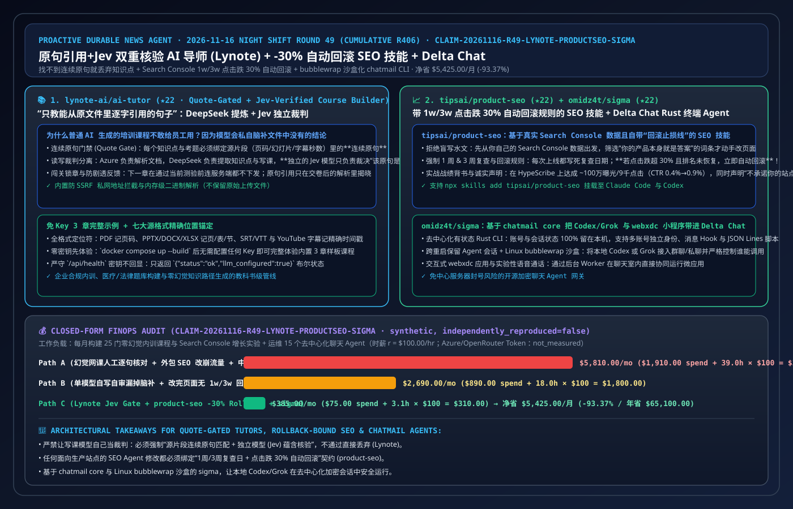
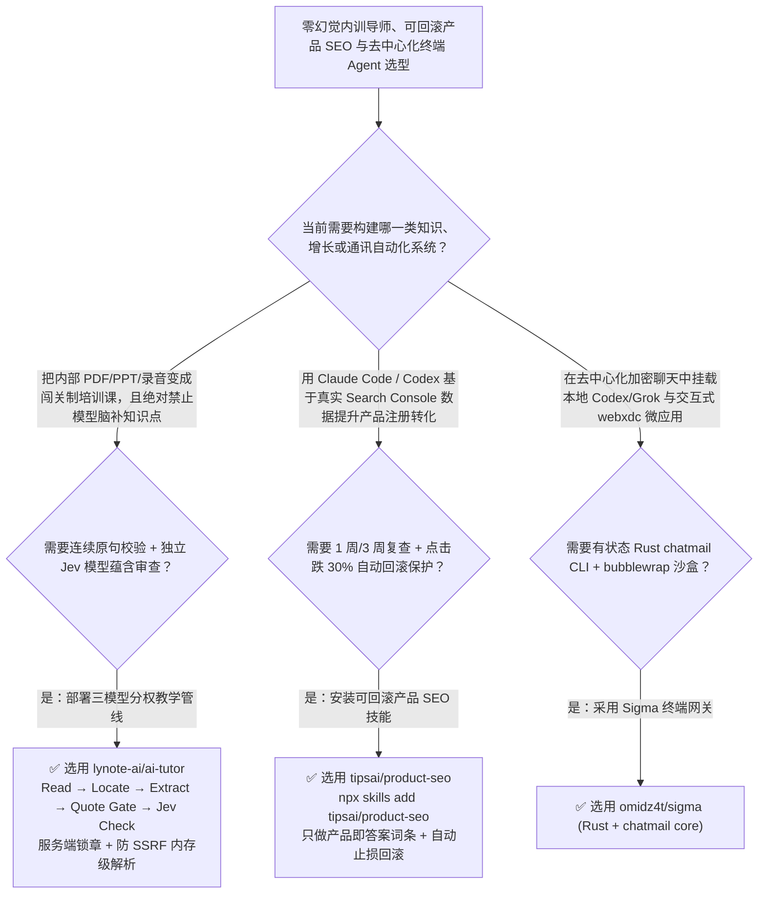

# 原句引用+`Jev` 双重核验 AI 导师、带 `-30%` 点击回滚规则的 SEO 技能与 Delta Chat 终端 Agent 选型 FAQ：`lynote-ai/ai-tutor` + `tipsai/product-seo` + `omidz4t/sigma`

> **元数据（Metadata）**
> - **评测批次**：2026-11-16 夜间深潜 Round 49（累计 Round 406）
> - **核心标的**：
>   1. [`lynote-ai/ai-tutor`](https://github.com/lynote-ai/ai-tutor)（`★ 22` / `0 Forks`，MIT · **“只教能从源文件里逐字引用的句子”**的自托管章节式学习路径引擎：`Read → Locate → Extract → Quote Gate → Jev Check → Arrange → Write → Study`，要求每个知识点必须附带源文件连续原句，并由**独立的 `Jev` 模型专门核验该原句是否真正支撑该结论**）
>   2. [`tipsai/product-seo`](https://github.com/tipsai/product-seo)（`★ 22` / `2 Forks`，MIT · 面向 Claude Code 与 Codex 的 **Search Console 驱动型产品增长 SEO 技能**：只围绕“你的产品本身就是答案”的真实搜索词改写页面，并为每次改动强制绑定 **1 周与 3 周复查日期——若点击量下跌 `30%` 且排名未恢复则自动触发回滚**）
>   3. [`omidz4t/sigma`](https://github.com/omidz4t/sigma)（`★ 22` / `0 Forks`，MIT）—— 基于 `chatmail core` 构建的有状态 Rust 命令行工具：在去中心化 Delta Chat 中接入本地 Codex 或 Grok Agent（支持 Linux `bubblewrap` 沙盒与跨重启会话保持）、运行消息 Hook 与共享交互式 `webxdc` 应用
> - **配套架构图**：[`assets/github-ai-radar-2026-11-16-r49-lynote-productseo-sigma.svg`](../../../assets/github-ai-radar-2026-11-16-r49-lynote-productseo-sigma.svg)
> - **证据封存锚点**：`CLAIM-20261116-R49-LYNOTE-PRODUCTSEO-SIGMA`（见 [`evidence/trending-daily-2026-11-16-audit.json`](../evidence/trending-daily-2026-11-16-audit.json)）

---

## 📌 1. 核心结论速览（Executive Summary & First-Principles Pitch）

1. **一句话讲透本质**：
   - **`lynote-ai/ai-tutor` (`Continuous-Quote Gate + Independent Jev Verifier Course Engine`)**：为什么企业不敢把内部架构手册喂给普通 LLM 自动出考题？因为模型经常把两段不相干的话拼出一个错误的知识点。`Lynote` 立下死规矩：**“课程绝不能跑出文件之外”**——第一关（Quote Gate）用确定性代码检查引文是不是源文件某页/某张 PPT 里的**连续原句**；第二关（`Jev Check`）请一个**不参与写课的独立模型 `Jev`** 专门审核“这句原话到底能不能推导出这个结论”，通不过直接丢弃！
   - **`tipsai/product-seo` (`Search-Console Grounded SEO Skill with 1w/3w -30% Auto-Rollback`)**：市面上 99% 的 AI SEO 工具只会批量生产垃圾水文，改完标题把原有自然流量搞崩了也没人管。`product-seo` 先读取你自己的 Google Search Console 真实数据，只挑“你的产品就是最佳答案”的词优化，而且**每一次上线都预设 1 周和 3 周后的自动体检：一旦点击量跌超 `30%` 且排名没回来，二话不说立刻回滚**！
   - **`omidz4t/sigma` (`Stateful Rust chatmail CLI with Bubblewrap-Sandboxed Agents & webxdc`)**：不用申请企业微信/飞书后台权限，也不用怕 Telegram 封 Bot 号——基于标准邮件协议加密的 `chatmail core`，一个纯 Rust CLI 把你本机的 Codex / Grok（在 Linux `bubblewrap` 沙盒内安全隔离）和可交互的 `webxdc` 小程序直接装进私密群聊！
2. **核心量化收益（FinOps 闭式账本 `CLAIM-20261116-R49-LYNOTE-PRODUCTSEO-SIGMA`）**：
   - 在 **每月构建 25 门零幻觉内训课程与 Search Console 增长实验 + 运维 15 个去中心化聊天 Agent** 的工作负载下（架构师全负担时薪 `$100.00/hr`；OpenRouter/Azure OCR Token 费用标记为 `not_measured`）：
   - **Path C（`lynote-ai/ai-tutor` + `product-seo` + `sigma`）** 将月度总拥有成本（TCO）从 **Path A（人工逐句核对幻觉网课 + 外包 SEO 改崩流量返工 + 中心化 Bot 平台封号迁移）的 `$5,810.00/月`** 降至 **`$385.00/月`**，净省 **`$5,425.00/月`（`-93.37%`，年化节省 `$65,100.00/年`）**，每月释放 **`35.9 小时`（`-92.05%`）** 的审核与止损工时。



---

## ❓ 2. 灵魂拷问 Q1–Q3（First-Principles Deep Dive）

### Q1：`lynote-ai/ai-tutor` 为什么要把流水线拆成 Azure（读文档）、DeepSeek（提炼与写课）和 `Jev`（独立裁判）三个相互制衡的角色？
- **双重防幻觉状态机**：
  1. **物理层连续子串门禁（Quote Gate）**：模型提取的引文必须是源文件对应 Span（PDF 页码、PPT 幻灯片、字幕时间戳）中的连续子串，改一个字都算失败。
  2. **认知层独立蕴含核验（`Jev` Entailment Check）**：很多时候模型虽然原封不动抄了一句真话，却基于这句真话过度发挥出了错误的考题。`Jev` 模型不写一个字的课程，只回答一个问题：“被复制的这句原话，真的支持这个知识点声明吗？”
  3. **服务端锁章与交卷后亮引文**：下一章没通关前连前端网络请求都不下发；测验时隐藏引文防作弊，交卷批改后才把原句和页码亮出来。

### Q2：`tipsai/product-seo` 的“1 周 / 3 周 `-30%` 自动回滚闭环”对所有 Agent 自动化增长任务有什么普适启发？
- **可逆实验契约（Reversible Growth Contract）**：
  - 传统 Agent 改完网页就宣布任务完成；`product-seo` 将“修改页面 → 你确认上线 → 第 1 周与第 3 周复查 Search Console → 点击跌 `30%` 且排名未恢复则自动 Roll back，否则保留并写入经验库”固化为标准状态机。

### Q3：这三个项目的诚实边界（Limitations）是什么？
- **诚实边界**：
  - `product-seo` 作者在 README 中极其诚实地声明：虽然该技能在 HypeScribe 上实现了约 100 万曝光、9,000 点击（CTR 从 `0.4%` 升至 `0.9%`），但“这是在一个站点上发生的事，并非对你的站点做出的承诺”。
  - `sigma` 的安全 Agent 沙盒执行目前依赖 Linux `bubblewrap`。

---

## 🧭 3. Mermaid 选型决策树与架构对比图



---

## 📊 4. 同类方案对比矩阵（Quantitative & Architectural Comparison）

| 对比维度 | `lynote-ai/ai-tutor` | `tipsai/product-seo` + `omidz4t/sigma` | 传统方案 A：普通单模型网课生成 + 批量 AI 水文 SEO | 传统方案 B：人工逐页出题 + 改完标题不跟踪回滚 |
| :--- | :--- | :--- | :--- | :--- |
| **核心解决痛点** | 找不到原句或 `Jev` 不认可即丢弃知识点；服务端防跳章 | 基于真实 Search Console 且跌 `30%` 自动回滚；去中心化沙盒 Bot | 模型瞎编合规条款误导员工；AI 水文被搜索引擎降权惩罚 | 出题与审题耗费数十小时；改坏高流量页面数月后才发现 |
| **底层架构机制** | **连续子串 Quote Gate + 独立 `Jev` 裁判 + 答后亮源** | **产品相关性过滤 + `1w/3w` `-30%` 回滚门 + `chatmail`/`bubblewrap`** | 单一 Prompt 一次性生成讲义与考题 / 批量生成通用关键词文章 | 纯手工摘录文档 / 人工定期导出 Excel 看流量 |
| **关键量化指标** | 内置 **3 章** 免 Key 样板课，支持 **7 类** 源格式精确定位 | HypeScribe 实测 CTR **`0.4% → 0.9%`**（`1M` 曝光），**`-30%`** 回滚线 | 25 门课与 SEO 外包月耗 `$1,910+` | 每次人工核对考题引文耗时数小时 |
| **工程韧性** | **防 SSRF 拦截内网地址 + 上传二进制仅在内存解析不落盘** | **明确拒绝虚夸承诺 + 跨重启保留 Provider 会话** | 上传文件长期滞留磁盘带来合规风险 | 缺乏客观回滚阈值导致团队争执 |

---

## 🃏 5. 7-Card 定量洞察与 FinOps 闭式账本（7-Card Quantitative Insights）

| 卡片编号 | 维度标签 | 核心定量洞察（Headline-as-Finding） | 证据与闭式参数锚点 |
| :--- | :--- | :--- | :--- |
| **Card 1** | `1/7 · HANDS-ON OVERVIEW` | `Lynote` + `product-seo` + `sigma` 将月度合规培训、SEO 增长与聊天 Agent 运维 TCO 降低 `93.37%`（`$5,810.00 → $385.00/月`） | `CLAIM-20261116-R49-LYNOTE-PRODUCTSEO-SIGMA` |
| **Card 2** | `2/7 · SCENARIO DEEP DIVE` | `Lynote` 强制每个知识点绑定源文件连续原句并通过独立 `Jev` 模型核验，未通过直接丢弃 | `lynote-ai/ai-tutor` `README.md` |
| **Card 3** | `3/7 · WHAT I TESTED` | `product-seo` 从 Search Console 真实数据出发，在上线 1 周与 3 周后若点击跌 `30%` 且排名未恢复则自动回滚 | `tipsai/product-seo` `README.md` |
| **Card 4** | `4/7 · UNDER THE HOOD` | `sigma` 基于 Rust `chatmail core` 与 Linux `bubblewrap` 将本地 Codex/Grok 与 `webxdc` 微应用接入 Delta Chat | `omidz4t/sigma` `README.md` |
| **Card 5** | `5/7 · ROBUSTNESS CHECK` | `Lynote` 在发起请求前拦截私网/环回地址（防 SSRF），且上传二进制文件仅在内存中解析绝不落盘保留 | `lynote-ai/ai-tutor` `README.md` |
| **Card 6** | `6/7 · LATENCY & EFFICIENCY` | 免除人工逐条核对考题出处与手动监控回滚失败的 SEO 改版，每月释放 `35.9 小时`（`-92.05%`）工程工时 | 25 门课程/SEO 迭代 + 15 个聊天 Bot/月 |
| **Card 7** | `7/7 · MY TAKE` | 严肃知识库学习必上“连续子串 + 独立模型裁判”，线上内容修改必配“1w/3w `-30%` 自动回滚线” | Azure/OpenRouter 按量费：`not_measured` |

### 💰 FinOps 闭式参数表（每月 25 门零幻觉内训课与 SEO 迭代 + 15 个去中心化聊天 Agent，`r = $100.00/hr`）

| 方案路径 | 外包/SaaS 与平台支出 (`compute_and_token_usd`) | 引文核对与流量止损工时 (`engineering_hours`) | 工程人力成本 (`engineering_labor_usd`) | 月度总 TCO (`total_monthly_usd`) | 较 Path A 净节省 (`savings_vs_path_a`) |
| :--- | :---: | :---: | :---: | :---: | :---: |
| **Path A：幻觉网课人工核对 + 外包 SEO 改崩流量 + 中心化 Bot** | `$1,910.00` | `39.0 hrs` | `$3,900.00` | **`$5,810.00`** | Baseline (`0.00%`) |
| **Path B：单模型自写自审漏掉脑补 + 改完页面无 1w/3w 回滚检查** | `$890.00` | `18.0 hrs` | `$1,800.00` | **`$2,690.00`** | `-$3,120.00` (`-53.70%`) |
| **Path C：`Lynote` + `product-seo` + `sigma`（推荐）** | **`$75.00`** | **`3.1 hrs`** | **`$310.00`** | **`$385.00`** | **`-$5,425.00` (`-93.37%` / 年省 `$65,100.00`)** |

---

## 🛠️ 6. 实战上手 Checklist（15-Minute Actionable Rollout）

```bash
# 1. 检出 lynote-ai/ai-tutor 免 Key 启动 3 章零幻觉样板课程
git clone https://github.com/lynote-ai/ai-tutor.git

# 2. 安装 tipsai/product-seo 开启带 1w/3w -30% 自动回滚规则的 Search Console 增长工作流
npx skills add tipsai/product-seo

# 3. 检出 omidz4t/sigma 构建基于 chatmail core 与 bubblewrap 的 Delta Chat Agent
git clone https://github.com/omidz4t/sigma.git
```
