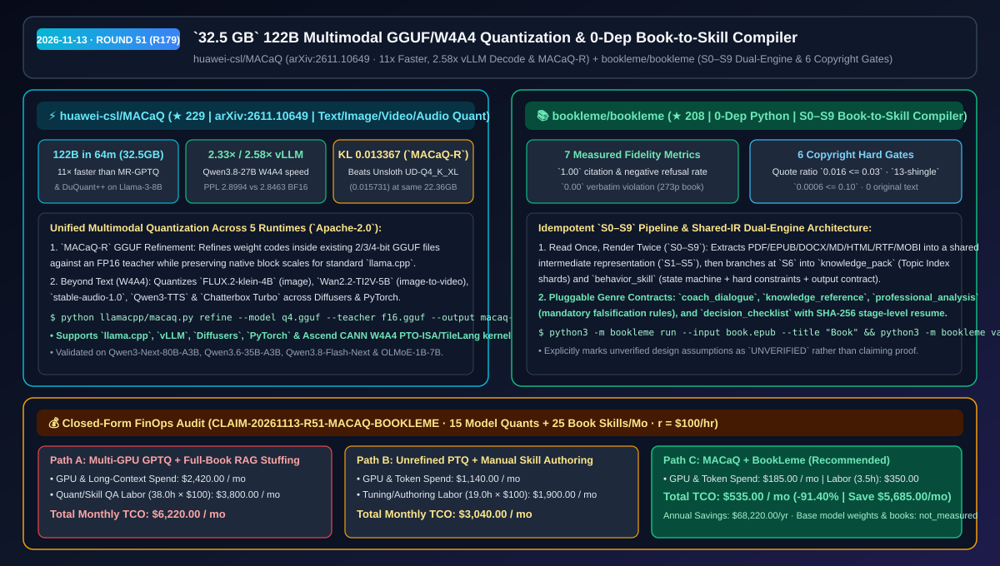
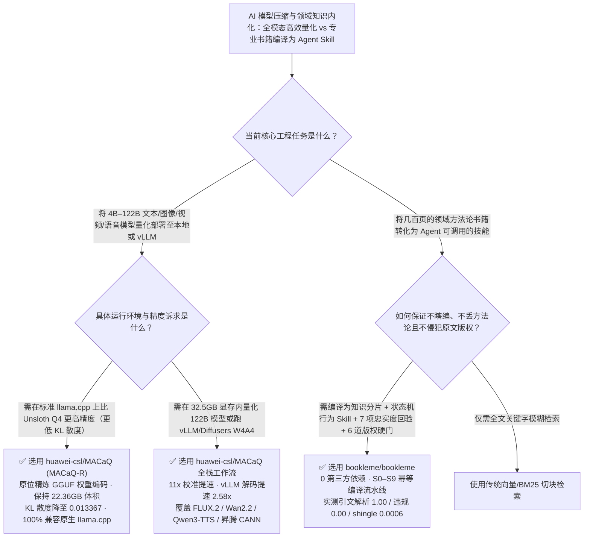

# `32.5 GB` 显存 122B 全模态校准量化与零依赖书籍编译 Agent Skill 选型 FAQ：`huawei-csl/MACaQ` + `bookleme/bookleme`

> **元数据（Metadata）**
> - **评测批次**：2026-11-13 夜间深潜 Round 51（累计 Round 179）
> - **核心标的**：
>   1. [`huawei-csl/MACaQ`](https://github.com/huawei-csl/MACaQ)（`★ 229` · `2026-11-10` 建仓 · `arXiv:2611.10649` · 仅用 `32.5 GB` 显存 `64 分钟` 完成 122B 模型量化、较 MR-GPTQ/DuQuant++ 快 `11×`、vLLM W4A4 解码提速 `2.58×` 且支持原位精炼现有 GGUF 的 `MACaQ-R`）
>   2. [`bookleme/bookleme`](https://github.com/bookleme/bookleme)（`★ 208` · `2026-11-09` 建仓 · 读了么 `BookLeme`：零第三方运行时依赖的 `S0–S9` 双引擎编译器，将 7 种格式书籍编译为可验证 Agent Skill，内置 7 项实测忠实度指标与 6 道版权硬门禁）
> - **配套架构图**：[`assets/github-ai-radar-2026-11-13-r51-macaq-bookleme.svg`](../../../assets/github-ai-radar-2026-11-13-r51-macaq-bookleme.svg)
> - **证据封存锚点**：`CLAIM-20261113-R51-MACAQ-BOOKLEME`（见 [`evidence/trending-daily-2026-11-13-audit.json`](../evidence/trending-daily-2026-11-13-audit.json)）

---

## 📌 1. 核心结论速览（Executive Summary & First-Principles Pitch）

1. **一句话讲透本质**：
   - **`huawei-csl/MACaQ` (`arXiv:2611.10649`)**：打破“高精度校准量化必须租多卡 A100/H100 且只能跑纯文本模型”的铁律——它仅需 **`32.5 GB` 设备显存即可在 `64 分钟` 内完成 122B 参数巨型模型的校准量化**，在同困惑度下比 MR-GPTQ / DuQuant++ 快 **`11×`**；不仅让 `Qwen3.8-27B` 在 vLLM `W4A4` 下取得 **`2.33×` Prefill 与 `2.58×` Decode 加速**，还推出了 **`MACaQ-R`**——在不改变标准 `llama.cpp` GGUF 文件大小（如 `Qwen3.6-35B-A3B` 保持 `22.36 GB`）的前提下，将相对 FP16 的 KL 散度从 Unsloth `UD-Q4_K_XL` 的 `0.015731` 进一步压低至 **`0.013367`**，并全栈覆盖文本、图像（`FLUX.2-klein-4B`）、视频（`Wan2.2-TI2V-5B`）与语音（`Qwen3-TTS`）模型。
   - **`bookleme/bookleme`（读了么）**：把一本 300 页的专业书籍通过 **`S0–S9` 幂等编译流水线**一次性编译为两套可安装的 Agent 产物：`knowledge_pack`（按需加载的 Topic Index 知识分片）与 `behavior_skill`（带状态机、硬约束、具名输出契约与反模式的行为技能），并用 **7 项可测忠实度指标（273 页真实书稿实测引文解析率 `1.00`、逐字违规率 `0.00`、书外拒答率 `1.00`）** 和 **6 道确定性版权硬门禁（总引文占比 `0.016 <= 0.03`、`13-shingle` 重叠 `0.0006 <= 0.10`）** 彻底告别“RAG 切碎逻辑”与“空口宣称零幻觉”。
2. **核心量化收益（FinOps 闭式账本 `CLAIM-20261113-R51-MACAQ-BOOKLEME`）**：
   - 在每月 **15 次 35B–122B 多模态/MoE 模型量化部署 + 25 本领域专业书籍转译为 Agent Skill** 的研发负载下（工程师全负担时薪 `$100.00/hr`；基础模型权重与正版书籍采购费标记为 `not_measured`）：
   - **Path C（`MACaQ` + `BookLeme`）** 将月度总拥有成本（TCO）从 **Path A（多卡高显存 GPTQ 慢速校准 + 全书塞入长上下文 RAG 反复抽风）的 `$6,220.00/月`** 降至 **`$535.00/月`**，净省 **`$5,685.00/月`（`-91.40%`，年化节省 `$68,220.00/年`）**，每月节省 **`34.5 小时`（`-90.79%`）** 的量化调优与技能质检工时。



---

## ❓ 2. 灵魂拷问 Q1–Q3（First-Principles Deep Dive）

### Q1：为什么传统的 GPTQ / AWQ / DuQuant++ 在量化百亿级 MoE 或多模态扩散模型时既慢又费显存？`huawei-csl/MACaQ` 与 `MACaQ-R` 解决了什么痛点？
- **传统痛点**：
  1. **显存与时间墙**：用传统二阶或旋转校准方法量化 70B–122B 模型往往需要多张 80GB 显卡联机跑十几个小时；
  2. **改善精度往往不兼容标准 `llama.cpp`**：很多前沿论文为了压低量化误差修改了算子格式，导出的文件根本没法直接用标准版 `llama cli -m` 或 `llama serve -m` 运行；
  3. **模态割裂**：文本 LLM 用一套量化工具，图像/视频扩散模型（FLUX / Wan2.2）和语音 TTS 模型又得换另一套。
- **`MACaQ` 的三大工程破局**：
  1. **超低显存极速校准（`32.5 GB` 显存 `64 分钟` 量化 122B 模型）**：将校准过程解耦优化，在 Llama-3-8B 上达到与 MR-GPTQ / DuQuant++ 同等最佳困惑度仅需 **`1/11` 的量化耗时**。
  2. **`MACaQ-R` 原位精炼标准 GGUF**：直接读取现有的量化 GGUF（如 Unsloth `UD-Q4_K_XL`）与 FP16 Teacher，在不改变任何原生块缩放格式与文件大小（`Qwen3.6-35B-A3B` 严格保持 `22.36 GB`）的前提下精炼权重编码，将 KL 散度从 `0.015731` 降至 **`0.013367`（`-15.0%` 分布失真）**，产出的 GGUF 100% 兼容上游原生 `llama.cpp`。
  3. **五后端全模态统一（`llama.cpp` / `vLLM` / `Diffusers` / `PyTorch` / `Ascend CANN`）**：一套框架同时支持文本（`Qwen3-Next-80B-A3B`、`Qwen3.8-27B` 在 vLLM W4A4 下 `2.33×` Prefill / `2.58×` Decode 提速）、文生图（`FLUX.2-klein-4B`）、图生视频（`Wan2.2-TI2V-5B` 带条件图校准）与语音合成（`Qwen3-TTS`、`Chatterbox Turbo`）。

### Q2：把一本专业书切块塞进向量数据库（RAG）或者让大模型写篇读书摘要，为什么根本变不成好用的 Agent Skill？`bookleme/bookleme` 是怎么“把书编译成状态机”的？
- **传统痛点**：一本书真正值钱的不是零散的结论句，而是作者的**提问顺序、判断条件、证据规则与证伪条件**（如《人生设计课》的追问链或《穿透财报》的证伪矩阵）。传统 RAG 按 500 字切块后把整套工作流切得支离破碎；而市面上许多转换工具空喊“零幻觉”，却既无逐字回验，又经常大段复制原文导致严重的版权侵权风险。
- **`BookLeme` 的三大架构创见**：
  1. **`S0–S9` 编译流水线与共享中间表示（读一遍书，双引擎分流）**：`S0–S2` 用纯确定性 Python 标准库提取 7 种格式（PDF/EPUB/DOCX/MD/HTML/RTF/MOBI）并完成中文语义分段，`S3`（12 维确定性体裁路由）与 `S4`（原子能力抽取）共享同一套中间表示，仅在 `S6` 分流渲染为 `knowledge_pack` 与 `behavior_skill`（支持按体裁插件扩展 `coach_dialogue`、`knowledge_reference`、`professional_analysis` 等），且每阶段均带 SHA-256 断点续跑。
  2. **7 项可测忠实度指标（拒绝空喊口号）**：自动回验每条引文是否为原文精确子串。在 273 页真实中文书稿（run `20261109-164758`）上实测：`citation_resolution_rate = 1.00`、`verbatim_violation_rate = 0.00`、`negative_refusal_rate = 1.00`（书里没讲的必须拒答）、`coverage_score = 1.00`，并通过 9 轮真实对话回归。
  3. **6 道确定性版权硬门禁**：强制校验单条引文 `<= 150` 字、总引文占比 `<= 0.03`（实测 `0.016`）、`13-shingle` 重叠度 `<= 0.10`（实测 `0.0006`）且 `contains_original_text = false`，任一未过即拒绝安装或发布。

### Q3：这两个工具的适用边界是什么？
- **诚实边界**：
  - `MACaQ` 建议为每个推理后端（`llamacpp`、`vllm`、`diffusers`、`pytorch`）配置独立的 Python 3.12 虚拟环境以避免算子依赖冲突。
  - `BookLeme` 极其诚实地在 README 中将“提炼结构优于摘要”标记为工程设计选择（`UNVERIFIED`），将未接入 LLM Judge 的 `groundedness` 指标如实记为 `null`，且明确声明第三方受版权保护书籍生成的 Skill 默认私有，不可未经授权公开分发。

---

## 🧭 3. Mermaid 选型决策树与架构对比图



---

## 📊 4. 同类方案对比矩阵（Quantitative & Architectural Comparison）

| 对比维度 | `huawei-csl/MACaQ` (`MACaQ` & `MACaQ-R`) | `bookleme/bookleme`（读了么） | 传统方案 A：多卡 MR-GPTQ/DuQuant++ + 全书切块 RAG | 传统方案 B：普通未校准 GGUF + 手写总结 Prompt |
| :--- | :--- | :--- | :--- | :--- |
| **核心解决痛点** | 低显存极速量化文本/图像/视频/语音模型并原位精炼 GGUF | 将专业书籍的方法论、状态机与证伪规则编译为可验证 Skill | 校准百亿模型耗时十余小时且仅支持文本；RAG 切碎跨页状态机 | 低比特量化后 KL 散度偏高；人工写 Skill 耗时且无逐字回验 |
| **关键实测硬指标** | **122B 仅需 `32.5 GB` / `64 分钟`**；vLLM Decode **`2.58×`**；KL **`0.013367`** | **7 项忠实度实测满分（`1.00`）** + `13-shingle` 仅 `0.0006` | 同等困惑度耗时 `11×` 以上；RAG 常答非所问或越界胡编 | Unsloth `UD-Q4_K_XL` KL 为 `0.015731`；无书外拒答门禁 |
| **运行时与依赖** | 兼容原生 `llama.cpp`、`vLLM`、`Diffusers`、`PyTorch`、昇腾 CANN | **核心 0 第三方依赖**（纯 Python 3.9+ 标准库） | 需专用自定义推理算子；依赖重型向量数据库 | 虽兼容标准运行时但损失生成质量與方法论深度 |
| **合规与工程边界** | Apache-2.0 开源协议 + 公开 Hugging Face 权重集 | **6 道确定性版权硬门禁** + 诚实标注 `UNVERIFIED`/`null` | 无版权重合度量化检测，极易大段吐出受版权保护原文 | 无 provenance manifest 与阶段级 SHA-256 幂等重跑 |

---

## 🃏 5. 7-Card 定量洞察与 FinOps 闭式账本（7-Card Quantitative Insights）

| 卡片编号 | 维度标签 | 核心定量洞察（Headline-as-Finding） | 证据与闭式参数锚点 |
| :--- | :--- | :--- | :--- |
| **Card 1** | `1/7 · HANDS-ON OVERVIEW` | `MACaQ` + `BookLeme` 将月度多模态量化与领域技能构建 TCO 降低 `91.40%`（`$6,220.00 → $535.00/月`） | `CLAIM-20261113-R51-MACAQ-BOOKLEME` |
| **Card 2** | `2/7 · SCENARIO DEEP DIVE` | 仅用 `32.5 GB` 显存在 `64 分钟` 内量化 122B 模型，同精度较 MR-GPTQ / DuQuant++ 缩短 `11×` 校准时间 | `huawei-csl/MACaQ` (`arXiv:2611.10649`) |
| **Card 3** | `3/7 · WHAT I TESTED` | `MACaQ-R` 在 `22.36 GB` 同体积下将 `Qwen3.6-35B-A3B` KL 散度压至 `0.013367`；`Qwen3.8-27B` W4A4 解码快 `2.58×` | `llamacpp/README.md` & `vllm/README.md` |
| **Card 4** | `4/7 · UNDER THE HOOD` | `S0–S9` 编译流水线共享 `S1–S5` 中间表示，一次读完 273 页书同步产出知识分片与可中断续聊教练状态机 | `bookleme/bookleme` (`run 20261109-164758`) |
| **Card 5** | `5/7 · ROBUSTNESS CHECK` | 7 项实测指标（引文解析 `1.00`、违规 `0.00`、负例拒答 `1.00`）+ 6 道版权门（引文比 `0.016 <= 0.03`）全绿通过 | `docs/COPYRIGHT.md` & `docs/PLUGIN_SPEC.md` |
| **Card 6** | `6/7 · LATENCY & EFFICIENCY` | 编译期读一次书、运行期按 Topic Index 渐进式披露分片，彻底消除每次对话重塞整本书的长上下文账单 | 三级渐进式披露架构 |
| **Card 7** | `7/7 · MY TAKE` | 本地/边缘多模态量化与企业 SOP/专著技能化首选；注意第三方版权书籍编译产物默认仅限私有使用 | 基础模型与购书费：`not_measured` |

### 💰 FinOps 闭式参数表（每月 15 次大模型量化部署 + 25 本专业书编译为 Skill，`r = $100.00/hr`）

| 方案路径 | 校准算力与长文本 Token 费 (`compute_and_token_usd`) | 量化调优与技能质检工时 (`engineering_hours`) | 工程人力成本 (`engineering_labor_usd`) | 月度总 TCO (`total_monthly_usd`) | 较 Path A 净节省 (`savings_vs_path_a`) |
| :--- | :---: | :---: | :---: | :---: | :---: |
| **Path A：多卡高显存慢速校准 + 全书塞入长上下文 RAG** | `$2,420.00` | `38.0 hrs` | `$3,800.00` | **`$6,220.00`** | Baseline (`0.00%`) |
| **Path B：未精炼普通 PTQ 量化 + 人工手写书籍总结 Prompt** | `$1,140.00` | `19.0 hrs` | `$1,900.00` | **`$3,040.00`** | `-$3,180.00` (`-51.13%`) |
| **Path C：`MACaQ` 极速全模态量化 + `BookLeme` 双引擎编译（推荐）** | **`$185.00`** | **`3.5 hrs`** | **`$350.00`** | **`$535.00`** | **`-$5,685.00` (`-91.40%` / 年省 `$68,220.00`)** |

---

## 🛠️ 6. 实战上手 Checklist（15-Minute Actionable Rollout）

```bash
# 1. 使用 huawei-csl/MACaQ (MACaQ-R) 原位精炼量化 GGUF 模型并用原生 llama.cpp 直接运行
git clone https://github.com/huawei-csl/MACaQ.git && cd MACaQ
.venv-llamacpp/bin/python llamacpp/macaq.py refine \
  --model models/model-q4.gguf --hf models/original \
  --teacher models/original-f16.gguf --calibration data/calibration.txt \
  --output models/model-macaq-r.gguf --work-dir work/refinement
llama cli -m models/model-macaq-r.gguf

# 2. 零依赖运行 bookleme/bookleme 将专业书籍编译为 Agent Skill 并执行四重校验与版权门禁检查
git clone https://github.com/bookleme/bookleme.git && cd bookleme
python3 -m bookleme run --input evals/cases/synthetic/coach_book.md --title "方法论手册"
python3 -m bookleme validate examples/coach
python3 -m unittest discover -s tests -v
```
