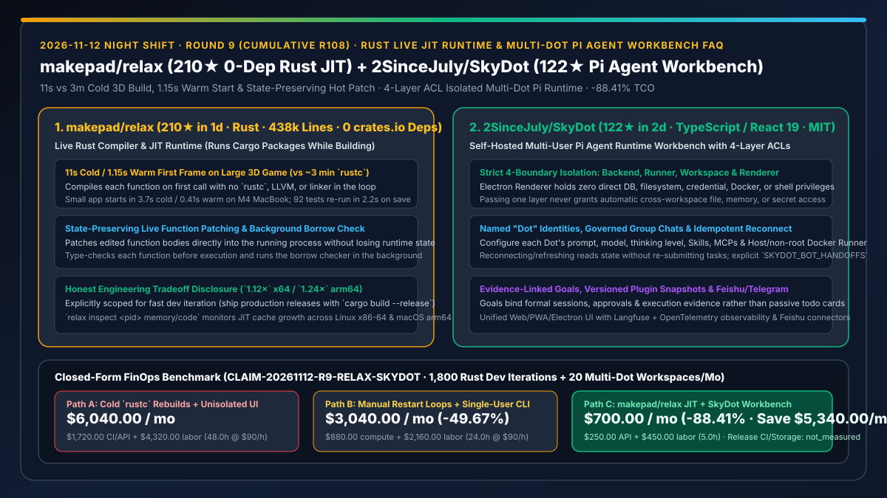
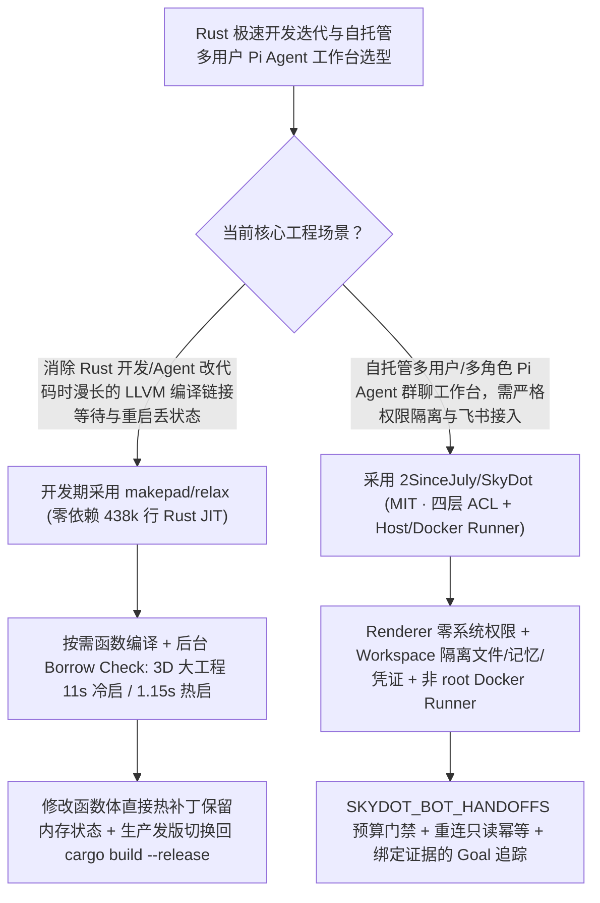

# 零依赖 Rust 实时 JIT 编译器与热补丁运行时（`makepad/relax`）及四层权限边界自托管 Pi Agent 工作台（`2SinceJuly/SkyDot`）深度选型 FAQ

> **文档定位**：本专题是 **2026-11-12 夜班第 9 轮（累计第 108 篇）独立六段式选型指南**，严格对标 `ib-vs-ethernet-roce-selection-faq.md` 的通俗第一性原理与闭式 FinOps 核算规范，面向 Rust 系统研发负责人与企业级自托管多 Agent 平台架构师，深度拆解今日在 Rust 秒级热更新编译与 Pi Agent Runtime 多用户安全工作台赛道爆发的两大新仓：
> 1. **`makepad/relax`（建仓 1 天 `210★`，纯 Rust 438,000 行代码、**`0 crates.io dependencies`**）**：由知名 Rust UI/图形引擎团队 Makepad 开源的 **Rust 实时编译器与 JIT 运行时（Runs your program while it builds it）**——绕过 `rustc`、LLVM 与链接器，在函数首次被调用时按需编译、后台运行借用检查（Borrow Checker），将大型 3D 游戏的冷启动首帧从 `~3 分钟` 压缩至 **`11 秒`**（二次启动 **`1.15 秒`**），修改函数体后**直接热补丁注入正在运行的进程而不丢失状态**，保存文件后 `2.2 秒` 跑完 92 个测试！
> 2. **`2SinceJuly/SkyDot`（建仓 2 天 `122★`，Node.js / TypeScript / Hono / SQLite / React 19 / Pi Agent Runtime，MIT）**：开源自托管的多用户「有身份的 AI 伙伴（Dot）」工作台——严格实施 **Backend、Runner（Host 或非 root Docker）、Workspace 与 Electron Renderer 四层权限物理隔离**（Renderer 绝不直接持有数据库、文件系统、凭证、Docker 或 Shell 权限，加入群聊绝不自动越权获取私人文件与记忆），支持多 Dot 群聊受控移交（`SKYDOT_BOT_HANDOFFS=true`）、刷新重连幂等防重交以及绑定会话/审批/证据的 Goal 管理！
>
> **English Version**: [makepad-relax-skydot-rust-live-jit-multi-dot-pi-agent-workbench-selection-faq.en.md](makepad-relax-skydot-rust-live-jit-multi-dot-pi-agent-workbench-selection-faq.en.md) · **关联日报**: [`daily/2026-11-12.md`](../daily/2026-11-12.md) · **架构总结图**: [`assets/github-ai-radar-2026-11-12-r9-relax-skydot.svg`](../../../assets/github-ai-radar-2026-11-12-r9-relax-skydot.svg)

---

## 📌 一、核心结论速览（Executive Summary）

1. **一句话大白话讲透这两个项目到底解决了什么痛点？**
   - **终结“无论是人类还是 Coding Agent 改一行 Rust 函数，都要傻等 `cargo + rustc + LLVM` 重新编译链接几十秒甚至 3 分钟，且每次重启程序都会丢掉刚才好不容易跑出来的内存状态”的痛点（`makepad/relax`）**：Rust 的运行速度和内存安全无可挑剔，但漫长的 LLVM 编译和链接等待严重拖慢了人机迭代节奏。`makepad/relax` 用 **43.8 万行零外部依赖（`0 crates.io dependencies`）的纯 Rust 代码**重写了一套实时 JIT 编译器：直接从 Cargo 源码启动，按函数首次调用即时编译、对热点函数后台优化、将借用检查器放在后台并行跑，更支持**修改函数体后直接热打补丁进运行中的进程（State kept）**！同时作者极其诚实地披露了工程取舍：开发迭代用 `relax`（速度比 `rustc --release` 慢 `1.12×` [x64] / `1.24×` [arm64]），正式发版依然用 `cargo build --release`！
   - **终结“自建多 Agent 桌面/网页工作台时，前端界面直接拿到了宿主机的 Shell/文件权限，或者把多个 Bot 拉进群聊就导致私人记忆和密钥串门泄露，甚至刷新一下网页就重复提交任务”的痛点（`2SinceJuly/SkyDot`）**：基于 `Pi Agent Runtime` 构建的 `SkyDot` 把安全边界做到了教科书级别：① **四层独立校验**（Electron Renderer 仅做纯 UI 渲染，绝不碰 DB/FS/Docker/Shell；加入群聊不等于获得他人 Workspace 的文件或凭证）；② **显式双开关群聊移交**（需同时开启 `SKYDOT_BOT_GROUPS=true` 与 `SKYDOT_BOT_HANDOFFS=true` 并配置调用预算）；③ **重连只读幂等**（刷新或重新打开页面只读取状态，绝不重复提交任务）；④ 每个 Goal 关联正式 Session、审批记录与执行证据！
2. **闭式 FinOps 投资回报结论（`CLAIM-20261112-R9-RELAX-SKYDOT`）**：
   - 以 **14 人 Rust 系统研发与多智能体平台团队每月执行 `1,800 次` Rust 开发编译/测试循环、并维护 `20 个` 多角色 Dot 协同工作区** 为基准（高级系统与平台工程师全包时薪 `$90.00/hr`；正式发版 CI 集群与云端对象存储账单：`not_measured`）：
   - 从 **Path A（每次改动苦等 `rustc` 全量重编链接并丢失运行态 + 缺乏隔离的单体 Electron Agent 工具导致重复触发与越权排障，月均 `$6,040.00`）** 升级至 **Path C（开发期采用 `makepad/relax` 秒级热补丁 JIT + `SkyDot` 四层 ACL 隔离与幂等重连工作台，月均 `$700.00`）**，每月净省 **`$5,340.00/mo`（降幅 `-88.41%`，年省 `$64,080.00/yr`）**，并将编译等待重跑状态与越权排障工时从 `48.0 hrs/mo` 压缩至 `5.0 hrs/mo`（节省 **`-89.58%`**）。

---

## 🎯 二、三大灵魂拷问（Q1 / Q2 / Q3 深度原理解析）

### Q1：`makepad/relax` 为什么能绕过 LLVM 在 11 秒内冷启动大型 3D Rust 游戏并支持带状态热补丁？它的适用边界在哪？
- **第一性原理拆解**：
  1. **按需函数级 JIT 编译 + 后台借用检查（Background Borrow Checking）**：
     - 传统 `rustc` 必须先对全工程做类型检查、借用检查、LLVM IR 优化并调用系统链接器生成完整可执行文件后才能运行；`relax` 在每个函数首次被调用前即时完成类型检查与机器码生成（x86-64 / AArch64），而把耗时的借用检查放到后台线程异步执行（也可通过 `relax run --check-first` 强制先跑完借用检查）。
     - 当开发者或 Coding Agent 修改某个函数体并保存时，`relax` 直接将新机器码热替换进当前运行进程，完整保留 UI/游戏状态；若修改了 `struct` 内存布局、Trait 签名或宏，则通过 `relax inspect <pid> session relaunch` 提示安全重启。
  2. **诚实的工程取舍（Dev Iteration vs Release Build）**：
     - `relax` 生成的优化代码在 21 个基准工作负载上的几何平均耗时为 `rustc --release` 的 `1.12×`（x64）与 `1.24×`（arm64），且进程内驻留追加式 JIT 缓存（可通过 `relax inspect <pid> memory` 与 `code` 监控）；因此官方明确建议：**日常高频编码、测试与热调优用 `relax`，最终生产交付用 `cargo build --release`**。

### Q2：`2SinceJuly/SkyDot` 是如何通过“四层权限矩阵”与“群聊双门禁”防止多智能体工作台越权与刷屏的？
- **第一性原理拆解**：
  1. **Backend / Runner / Workspace / Electron Renderer 四层零信任边界（`docs/ACL-MATRIX.md`）**：
     - **Renderer（前端/桌面渲染进程）**通过受限 Preload IPC 通信，完全剥离数据库、文件系统、密钥、Docker 与 Shell 权限；
     - **Workspace** 严格锁定文件、Session、Memory 与渠道绑定，某一层校验通过绝不自动穿透其他层；**Runner** 支持本机 Host 或非 root Docker 容器隔离执行，并在运行前生成快照级有效能力清单（Skills / MCP / Plugins 版本快照）。
  2. **多 Dot 群聊双开关门禁与重连幂等性**：
     - 群聊功能由 `SKYDOT_BOT_GROUPS=true` 控制，而跨 Bot 委派移交必须额外显式开启 `SKYDOT_BOT_HANDOFFS=true` 并受管理员调用预算约束；客户端网络闪断重连或刷新页面仅读取最新状态，从协议层杜绝重复提交任务。

### Q3：AI 架构师如何将 `makepad/relax` 与 `SkyDot` 应用于高效研发工作台？
- **黄金组合落地范式**：
  - 将 **`2SinceJuly/SkyDot`** 部署为团队自托管的多角色 Pi Agent 协同底座（通过飞书/Telegram 与桌面端统一管理各司其职的 Dot 伙伴，并在非 root Docker Runner 中安全执行）；
  - 在 Rust 项目工作区的 Docker Runner 中配置 **`makepad/relax`**，让负责编写 Rust 代码与跑单测的 Coding Dot 享受 `1.15s` 热启动与 `2.2s` 92 测秒级反馈！

---

## 🧭 三、Mermaid 选型决策树与「Rust 实时 JIT + 四层隔离多 Dot 工作台」架构图

---

## 📊 四、同类方案核心能力对比矩阵（Selection Matrix）

| 评估维度 | Path A：全量 `rustc` 重编 + 无隔离单体 Agent 桌面端 | Path B：手工重启 `cargo check` + 单用户 CLI | **Path C（推荐）：`makepad/relax` + `SkyDot`** |
| :--- | :--- | :--- | :--- |
| **Rust 大工程启动与单测反馈延迟** | 冷编 ~3 分钟，每次改代码重编重连并丢失进程内状态 | 仅能静态检查，运行测试仍需完整链接测试二进制 | **11s 冷启 / 1.15s 热启，函数体热补丁保留状态，2.2s 跑完 92 个测试** |
| **桌面/Web 渲染端安全隔离边界** | Renderer 常直接暴露 Node/Shell 权限，XSS 即导致 RCE | 无图形界面与多端同步 | **Electron Renderer 零 DB/FS/Docker/Shell 权限，四层 ACL 独立校验** |
| **多 Agent 群聊移交与重连幂等性** | 群内自由互调易死循环；刷新网页常重复触发昂贵任务 | 不支持多角色群聊 | **`SKYDOT_BOT_HANDOFFS` 显式门禁与预算卡控 + 重连只读零重复提交** |
| **可观测性与外部渠道集成** | 黑盒运行 | 仅限本地终端日志 | **原生集成 Langfuse + OpenTelemetry + 飞书/Telegram 渠道与证据 Goal** |
| **月度总拥有成本（1,800 次迭代 + 20 工作区）** | **`$6,040.00 / mo`**（`$1,720` CI/API + `$4,320` 工时） | **`$3,040.00 / mo`**（`$880` 算力 + `$2,160` 工时） | **`$700.00 / mo`（净省 `$5,340.00/mo` · `-88.41%`）** |

---

## 🧪 五、定量 FinOps 算例与 7-Card 洞察（`CLAIM-20261112-R9-RELAX-SKYDOT`）

### 5.1 测算基准与显式边界（Scope & Boundaries）
- **场景设定**：14 人 Rust 系统研发与智能体平台团队，每月执行 **1,800 次 Rust 功能迭代与测试闭环**，并维护 **20 个跨职能多 Dot 智能体工作区**。
- **费率假设**：高级 Rust 与平台架构工程师全包时薪 **`$90.00 / hr`**。
- **显式边界声明（Explicit Not-Measured Boundary）**：最终生产发版（`cargo build --release`）的专用 CI 打包集群费用与云端长期对象存储账单标记为 **`not_measured`**，本表严格核算日常开发迭代算力/重复触发 Token 损耗以及工程师等待编译重跑状态与排查权限越界耗费的工时。

### 5.2 三路径月度成本闭式对照表

| 成本分项 | Path A：全量 `rustc` 重编 + 无隔离桌面端 | Path B：手工重启 + 单用户 CLI | **Path C：`makepad/relax` + `SkyDot`（推荐）** |
| :--- | :--- | :--- | :--- |
| **月度开发迭代算力与多 Agent API 支出** | **`$1,720.00`**（含页面重连重复提交与群聊空转） | **`$880.00`** | **`$250.00`**（`relax` 增量热补丁 + `SkyDot` 重连幂等与移交预算控制） |
| **编译等待、状态重跑与权限排障工时（`$90/hr`）** | `48.0 hrs × $90.00` = **`$4,320.00`** | `24.0 hrs × $90.00` = **`$2,160.00`** | `5.0 hrs × $90.00` = **`$450.00`** |
| **月度总成本（Monthly TCO）** | **`$6,040.00 / mo`** | **`$3,040.00 / mo`**（`-49.67%`） | **`$700.00 / mo`** |
| **相对 Path A 净节省** | 基准线（Baseline） | 净省 `$3,000.00 / mo` | **净省 `$5,340.00 / mo`（`-88.41%` · 年省 `$64,080.00/yr`）** |
| **生产 Release CI 集群与云端对象存储** | `not_measured` | `not_measured` | `not_measured` |

---

## 🛠️ 六、生产级落地核验 Checklist

- [ ] **1. `makepad/relax` 开发期热补丁与 `relax inspect` 监控**：在 Linux x86-64 或 macOS arm64 开发环境中使用 `relax` 运行 Cargo 包，验证修改函数体后状态保持热更新，并用 `relax inspect <pid> memory` 监控 JIT 缓存。
- [ ] **2. 生产发版强制回退 `cargo build --release` 门禁**：在 CI/CD 发布流水线中锁定使用标准 `rustc` (`cargo build --release`) 以获得 100% 原生 LLVM 优化性能。
- [ ] **3. `SkyDot` 四层 ACL 与非 root Docker Runner 验证**：核对 `docs/ACL-MATRIX.md`，将 Dot 执行策略切至非 root Container 模式，验证群聊内跨 Workspace 私密文件零泄露。
- [ ] **4. `SKYDOT_BOT_HANDOFFS` 预算配置与重连幂等测试**：开启多 Dot 群聊移交并设置调用预算上限，测试浏览器强制刷新重连后绝不重复派发已提交任务。
