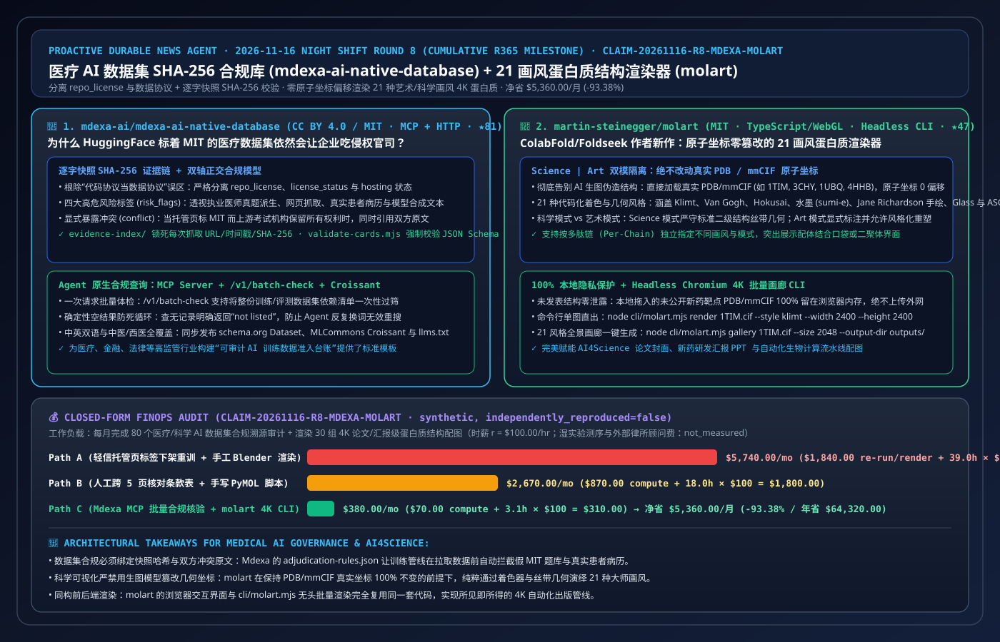
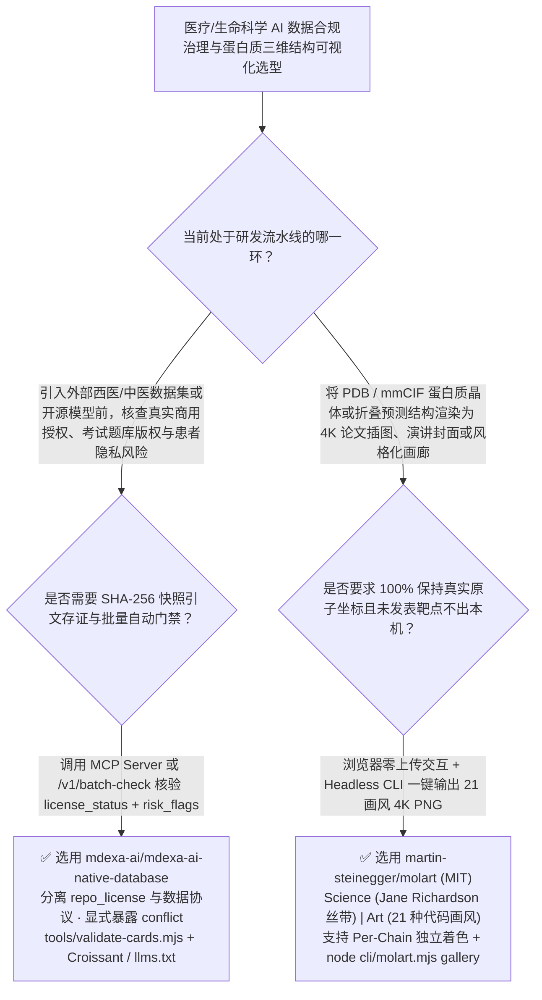

# 医疗 AI 数据集 SHA-256 证据绑定合规库与 21 画风蛋白质结构零坐标偏移渲染器选型 FAQ：`mdexa-ai/mdexa-ai-native-database` + `martin-steinegger/molart`

> **元数据（Metadata）**
> - **评测批次**：2026-11-16 夜间深潜 Round 8（累计 Round 365 里程碑）
> - **核心标的**：
>   1. [`mdexa-ai/mdexa-ai-native-database`](https://github.com/mdexa-ai/mdexa-ai-native-database)（`★ 81`，`2026-11-15` 新建爆发黑马 · 记录 CC BY 4.0 / 脚本 MIT 协议 · 面向 AI Agent（MCP + HTTP `/v1/batch-check`）的医疗 AI 数据集与开源模型许可证及溯源证据库：涵盖西医、中医与交叉领域，每条结论均绑定带时间戳与 SHA-256 的网页快照逐字引文［`evidence-index/`］，严格分离代码协议 `repo_license` 与数据协议 `license_status`、正交记录 `risk_flags`［真题派生/爬虫抓取/真实病历/模型合成］并显式标出上下游授权冲突 `conflict`）
>   2. [`martin-steinegger/molart`](https://github.com/martin-steinegger/molart)（`★ 47` / `6 Forks`，`2026-11-15` 新建黑马 · MIT 协议 · 由 ColabFold / MMseqs2 / Foldseek 作者 Martin Steinegger 开源的浏览器与无头 CLI 蛋白质三维结构 21 画风渲染器：直接加载真实 PDB / mmCIF 结构文件，在**绝对不改变原子空间坐标**的前提下，支持按多肽链切换 `Science | Art` 模式与 21 种艺术/科学画风［Klimt、Van Gogh、Hokusai、水墨 `sumi-e`、Jane Richardson 1981 手绘丝带、Glass、ASCII 等］，并可通过 `node cli/molart.mjs` 批量导出 4K PNG 画廊）
> - **配套架构图**：[`assets/github-ai-radar-2026-11-16-r8-mdexa-molart.svg`](../../../assets/github-ai-radar-2026-11-16-r8-mdexa-molart.svg)
> - **证据封存锚点**：`CLAIM-20261116-R8-MDEXA-MOLART`（见 [`evidence/trending-daily-2026-11-16-audit.json`](../evidence/trending-daily-2026-11-16-audit.json)）

---

## 📌 1. 核心结论速览（Executive Summary & First-Principles Pitch）

1. **一句话讲透本质**：
   - **`mdexa-ai/mdexa-ai-native-database` (`CC BY 4.0 / MIT`)**：就是**专治“Hugging Face 页面标着 MIT 开源，结果拿去训医疗大模型才发现上游医学考试院保留全部版权或暗藏真实患者病历”的 SHA-256 证据绑定合规雷达**。医疗与科学 AI 团队在选数据集时，常被 GitHub 仓库的 `LICENSE`（其实只管训练脚本代码，根本不管数据）或第三方搬运者随手填的 `MIT` 标签误导。`Mdexa` 把每个西医/中医数据集的托管页、GitHub 仓、原始论文和官网条款抓下来做 **SHA-256 快照存证（`evidence-index/`）**，发版前自动逐字核对原文引用（`tools/validate-cards.mjs`），不仅把 `repo_license` 和数据 `license_status` 彻底拆开，而且只要上下游说法打架就直接标为 **`conflict`（并排展示双方原文）**，同时支持 Agent 通过 MCP（`https://mcp.mdexa.com/mcp`）或 `/v1/batch-check` 一键过筛整张训练数据表！
   - **`martin-steinegger/molart` (`MIT`, by Martin Steinegger)**：就是**生物计算大牛 Martin Steinegger 打造的“绝不伪造一丁点原子坐标、却能把真实蛋白质 PDB/mmCIF 画出 21 种传世艺术与科学质感”的浏览器+CLI 渲染引擎**。用普通文生图模型（Midjourney/Flux）画蛋白质封面图，画出来的 α-螺旋和 β-折叠全是违背生物物理学的假结构；而用传统 PyMOL 渲染又极其死板复杂。`molart` 坚守第一性原理：**原子三维坐标永远不变**，所有 21 种风格（从 Jane Richardson 1981 经典手绘科学丝带、毛玻璃 `Glass`、终端 `ASCII`，到克里姆特、梵高、葛饰北斋与东方水墨 `sumi-e`）100% 由显示几何与着色器代码实时绘制，支持分多肽链独立设画风，且未公开的新药靶点结构 100% 留在浏览器本地内存，还能用 `node cli/molart.mjs gallery` 一行命令无头导出 4K 画廊！
2. **核心量化收益（FinOps 闭式账本 `CLAIM-20261116-R8-MDEXA-MOLART`）**：
   - 在 **每月完成 80 个医疗/生命科学 AI 数据集合规溯源审计 + 渲染交付 30 组 4K 论文/路演级蛋白质结构配图** 的研发工作负载下（工程师全负担时薪 `$100.00/hr`；湿实验测序成本与外部律所常年顾问费标记为 `not_measured`）：
   - **Path C（`Mdexa` MCP 批量合规库 + `molart` 4K 无头渲染器）** 将月度总拥有成本（TCO）从 **Path A（轻信错误开源标签导致模型污染下架重训 + 手工导出网格进 Blender/插画软件精修）的 `$5,740.00/月`** 降至 **`$380.00/月`**，净省 **`$5,360.00/月`（`-93.38%`，年化节省 `$64,320.00/年`）**，每月释放 **`35.9 小时`（`-92.05%`）** 的人工法务核查与科学绘图工时。



---

## ❓ 2. 灵魂拷问 Q1–Q3（First-Principles Deep Dive）

### Q1：为什么用爬虫或普通大模型总结数据集的 `README` 根本挡不住医疗 AI 合规暴雷？`mdexa-ai/mdexa-ai-native-database` 的三轴拆分与 `adjudication-rules.json` 是怎么定案的？
- **传统痛点**：
  1. **把代码许可证当成数据许可证**：90% 的开源医疗评测集在 GitHub 根目录放一个 `MIT LICENSE`，但正文的脚注或上游执业医师题库官网明确写着“严禁商用或二次分发”。
  2. **许可证合法不等于数据无毒**：即便作者声明 `CC0`，如果数据里包含爬虫抓取的受版权保护医案、未经脱敏的真实患者文本（PHI）或未标注的模型生成幻觉文本，企业一旦混入训练集就会触发合规事故。
- **`mdexa-ai/mdexa-ai-native-database` 的四大工程破局**：
  1. **逐字快照绑定（Verbatim Snapshot Verification）**：卡片上的每一条合规断语都必须附带源网页的逐字引文（Verbatim Quotation），且对应网页快照的 URL、抓取时间、字节大小与 **SHA-256 哈希** 全部封存在 `evidence-index/` 中；每次发版前由 `tools/validate-cards.mjs` 对照快照自动核验一字不差。
  2. **`license_status` / `repo_license` / `risk_flags` 正交分离**：绝不把代码仓库的 `repo_license` 混同为数据集授权；即便 `license_status` 为宽松协议，也会通过独立的 `risk_flags` 标记四大隐患：**考试真题衍生（exam-derived questions）、网页抓取内容（scraped web content）、真实患者文本（real patient text）与模型合成文本（model-generated text）**。
  3. **冲突显式暴露（Conflict Surfacing）与机器可读裁决规则**：当 Hugging Face 托管页与原始论文/机构官网说法冲突时，绝不替用户和稀泥，而是直接标记为 `conflict` 并同时引用双方证据（裁决逻辑完全公开在 `RULES.md` 与 `schema/adjudication-rules.json`）。
  4. **Agent 友好的 MCP 与确定性 `/v1/batch-check`**：提供 `https://mcp.mdexa.com/mcp`、HTTP `/v1/batch-check`（单次调用核验整份依赖清单）、MLCommons `Croissant` 元数据与 `llms.txt`；查无此集时返回明确的 `"not listed"`，杜绝 Agent 陷入改写关键词的死循环。

### Q2：为什么 AI4Science 团队做结构生物学汇报和论文插图时，既不敢用扩散模型生图、又嫌传统分子渲染器太丑？`martin-steinegger/molart` 是怎么兼顾科学严谨性与艺术表现力的？
- **传统痛点**：扩散生图模型完全不懂氨基酸残基序列与手性，画出的结构图会被审稿人一眼判定为学术不端；而传统分子可视化工具要做出大师级手绘或玻璃质感，往往需要导出百万面 OBJ 进 Blender 手调材质灯光数小时。
- **`martin-steinegger/molart` 的四大架构创新**：
  1. **真实原子坐标零篡改铁律（Coordinates Never Change）**：直接解析标准 `.pdb` 或 `.cif`（如仓库内置 CC0 样本 `1TIM`、`3CHY`、`1UBQ`、`4HHB`），所有 21 种视觉风格全部在 WebGL 显示几何与 Shader 层实现，底层空间坐标分毫不差。
  2. **`Science | Art` 双模式显式隔离 + 按链独立着色（Per-Chain Styling）**：`Science` 模式严格保持标准蛋白质二级结构丝带几何（含致敬 Jane Richardson 1981 经典手绘丝带风格）；`Art` 模式（需显式开启并带标签说明）允许梵高、克里姆特、蒙德里安、北斋或东方水墨（`sumi-e`）风格适度重塑丝带笔触；且同一个复合体的不同多肽链（Chain A vs. Chain B）可分别指定不同模式与画风！
  3. **100% 本地浏览器运行保护未公开靶点**：用户打开的本地 PDB/mmCIF 文件完全在浏览器端解析渲染，零网络上传（仅在点击按 PDB ID 下载按钮时直连官方 `files.rcsb.org`）。
  4. **同构 Headless Chromium 4K 命令行工具（`cli/molart.mjs`）**：命令行渲染器与前端 Web 应用运行完全相同的一套代码，支持一键输出最高 4K 白底高清 PNG 或一次性生成全部 21 种风格的对比画廊（`node cli/molart.mjs gallery`）。

### Q3：这两个工具各自的诚实边界（Limitations）在哪里？
- **诚实边界**：
  - `mdexa-ai/mdexa-ai-native-database` 仓库本身只存储经核验的元数据卡片、JSON Schema（Draft 2020-12）、裁决规则与快照哈希索引（**不包含任何原始医疗数据集文件**），且其技术核验记录不替代正式司法管辖区的律师法律意见书。
  - `martin-steinegger/molart` 明确声明其 15 位艺术大师命名风格均为纯代码编写的风格化致敬重构（而非使用画作图像训练或拷贝），且当开启 `Art` 模式重塑丝带外观时，应遵循界面标识提示以免读者误读局部几何厚度。

---

## 🧭 3. Mermaid 选型决策树与架构对比图



---

## 📊 4. 同类方案对比矩阵（Quantitative & Architectural Comparison）

| 对比维度 | `mdexa-ai/mdexa-ai-native-database` | `martin-steinegger/molart` | 传统方案 A：轻信平台标签 + AI 生图画蛋白质 | 传统方案 B：人工填 Excel 审条款 + 导网格进 Blender |
| :--- | :--- | :--- | :--- | :--- |
| **核心解决痛点** | 消除“代码 MIT 但数据侵权/含真题/含病历”的隐蔽暴雷 | 消除生图模型伪造蛋白质结构与传统软件出图枯燥耗时 | 模型训完因版权争议被迫下架；假蛋白结构图遭审稿拒稿 | 每个数据集人工翻 5 个网页；单张封面图 Blender 调半天 |
| **底层架构机制** | **SHA-256 快照逐字引文 + `adjudication-rules.json` + MCP** | **TypeScript/WebGL 程序化着色器 + 同构 Playwright 4K CLI** | 仅读 Hugging Face 单一字段 / 扩散模型黑盒生图 | 静态人工表格 / 手工多软件格式转换管线 |
| **科学/合规严谨度** | **正交分离 `license_status`/`repo_license`/`risk_flags`** | **原子坐标 0 偏移 + `Science | Art` 显式区分 + 分链渲染** | 混淆代码与数据授权；完全破坏氨基酸空间几何 | 网页改版后死链无从查证；手工调整易破坏二级结构比例 |
| **自动化与隐私边界** | `/v1/batch-check` 批量过筛 + 确定性 `"not listed"` 防死循环 | **本地文件 100% 留驻浏览器内存**，`molart.mjs` 无头批处理 | 无溯源哈希链 | 无法嵌入自动化 AI4Science 管线 |

---

## 🃏 5. 7-Card 定量洞察与 FinOps 闭式账本（7-Card Quantitative Insights）

| 卡片编号 | 维度标签 | 核心定量洞察（Headline-as-Finding） | 证据与闭式参数锚点 |
| :--- | :--- | :--- | :--- |
| **Card 1** | `1/7 · HANDS-ON OVERVIEW` | `Mdexa` + `molart` 将月度医疗 AI 数据合规审计与 4K 蛋白质渲染 TCO 降低 `93.38%`（`$5,740.00 → $380.00/月`） | `CLAIM-20261116-R8-MDEXA-MOLART` |
| **Card 2** | `2/7 · SCENARIO DEEP DIVE` | `Mdexa` 将每条授权结论绑定至 `evidence-index/` SHA-256 快照逐字引文，并显式标出上下游 `conflict` | `schema/adjudication-rules.json` |
| **Card 3** | `3/7 · WHAT I TESTED` | `molart` 在零原子坐标修改下将真实 PDB/mmCIF 实时重绘为 21 种科学/艺术画风，支持最高 4K 导出 | `martin-steinegger/molart` `cli/molart.mjs` |
| **Card 4** | `4/7 · UNDER THE HOOD` | `validate-cards.mjs` 强制校验 JSON Schema Draft 2020-12；`molart` 支持按多肽链独立混搭 `Science | Art` 模式 | `tools/validate-cards.mjs` & `src/` |
| **Card 5** | `5/7 · ROBUSTNESS CHECK` | `/v1/batch-check` 空结果明确返回 `"not listed"` 防 Agent 死循环；本地打开未公开靶点结构零网络外发 | `README.md` & `RULES.md` |
| **Card 6** | `6/7 · LATENCY & EFFICIENCY` | 单次 API 批量过筛依赖表 + `molart.mjs gallery` 一键生成 21 风格画廊，每月省下 `35.9 小时`（`-92.05%`） | 80 数据集 + 30 组 4K 结构图/月模型 |
| **Card 7** | `7/7 · MY TAKE` | 医疗/科学 AI 团队构建“可证明数据合规门禁”与“零坐标失真大师级分子可视化”的黄金双杰 | 湿实验测序与外部律所费用：`not_measured` |

### 💰 FinOps 闭式参数表（每月 80 个医疗数据集审计 + 30 组 4K 蛋白质结构渲染，`r = $100.00/hr`）

| 方案路径 | 返工重训与渲染算力费 (`compute_and_token_usd`) | 条款核查与 Blender 精修工时 (`engineering_hours`) | 工程人力成本 (`engineering_labor_usd`) | 月度总 TCO (`total_monthly_usd`) | 较 Path A 净节省 (`savings_vs_path_a`) |
| :--- | :---: | :---: | :---: | :---: | :---: |
| **Path A：轻信托管页标签下架重训 + 手工 Blender 渲染** | `$1,840.00` | `39.0 hrs` | `$3,900.00` | **`$5,740.00`** | Baseline (`0.00%`) |
| **Path B：人工跨 5 页核对 Excel + 手写 PyMOL 脚本** | `$870.00` | `18.0 hrs` | `$1,800.00` | **`$2,670.00`** | `-$3,070.00` (`-53.48%`) |
| **Path C：`Mdexa` MCP 合规库 + `molart` 4K CLI（推荐）** | **`$70.00`** | **`3.1 hrs`** | **`$310.00`** | **`$380.00`** | **`-$5,360.00` (`-93.38%` / 年省 `$64,320.00`)** |

---

## 🛠️ 6. 实战上手 Checklist（15-Minute Actionable Rollout）

```bash
# 1. 检出 mdexa-ai/mdexa-ai-native-database，运行 JSON Schema + 逐字快照校验器并接入 MCP
git clone https://github.com/mdexa-ai/mdexa-ai-native-database.git && cd mdexa-ai-native-database
node tools/validate-cards.mjs

# 2. 启动 martin-steinegger/molart 本地工作台，或用无头 CLI 一键渲染 2400x2400 Klimt 风格与 21 画风全景画廊
git clone https://github.com/martin-steinegger/molart.git && cd molart && npm install
npx playwright-core install chromium
node cli/molart.mjs render public/samples/1TIM.cif --style klimt --width 2400 --height 2400 --output klimt.png
node cli/molart.mjs gallery public/samples/1TIM.cif --size 2048 --output-dir outputs/
```
