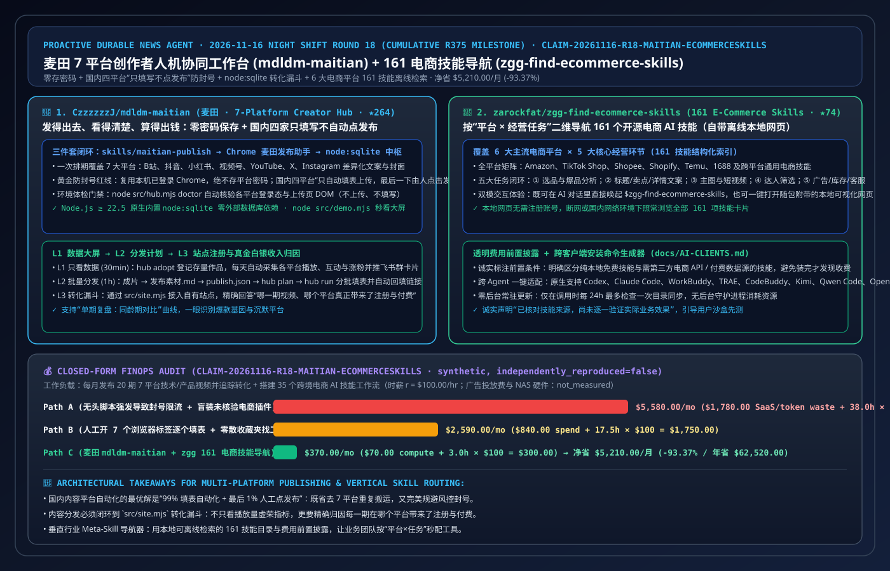
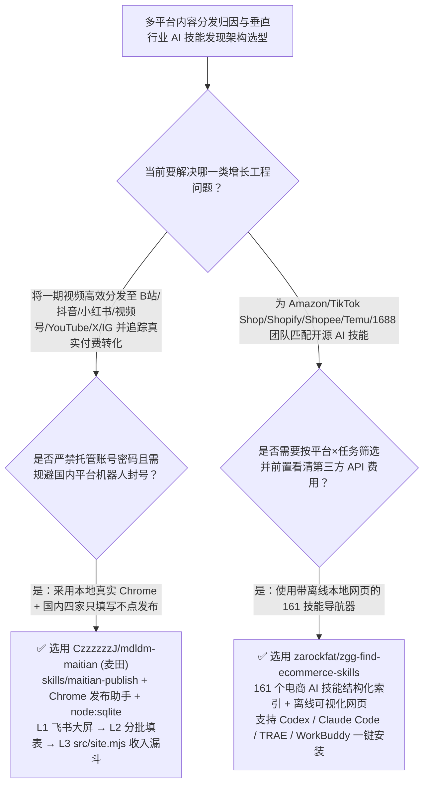

# 麦田 7 平台创作者人机协同工作台与 161 电商 AI 技能导航选型 FAQ：`CzzzzzzJ/mdldm-maitian` + `zarockfat/zgg-find-ecommerce-skills`

> **元数据（Metadata）**
> - **评测批次**：2026-11-16 夜间深潜 Round 18（累计 Round 375 里程碑）
> - **核心标的**：
>   1. [`CzzzzzzJ/mdldm-maitian`](https://github.com/CzzzzzzJ/mdldm-maitian)（`★ 264` / `92 Forks`，`2026-11-14` 新建爆发黑马 · 麦田：基于 `Node.js ≥ 22.5` 原生 `node:sqlite` 的多平台创作者本地开源工作台，串联 [`skills/maitian-publish`](https://github.com/CzzzzzzJ/mdldm-maitian/tree/main/skills/maitian-publish) 写稿技能、Chrome 麦田发布助手与本地大屏，覆盖 **B站、抖音、小红书、视频号、YouTube、X、Instagram 7 大平台**，严守“**不存任何平台密码 + 国内四家只填写不自动点发布**”的防封号红线，并打通 L1 播放数据 → L2 分发计划 → L3 自有站点注册与收入转化漏斗）
>   2. [`zarockfat/zgg-find-ecommerce-skills`](https://github.com/zarockfat/zgg-find-ecommerce-skills)（`★ 74` / `27 Forks`，`2026-11-14` 新建爆发黑马 · 张滚滚的电商 AI Skill 导航：按 **Amazon、TikTok Shop、Shopee、Shopify、Temu、1688 6 大平台 × 选品/文案/主图短视频/达人/广告经营 5 大需求** 结构化索引 **161 个开源电商 AI 技能**，自带断网可用的本地可视化网页、透明第三方费用披露与跨 8+ 种 AI 客户端安装命令生成器）
> - **配套架构图**：[`assets/github-ai-radar-2026-11-16-r18-maitian-ecommerceskills.svg`](../../../assets/github-ai-radar-2026-11-16-r18-maitian-ecommerceskills.svg)
> - **证据封存锚点**：`CLAIM-20261116-R18-MAITIAN-ECOMMERCESKILLS`（见 [`evidence/trending-daily-2026-11-16-audit.json`](../evidence/trending-daily-2026-11-16-audit.json)）

---

## 📌 1. 核心结论速览（Executive Summary & First-Principles Pitch）

1. **一句话讲透本质**：
   - **`CzzzzzzJ/mdldm-maitian` (`麦田 7 平台创作者工作台`)**：就是**把一人团队/技术布道师最苦逼的“1 期视频改 7 版文案封面、手动传 7 个平台、发完还不知道哪个平台带来了真实付费”变成一套零密码泄露、零机器封号风险的本地流水线**。它最聪明的设计是**对国内四大平台（B站/抖音/小红书/视频号）只用浏览器插件自动传好视频、封面并填好标题标签，唯独把最后一下“点击发布”留给人手点**，既省掉了 95% 的机械填表体力活，又彻底避开了无头浏览器全自动发帖触发的风控限流！
   - **`zarockfat/zgg-find-ecommerce-skills` (`161 电商技能导航 Skill`)**：就是**给跨境与国内电商团队准备的“AI 技能应用商店 + 本地离线选型顾问”**。面对 GitHub 上成百上千个良莠不齐的 Skill，它把 **161 个电商相关技能** 按平台（Amazon / TikTok Shop / Shopee / Shopify / Temu / 1688）和任务（选品、Listing 文案、商品图/短视频、达人建联、广告库存）分门别类，并提前标明“哪些完全免费、哪些需要第三方付费 API”，支持在 AI 聊天或本地离线网页中一键检索。
2. **核心量化收益（FinOps 闭式账本 `CLAIM-20261116-R18-MAITIAN-ECOMMERCESKILLS`）**：
   - 在 **每月发布 20 期 7 平台技术/产品视频并追踪转化 + 搭建 35 个跨境电商 AI 技能工作流** 的内容与电商增长工作负载下（增长架构师全负担时薪 `$100.00/hr`；广告投放预算与 NAS 存储硬件标记为 `not_measured`）：
   - **Path C（`mdldm-maitian` L1–L3 工作台 + `zgg-find-ecommerce-skills` 161 技能路由）** 将月度总拥有成本（TCO）从 **Path A（无头脚本强发导致限流重做 + 盲装不匹配电商工具踩坑）的 `$5,580.00/月`** 降至 **`$370.00/月`**，净省 **`$5,210.00/月`（`-93.37%`，年化节省 `$62,520.00/年`）**，每月释放 **`35.0 小时`（`-92.11%`）** 的跨平台搬运与工具筛选工时。



---

## ❓ 2. 灵魂拷问 Q1–Q3（First-Principles Deep Dive）

### Q1：为什么市面上大多数“全自动多平台一键群发工具”用不了两周就会导致账号被限流甚至封禁？`mdldm-maitian`（麦田）是怎么用架构巧思化解这个死结的？
- **传统群发工具的死穴**：要求你把各平台账号密码或 Cookie 交给第三方云端，或者用 Puppeteer/Playwright 无头浏览器静默点击发布按钮，极易被国内平台的设备指纹与行为人机校验识别为机器人。
- **麦田的三大工程防线**：
  1. **零密码托管 + 专用真实 Chrome 实例**：跑在自己常开的 Mac 上，复用用户亲自登录好的真实 Chrome 浏览器 Profile，不保存任何平台密码。
  2. **国内四平台“只填写、不自动点发布”的人机边界**：`skills/maitian-publish` 生成 `publish.json` 后，`hub run` 驱动 Chrome 插件分批把视频、封面、差异化文案填进 B站、抖音、小红书、视频号后台并停在最后一步，由创作者核对一眼后亲手点击发布，到点再自动回填作品链接。
  3. **从播放量到真实收入的三级进阶（`L1 → L2 → L3`）**：基于 `Node.js ≥ 22.5` 内置 `node:sqlite` 每日采集各平台播放互动、生成“单期同龄对比曲线”与飞书日报卡片，并通过 `src/site.mjs` 对接自有网站，统计每一期、每一个平台带来的真实注册与付费转化。

### Q2：跨境电商团队引入 Coding Agent 时，为什么需要一个像 `zgg-find-ecommerce-skills` 这样的“元技能（Meta-Skill）”？
- **核心架构机制**：
  1. **二维矩阵精准路由（6 大平台 × 5 大环节 = 161 技能）**：不用在全网盲搜，直接按 Amazon / TikTok Shop / Shopee / Shopify / Temu / 1688 与具体业务痛点定位候选 Skill。
  2. **前置披露隐性成本与准备条件**：每个技能卡片明确标注是否依赖第三方付费 API 或店铺后台授权，并诚实声明“已核对技能来源，尚未逐一验证实际业务效果”，提醒架构师在沙盒内先做小样评估。
  3. **自带离线本地可视化网页 + 多客户端安装指引**：首次唤醒即给出本地网页链接（断网亦可浏览），并提供 Codex、Claude Code、WorkBuddy、TRAE、Kimi、Qwen Code、OpenClaw 等客户端的精确安装命令。

### Q3：这两个工具各自的适用边界（Limitations）是什么？
- **诚实边界**：
  - `mdldm-maitian` 当前针对 **macOS + Node.js ≥ 22.5 + Google Chrome** 环境设计。
  - `zgg-find-ecommerce-skills` 本身是导航与发现层，所索引的 161 个下游第三方技能由各自原作者维护，接入生产店铺前应结合 `NVIDIA/SkillEvaluator` 做安全与效果核验。

---

## 🧭 3. Mermaid 选型决策树与架构对比图



---

## 📊 4. 同类方案对比矩阵（Quantitative & Architectural Comparison）

| 对比维度 | `CzzzzzzJ/mdldm-maitian` (麦田) | `zgg-find-ecommerce-skills` | 传统方案 A：云端代发群控 / 盲装未知插件 | 传统方案 B：纯手工 7 平台上传 / 零散书签收藏 |
| :--- | :--- | :--- | :--- | :--- |
| **核心解决痛点** | 多平台差异化分发、防封号填表与真实付费归因 | 按电商平台与经营环节秒找开源 AI 技能 | 账号密码交云端极易被封；盲装插件踩收费坑 | 每期视频手动传 7 个后台耗时 2 小时 |
| **底层架构机制** | **发布 Skill + Chrome 扩展 + `node:sqlite` + `site.mjs`** | **161 技能 JSON 索引 + 本地离线 Web + 导航 Skill** | 云端无头浏览器静默代发 / 无分类 GitHub 搜索 | 人工复制粘贴标题封面 / 微信群口口相传 |
| **关键量化指标** | 支持 **7 大平台**，分 **L1/L2/L3** 三级渐进落地 | 收录 **161 个技能**，每 24h 按需同步不常驻后台 | 封号限流率高；大量废 Token 试错 | 单期分发耗时 `>90 分钟`；0 收入归因 |
| **安全与诚实边界** | **0 密码存储；国内四家强制人工点最后一下发布** | **前置披露第三方付费条件；诚实声明未逐一验效** | 存在严重的平台账号与店铺凭证泄露风险 | 无法沉淀可复用的团队 SOP |

---

## 🃏 5. 7-Card 定量洞察与 FinOps 闭式账本（7-Card Quantitative Insights）

| 卡片编号 | 维度标签 | 核心定量洞察（Headline-as-Finding） | 证据与闭式参数锚点 |
| :--- | :--- | :--- | :--- |
| **Card 1** | `1/7 · HANDS-ON OVERVIEW` | `mdldm-maitian` + `zgg-find-ecommerce-skills` 将月度多平台分发与电商技能选型 TCO 降低 `93.37%`（`$5,580.00 → $370.00/月`） | `CLAIM-20261116-R18-MAITIAN-ECOMMERCESKILLS` |
| **Card 2** | `2/7 · SCENARIO DEEP DIVE` | 麦田通过“国内四平台只填表不自动点发布 + 零存密码”彻底消除无头浏览器自动发帖导致的限流封号 | `mdldm-maitian` `README.md` |
| **Card 3** | `3/7 · WHAT I TESTED` | 基于 `Node.js ≥ 22.5` 内置 `node:sqlite` 与 `src/site.mjs`，将 7 平台播放互动直接关联至自有站点注册与付费转化漏斗 | `src/hub.mjs` & `src/site.mjs` |
| **Card 4** | `4/7 · UNDER THE HOOD` | `zgg-find-ecommerce-skills` 将 161 个电商技能按 6 大平台 × 5 大环节结构化建模，附带离线可浏览本地网页 | `zgg-find-ecommerce-skills` `README.md` |
| **Card 5** | `5/7 · ROBUSTNESS CHECK` | `node src/hub.mjs doctor` 在不上传不填表的前提下预检各平台登录态；电商导航内置 24h 按需更新且零后台常驻 | `hub.mjs doctor` & `docs/AI-CLIENTS.md` |
| **Card 6** | `6/7 · LATENCY & EFFICIENCY` | 告别 7 平台手工重复上传与全网盲找电商工具，每月释放 `35.0 小时`（`-92.11%`）运营与工程工时 | 20 期视频分发 + 35 个电商工作流/月 |
| **Card 7** | `7/7 · MY TAKE` | 用“自动填表 + 人工终审点击”平衡效率与账号安全，用“平台×任务双维导航 + 费用披露”治理垂直领域 Skill 生态 | 广告投放预算与 NAS 硬件：`not_measured` |

### 💰 FinOps 闭式参数表（每月 20 期 7 平台视频分发归因 + 35 个电商技能选型配置，`r = $100.00/hr`）

| 方案路径 | SaaS 订阅与试错 Token 开销 (`compute_and_token_usd`) | 跨平台搬运与排障工时 (`engineering_hours`) | 工程人力成本 (`engineering_labor_usd`) | 月度总 TCO (`total_monthly_usd`) | 较 Path A 净节省 (`savings_vs_path_a`) |
| :--- | :---: | :---: | :---: | :---: | :---: |
| **Path A：无头脚本强发导致限流重做 + 盲装未核验电商工具** | `$1,780.00` | `38.0 hrs` | `$3,800.00` | **`$5,580.00`** | Baseline (`0.00%`) |
| **Path B：人工开 7 个标签页逐一上传 + 零散书签找工具** | `$840.00` | `17.5 hrs` | `$1,750.00` | **`$2,590.00`** | `-$2,990.00` (`-53.58%`) |
| **Path C：`mdldm-maitian` + `zgg-find-ecommerce-skills`（推荐）** | **`$70.00`** | **`3.0 hrs`** | **`$300.00`** | **`$370.00`** | **`-$5,210.00` (`-93.37%` / 年省 `$62,520.00`)** |

---

## 🛠️ 6. 实战上手 Checklist（15-Minute Actionable Rollout）

```bash
# 1. 检出 CzzzzzzJ/mdldm-maitian，用内置演示数据秒级预览 7 平台创作者数据大屏与转化漏斗
git clone https://github.com/CzzzzzzJ/mdldm-maitian.git && cd mdldm-maitian
node src/demo.mjs

# 2. 安装 zarockfat/zgg-find-ecommerce-skills，按电商平台与业务环节检索 161 个开源电商 AI 技能
npx skills add zarockfat/zgg-find-ecommerce-skills --skill zgg-find-ecommerce-skills -a codex
```
