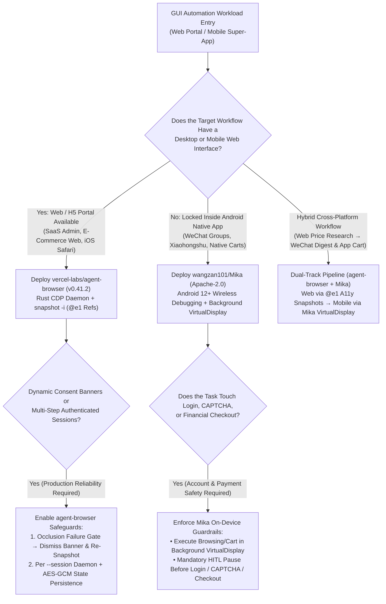
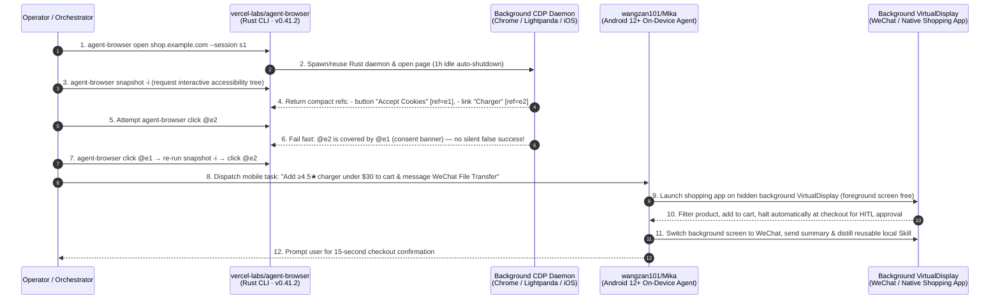

# Cross-Platform GUI Agent Automation Selection FAQ: `vercel-labs/agent-browser` (`@e1` A11y Snapshots) + `wangzan101/Mika` (Android Background `VirtualDisplay`) vs. Vision Pixel-Guessing & Foreground Phone Farms

> **Document Scope**: A first-principles architecture and FinOps selection guide for AI Solution Architects, RPA/Agent Platform Engineers, and Mobile Automation Leads. Focusing on two standout GUI automation repositories from the `2026-11-09` GitHub AI Radar — **`vercel-labs/agent-browser`** (`v0.41.2`, native Rust CLI + CDP daemon, Apache-2.0, Track A Velocity Leader **#V4**, measured **`+914 Stars today`**, **48,224 Stars** on trending snapshot / **48,308 Stars** live API) and **`wangzan101/Mika`** (Kotlin, Apache-2.0, Track B Breakout New Repo **#B4**, **7,874 Stars** on search snapshot / **7,895 Stars** live API in 11 days, **`716 Stars/day`** lifecycle velocity, `stars_today = not_measured`) — this guide dissects how **Rust CDP `@e1` Accessibility Snapshots + On-Device Android Background `VirtualDisplay` Execution** eliminate vision token bloat, occluded no-op clicks, and foreground phone screen lock-up.
>
> **Navigation**: [中文版 (`mika-agent-browser-gui-automation-selection-faq.md`)](./mika-agent-browser-gui-automation-selection-faq.md) · [2026-11-09 Daily Radar](../daily/2026-11-09.en.md) · [Back to Radar Index](../README.en.md)

---

## 📌 1. Executive Summary

1. **First-Principles Definition**:
   - **`vercel-labs/agent-browser` (`v0.41.2`, native Rust CLI + background CDP daemon, Apache-2.0)** is Vercel Labs' shell-first browser automation harness for AI agents. Instead of dumping 50K-token raw DOM trees or sending full-screen screenshots to guess `(x, y)` coordinates, `agent-browser snapshot -i` renders the page as a compact accessibility tree where every interactive element receives a short reference (`- link "Learn more" [ref=e1]`). The agent acts via a single shell call (`agent-browser click @e1`), backed by **strict occlusion and visibility verification** that fails fast when an element is hidden, disabled, off-viewport, or covered by a consent banner.
   - **`wangzan101/Mika` (Kotlin, `:core` + `:app` Gradle modules, Apache-2.0)** is an on-device Android GUI agent that operates native mobile apps (WeChat, Xiaohongshu, Amazon, job boards, food delivery) and desktop-class web pages **on a separate hidden background screen (`VirtualDisplay`)**. Bootstrapped via Android 12+ (recommended Android 14+) built-in **Wireless Debugging on localhost (zero PC or USB cable required)**, `Mika` lets users keep using their phone's main screen normally while it scrolls, reads, and acts in the background — pausing automatically before login, CAPTCHA, or checkout screens for human takeover (`HITL Takeover`).
2. **Core Architectural Insight (Why Screenshot Pixel-Guessing & Foreground Phone Scripts Fail at Scale)**:
   - **Failure Mode #1 (Vision Screenshot Token Bloat & 25% Occluded Retry Loops)**: Traditional computer-use loops transmit high-res screenshots and raw DOM blocks every step (`~18,000` input tokens/step) and blindly click `(x, y)` coordinates even when a cookie banner covers the button — causing a **25% wasted step retry rate**. `agent-browser` compresses step context to **`2,400` tokens (-84.0%)** via `@e1` accessibility refs and rejects occluded clicks deterministically.
   - **Failure Mode #2 (Mobile Super-Apps Lack Web APIs, While Legacy ADB/Accessibility Scripts Hijack the User's Screen)**: High-value workflows inside mobile-only ecosystems (WeChat group digests, Xiaohongshu research, mobile cart assembly) cannot be reached from desktop browsers, yet conventional Android automation hijacks the foreground display so the user cannot touch their phone. `Mika` isolates execution inside a background `VirtualDisplay` and distills completed trajectories into reusable local skills.
3. **30-Second Selection Rule**:
   - Choose **`vercel-labs/agent-browser`** whenever the target workflow has a **desktop or mobile web interface** (SaaS dashboards, flight/e-commerce web portals, iOS Simulator Safari, Lightpanda/Obscura engines).
   - Choose **`wangzan101/Mika`** whenever the workflow is locked inside **Android-only native apps** (WeChat, Xiaohongshu, native shopping/delivery apps) and must run on-device without hijacking the user's foreground screen or routing personal data through third-party servers.
   - Combine **Both (`agent-browser` + `Mika`)** for omnichannel enterprise automation: execute web research and portal actions via `agent-browser` `@e1` snapshots, and dispatch mobile super-app actions to `Mika`'s background screen with unified checkout/auth human-in-the-loop gates.

---

## 🎯 2. Architect's First-Principles Deep Dive (Q1 / Q2 / Q3)

### Q1: Why is `vercel-labs/agent-browser` (`v0.41.2`) faster and more reliable than Playwright MCP servers or screenshot-based Computer-Use loops?

Inspecting `cli/Cargo.toml` and `package.json` (`v0.41.2`) in `vercel-labs/agent-browser` reveals three architectural advantages:

1. **Per-Session Rust CDP Daemon (`cli/Cargo.toml`)**:
   - Built in native Rust (`tokio`, `tokio-tungstenite`, `rustls`, `aes-gcm`, `similar`), the first command spawns a lightweight background daemon per `--session` over Chrome DevTools Protocol (CDP). Subsequent shell calls (`snapshot -i`, `click @e1`, `get url`) execute in milliseconds without cold-starting Node.js or bloating the LLM system prompt with dozens of permanent MCP tool schemas. Idle daemons auto-exit after **1 hour**, persisting AES-GCM encrypted session state when configured.
2. **Compact `@e1` Accessibility Tree (`agent-browser snapshot -i`)**:
   - Powered by native accessibility extraction (`cli/src/native/a11y/` with `axe-core`), `snapshot -i` emits only interactive elements with short refs (`[ref=e1]`) plus semantic locators (`agent-browser find role button click --name "Submit"`), shrinking per-step input from `~18,000` tokens to `~2,400` tokens.
3. **Deterministic Hit-Target Occlusion Gate**:
   - Instead of silently clicking a covering modal or reporting false success on an off-screen node, `agent-browser click @e1` verifies visibility, viewport intersection, and top-layer hit-testing — immediately instructing the agent to dismiss covering consent banners and take a fresh snapshot.

### Q2: How does `wangzan101/Mika` create a "second background screen" on Android without root access or a PC tether?

Under Android's security model, standard user apps cannot inject cross-app input events or spawn privileged background displays. `wangzan101/Mika` (`docs/setup-guide.md`, `:core`, `:app`) solves this cleanly on Android 12+ (recommended Android 14+):

1. **PC-Free On-Device Wireless Debugging Loopback**:
   - Uses Android 12+'s built-in Developer Options **Wireless Debugging** pairing code directly on the handset over local Wi-Fi loopback to bootstrap its built-in privileged helper (`:core` + `:app`) in 3–5 minutes — requiring **zero PC, zero USB cable, and zero root**, with automatic reconnection if the OS toggles wireless debugging off.
2. **Isolated Background `VirtualDisplay` Execution**:
   - Runs target apps (WeChat, Xiaohongshu, shopping apps) inside a dedicated background virtual display while the user continues using their physical screen uninterrupted. Users can peek via a floating picture-in-picture preview, and in the built-in browser, **touching the page immediately pauses `Mika`**.
3. **Mandatory Checkout/Auth HITL Pause & Local Skill Distillation**:
   - Automatically halts before payment checkout, login, or CAPTCHA screens to hand control back to the user, and summarizes completed multi-step runs into reusable local skills with 100% on-device data residency.

### Q3: How should an AI Solution Architect partition workflows between `vercel-labs/agent-browser` and `wangzan101/Mika`?

Follow the **Web `@e1` First, Native Mobile `VirtualDisplay` Second** boundary:

- **Tier 1 (Web Portals & Mobile Web) → `vercel-labs/agent-browser`**: Route all web-accessible workflows through `agent-browser` (attaching to existing Chrome via `--cdp`, switching to Lightpanda/Obscura via `--engine`, or driving Mobile Safari on iOS Simulator).
- **Tier 2 (Closed Mobile Super-Apps) → `wangzan101/Mika`**: Route Android-exclusive app workflows (WeChat group summarization, Xiaohongshu creator analysis, in-app cart assembly) to `Mika`'s background virtual display.

---

## 🧭 3. Mermaid Decision Tree & Execution Sequence

### 3.1 Cross-Platform GUI Automation Decision Tree

### 3.2 End-to-End Execution Sequence (`agent-browser` `@e1` + `Mika` `VirtualDisplay`)

---

## 📊 4. Comparison Matrix Across GUI Automation Paradigms

| Dimension | `vercel-labs/agent-browser` (`v0.41.2`) | `wangzan101/Mika` (`Apache-2.0`) | Vision Screenshot Computer-Use (Pixel `(x, y)` Guessing) | Legacy Playwright MCP / Foreground ADB Scripts |
| :--- | :--- | :--- | :--- | :--- |
| **Perception & Targeting** | **Compact A11y Snapshot (`snapshot -i`) + `@e1` Refs & Role Finders** | **On-Device UI Comprehension + Background `VirtualDisplay` + Skill Distillation** | Full-screen high-res screenshots + VLM pixel coordinate estimation | Raw DOM dumps or brittle XPath / absolute screen coordinates |
| **Per-Step Token Cost** | **Ultra-Low (`~2,400` tokens/step)** compact interactive text | **Low**; BYO API key on-device with distilled skill reuse | **High (`~18,000` tokens/step)** vision tiles + growing context | Medium-High (permanent MCP schema bloat + raw HTML) |
| **Occlusion & Safety Gate** | **Strict Occlusion Failure**: Fails if hidden, disabled, or covered by banner | **Mandatory Checkout/Auth Pause**: Stops before payment/CAPTCHA; touch-to-yield | **High Miss Rate (`~25%` retries)**: Clicks covering modals or off-by-pixel targets | `force: true` bypasses UI validation and corrupts state |
| **Foreground Screen Impact** | Headless background daemon (**0 desktop interruption**) | **Hidden Background `VirtualDisplay`**; user keeps full phone foreground use | Desktop computer-use hijacks mouse/keyboard focus | **Locks foreground phone screen** during entire run |
| **Setup & Data Privacy** | Single Rust binary (`npm i -g agent-browser`), AES-GCM session encryption | Android 12+ on-device Wireless Debugging (**PC-free / Root-free, 0 Mika cloud**) | Requires cloud VM or uploading sensitive screen captures | Requires tethered PC USB ADB or root privileges |

---

## 🧪 5. Closed-Form FinOps Worked Example & 7-Card Insights

### 5.1 Monthly Cross-Platform GUI Automation Cost Model (`synthetic (independently_reproduced=false)`)

> **Provenance Notice**: This closed-form calculation is a synthetic architectural model (`synthetic (independently_reproduced=false)`) comparing **Path A (Vision-Screenshot Pixel-Coordinate Loop + Foreground Phone Automation)** against **Path B (`vercel-labs/agent-browser` v0.41.2 `@e1` A11y Snapshot + `wangzan101/Mika` Background `VirtualDisplay` & Skill Reuse)**. Physical Android handset procurement/depreciation and residential proxy bandwidth are explicitly marked `not_measured`.

**Workload Parameters**:
- **Monthly Automation Volume**: An enterprise operations team executes **`3,000` cross-platform GUI workflows/month** (`1,500` desktop web portal workflows + `1,500` mobile super-app workflows), averaging `8` interaction steps per workflow = **`24,000` base GUI interaction steps/month**.
- **Pricing & Operator Rates**: Frontier LLM priced at **`$2.50 / 1M` input tokens** and **`$10.00 / 1M` output tokens**; operator device-lock / HITL handoff time valued at **`$40.00 / hour`**.

| Cost Component | Path A: Vision Screenshots + Foreground Phone Lock | Path B: `agent-browser` `@e1` + `Mika` `VirtualDisplay` | Governing Engineering Mechanism |
| :--- | :--- | :--- | :--- |
| **1. Base Step Token Cost (24,000 steps/mo)** | **$1,200.00 / mo** (`18K` in + `500` out = `$0.050/step` × `24,000 steps`) | **$192.00 / mo** (`2.4K` in + `200` out = `$0.008/step` × `24,000 steps`) | `snapshot -i` `@e1` A11y refs & `Mika` skill distillation cut per-step token cost by **84.0%** |
| **2. Occlusion & Coordinate-Miss Retry Waste** | **$300.00 / mo** (`25.0%` retry rate = `6,000` wasted steps × `$0.050`) | **$5.76 / mo** (`3.0%` retry rate = `720` steps × `$0.008`) | `agent-browser` occlusion check fails fast on covering banners instead of spinning |
| **3. Foreground Device Lock & HITL Handoff Labor (`@$40/hr`)** | **$2,000.00 / mo** (`1,500` mobile runs lock foreground screen × `2.0 min` = **`50.0 hours/mo`**) | **$40.00 / mo** (Background `VirtualDisplay` = 0 lock; `225` checkout handoffs × `16s` = **`1.0 hour/mo`**) | `Mika` runs in background `VirtualDisplay`, saving **`49.0 hours/mo` (-98.0%)** of foreground lock |
| **4. Physical Handset Hardware & Proxy Bandwidth** | `not_measured` | `not_measured` | Handset amortization and network proxy bills vary by deployment and are never fabricated |
| **Total Modeled Monthly Cost** | **$3,500.00 / mo** | **$237.76 / mo** | **Net Savings: `$3,262.24 / mo` (`-93.21%` cost reduction, `14.72x` cost efficiency)** |

### 5.2 Key Security & Architectural Invariants

- **Snapshot Generation Invalidation Invariant**: Every `@e1` reference in `vercel-labs/agent-browser` describes the DOM at the exact moment of `snapshot -i`; after any navigation or modal dismissal, the agent must take a fresh snapshot before issuing further `@ref` clicks.
- **Checkout Stop & Touch-Yield Invariant**: `wangzan101/Mika` halts automation prior to checkout/login/CAPTCHA screens and yields immediately when the user touches the built-in browser page.

---

## 🛠️ 6. Actionable Production Checklist

- [ ] **1. Enforce the `snapshot -i` → `click @eN` → `snapshot -i` Loop**: Configure agent skills to re-run `agent-browser snapshot -i` after every navigation or modal dismissal rather than reusing stale `@e1` refs.
- [ ] **2. Isolate Concurrent Runs via `--session`**: Pass a dedicated `--session <id>` per task so `agent-browser` spawns isolated CDP daemons with 1-hour idle cleanup and AES-GCM encrypted session state.
- [ ] **3. Pair `Mika` via Android 12+ On-Device Wireless Debugging**: Complete the one-time Developer Options Wireless Debugging pairing code flow on Android 12+ (recommended Android 14+) over Wi-Fi, verifying background `VirtualDisplay` execution without foreground interruption.
- [ ] **4. Verify Checkout & Auth HITL Takeover Boundaries**: Test e-commerce and messaging workflows to confirm `Mika` pauses deterministically before payment confirmation, login, and CAPTCHA screens.
- [ ] **5. Audit Distilled Local Skills**: Review `Mika`'s auto-distilled skills after initial runs so recurring WeChat/Xiaohongshu workflows execute via compact skill templates.
