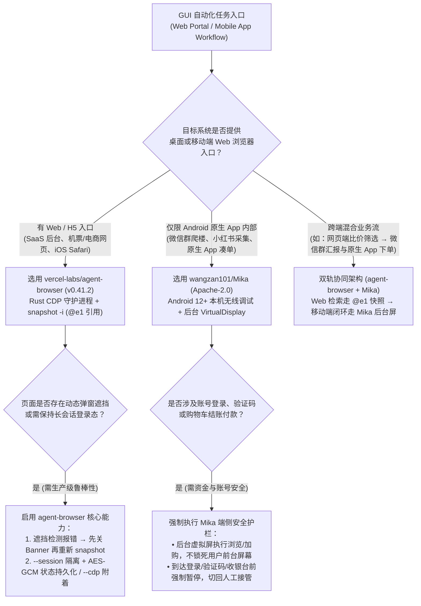
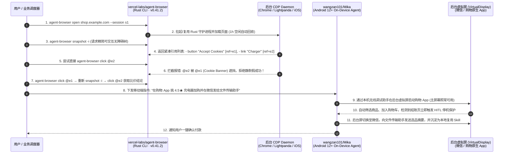

# 跨端 GUI 智能体自动化选型 FAQ：`vercel-labs/agent-browser` (`@e1` 无障碍快照) + `wangzan101/Mika` (安卓后台虚拟屏) vs 视觉截图猜坐标与前台真机群控

> **文档定位**：面向 AI Solution Architect（AI 解决方案架构师）、RPA/Agent 平台架构师与移动端自动化负责人的第一性原理选型指南。聚焦 `2026-11-09` GitHub AI 全景热榜与新仓爆发榜的两大跨端 GUI 操作标杆——**`vercel-labs/agent-browser`**（`v0.41.2`，Rust 原生 CLI，Apache-2.0，Track A 飙升榜 **#V4**，今日实测 **`+914 Stars today`**，榜单快照 **48,224 Stars** / 实时 API **48,308 Stars**）与 **`wangzan101/Mika`**（Kotlin，Apache-2.0，Track B 新仓黑马榜 **#B4**，建仓 11 天揽下 **7,874 Stars** 搜索快照 / **7,895 Stars** 实时 API，日均斜率 **`716 Stars/day`**，`stars_today = not_measured`），深度拆解如何用 **“Rust CDP 守护进程 `@e1` 精简无障碍树引用 + 安卓端侧无线调试后台虚拟屏（Background `VirtualDisplay`）”** 彻底解决传统 GUI Agent 截图猜坐标贵、遮挡空点多、霸占用户手机前台屏幕的三大工程死穴。
>
> **阅读导航**：[English Version (`mika-agent-browser-gui-automation-selection-faq.en.md`)](./mika-agent-browser-gui-automation-selection-faq.en.md) · [2026-11-09 全景日报](../daily/2026-11-09.md) · [返回雷达首页](../README.md)

---

## 📌 1. 核心结论速览（Executive Summary）

1. **一句话本质定义**：
   - **`vercel-labs/agent-browser`（`v0.41.2`，Rust 原生 CLI + 后台 CDP 守护进程，Apache-2.0）** 是 Vercel Labs 专为 AI Agent 打造的**命令行浏览器控制面**。它摒弃了动辄几万 Token 的原始 HTML 倾倒与缓慢的全屏截图坐标识别，通过 `agent-browser snapshot -i` 将网页交互元素浓缩为带短引用编号的无障碍树（如 `- link "Learn more" [ref=e1]`），Agent 只需执行一条短 Shell 命令 `agent-browser click @e1` 即可精准操作，且内置严格的**遮挡与可见性门禁（被 Cookie 弹窗遮挡或隐藏时立即报错拒绝假成功）**。
   - **`wangzan101/Mika`（Kotlin，`:core` + `:app` 模块，Apache-2.0）** 是运行在 Android 手机本地的**后台虚拟屏（Background `VirtualDisplay`）自主操作 Agent**。它借助 Android 12+（推荐 Android 14+）自带的**本机无线调试（Wireless Debugging，无需连接电脑或 USB 线）**拉起内置辅助服务，在一块看不见的独立后台虚拟屏幕上打开微信、小红书、招聘软件、购物与外卖 App 完成翻聊天记录、比价加购等长链路任务，**完全不占用用户的手机前台主屏幕**，并在遇到登录、验证码或结账付款时自动停下请人工接管（HITL Takeover）。
2. **核心架构洞察（为什么“全屏截图猜 `(x, y)` 坐标 + 前台真机自动化”无法规模化落地？）**：
   - **痛点一（全屏截图 + 原始 DOM 带来的 Token 爆炸与 `25%` 遮挡误点率）**：传统 Computer-Use / Playwright 包装器每走一步都要发送高分辨率截图或全量 HTML（单步约 `18,000` 输入 Tokens），且当按钮在视口外或被 Cookie 横幅遮挡时，基于坐标的点击会“静默点在遮罩层上却返回成功”，导致高达 **25%** 的步骤陷入无效重试。`agent-browser` 用 `@e1` 精简无障碍树将单步上下文压至 **`2,400` Tokens（直降 84%）**，并在底层阻断遮挡点击。
   - **痛点二（移动端超级 App 封锁 Web 接口，而传统无障碍自动化会“抢夺用户手机屏幕”）**：微信群消息汇总、小红书创作者分析、外卖凑单等高频场景只有移动端 App 入口。传统 ADB / 无障碍脚本直接在手机主屏幕上乱跳，执行任务期间用户根本没法用手机。`Mika` 独创性地将 Agent 关进后台独立 `VirtualDisplay`，实现**前台用户正常刷手机、后台 Mika 并行干活**，并将跑通的操作轨迹自动沉淀为本地可复用技能（Skills）。
3. **30 秒选型口诀**：
   - 凡是**有 Web 端入口或移动端 H5/Safari 页面的自动化任务（SaaS 后台操作、机票比价、数据填报、无障碍审计）** → 选 **`vercel-labs/agent-browser`**（`--session` 持久化 + `@e1` 引用 + 多引擎支持 Chrome / Lightpanda / Obscura / iOS Simulator）。
   - 凡是**锁死在 Android 原生 App 内的闭源生态任务（微信爬楼总结、小红书/抖音内容采集、Boss 直聘打招呼、电商比价加购）** → 选 **`wangzan101/Mika`**（本机无线调试激活后台虚拟屏 + 付款前停机确认）。
   - 构建**企业级全渠道数字员工（Web + Mobile Super-App）** → **双轨组合**：桌面/云端 Web 任务走 `agent-browser` Rust CLI，移动端原生 App 任务派发给端侧 `Mika`，共享同一套敏感操作（支付/验证码）人工确认规范。

---

## 🎯 2. 架构师灵魂拷问（Q1 / Q2 / Q3 First-Principles Deep Dive）

### Q1：`vercel-labs/agent-browser` (`v0.41.2`) 的 Rust 守护进程与 `@e1` 快照机制，相比传统 Playwright MCP 或截图流 Computer-Use 究竟快在哪、准在哪？

通过拆解 `vercel-labs/agent-browser` 的 `cli/Cargo.toml` 与 `package.json`（`v0.41.2`），可以看到它在三个核心层面做了极致工程优化：

1. **进程模型：按 `--session` 隔离的 Rust 原生后台 CDP 守护进程**：
   - 传统 CLI 每执行一条命令就要冷启动一次 Node.js + Playwright 进程；而 MCP 长连接又会把几十个复杂的浏览器 Tool Schema 永远塞在 LLM 的 System Prompt 里。
   - `agent-browser` 采用纯 Rust 编写（基于 `tokio` 异步运行时、`tokio-tungstenite` WebSocket 与 `rustls`），首次调用 `agent-browser open` 时自动在后台拉起一个轻量级守护进程并通过 Chrome DevTools Protocol（CDP）保持浏览器长连接。后续每一条 `snapshot`、`click @e1`、`get url` 都是一次毫秒级本地 Socket 通信；守护进程默认在 **1 小时无命令后自动关闭无头浏览器并退出**，且通过 `aes-gcm` 加密持久化会话 Cookie 与登录态。
2. **表征压缩：`snapshot -i` 精简无障碍树与 `@e1` 确定性引用**：
   - 执行 `agent-browser snapshot -i` 时，内置的原生无障碍模块（集成 `axe-core`，见 `cli/src/native/a11y/`）仅提取当前页面可交互元素并赋予短引用，如 `- link "Learn more" [ref=e1]`，同时支持语义定位器（如 `agent-browser find role button click --name "Submit"`）。单步上下文从 `~18,000` Tokens 骤降至 `~2,400` Tokens。
3. **执行门禁：遮挡（Occlusion）与可见性硬核校验**：
   - 当目标元素处于隐藏（hidden）、禁用（disabled）、视口外（outside viewport）或被弹窗/Cookie 横幅遮挡（covered by another element）时，`agent-browser click @e1` **绝不静默伪造成功，而是立即返回明确的遮挡错误**，引导 Agent 先关闭遮挡横幅、重新执行 `snapshot` 刷新 `@ref` 再重试。

### Q2：`wangzan101/Mika` 是如何在不 Root 手机、不连电脑数据线的前提下，在 Android 手机上开辟“第二块后台屏幕”操作微信和购物 App 的？

在 Android 安全沙盒下，普通第三方 App 无法在其他 App 界面上静默注入点击，也无法创建高权限后台虚拟屏幕。`wangzan101/Mika`（`docs/setup-guide.md`、`:core` 与 `:app` 模块）巧妙利用了 Android 12+ 的系统原生能力：

1. **零电脑（PC-Free）本机无线调试环回配对（Wireless Debugging Loopback）**：
   - Android 12 及以上系统（推荐 Android 14+）在开发者选项中内置了「无线调试（Wireless Debugging）」。`Mika` 引导用户在手机上开启无线调试并使用「配对码配对设备」，直接在手机本机环回网络完成一次 ADB 级授权，拉起内置的辅助常驻组件（无需电脑、无需 USB 数据线，且后续系统重启无线调试关闭时可自动重连）。
2. **独立后台虚拟屏（Background `VirtualDisplay`）并行执行**：
   - 获得无线调试辅助权限后，`Mika` 创建一个不占用物理主屏幕的后台虚拟显示层。当用户发出“翻完微信群总结今天聊了啥”或“挑一个 30 美元以内 4.5 星以上的充电器加进购物车”时，`Mika` 在后台屏上启动目标 App、滚动长列表、读取界面并执行点击输入。
   - 用户可以随时点开左下角小窗实时观看后台屏画面，而在内置浏览器中**用户手指一旦触碰页面，`Mika` 立即暂停退让控制权**。
3. **高危边界自动熔断（Checkout/Auth HITL Pause）与技能自进化**：
   - 遇到登录、滑块验证码、收银台付款等敏感界面时，`Mika` 严格停止自动点击并弹窗请用户接管；任务完成后，自动将成功的操作步骤总结为本地技能（Skill），下次执行同类任务时无需从头摸索。

### Q3：面对复杂的跨平台业务流程，架构师该如何划分 `vercel-labs/agent-browser` 与 `wangzan101/Mika` 的职责边界？

遵循 **“Web 优先走 `agent-browser` `@e1` 协议，移动端独占闭源 App 走 `Mika` 后台虚拟屏”** 的分层原则：

- **第一顺位（桌面/云端 Web 与移动端 H5/Safari）→ `vercel-labs/agent-browser`**：只要业务系统提供 Web 页面（哪怕需要登录态或运行在移动端 Safari），一律优先用 `agent-browser`（可通过 `--cdp` 附着已有 Chrome、通过 `--engine` 切换 Lightpanda/Obscura 极速引擎，或驱动 iOS Simulator）。文本级 `@e1` 无障碍树比任何移动端视觉方案都快一个数量级。
- **第二顺位（无 Web 接口的移动端原生超级 App）→ `wangzan101/Mika`**：当工作流必须进入微信、小红书、闲鱼、Boss 直聘原生客户端或美团/饿了么凑单界面时，使用运行在 Android 12+ 终端上的 `Mika` 在后台虚拟屏完成操作，且所有聊天记录与账号凭证 100% 留在手机本地（无第三方中转服务器）。

---

## 🧭 3. Mermaid 选型决策树与双轨执行时序图（Decision Tree & Architecture Flow）

### 3.1 跨端 GUI 智能体自动化选型决策树

### 3.2 `agent-browser` `@e1` 快照 + `Mika` 后台虚拟屏协同执行时序图

---

## 📊 4. 同类 GUI 自动化方案核心能力对比矩阵（Comparison Matrix）

| 评估维度 | `vercel-labs/agent-browser` (`v0.41.2`) | `wangzan101/Mika` (`Apache-2.0`) | 传统视觉截图流 Computer-Use（全屏截图猜 `(x,y)`） | 传统 Playwright MCP / 前台 ADB 群控脚本 |
| :--- | :--- | :--- | :--- | :--- |
| **核心感知与定位机制** | **精简无障碍树快照（`snapshot -i`）+ `@e1` 短引用 / 语义角色定位** | **端侧界面理解 + 后台虚拟屏交互 + 历史轨迹技能蒸馏（Skills）** | 每步截取高清全屏图，靠多模态模型估算像素坐标 `(x, y)` | 倾倒全量 DOM 树或写死脆弱的 XPath / 手机屏幕绝对坐标 |
| **单步 Token 消耗量** | **极低（`~2,400` Tokens/步）**，仅传输紧凑可交互节点文本 | **低**，端侧直连自有 API Key，技能固化后大幅减少探索步数 | **极高（`~18,000` Tokens/步）**，高清大图 + 冗余上下文持续累加 | 中高（MCP 工具定义常驻上下文 + 大包 HTML 返回） |
| **遮挡与误点防护** | **硬核阻断**：目标隐藏/出视口/被弹窗遮挡时直接报错，杜绝空点 | **收银台/验证码强制停机**：停在结账前交由用户确认，触碰即停 | **盲点率高（~25% 重试）**：经常点在透明遮罩或偏移像素上 | `force: true` 容易绕过前端校验触发脏状态 |
| **对用户前台设备的干扰** | 后台无头（Headless）守护进程运行，**0 桌面干扰** | **独立后台虚拟屏（`VirtualDisplay`）**，用户照常使用手机前台 | 桌面端 Computer-Use 往往独占鼠标键盘焦点 | **霸占手机前台屏幕**，任务运行期间手机完全无法使用 |
| **部署门槛与数据隐私** | 单一 Rust 二进制（`npm i -g agent-browser`），AES-GCM 本地会话加密 | Android 12+ 手机本机无线调试配对（**免电脑/免 Root**），**0 中转服务器** | 需云端沙盒虚拟机或上传全屏隐私截图 | 需长连电脑 USB 调试线或 Root 权限 |

---

## 🧪 5. 定量 FinOps 算例与 7-Card 评测洞察（Closed-Form Quantitative Model）

### 5.1 封闭式月度跨端 GUI 自动化成本算例（`synthetic (independently_reproduced=false)`）

> **口径声明**：本算例为合成架构基准模型（`synthetic (independently_reproduced=false)`），用于量化对比 **Path A（传统视觉截图猜坐标 Computer-Use 循环 + 霸占手机前台屏幕的移动自动化）** 与 **Path B（`vercel-labs/agent-browser` `@e1` 无障碍快照 + `wangzan101/Mika` 后台虚拟屏与技能复用）**。Android 物理测试机硬件采购折旧与住宅代理 IP 流量费均显式标记为 `not_measured`。

**基准工作负载设定**：
- **月度任务规模**：企业运营与增长团队每月执行 **`3,000` 次跨端 GUI 自动化任务**（含 `1,500` 次 Web 门户任务 + `1,500` 次移动端原生超级 App 任务），每次任务平均包含 `8` 个交互步，每月共 **`24,000` 个基础 GUI 交互步**。
- **单价与工时设定**：大模型单价按输入 **`$2.50 / 1M Tokens`**、输出 **`$10.00 / 1M Tokens`** 计；运营人员因手机前台屏幕被霸占锁死或人工接管支付/验证码的综合时薪按 **`$40.00 / 小时`** 计。

| 成本分项 | Path A：视觉截图猜坐标 + 前台真机霸屏 | Path B：`agent-browser` `@e1` + `Mika` 后台屏 | 核心工程机制差异说明 |
| :--- | :--- | :--- | :--- |
| **1. 基础交互步 Token 成本（24,000 步/月）** | **$1,200.00 / 月** （每步 `18K` 输入 + `500` 输出 = `$0.050/步` × `24,000 步`） | **$192.00 / 月** （每步 `2.4K` 输入 + `200` 输出 = `$0.008/步` × `24,000 步`） | `snapshot -i` `@e1` 无障碍树与 `Mika` 技能蒸馏将单步 Token 成本压降 **84.0%** |
| **2. 弹窗遮挡与坐标偏移无效重试成本** | **$300.00 / 月** （`25.0%` 误点重试率 = `6,000` 额外步 × `$0.050/步`） | **$5.76 / 月** （`3.0%` 重试率 = `720` 额外步 × `$0.008/步`） | `agent-browser` 遮挡硬阻断机制防止在 Cookie 弹窗上盲目连点 |
| **3. 手机前台屏幕锁死与人工接管工时成本（@$40/hr）** | **$2,000.00 / 月** （`1,500` 次移动任务全程霸占前台 × `2.0 分钟/次` = **`50.0 小时/月`**） | **$40.00 / 月** （后台虚拟屏 0 霸屏，仅 `15%` 即 `225` 次需 16 秒付款确认 = **`1.0 小时/月`**） | `Mika` 后台 `VirtualDisplay` 并行执行，每月释放 **`49.0 小时`（-98.0%）** 前台设备占用 |
| **4. 物理手机硬件采购与代理 IP 带宽** | `not_measured` | `not_measured` | 终端硬件折旧与网络代理费用因企业基础设施而异，严禁捏造或归零 |
| **月度可建模总成本（Modeled Total）** | **$3,500.00 / 月** | **$237.76 / 月** | **月度净节省 `$3,262.24`（总成本直降 `-93.21%`，成本效率提升 `14.72x`）** |

### 5.2 关键安全与工程不变量（Key Invariants）

- **快照世代失效不变量（Snapshot Generation Invariant）**：`vercel-labs/agent-browser` 中的 `@e1` 引用严格绑定于调用 `snapshot` 时刻的 DOM 状态；一旦发生页面跳转或弹窗关闭，Agent 必须重新执行 `agent-browser snapshot -i` 获取新一代引用，杜绝跨页面幽灵点击。
- **收银台与触碰退让不变量（Checkout & Touch-Yield Invariant）**：`wangzan101/Mika` 在检测到支付密码框、登录鉴权页或用户在内置浏览器中用手指触碰屏幕时，立即挂起自动化动作并交还控制权，确保零未授权资金扣款。

---

## 🛠️ 6. 生产落地核验清单（Actionable Production Checklist）

- [ ] **1. 遵循 `snapshot -i` → `click @eN` → `snapshot -i` 标准闭环**：在编写 `agent-browser` Agent 提示词或 Skill 时，强制要求每次导航或关闭遮挡弹窗后重新执行 `agent-browser snapshot -i`，严禁跨页面复用过期的 `@e1` 引用。
- [ ] **2. 启用 `--session` 隔离与 AES-GCM 状态持久化**：并发运行多个 Web Agent 时，为每个任务分配独立的 `--session <id>`，利用 `agent-browser` 1 小时空闲自动退出与加密会话存储复用登录 Cookie。
- [ ] **3. 完成 Android 12+ 本机无线调试一次性配对**：在部署 `wangzan101/Mika` 时，使用 Android 12+（推荐 Android 14+）设备在同一 Wi-Fi 下完成开发者选项「无线调试」配对码绑定，验证后台虚拟屏小窗可正常预览且不抢占主屏幕焦点。
- [ ] **4. 核验敏感操作人工接管（HITL Takeover）边界**：在将 `Mika` 用于电商加购、外卖点单或招聘打招呼前，实测验证其在到达最终付款页、登录页与验证码页时能够 100% 停机等待人工确认。
- [ ] **5. 沉淀高频移动任务为本地 Skill**：对每日重复执行的微信群摘要、小红书竞品巡检等任务，检查 `Mika` 是否已将首次成功轨迹自动归纳为本地技能，以降低后续执行的模型调用轮次。
