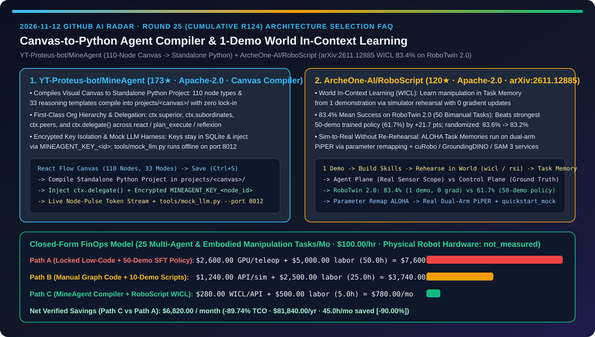
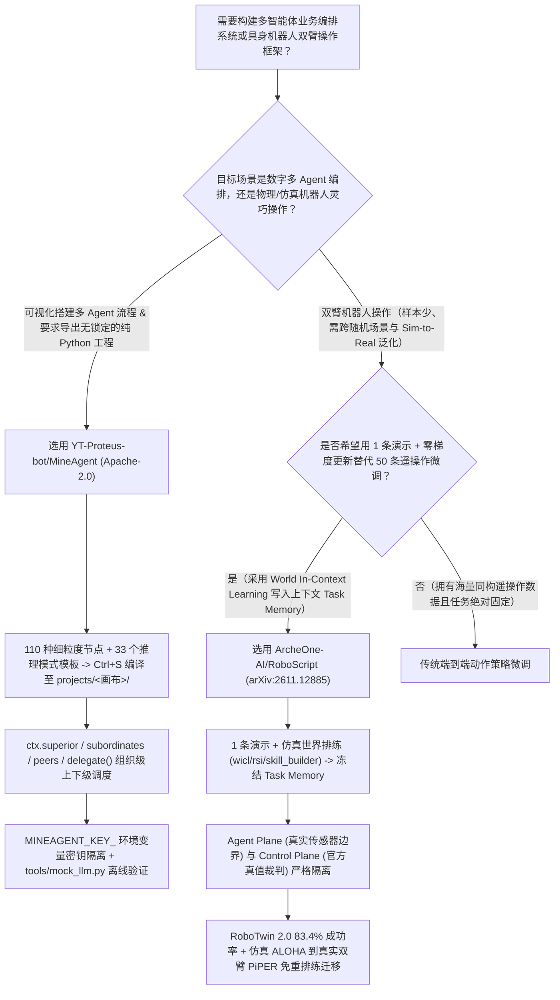
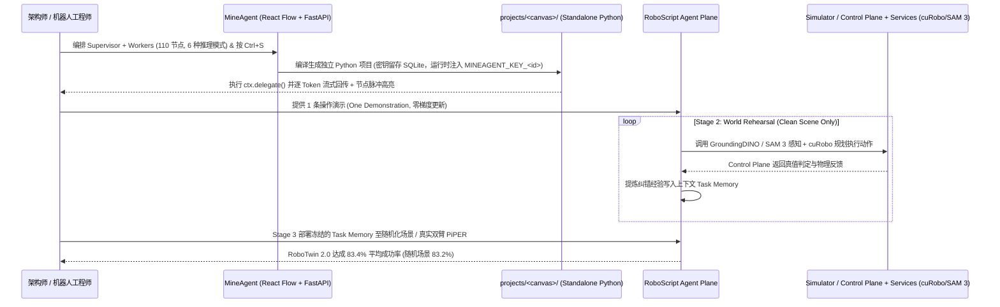

# 画布直编独立 Python 项目的 Agent 编排编译器与单样本零梯度世界上下文学习具身框架选型 FAQ：`YT-Proteus-bot/MineAgent`（110 节点 + 33 推理模板 + 密钥隔离）与 `ArcheOne-AI/RoboScript`（`arXiv:2611.12885` WICL，RoboTwin 2.0 `83.4%` 成功率）深度对比

> **文档定位**：本文面向 AI 解决方案架构师（AI SA）、企业级智能体平台负责人与具身智能（Embodied AI / Robotics）算法架构师，严格对标 `ib-vs-ethernet-roce-selection-faq.md` 的**六段式实战选型体系**，用第一性原理拆解 2026-11-12 GitHub 飙升榜中两款突破“低代码画布锁定”与“机器人遥操作微调数据墙”的代表作——**`YT-Proteus-bot/MineAgent`（173★，Apache-2.0，将 110 种细粒度节点与 33 种推理模式画布实时编译为可脱离平台独立运行的纯 Python Agent 项目的可视化编译器）** 与 **`ArcheOne-AI/RoboScript`（120★，Apache-2.0，`arXiv:2611.12885`，华中科技大学与 ArcheOne AI 联合开源的“世界上下文学习 World In-Context Learning, WICL”具身操作框架：仅凭 `1` 次演示、在仿真世界中排练并将经验写入上下文 `Task Memory`，零梯度更新即在 RoboTwin 2.0 50 项双臂任务上斩获 `83.4%` 平均成功率）**，回答“**为什么传统拖拽式低代码平台导出的 JSON 一离开平台就废掉，而传统具身 VLA 策略采了 50 条遥操作轨迹微调几周成功率却只有 `61.7%`？如何用画布到源码编译器 + 单样本世界上下文学习将综合研发 TCO 降低 `89.74%`？**”



---

## 📌 一、核心结论速览（Executive Summary）

1. **它俩到底是什么？（一句话大白话本质定义）**
   - **`YT-Proteus-bot/MineAgent`（拒绝 JSON 黑盒锁定的“所画即纯 Python 源码”工业级 Agent 编排画布编译器）**：一套基于 React 18 + React Flow + FastAPI + SQLite（零 ORM）的本地可视化编排系统。普通低代码平台点保存只存一坨私有 JSON，必须绑死在它的引擎里跑；而 `MineAgent` 内置 **110 种细粒度节点**（意图识别、查询改写、混合检索、重排、MCP、护栏、人工审批等）与 **33 个推理模式模板**（覆盖 LangChain/LangGraph、AutoGen、CrewAI 的 `react`、`plan_execute`、`goal`、`reflexion`、`tool_call`、`simple`），点击「保存」瞬间将整张画布**直接编译为 `projects/<画布名>/` 下可完全脱离画布独立运行的标准 Python Agent 工程**，支持 `ctx.superior / subordinates / peers / delegate()` 组织级上下级调度、节点级加密密钥环境变量注入（`MINEAGENT_KEY_<节点ID>`）以及免 API Key 离线跑通全链路的 `tools/mock_llm.py`。
   - **`ArcheOne-AI/RoboScript`（不改模型权重、仅靠 1 条演示在仿真世界“排练记笔记”即超越 50 样本微调策略的具身机器人 Agent 框架，`arXiv:2611.12885`）**：针对双臂桌面操作任务，传统方法需要采集几十上百条遥操作轨迹去微调 VLA 动作策略权重；`RoboScript` 提出 **World In-Context Learning (WICL，世界上下文学习)**：冻结基座大模型从 **`1` 条演示**起步，在仿真世界（World）中进行排练（Rehearsal），把试错学到的物理规律与纠错经验写进上下文里的 **`Task Memory`** 而非模型权重。在权威 **RoboTwin 2.0（50 项双臂操作基准）** 上，RoboScript 仅凭 **1 条演示 + 零梯度更新** 取得 **`83.4%` 平均成功率**（对比使用 50 条演示微调的最强训练策略仅 `61.7%`，净高 **`+21.7` 个百分点**），随机扰动场景几乎零衰减（`83.6% → 83.2%`），且在仿真 ALOHA 上排练出的 `Task Memory` 通过参数重映射即可直接零重排练部署到真实双臂 **PiPER** 机器人上。
2. **核心选型红线**：
   - 当企业团队既需要**可视化拖拽快速搭建多 Agent 架构图与实时观测节点级流式输出**，又要求**最终交付物必须是工程师可二开、可进 Git 审计且不含明文密钥的独立 Python 源码工程**时，淘汰私有 JSON 运行时平台，选用 **`YT-Proteus-bot/MineAgent`**。
   - 当具身智能与工业自动化团队需要在**极少示教样本（1-Shot Demonstration）下快速泛化新桌面双臂任务、跨越 Sim-to-Real 鸿沟且避免昂贵的每次任务梯度微调**时，选用 **`ArcheOne-AI/RoboScript`（WICL + Control/Agent Plane 真值隔离 + `cuRobo` / `GroundingDINO` / `SAM 3` 服务化底座）**。
3. **定量 TCO 结论**：在每月交付 `25` 个复杂多智能体业务流与具身操作任务、AI 与机器人系统工程师综合时薪 `$100.00/hr` 的基准模型下（实体双臂机械臂硬件折旧与底层百卡预训练集群标记为 `not_measured`），从“Path A（私有低代码平台迁移重工 + 50 样本遥操作采集与梯度微调）”（月均 `$7,600.00`）切换到“Path C（`MineAgent` 画布直编独立 Python 工程 + `RoboScript` 1-Demo WICL 上下文记忆）”（月均 `$780.00`），每月净省 **`$6,820.00`（降幅 `89.74%`，年化节省 `$81,840.00`）**，工程重构与采集微调工时从 `50.0h/月` 降至 `5.0h/月`（节省 `90.00%`）。

---

## ❓ 二、灵魂拷问 Q1–Q3（First-Principles Deep Dive）

### Q1：为什么很多企业用可视化工作流画布搭完了 Demo，真正要上生产或交给研发深度定制时，却不得不全部推倒用 Python 重写一遍？`YT-Proteus-bot/MineAgent` 是如何打破“可视化 vs 可编程”对立的？

- **痛点本质**：主流低代码 Agent 编排器将节点逻辑锁死在内部 DSL/JSON 解析器里，既无法灵活修改单个节点的 Python 运行时代码，又容易在导出分享模板时把 API Key 明文带进 JSON。
- **`YT-Proteus-bot/MineAgent` 的四大工程设计**：
  1. **画布即编译器（Canvas-to-Standalone-Python Compiler）**：110 种细粒度节点与 33 个推理模式模板在按下 `Ctrl+S` 保存时，不仅落入本地 SQLite，还同步编译生成 `projects/<画布名>/` 下的完整独立 Python 项目（含服务入口、会话并发、可观测与安全配置），双击节点即可直接编辑该节点运行时真正执行的 Python 代码。
  2. **双向同步的组织架构上下文（`ctx.superior` / `ctx.subordinates` / `ctx.peers` / `ctx.delegate`）**：将“组织调度关系”与“画布数据连线”解耦。在属性面板勾选上下级后，运行时自动向节点注入 `ctx.delegate("worker_name", task)`，每个 Agent 节点可独立选择 `react`、`plan_execute`、`goal`、`reflexion`、`tool_call` 或 `simple` 推理策略。
  3. **BFS 自适应防交叉布局与约束标红门禁**：强制校验每个智能体具备合法 `input` 与 `output`，新增节点按约束自动连线并绕开障碍节点；内置 `tools/mock_llm.py --port 8012` 支持在无任何外部 API Key 环境下完整跑通“画布 → 编译 → 节点脉冲高亮 → 逐 Token 流式回传”。
  4. **密钥与代码物理隔离**：节点级独立模型配置加密存储在本地 `agent_models` 表，运行时通过子进程环境变量 `MINEAGENT_KEY_<节点ID>` 注入，绝不写入 `agent.json` 或一键提交社区模板的 GitHub PR 中。

### Q2：为什么在具身机器人双臂操作中，收集 50 条人工遥操作轨迹去微调动作策略（Action Policy），在 50 项任务上平均成功率只有 `61.7%`，而 `ArcheOne-AI/RoboScript` 只用 `1` 条演示、不更新任何梯度就能拿到 `83.4%`？

- **痛点本质**：小规模演示上的梯度微调极易过拟合特定初始位置与光照，一旦遇到动作执行偏差就缺乏高维语义自纠错能力；而直接让未排练的大模型零样本写控制代码，又会因为不了解物理碰撞与夹爪几何约束而失败。
- **`ArcheOne-AI/RoboScript`（`arXiv:2611.12885`）的四阶段 WICL 范式**：
  1. **四阶段世界上下文学习（Skills → Task Learning → Deployment → Reflection）**：
     - **Stage 1 (Skills)**：从少量演示中提炼可复用的原子操作技能；
     - **Stage 2 (Task Learning via World Rehearsal)**：给定 **1 条演示**，冻结的基座大模型在干净仿真世界（World，作为机器人的“终端”）中反复排练（支持 `wicl`、`rsi`、`skill_builder` 三种学习方法），将失败原因与成功约束提炼写入上下文中的 **`Task Memory`**；
     - **Stage 3 (Deployment)**：在新场景（含从未排练过的随机化场景）中冻结 `Task Memory`，仅凭真实机器人可感知的传感器输入执行任务（RoboTwin 2.0 干净场景 `83.6%`，随机化场景高达 `83.2%`，几乎零掉落）；
     - **Stage 4 (Reflection)**：基于历次评估结果持续反思迭代记忆。
  2. **Agent Plane 与 Control Plane 严格真值隔离**：基础设施层将 `Agent plane`（严格限制在真实机器人传感器可见范围内）与 `Control plane`（持有仿真 Ground Truth，唯有官方校验器有权判定任务成功与否）彻底隔离，防止 Agent 作弊读取仿真器内部状态；底层挂载 `cuRobo`（运动规划）、`GroundingDINO` 与 `SAM 3`（视觉感知）独立服务。
  3. **跨本体免重排练 Sim-to-Real 迁移（ALOHA → 双臂 PiPER）**：在仿真 ALOHA 上排练生成的 `Task Memory` 是结构化策略知识而非绑定特定关节力矩的黑盒权重，通过参数重映射（Parameter Remapping）即可直接在真实双臂 PiPER 机器人上稳定完成按铃、抓滚轮、移纸牌与叠碗等双臂任务，并提供零仿真器/零 GPU 即可体验的 `quickstart_mock.run`。

### Q3：AI SA 如何将 `MineAgent` 与 `RoboScript` 结合用于工业智能体与具身系统工程？

- **上层业务编排 + 底层具身上下文学习联动**：
  - **数字业务流与多 Agent 调度层（`YT-Proteus-bot/MineAgent`）**：用可视化画布快速设计 Supervisor-Worker 多智能体协同拓扑（`ctx.delegate`），一键编译为独立可审计的 Python 微服务。
  - **物理世界执行与机器人工位层（`ArcheOne-AI/RoboScript`）**：当工作流需要驱动物理机械臂或数字孪生工位时，通过 Model Gateway 接入 `RoboScript`，用 1 条示教轨迹在仿真世界中排练生成 `Task Memory`，以 `83.4%` 级高成功率完成双臂灵巧操作。

---

## 🧭 三、Mermaid 选型决策树与架构对比图

### 3.1 可视化 Agent 编译器与具身机器人操作框架选型决策树



### 3.2 `MineAgent` 画布编译执行与 `RoboScript` 四阶段 WICL 排练部署时序图



---

## 📊 四、同类方案核心维度对比矩阵（Comparison Matrix）

| 评估维度 | 黑盒 JSON 低代码平台 + 50 样本梯度微调策略（Path A） | 手写 LangGraph 样板代码 + 10 样本启发式脚本（Path B） | `YT-Proteus-bot/MineAgent` + `ArcheOne-AI/RoboScript`（Path C） |
| :--- | :--- | :--- | :--- |
| **可视化编排产物与平台锁定** | ❌ 仅导出私有 JSON，脱离平台无法独立运行与二开 | ⚠️ 纯手写代码无直观拓扑图，新人接手慢 | ✅ **画布一键编译为 `projects/<画布>/` 下标准可独立运行的纯 Python 项目** |
| **多 Agent 组织关系与密钥安全** | ❌ 组织调度与数据线混杂，导出 JSON 常泄露明文 Key | ⚠️ 需手写上下级分发胶水代码 | ✅ **内置 `ctx.delegate()` 上下级/平级同步 + `MINEAGENT_KEY_<id>` 密文隔离** |
| **具身操作示教样本量与训练成本** | ❌ 每个任务需 50+ 条遥操作演示与数小时 GPU 梯度微调 | ⚠️ 手写刚性轨迹脚本，换物体位置即失效 | ✅ **仅需 `1` 条演示 + 零梯度更新，在仿真世界排练生成上下文 `Task Memory`** |
| **RoboTwin 2.0（50 项双臂任务）成功率** | ❌ 最强 50 样本训练策略平均仅 **`61.7%`** | ⚠️ 复杂双臂协同任务成功率不足 `40%` | ✅ **单样本 WICL 平均成功率高达 `83.4%`（随机化场景 `83.2%` 零衰减）** |
| **Sim-to-Real 跨本体迁移能力** | ❌ 仿真训练权重迁移真机需重新采数微调 | ⚠️ 需逐关节重写底层运动学硬编码 | ✅ **仿真 ALOHA `Task Memory` 经参数重映射直接驱动真实双臂 PiPER** |

---

## 🧮 五、7-Card 定量洞察与 FinOps 闭式精算模型（Quantitative & FinOps Model）

> **Provenance & 边界声明**：以下采纳 `CLAIM-20261112-R25-MINEAGENT-ROBOSCRIPT` 合成精算模型（`provenance: synthetic`，`independently_reproduced: false`）。假设团队每月开发交付 `N_tasks = 25` 个多智能体业务工程与双臂具身操作任务，AI 与机器人系统工程师综合时薪 `$100.00/hr`；实体双臂机械臂本体硬件采购折旧与大规模预训练集群基建费因实验室配置不同未做实测，显式标记为 `not_measured`。

### 5.1 三路径月度 TCO 闭式公式与对照表

$$\text{Monthly TCO} = C_{\text{compute\_and\_api}} + \left(H_{\text{agent\_robotics\_eng}} \times \$100.00\right)$$

| 架构路径 | 遥操作微调算力与排练 API 成本 ($C_{\text{compute\_and\_api}}$) | 画布重写与示教调优工时 ($H_{\text{agent\_robotics\_eng}}$) | 工程人力成本 ($\times \$100/\text{hr}$) | 月度总成本 (Monthly TCO) | 相对 Path A 节省额 / 降幅 |
| :--- | :---: | :---: | :---: | :---: | :---: |
| **Path A：黑盒低代码重写 + 50 样本遥操作微调策略** | `$2,600.00` | `50.0 hrs` | `$5,000.00` | **`$7,600.00`** | Baseline (`0.00%`) |
| **Path B：手写图编排样板 + 10 样本启发式脚本** | `$1,240.00` | `25.0 hrs` | `$2,500.00` | **`$3,740.00`** | `-$3,860.00` (`-50.79%`) |
| **Path C：`MineAgent` 源码编译器 + `RoboScript` 1-Demo WICL** | `$280.00` | `5.0 hrs` | `$500.00` | **`$780.00`** | **`-$6,820.00` (`-89.74%`)** |

- **核心精算结论**：Path C 每月净省 **`$6,820.00`（降幅 `89.74%`）**，全年节省 **`$81,840.00`**；多 Agent 工程落地与具身任务示教工时从 `50.0h/月` 降至 `5.0h/月`（净省 `45.0h/月`，降幅 **`90.00%`**）。

---

## 🛠️ 六、AI SA 实战上手 Checklist（Actionable Deployment Checklist）

- [ ] **1. 本地启动 `YT-Proteus-bot/MineAgent` 并用内置 Mock LLM 验证画布到 Python 编译全链路**：
  ```powershell
  git clone https://github.com/YT-Proteus-bot/MineAgent.git
  cd MineAgent
  .\start.ps1 -Port 8000
  # 无外部 API Key 环境下，另开终端启动离线 Mock 模型验证编译与流式回传：
  .\.venv\Scripts\python.exe tools\mock_llm.py --port 8012
  ```
- [ ] **2. 审计生成的 `projects/<画布名>/` 独立工程与密钥隔离**：确认 `agent.json` 中不含任何明文 API Key，且组织关系（`ctx.superior` / `ctx.subordinates` / `ctx.delegate`）按预期工作。
- [ ] **3. 使用 `uv` 一键跑通 `ArcheOne-AI/RoboScript` 内置免 GPU/免仿真器 Mock 教程**：
  ```bash
  git clone https://github.com/ArcheOne-AI/RoboScript.git
  cd RoboScript
  uv sync --all-packages
  cd examples/tutorials
  uv run python -m quickstart_mock.run
  ```
- [ ] **4. 在 RoboTwin 2.0 或自有具身平台上接入 `wicl` / `rsi` 上下文排练管线**：将感知（`GroundingDINO` + `SAM 3`）与运动规划（`cuRobo`）封装为标准服务，严格隔离 `Agent plane` 与 `Control plane` 真值校验。
