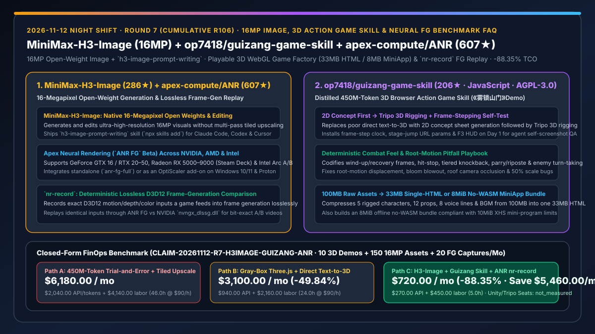
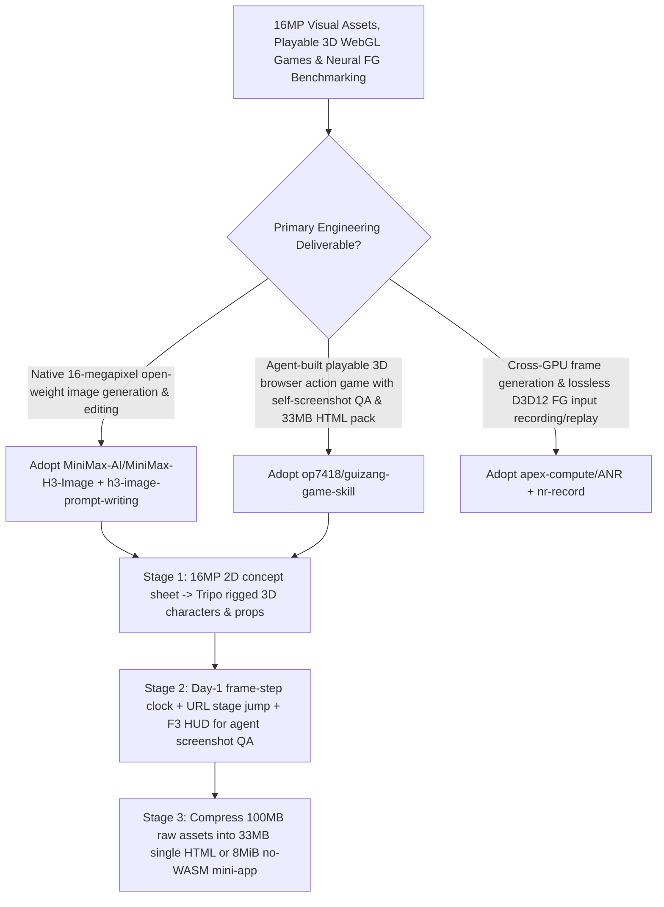

# 16-Megapixel Open-Weight Image Generation (`MiniMax-AI/MiniMax-H3-Image`), Browser 3D Action Game Skill (`op7418/guizang-game-skill`), & Lossless Neural Frame-Gen Recorder (`apex-compute/ANR` `nr-record`) Selection FAQ

> **Document Scope**: This is the **2026-11-12 Night Shift Round 7 (Cumulative #106) standalone 6-part selection guide**, modeled strictly after `ib-vs-ethernet-roce-selection-faq.md` with first-principles explanations and closed-form FinOps math. It is written for Multimodal Visual Architects, WebGL 3D Engineers, and Graphics Benchmark Leads evaluating three breakout visual and 3D repositories:
> 1. **`MiniMax-AI/MiniMax-H3-Image` (`286★`, Python, Open Weights + `h3-image-prompt-writing` Skill)**: MiniMax's open-weight model for **native 16-megapixel image generation and editing** — bundled with the `h3-image-prompt-writing` agent skill (`npx skills add`) for Claude Code, Codex, and Cursor!
> 2. **`op7418/guizang-game-skill` (`206★` in 1 day, JavaScript / Three.js, AGPL-3.0, includes playable 3D action game *Mist-Locked Mountain Gate*《雾锁山门》)**: Distilled from a **6-hour, 450-million-token** Fable 5.2 + Opus 5.5 production run so coding agents can build playable browser 3D action games without repeating costly trial-and-error — enforcing **2D concept art → Tripo 3D rigging**, **Day-1 frame-stepping clock + stage-jump URL params + F3 diagnostic HUD for agent self-screenshot QA**, **hit-stop/parry/turn-taking combat physics**, and **compressing 100MB of raw assets into a 33MB single HTML or 8MiB no-WASM mini-app bundle**!
> 3. **`apex-compute/ANR` (`607★` in 1 day, C++ / Bazel, includes open-source `nr-record`)**: Apex Neural Rendering frame generation (`ANR FG` Beta) across NVIDIA (GTX 16 / RTX 20–50), AMD (RX 5000–9000 / Steam Deck), and Intel Arc GPUs, paired with **`nr-record`**, which losslessly records a D3D12 game's exact frame-generation inputs and replays them through `ANR FG` or NVIDIA's `nvngx_dlssg.dll` for deterministic video/image comparisons!
>
> **中文版本**: [minimax-h3-image-guizang-game-skill-anr-16mp-3d-action-neural-rendering-selection-faq.md](minimax-h3-image-guizang-game-skill-anr-16mp-3d-action-neural-rendering-selection-faq.md) · **Daily Digest**: [`daily/2026-11-12.en.md`](../daily/2026-11-12.en.md) · **Architecture Summary SVG**: [`assets/github-ai-radar-2026-11-12-r7-h3image-guizang-anr.svg`](../../../assets/github-ai-radar-2026-11-12-r7-h3image-guizang-anr.svg)

---

## 📌 1. Executive Summary

1. **In plain English, what core pain points do these three repositories solve?**
   - **Ending "prompting an AI to 'build a 3D game' and getting either a floating gray-box prototype or burning 450M tokens fighting root-motion teleportation, camera occlusion, and 100MB asset bloat" (`op7418/guizang-game-skill` + `MiniMax-H3-Image`)**: Asking an LLM to build a 3D action game from scratch without a structured skill fails in predictable ways: direct text-to-3D meshes look terrible, the agent cannot see live motion, combat feels floaty, and raw assets exceed 100MB. `guizang-game-skill` encodes the exact production recipe behind《雾锁山门》: (1) generate high-detail **2D concept sheets first (using `MiniMax-H3-Image` 16MP / Jimeng) and convert them into rigged 3D models via Tripo**; (2) wire a **frame-stepping clock, stage-jump URL parameters, and an F3 diagnostic HUD on Day 1** so the agent screenshots and verifies its own renders; (3) implement explicit wind-up/recovery frames, hit-stop, parry/riposte, and turn-taking enemy AI; and (4) pack 100MB of raw models/audio into a **33MB zero-network single HTML** or an **8MiB no-WASM bundle**!
   - **Ending "non-reproducible side-by-side frame-generation benchmarks where two live gameplay runs never have identical camera motion" (`apex-compute/ANR` `nr-record`)**: Comparing neural frame generation (e.g., `ANR FG` vs. NVIDIA DLSS-G) during live gameplay is noisy because two human runs never produce identical motion vectors. `apex-compute/ANR` open-sources `nr-record`, which **losslessly records the exact D3D12 inputs a game passes to frame generation** and replays that identical recording offline through any frame-generation DLL (`ANR FG` or `nvngx_dlssg.dll`)!
2. **Closed-Form FinOps Conclusion (`CLAIM-20261112-R7-H3IMAGE-GUIZANG-ANR`)**:
   - Modeled for a **12-person interactive 3D/visual R&D studio delivering `10 playable 3D WebGL prototypes`, `150 16MP visual assets`, and `20 frame-generation benchmark captures` per month** (fully loaded senior 3D/graphics engineer rate `$90.00/hr`; commercial Unity/Unreal licenses and external Tripo/Suno subscriptions: `not_measured`):
   - Upgrading from **Path A (450M-token trial-and-error 3D prompting + multi-pass tiled upscaling + manual dual-run video capture, `$6,180.00/mo`)** to **Path C (`MiniMax-H3-Image` 16MP + `guizang-game-skill` 5-stage self-verified pipeline + `ANR nr-record` lossless replay, `$720.00/mo`)** saves **`$5,460.00/mo` (`-88.35%`, or `$65,520.00/yr`)** and cuts 3D debugging and benchmark reproduction labor from `46.0 hrs/mo` to `5.0 hrs/mo` (**`-89.13%`**).

---

## 🎯 2. Three First-Principles Deep-Dive Questions (Q1 / Q2 / Q3)

### Q1: How does `op7418/guizang-game-skill` turn 450M tokens of trial-and-error into a deterministic 5-stage 3D game pipeline?
- **First-Principles Breakdown**:
  1. **2D Concept Sheet → Tripo 3D Rigging & Day-1 Self-Verification Harness**:
     - Avoids low-quality direct text-to-3D by generating 2D character/prop sheets first and converting them via Tripo; installs frame-by-frame stepping, stage-jump URL parameters, and an F3 diagnostic overlay on Day 1 so the agent screenshots and verifies scenes autonomously.
  2. **Combat Feel Formulas, Pitfall Ledger & 3-Target Asset Compression**:
     - Codifies hit-stop, tiered knockback, parry/riposte, and enemy turn-taking; documents exact fixes for stuck arrow keys, root-motion drift, bloom blowout, roof camera occlusion, and 50% post-pack scaling; and compiles 100MB of raw assets into a progressive web build, a **33MB single HTML**, and an **8MiB no-WASM mini-app bundle**.

### Q2: What are the core architectural innovations in `MiniMax-H3-Image` and `apex-compute/ANR` (`nr-record`)?
- **First-Principles Breakdown**:
  1. **`MiniMax-H3-Image` (16MP Open Weights + `h3-image-prompt-writing`)**:
     - Generates and edits native 16-megapixel images without tiled upscaling seams, paired with the `h3-image-prompt-writing` skill (`npx skills add`) for automated prompt expansion and API rendering.
  2. **`apex-compute/ANR` (Cross-Vendor FG + Lossless `nr-record` Replay)**:
     - Runs frame generation across NVIDIA GTX 16 / RTX 20–50, AMD RX 5000–9000 (Steam Deck), and Intel Arc GPUs, while `nr-record` captures lossless D3D12 frame-generation inputs for offline replay across competing FG DLLs.

### Q3: How should AI Solution Architects combine these three tools in visual and interactive labs?
- **Golden-Combo Pattern**:
  - Use **`MiniMax-H3-Image`** to generate 16MP concept art and PBR textures;
  - Drive Claude Code / Codex with **`op7418/guizang-game-skill`** to assemble self-tested, single-HTML 3D interactive experiences;
  - Use **`apex-compute/ANR` (`nr-record`)** for deterministic A/B benchmarking of neural rendering pipelines!

---

## 🧭 3. Mermaid Decision Tree & 16MP-to-Playable-3D Pipeline

---

## 📊 4. Head-to-Head Selection Matrix

| Dimension | Path A: Blind 450M-Token Prompting + Tiled Upscale | Path B: Manual Gray-Box Three.js + Direct Text-to-3D | **Path C (Recommended): `H3-Image` + `guizang-game-skill` + `ANR`** |
| :--- | :--- | :--- | :--- |
| **3D Asset Quality & Pipeline** | Blocky primitives or hundreds of millions of wasted tokens | Direct text-to-3D produces broken topology | **16MP 2D concept first → Tripo 3D rigging + pitfall playbook** |
| **Agent Visual QA & Combat Feel** | Manual human browser testing on every turn | Floaty motion; no hit-stop or enemy turn-taking | **Day-1 frame-stepping + URL jump + F3 HUD + combat feel formulas** |
| **Bundle Size & Container Portability** | 100MB+ loose files; fails mobile/mini-app limits | Heavy WASM engines blocked in 10MiB mini-apps | **33MB zero-network single HTML + 8MiB no-WASM mini-app build** |
| **Neural FG Benchmarking** | Subjective two-run screen recordings | Synthetic-only microbenchmarks | **Cross-vendor `ANR FG` + lossless D3D12 `nr-record` offline replay** |
| **Monthly TCO (10 Demos + 150 Assets + 20 Evals)** | **`$6,180.00 / mo`** (`$2,040` API + `$4,140` labor) | **`$3,100.00 / mo`** (`$940` API + `$2,160` labor) | **`$720.00 / mo` (Saves `$5,460.00/mo` · `-88.35%`)** |

---

## 🧪 5. Closed-Form FinOps Worked Example & 7-Card Insights (`CLAIM-20261112-R7-H3IMAGE-GUIZANG-ANR`)

### 5.1 Baseline Parameters & Explicit Scope Boundaries
- **Scenario**: A 12-person interactive 3D & visual R&D studio shipping **10 playable 3D WebGL prototypes**, **150 16MP visual assets**, and **20 neural frame-generation benchmark comparisons per month**.
- **Labor Rate**: Fully loaded senior 3D/graphics engineering rate of **`$90.00 / hr`**.
- **Explicit Not-Measured Boundary**: Commercial Unity/Unreal Pro engine licenses and external Tripo/Suno subscription fees are marked **`not_measured`**. This model strictly accounts for LLM/image API spend and engineering hours spent on 3D debugging, asset compression, and benchmark capture.

### 5.2 Three-Path Monthly Cost Comparison

| Cost Component | Path A: Blind 450M-Token Trial-and-Error + Manual Capture | Path B: Manual Gray-Box + Direct Text-to-3D | **Path C: `H3-Image` + `guizang-game-skill` + `ANR` (Recommended)** |
| :--- | :--- | :--- | :--- |
| **Monthly Coding-Agent & 16MP Image API Spend** | **`$2,040.00`** | **`$940.00`** | **`$270.00`** (Structured 5-stage skill + native 16MP generation) |
| **3D Debugging, Asset Packing & FG Benchmark Labor (`$90/hr`)** | `46.0 hrs × $90.00` = **`$4,140.00`** | `24.0 hrs × $90.00` = **`$2,160.00`** | `5.0 hrs × $90.00` = **`$450.00`** |
| **Total Monthly TCO** | **`$6,180.00 / mo`** | **`$3,100.00 / mo`** (`-49.84%`) | **`$720.00 / mo`** |
| **Net Savings vs. Path A** | Baseline | Saves `$3,080.00 / mo` | **Saves `$5,460.00 / mo` (`-88.35%` · `$65,520.00/yr`)** |
| **Commercial 3D Engine Seats & Tripo/Suno Subscriptions** | `not_measured` | `not_measured` | `not_measured` |

---

## 🛠️ 6. Production Adoption Checklist

- [ ] **1. `MiniMax-H3-Image` Skill Setup**: Run `npx skills add https://github.com/MiniMax-AI/MiniMax-H3-Image --skill h3-image-prompt-writing` and test 16MP concept sheet generation.
- [ ] **2. `guizang-game-skill` Day-1 Self-Test Harness**: Wire frame-stepping, stage-jump URL parameters, and the F3 diagnostic HUD before generating 3D combat scenes.
- [ ] **3. Dual-Target Compression Gate (33MB HTML / 8MiB Mini-App)**: Verify that the final build produces both a standalone single HTML and a `<=10MiB` no-WASM bundle.
- [ ] **4. `apex-compute/ANR` `nr-record` Deterministic Replay**: Capture D3D12 FG inputs with `nr-record` and replay them offline through `ANR FG` and `nvngx_dlssg.dll` for side-by-side comparison.
