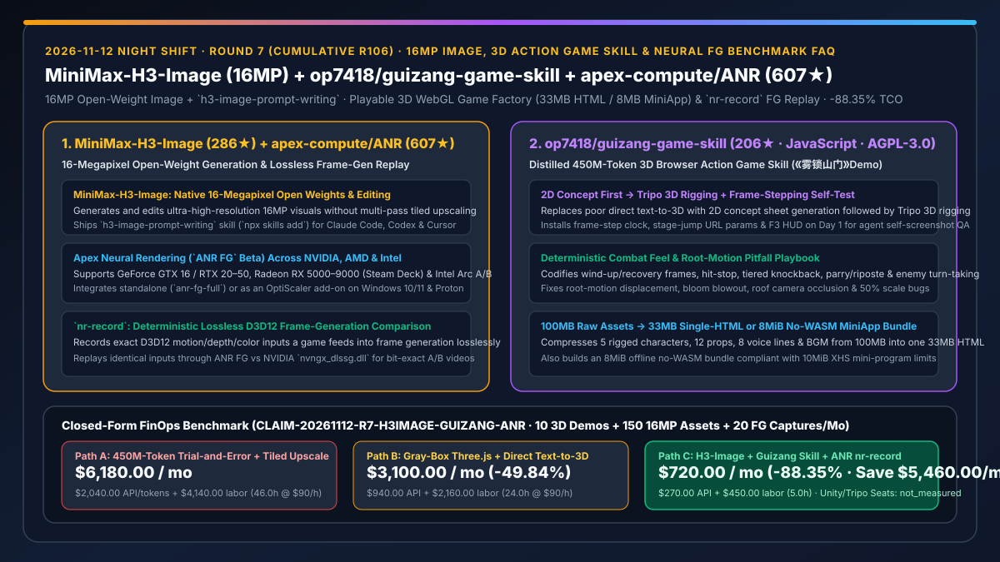
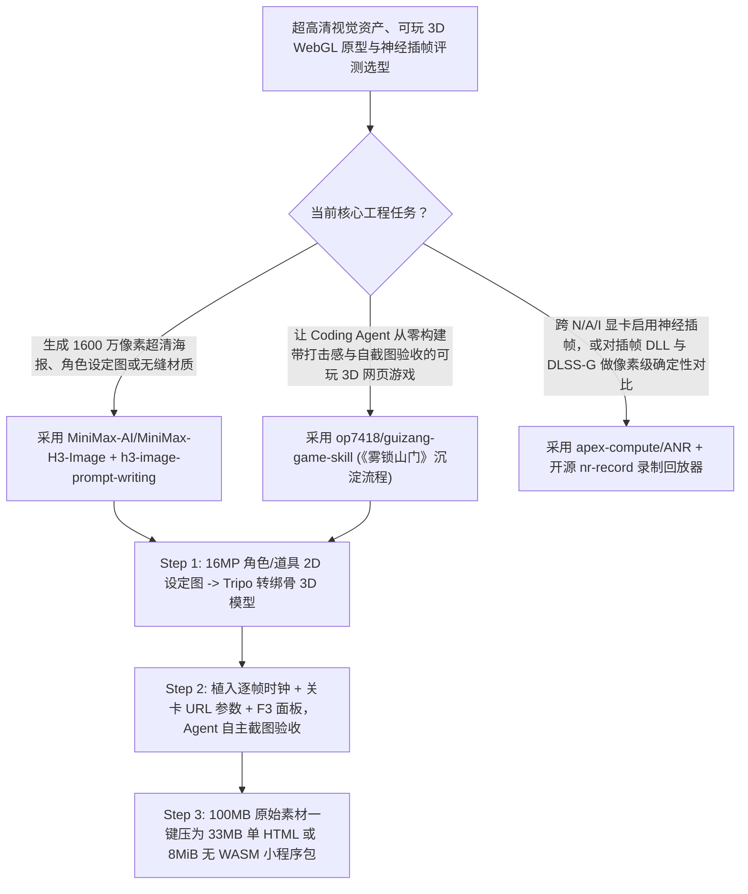

# 1600 万像素开源生图模型（`MiniMax-AI/MiniMax-H3-Image`）、浏览器 3D 动作游戏构建技能（`op7418/guizang-game-skill`《雾锁山门》）与神经插帧无损录制对比器（`apex-compute/ANR` `nr-record`）深度选型 FAQ

> **文档定位**：本专题是 **2026-11-12 夜班第 7 轮（累计第 106 篇）独立六段式选型指南**，严格对标 `ib-vs-ethernet-roce-selection-faq.md` 的通俗第一性原理与闭式 FinOps 核算规范，面向多模态视觉工程、交互式 3D WebGL 研发与图形基准评测架构师，深度拆解今日在超高清生图、Agent 端到端 3D 游戏构建与神经渲染评测赛道爆发的三大高热度开源仓：
> 1. **`MiniMax-AI/MiniMax-H3-Image`（`286★`，Python，开源权重 + `h3-image-prompt-writing` 技能）**：MiniMax 官方开源的 **1600 万像素（16-megapixel）原生图像生成与编辑模型**——配套可通过 `npx skills add` 一键安装的 `h3-image-prompt-writing` Agent Skill，将一句话简报或参考图转化为专业提示词并直连渲染！
> 2. **`op7418/guizang-game-skill`（建仓 1 天 `206★`，JavaScript / Three.js，AGPL-3.0，附可玩 3D 仙侠动作游戏《雾锁山门》）**：知名 AI 创作者歸藏（`@op7418`）将耗费 **6 小时、4.5 亿 Token** 踩坑全流程提炼而成的 **3D 浏览器动作游戏构建 Skill**——包含“先出 2D 设定图再转 Tripo 3D 绑骨”、“Day-1 内置逐帧推进/直达关卡参数/F3 诊断面板自截屏验收”、“命中顿帧/弹反/敌人轮流进攻手感公式”以及将 **100MB 原始素材压进 33MB 单 HTML 或 8MiB 无 WASM 小程序离线包**的全套工程方案！
> 3. **`apex-compute/ANR`（建仓 1 天狂揽 `607★`，C++ / Bazel，含开源 `nr-record`）**：Apex Compute 发布的跨 NVIDIA (GTX 16 / RTX 20–50)、AMD (RX 5000–9000 / Steam Deck) 与 Intel Arc 显卡的神经插帧（`ANR FG`）套件，并开源 **`nr-record` 无损帧生成输入录制器**——完整记录 D3D12 游戏送入插帧器的原始运动矢量/深度输入，可反复回放注入 `ANR FG` 或英伟达 `nvngx_dlssg.dll` 生成逐帧对齐的客观对比视频！
>
> **English Version**: [minimax-h3-image-guizang-game-skill-anr-16mp-3d-action-neural-rendering-selection-faq.en.md](minimax-h3-image-guizang-game-skill-anr-16mp-3d-action-neural-rendering-selection-faq.en.md) · **关联日报**: [`daily/2026-11-12.md`](../daily/2026-11-12.md) · **架构总结图**: [`assets/github-ai-radar-2026-11-12-r7-h3image-guizang-anr.svg`](../../../assets/github-ai-radar-2026-11-12-r7-h3image-guizang-anr.svg)

---

## 📌 一、核心结论速览（Executive Summary）

1. **一句话大白话讲透这三个项目到底解决了什么痛点？**
   - **终结“让 AI『写个 3D 游戏』结果要么只给你几个漂浮的彩色方块灰模、要么狂烧几亿 Token 在镜头穿模/动画瞬移/包体过大里打转”的痛点（`op7418/guizang-game-skill` + `MiniMax-H3-Image`）**：裸写 Prompt 让大模型从零做 3D 动作游戏有四大必踩深坑：① 直接文字转 3D 模型质量极差（必须改为**先用 `MiniMax-H3-Image` / 即梦生成高细节 2D 角色设定图，再喂给 Tripo 转带骨骼 3D 模型**）；② AI 自己看不见动态画面（必须在第一天就埋入**逐帧步进时钟、关卡直达 URL 参数与 F3 诊断面板**，让 Agent 自己跑固定帧截图验收）；③ 缺乏战斗手感（必须显式编码前摇后摇、命中顿帧 Hit-Stop、分级击退、格挡弹反与敌人轮流进攻 AI）；④ 100MB 的 GLB/贴图/音频无法分享（通过模型减面与纹理音频重编码压成 **33MB 零网络请求单 HTML** 或符合小红书 10MiB 无 WASM 限制的 **8MiB 小程序包**）！
   - **终结“评测不同神经插帧算法（如自研 FG vs NVIDIA DLSS-G）时，因为人工打游戏每次操作走位不可能 100% 一模一样，导致根本无法做像素级客观画质对比”的痛点（`apex-compute/ANR` `nr-record`）**：以往对比插帧伪影只能靠两次跑图录屏肉眼看，相机角度稍有偏差就无法算 PSNR/VMAF。`apex-compute/ANR` 开源的 `nr-record` 直接在 D3D12 管线层**无损录制游戏喂给插帧接口的每一帧精确输入**，之后可在完全离线、确定性的状态下把同一份录制数据分别喂给 `ANR FG` DLL 和官方 `nvngx_dlssg.dll` 重放输出对比视频！
2. **闭式 FinOps 投资回报结论（`CLAIM-20261112-R7-H3IMAGE-GUIZANG-ANR`）**：
   - 以 **12 人交互式 3D 演示、游戏原型与图形研发团队每月交付 `10 个` 可玩 3D WebGL 交互样机、生成 `150 张` 16MP 超清概念/材质资产并执行 `20 组` 插帧画质回归评测** 为基准（高级 3D/图形研发工程师全包时薪 `$90.00/hr`；商业 Unity/Unreal 引擎授权与外部 Tripo/Suno 算力订阅费：`not_measured`）：
   - 从 **Path A（无方法论指导盲跑 4.5 亿 Token 试错返工 + 低清生图分块放大伪影修复 + 人工重复跑图录屏对比插帧，月均 `$6,180.00`）** 升级至 **Path C（`MiniMax-H3-Image` 16MP 原生出图 + `guizang-game-skill` 五步自验收管线 + `ANR nr-record` 无损确定性回放，月均 `$720.00`）**，每月净省 **`$5,460.00/mo`（降幅 `-88.35%`，年省 `$65,520.00/yr`）**，并将 3D 穿模排障与基准复现工时从 `46.0 hrs/mo` 压缩至 `5.0 hrs/mo`（节省 **`-89.13%`**）。

---

## 🎯 二、三大灵魂拷问（Q1 / Q2 / Q3 深度原理解析）

### Q1：`op7418/guizang-game-skill` 是如何把 4.5 亿 Token 踩坑经验固化为“5 步流程 + 自测三件套 + 三态打包”的？
- **第一性原理拆解**：
  1. **「2D 设定图 → Tripo 3D 绑骨」两段式资产管线与 Day-1 自测三件套**：
     - 严禁直接 Text-to-3D，而是先由 AI 生成统一国风美学的 2D 角色/武器/场景道具设定图，再转交 Tripo 生成带骨骼的 3D 模型（《雾锁山门》含 5 个绑骨角色、2 把武器、12 种场景道具、8 条配音）；
     - 开工第一天即植入 **逐帧推进接口、直达指定关卡/Boss 战的 URL 参数、以及 F3 实时诊断面板**，让 Agent 每改完一处光影或动作就自动跳关截屏核验。
  2. **硬核踩坑防治清单与三形态极致压缩（100MB → 33MB / 8MiB）**：
     - 精确记录并根治了 WebGL 3D 游戏最常见的五大顽疾：方向键锁死、预设 Root-Motion 动画把角色甩离原地、Bloom 泛光过曝、屋顶遮挡第三人称镜头、以及打包压缩后骨骼角色莫名缩小一半；
     - 同一份源码一键构建三种形态：边玩边加载的**在线版**（支持手机触屏摇杆）、零网络请求的 **33MB 单文件 HTML**、以及剔除 WASM 压至 **8MiB 的小红书小工具容器包**。

### Q2：`MiniMax-AI/MiniMax-H3-Image` 的 16MP 开源权重与 `apex-compute/ANR` 的 `nr-record` 各自有哪些技术亮点？
- **第一性原理拆解**：
  1. **`MiniMax-H3-Image`（1600 万像素开源生图/改图 + `h3-image-prompt-writing`）**：
     - 原生支持 16-megapixel 超高分辨率生成与局部编辑，避免传统 1MP 模型通过多次 Tiled Upscale 产生的接缝与伪影；配套 `npx skills add https://github.com/MiniMax-AI/MiniMax-H3-Image --skill h3-image-prompt-writing` 技能，让 Claude Code / Codex 自动扩写构图、光影与中文字体排版提示词。
  2. **`apex-compute/ANR`（跨三家显卡神经插帧 + `nr-record` 无损 D3D12 回放器）**：
     - `ANR FG` 同时兼容 NVIDIA (GTX 16 及 RTX 20–50)、AMD (RX 5000–9000 与 Steam Deck Proton) 和 Intel Arc A/B 系列；开源工具 `nr-record` 将游戏传给插帧层的 D3D12 输入无损落盘，使任何第三方插帧 DLL 都能在同一组真实游戏输入上做 100% 确定性的离线回放对比。

### Q3：AI 架构师与视觉实验室如何将这三者组合成交互式 3D 与高精视觉交付管线？
- **黄金组合落地范式**：
  - 使用 **`MiniMax-H3-Image` (`h3-image-prompt-writing`)** 生成 16MP 超清角色设定图、无缝材质贴图与 UI 海报；
  - 调用 **`op7418/guizang-game-skill`** 驱动 Claude Code / Codex 将设定图转为绑骨 3D 资产、装配顿帧/弹反战斗逻辑并打包为单文件 HTML 交互演示；
  - 在原生桌面 3D 渲染器优化中使用 **`apex-compute/ANR` (`nr-record`)** 对神经超分与插帧算法执行确定性回放验收！

---

## 🧭 三、Mermaid 选型决策树与「16MP 设定图 → 3D 可玩构建 → 确定性帧回放」流水线

---

## 📊 四、同类方案核心能力对比矩阵（Selection Matrix）

| 评估维度 | Path A：无指导盲写 3D 游戏 + 1MP 拼接放大 + 肉眼录屏 | Path B：手写 Three.js 灰模 + 直接文字转 3D | **Path C（推荐）：`H3-Image` + `guizang-game-skill` + `ANR`** |
| :--- | :--- | :--- | :--- |
| **3D 角色资产质量与构建路径** | AI 盲写几十个方块拼接，或反复返工烧掉 4.5 亿 Token | 直接 Text-to-3D 网格破损、贴图模糊 | **16MP 2D 设定图先行 → Tripo 绑骨 3D + 完整踩坑修复清单** |
| **Agent 画面自检与战斗打击感** | 人类每改一次手动打开浏览器试玩报错 | 动作生硬，无顿帧/击退/弹反与敌人轮流进攻调度 | **Day-1 逐帧时钟 + 跳关参数 + F3 面板自截图 + 完整动作手感公式** |
| **交付物打包体积与跨容器兼容** | 100MB+ 散装目录，手机与小程序无法打开 | 依赖重型 WASM 引擎，超出小程序 10MiB 限制 | **一键构建在线版、33MB 单文件 HTML 与 8MiB 无 WASM 小程序离线包** |
| **神经插帧跨显卡支持与客观评测** | 仅限 RTX 40/50 独享；人工两次跑图无法对齐帧 | 仅有合成基准，缺乏真实游戏输入回放 | **支持 GTX 16/AMD/Intel Arc + `nr-record` 无损录制 D3D12 输入离线回放** |
| **月度总拥有成本（10 样机 + 150 图 + 20 评测）** | **`$6,180.00 / mo`**（`$2,040` Token/API + `$4,140` 工时） | **`$3,100.00 / mo`**（`$940` API + `$2,160` 工时） | **`$720.00 / mo`（净省 `$5,460.00/mo` · `-88.35%`）** |

---

## 🧪 五、定量 FinOps 算例与 7-Card 洞察（`CLAIM-20261112-R7-H3IMAGE-GUIZANG-ANR`）

### 5.1 测算基准与显式边界（Scope & Boundaries）
- **场景设定**：12 人交互式 3D 视觉实验室与图形研发团队，每月构建 **10 个可玩 3D WebGL 交互演示**、生成 **150 张 16MP 超清设定与贴图资产**，并执行 **20 组跨显卡神经插帧确定性对比测试**。
- **费率假设**：高级 3D 与图形研发工程师全包时薪 **`$90.00 / hr`**。
- **显式边界声明（Explicit Not-Measured Boundary）**：商业 Unity/Unreal Pro 引擎席位费与外部 Tripo/Suno 独立商业套餐订阅费标记为 **`not_measured`**，本表严格核算大模型/生图 API 消耗以及因 3D 盲写试错、镜头穿模排障、包体超限裁剪与重复跑图录屏产生的工程工时。

### 5.2 三路径月度成本闭式对照表

| 成本分项 | Path A：4.5 亿 Token 盲试 + 拼接放大 + 手工跑图 | Path B：手写灰模 + 直接文字转 3D | **Path C：`H3-Image` + `guizang-game-skill` + `ANR`（推荐）** |
| :--- | :--- | :--- | :--- |
| **月度 Coding Agent 与 16MP 生图 API 支出** | **`$2,040.00`**（大量无效返工 Token 与重复重绘） | **`$940.00`** | **`$270.00`**（避开踩坑清单一步到位 + 16MP 原生直出） |
| **3D 动作调优、打包压缩与插帧对齐评测工时（`$90/hr`）** | `46.0 hrs × $90.00` = **`$4,140.00`** | `24.0 hrs × $90.00` = **`$2,160.00`** | `5.0 hrs × $90.00` = **`$450.00`** |
| **月度总成本（Monthly TCO）** | **`$6,180.00 / mo`** | **`$3,100.00 / mo`**（`-49.84%`） | **`$720.00 / mo`** |
| **相对 Path A 净节省** | 基准线（Baseline） | 净省 `$3,080.00 / mo` | **净省 `$5,460.00 / mo`（`-88.35%` · 年省 `$65,520.00/yr`）** |
| **商业 3D 引擎授权与 Tripo/Suno 套餐费** | `not_measured` | `not_measured` | `not_measured` |

---

## 🛠️ 六、生产级落地核验 Checklist

- [ ] **1. `MiniMax-H3-Image` 技能安装与 16MP 渲染验证**：执行 `npx skills add https://github.com/MiniMax-AI/MiniMax-H3-Image --skill h3-image-prompt-writing`，验证 16MP 设定图与中文字体海报生成。
- [ ] **2. `guizang-game-skill` Day-1 自测三件套埋点**：在启动 3D WebGL 项目首日即配置逐帧推进时钟、直达关卡 URL 参数与 F3 诊断面板，要求 Agent 提交自身截图核验记录。
- [ ] **3. 三形态打包体积门禁（33MB 单 HTML / 8MiB 无 WASM）**：验证构建产物同时满足零外部请求的独立单 HTML 与 `<=10MiB` 无 WASM 受限容器离线包要求。
- [ ] **4. `apex-compute/ANR` `nr-record` 无损输入录制与双 DLL 回放**：在 D3D12 测试环境中用 `nr-record` 采集一段基准序列，分别回放通过 `ANR FG` 与 `nvngx_dlssg.dll` 并用 `ffmpeg` 生成并排对比视频。
