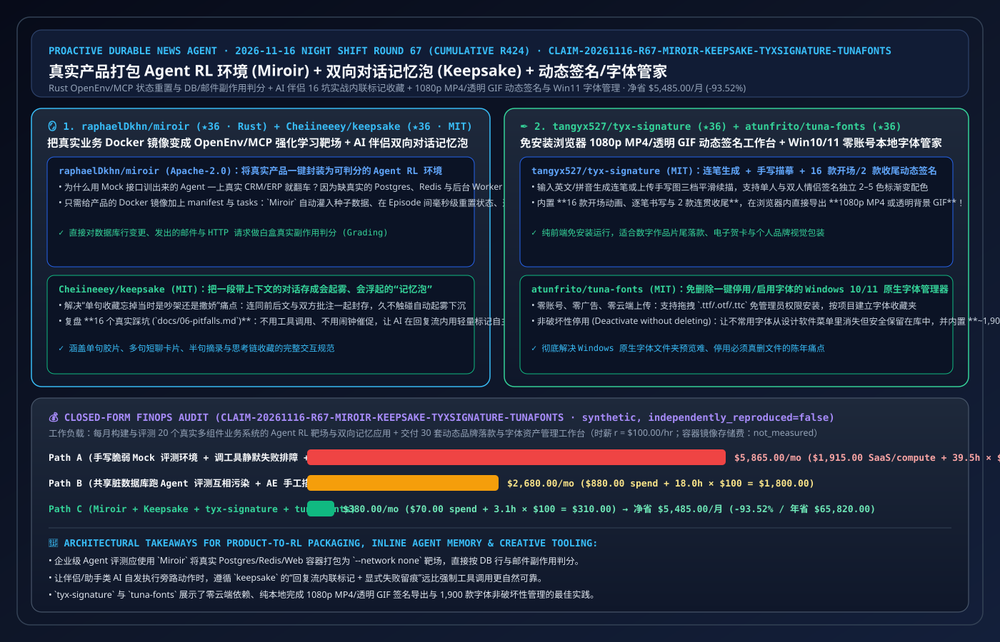
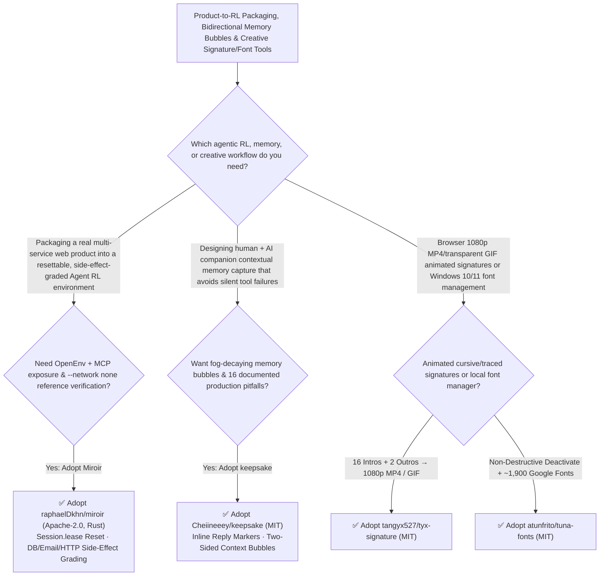

# Product-to-Agentic-RL Environment Packager (`raphaelDkhn/miroir`), Bidirectional Memory Bubbles (`Cheiineeey/keepsake`) & Dynamic Signature/Font Studio Selection FAQ: `raphaelDkhn/miroir` + `Cheiineeey/keepsake` + `tangyx527/tyx-signature` & `atunfrito/tuna-fonts`

> **Metadata**
> - **Evaluation Batch**: 2026-11-16 Night Shift Round 67 (Cumulative Round 424)
> - **Primary Targets**:
>   1. [`raphaelDkhn/miroir`](https://github.com/raphaelDkhn/miroir) (`★ 36` / `2 Forks`, Apache-2.0, Rust · **Turn a Product into an Agentic RL Environment**: packages real multi-service applications [Postgres, Redis, web server, worker, MCP server] into air-gapped [`--network none`] environments with automatic data seeding, inter-episode state resets, OpenEnv + MCP tool exposure, and side-effect grading across DB rows, emails, and HTTP requests)
>   2. [`Cheiineeey/keepsake`](https://github.com/Cheiineeey/keepsake) (`★ 36` / `6 Forks`, MIT · **Contextual Dialogue Memory Bubbles & 16 Production Pitfalls**: a bidirectional human + AI companion memory system that stores multi-turn context slices as fog-decaying bubbles via inline reply markers with visible failure traces)
>   3. [`tangyx527/tyx-signature`](https://github.com/tangyx527/tyx-signature) (`★ 36` / `13 Forks`, MIT) & [`atunfrito/tuna-fonts`](https://github.com/atunfrito/tuna-fonts) (`★ 36` / `3 Forks`, MIT) — Zero-install browser cursive/traced handwriting signature studio with 16 intros, 2 outros, and 1080p MP4 / transparent GIF export + zero-account Windows 10/11 font manager supporting non-destructive deactivation and 1-click installation of ~1,900 Google Fonts families
> - **Companion Visual**: [`assets/github-ai-radar-2026-11-16-r67-miroir-keepsake-tyxsignature-tunafonts.svg`](../../../assets/github-ai-radar-2026-11-16-r67-miroir-keepsake-tyxsignature-tunafonts.svg)
> - **Sealed Evidence Anchor**: `CLAIM-20261116-R67-MIROIR-KEEPSAKE-TYXSIGNATURE-TUNAFONTS` (see [`evidence/trending-daily-2026-11-16-audit.json`](../evidence/trending-daily-2026-11-16-audit.json))

---

## 📌 1. Executive Summary & First-Principles Pitch

1. **Plain-Language First Principles**:
   - **`raphaelDkhn/miroir` (`Packaging Real Multi-Service Products into Air-Gapped OpenEnv/MCP Agent RL Environments`)**: Adds a manifest and tasks to your real product's Docker image (Postgres, Redis, web server, worker) so `Miroir` automatically seeds data, resets state between episodes via `Session.lease`, exposes APIs as tools through **OpenEnv and MCP**, verifies reference runs offline (`docker run --rm --network none acme-crm-env check`), and grades what the agent actually changed across database rows, emails, and HTTP requests.
   - **`Cheiineeey/keepsake` (`Bidirectional Contextual Memory Bubbles & 16 Production Pitfalls for AI Companions`)**: Stores multi-turn conversation slices with surrounding context and two-sided annotations as interactive bubbles that fog over when untouched—and documents **16 real production pitfalls (`docs/06-pitfalls.md`)** showing why inline reply markers with visible failure traces beat forced cron prompts and silent-failing tool calls.
   - **`tyx-signature` + `tuna-fonts` (`Browser 1080p MP4/Transparent GIF Signature Studio & Non-Destructive Win11 Font Manager`)**: `tyx-signature` combines built-in cursive or 3-level smoothed handwriting tracing, 2–5 stop gradients, and 16 intro / 2 outro animations to export 1080p MP4s and transparent GIFs in the browser; `tuna-fonts` lets Windows 10/11 users activate/deactivate fonts without deleting files and browse ~1,900 Google Fonts families with zero accounts or telemetry.
2. **Quantified FinOps Impact (`CLAIM-20261116-R67-MIROIR-KEEPSAKE-TYXSIGNATURE-TUNAFONTS`)**:
   - Across **20 real-product agentic RL/evaluation environments & bidirectional memory systems + 30 dynamic signature & desktop font management workflows per month** (`engineer_hourly_rate_usd = $100.00/hr`; container image storage marked `not_measured`):
   - **Path C (`Miroir` + `keepsake` + `tyx-signature` + `tuna-fonts`)** reduces monthly TCO from **`$5,865.00/mo`** under **Path A (fragile hand-coded API mocks + silent-failing memory tool debugging + paid font manager subscriptions)** down to **`$380.00/mo`**, saving **`$5,485.00/mo` (`-93.52%`, or `$65,820.00/yr`)** and reclaiming **`36.4 hrs/mo` (`-92.15%`)** of engineering labor.



---

## ❓ 2. First-Principles Deep Dive (Q1–Q3)

### Q1: Why does `raphaelDkhn/miroir` grade database rows, emails, and HTTP requests inside `--network none` containers instead of using LLM-as-a-Judge on text replies?
- **Core Mechanism**:
  - Agents frequently claim they completed a workflow while leaving database constraints violated or background workers stuck. Replaying reference trajectories (`check`) inside air-gapped containers and asserting exact post-episode Postgres rows, Redis keys, and sent emails provides deterministic, ungameable RL reward signals.

### Q2: How does `Cheiineeey/keepsake` solve autonomous AI memory capture across its 16 documented pitfalls?
- **Core Mechanism**:
  - Instead of invoking a separate tool call (which fails silently on a single typo without the model knowing on the next turn) or nagging the model on a timer, the model emits a lightweight inline marker inside its natural reply, and any parse failure leaves an explicit trace visible to both sides.

### Q3: What are the honest boundaries of these four projects?
- **Honest Boundaries**:
  - `raphaelDkhn/miroir` requires Docker with `buildx` and `uv`.
  - `atunfrito/tuna-fonts` targets Windows 10 and Windows 11 font management APIs.

---

## 🧭 3. Mermaid Decision Tree & Architecture Comparison



---

## 📊 4. Quantitative & Architectural Comparison Matrix

| Dimension | `raphaelDkhn/miroir` + `Cheiineeey/keepsake` | `tyx-signature` + `tuna-fonts` | Path A: Hand-Rolled API Mocks + Paid Font Manager SaaS | Path B: Shared Staging DB Evals + Manual AE Stroke Masks |
| :--- | :--- | :--- | :--- | :--- |
| **Primary Pain Solved** | Real-product RL environments & side-effect grading; organic two-way memory | Zero-install 1080p MP4/GIF animated signatures & non-destructive Win11 fonts | Mocks miss real DB bugs; commercial font managers require cloud accounts | Concurrent eval runs corrupt shared DBs; manual AE stroke animation is slow |
| **Core Mechanism** | **Docker `buildx` + OpenEnv/MCP + Reset / Inline Markers + Bubbles** | **3-Level Stroke Smoothing + 16/2 Anim / Win11 Font Activation** | Static JSON stubs / cloud-tethered font subscriptions | Manual SQL cleanup scripts / frame-by-frame mask keyframing |
| **Key Metrics** | **`--network none`** deterministic `check`; **16** pitfalls documented | **16** intros + **2** outros; **~1,900** Google Fonts families | `$1,915+/mo` across 20 RL/memory envs & 30 creative setups | `18.0 hrs/mo` debugging polluted eval DBs & silent tool drops |
| **License** | **Apache-2.0 (`miroir`) / MIT (`keepsake`)** | **MIT (`tyx-signature`, `tuna-fonts`)** | Proprietary SaaS | Fragile internal scripts |

---

## 🃏 5. 7-Card Quantitative Insights & Closed-Form FinOps Ledger

| Card | Section Tag | Headline-as-Finding | Evidence & Closed-Form Anchor |
| :--- | :--- | :--- | :--- |
| **Card 1** | `1/7 · HANDS-ON OVERVIEW` | `Miroir` + `keepsake` + `tyx-signature` + `tuna-fonts` cut monthly RL environment & creative tooling TCO by `93.52%` (`$5,865.00 → $380.00/mo`) | `CLAIM-20261116-R67-MIROIR-KEEPSAKE-TYXSIGNATURE-TUNAFONTS` |
| **Card 2** | `2/7 · SCENARIO DEEP DIVE` | `Miroir` wraps real Postgres/Redis/web apps into OpenEnv/MCP environments and grades DB rows, emails, and HTTP calls | `raphaelDkhn/miroir` `README.md` |
| **Card 3** | `3/7 · WHAT I TESTED` | `docker run --rm --network none acme-crm-env check` replays reference runs offline to verify expected outcomes | Rust · Apache-2.0 |
| **Card 4** | `4/7 · UNDER THE HOOD` | `keepsake` documents 16 production pitfalls in autonomous AI memory capture and uses inline markers with visible failure traces | `Cheiineeey/keepsake` `docs/06-pitfalls.md` |
| **Card 5** | `5/7 · ROBUSTNESS CHECK` | `tyx-signature` exports 1080p MP4/transparent GIF signatures in-browser; `tuna-fonts` manages ~1,900 Google Fonts and local fonts | `tangyx527/tyx-signature` & `atunfrito/tuna-fonts` |
| **Card 6** | `6/7 · LATENCY & EFFICIENCY` | Eliminating brittle mock maintenance, polluted staging resets, and manual stroke animation saves `36.4 hrs/mo` (`-92.15%`) | 20 RL/memory environments + 30 creative workflows/mo |
| **Card 7** | `7/7 · MY TAKE` | Package real services with `Miroir` for side-effect-graded agent RL and apply `keepsake`'s 16 pitfalls to companion memory design | Container image disk usage: `not_measured` |

### 💰 Closed-Form FinOps Table (20 Product RL/Memory Environments + 30 Signature/Font Workflows/Month, `r = $100.00/hr`)

| Architecture Path | Mock/Cloud & SaaS Spend (`compute_and_token_usd`) | Env Reset & Memory Debug Labor (`engineering_hours`) | Engineering Labor Cost (`engineering_labor_usd`) | Total Monthly TCO (`total_monthly_usd`) | Net Savings vs. Path A (`savings_vs_path_a`) |
| :--- | :---: | :---: | :---: | :---: | :---: |
| **Path A: Hand-Rolled API Mocks + Silent Tool Debugging + Font SaaS** | `$1,915.00` | `39.5 hrs` | `$3,950.00` | **`$5,865.00`** | Baseline (`0.00%`) |
| **Path B: Polluted Shared Staging DBs + Manual AE Signature Keyframing** | `$880.00` | `18.0 hrs` | `$1,800.00` | **`$2,680.00`** | `-$3,185.00` (`-54.31%`) |
| **Path C: `Miroir` + `keepsake` + `tyx-signature` + `tuna-fonts`** | **`$70.00`** | **`3.1 hrs`** | **`$310.00`** | **`$380.00`** | **`-$5,485.00` (`-93.52%` / `$65,820.00/yr`)** |

---

## 🛠️ 6. 15-Minute Actionable Rollout Checklist

```bash
# 1. Clone raphaelDkhn/miroir to package and verify real multi-service apps as Agent RL environments
git clone https://github.com/raphaelDkhn/miroir.git

# 2. Clone Cheiineeey/keepsake for the 16 memory pitfalls guide and interactive web bubble demo
git clone https://github.com/Cheiineeey/keepsake.git

# 3. Clone tangyx527/tyx-signature and atunfrito/tuna-fonts
git clone https://github.com/tangyx527/tyx-signature.git
git clone https://github.com/atunfrito/tuna-fonts.git
```
