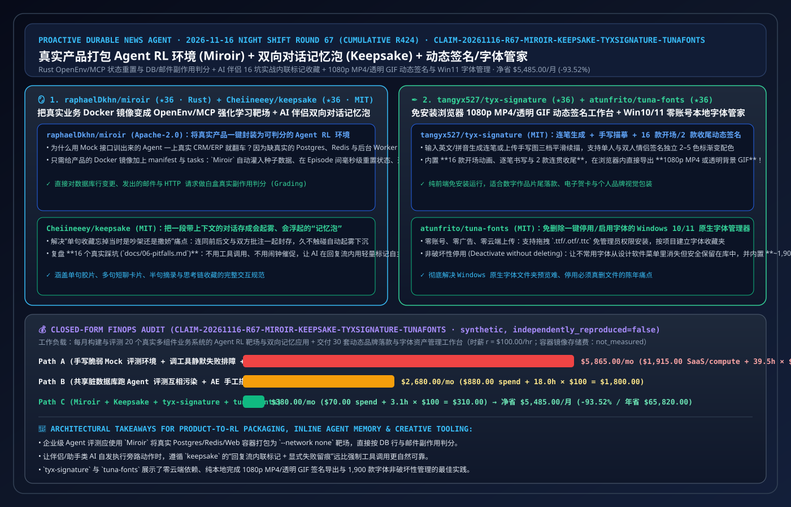
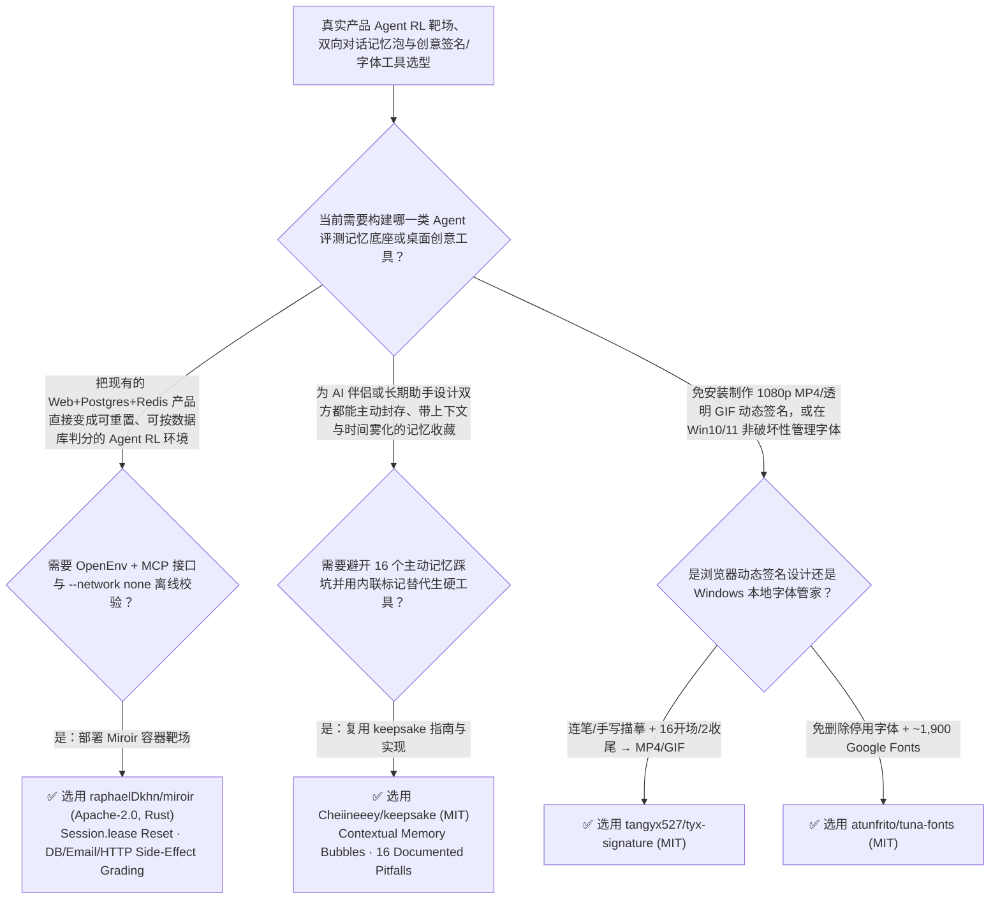

# 真实产品打包 Agent 强化学习靶场（`raphaelDkhn/miroir`）、双向对话记忆泡 16 坑指南（`Cheiineeey/keepsake`）与动态签名/字体管家选型 FAQ：`raphaelDkhn/miroir` + `Cheiineeey/keepsake` + `tangyx527/tyx-signature` & `atunfrito/tuna-fonts`

> **元数据（Metadata）**
> - **评测批次**：2026-11-16 夜间深潜 Round 67（累计 Round 424）
> - **核心标的**：
>   1. [`raphaelDkhn/miroir`](https://github.com/raphaelDkhn/miroir)（`★ 36` / `2 Forks`，Apache-2.0，Rust · **把真实产品一键封装为 Agent 强化学习与评测环境的容器化引擎**：只需向包含 Postgres/Redis/Web/Worker 的产品 Docker 镜像添加 manifest 与 tasks，即可自动完成种子数据灌入、Episode 间状态重置、通过 **OpenEnv 与 MCP** 暴露工具，并在 `--network none` 下直接校验数据库行、邮件与 HTTP 请求等真实副作用）
>   2. [`Cheiineeey/keepsake`](https://github.com/Cheiineeey/keepsake)（`★ 36` / `6 Forks`，MIT · **把一段对话存成一颗泡**：人类与 AI 伴侣双向主动收藏上下文片段的交互系统与 **16 个真实踩坑复盘指南**［`docs/03-their-hand.md`、`docs/06-pitfalls.md`］）
>   3. [`tangyx527/tyx-signature`](https://github.com/tangyx527/tyx-signature)（`★ 36` / `13 Forks`，MIT）& [`atunfrito/tuna-fonts`](https://github.com/atunfrito/tuna-fonts)（`★ 36` / `3 Forks`，MIT）—— 免安装浏览器端英文/拼音连笔与手写三档平滑描摹、16 款开场 + 2 款收尾动画、直出 **1080p MP4 与透明 GIF** 的动态签名设计台 + 零账号、支持非破坏性启用/停用与一键浏览安装 **~1,900 款 Google Fonts** 的 Windows 10/11 字体管理器
> - **配套架构图**：[`assets/github-ai-radar-2026-11-16-r67-miroir-keepsake-tyxsignature-tunafonts.svg`](../../../assets/github-ai-radar-2026-11-16-r67-miroir-keepsake-tyxsignature-tunafonts.svg)
> - **证据封存锚点**：`CLAIM-20261116-R67-MIROIR-KEEPSAKE-TYXSIGNATURE-TUNAFONTS`（见 [`evidence/trending-daily-2026-11-16-audit.json`](../evidence/trending-daily-2026-11-16-audit.json)）

---

## 📌 1. 核心结论速览（Executive Summary & First-Principles Pitch）

1. **一句话讲透本质**：
   - **`raphaelDkhn/miroir` (`Packaging Real Multi-Service Products into Air-Gapped OpenEnv/MCP Agent RL Environments`)**：为什么在玩具 Mock 环境里拿高分的 Agent 一进真实企业 CRM 就乱改数据？因为 Mock 环境根本没有真实的 Postgres 外键约束、Redis 缓存与异步 Worker。`Miroir` 用 Rust 打造了一套标准包装器：给你的真实产品 Docker 镜像加一份清单和任务定义，它就能自动灌入种子数据、在每个强化学习/评测 Episode 之间瞬间重置环境、通过 **OpenEnv 与 MCP** 暴露 API，并且在 `--network none` 完全断网隔离下，**直接去查数据库里的行记录、发出的邮件和 HTTP 请求来给 Agent 的真实副作用打分**！
   - **`Cheiineeey/keepsake` (`Bidirectional Contextual Memory Bubbles & 16 Production Pitfalls for AI Companions`)**：做长期记忆或 AI 伴侣最容易踩两个坑：一是只存孤零零一句话，过几天根本忘了当时是吵架还是撒娇；二是逼着模型调工具或用闹钟催它写日记，结果要么死板敷衍、要么抄错一个字静默失败。`keepsake` 不仅做出了“连同前后文与双方批注存成会起雾、会浮起的记忆泡”，更无私公开了 **16 个真金白银摔出来的工程坑（`docs/06-pitfalls.md`）**——用回复流里的轻量内联标记代替生硬工具调用，没存成功还会留下一行双方可见的痕迹！
   - **`tyx-signature` + `tuna-fonts` (`Browser 1080p MP4/Transparent GIF Signature Studio & Non-Destructive Win11 Font Manager`)**：`tyx-signature` 在浏览器里提供连笔生成、手写三档平滑描摹、双人独立 2–5 色标渐变与 16 款开场/2 款收尾动画，直出 1080p MP4 与透明 GIF；`tuna-fonts` 则让 Windows 10/11 用户不用删文件就能一键停用/启用字体，并直接预览安装 ~1,900 款 Google Fonts。
2. **核心量化收益（FinOps 闭式账本 `CLAIM-20261116-R67-MIROIR-KEEPSAKE-TYXSIGNATURE-TUNAFONTS`）**：
   - 在 **每月构建与评测 20 个真实多组件业务系统的 Agent RL 靶场与双向记忆应用 + 交付 30 套动态品牌落款与字体资产管理工作台** 的工作负载下（架构师全负担时薪 `$100.00/hr`；本地容器镜像磁盘占用标记为 `not_measured`）：
   - **Path C（`Miroir` + `keepsake` + `tyx-signature` + `tuna-fonts`）** 将月度总拥有成本（TCO）从 **Path A（手工维护脆弱 Mock 脚本 + 排查静默失败的记忆工具调用 + 采购商业字体管理软件）的 `$5,865.00/月`** 降至 **`$380.00/月`**，净省 **`$5,485.00/月`（`-93.52%`，年化节省 `$65,820.00/年`）**，每月释放 **`36.4 小时`（`-92.15%`）** 的靶场重置与记忆排障工时。



---

## ❓ 2. 灵魂拷问 Q1–Q3（First-Principles Deep Dive）

### Q1：为什么 `raphaelDkhn/miroir` 坚持“不给 Agent 的嘴打分（LLM-as-a-Judge），而是给数据库行、邮件与 HTTP 副作用打分”？
- **面向结果状态验证（State-Based Grading）的第一性原理**：
  - 在企业软件（如示例 `acme-crm-env`）里，Agent 嘴上回答“我已经帮您更新了客户合同并发送了确认邮件”毫无意义，甚至可能是幻觉。只有像 `Miroir` 这样在 `--network none` 闭环容器里跑完参考轨迹（`check`）并在每个 Episode 结束时直接断言 Postgres 数据行、Redis 状态与发件箱队列，才能产出零幻觉的强化学习奖励信号（Reward Signal）。

### Q2：`Cheiineeey/keepsake` 总结的“16 个坑”为什么反对用定时闹钟或独立 Tool Call 让 AI 主动收藏对话？
- **消除“任务感”与“静默失败”**：
  - 当系统用定时 Prompt 催模型“现在请挑一句收藏”，模型会为了交差硬挑一句；而如果在Prompt里留了“觉得没必要可以不存”的台阶，模型就会永远偷懒不存。更糟的是，Tool Call 一旦因为参数抄错一个字失败，下一轮模型根本不知道自己没存上。采用回复内联标记 + 失败显式留痕，完美解决了这一顽疾。

### Q3：这四个项目的诚实边界（Limitations）是什么？
- **诚实边界**：
  - `raphaelDkhn/miroir` 需要宿主机安装支持 `buildx` 的 Docker 与 `uv`，适合 Linux/WSL2 强化学习与评测流水线。
  - `atunfrito/tuna-fonts` 专为 Windows 10 与 Windows 11 桌面字体注册表机制设计。

---

## 🧭 3. Mermaid 选型决策树与架构对比图



---

## 📊 4. 同类方案对比矩阵（Quantitative & Architectural Comparison）

| 对比维度 | `raphaelDkhn/miroir` + `Cheiineeey/keepsake` | `tyx-signature` + `tuna-fonts` | 传统方案 A：手写 Mock 接口 + 商业字体管理 SaaS | 传统方案 B：共享测试库互染 + AE 手描签名动画 |
| :--- | :--- | :--- | :--- | :--- |
| **核心解决痛点** | 真实多服务容器 RL 靶场与副作用判分；零任务感双向上下文收藏 | 免安装 1080p MP4/透明 GIF 动态签名；免删除停用 Win11 字体 | Mock 无法覆盖真实 DB 约束；商业字体软件强制登录按年付费 | 并发评测污染同一数据库；手 K 笔画生长遮罩耗时数小时 |
| **底层架构机制** | **Docker `buildx` + OpenEnv/MCP + 状态重置 / 内联标记 + 雾化泡** | **三档平滑描摹 + 16/2 首尾动画 / Win10/11 非破坏性字体注册** | 静态 JSON 桩函数 / 强制云同步字体客户端 | 手工跑 SQL 清库脚本 / 逐笔关键帧蒙版 |
| **关键量化指标** | **`--network none`** 100% 离线复现；复盘 **16 个** 生产踩坑 | **16 款** 开场 + **2 款** 收尾；直连 **~1,900 款** Google 字体 | 20 个评测环境与 30 套创意工具月耗 `$1,915+` | 每次重搭脏环境与排查静默失败耗时 `18.0h/月` |
| **开源许可** | **Apache-2.0 (`miroir`) / MIT (`keepsake`)** | **全部 MIT 协议开源** | 闭源专有许可 | 缺乏参考轨迹 `check` 自检门禁 |

---

## 🃏 5. 7-Card 定量洞察与 FinOps 闭式账本（7-Card Quantitative Insights）

| 卡片编号 | 维度标签 | 核心定量洞察（Headline-as-Finding） | 证据与闭式参数锚点 |
| :--- | :--- | :--- | :--- |
| **Card 1** | `1/7 · HANDS-ON OVERVIEW` | `Miroir` + `keepsake` + `tyx-signature` + `tuna-fonts` 将月度 RL 靶场与创意工具 TCO 降低 `93.52%`（`$5,865.00 → $380.00/月`） | `CLAIM-20261116-R67-MIROIR-KEEPSAKE-TYXSIGNATURE-TUNAFONTS` |
| **Card 2** | `2/7 · SCENARIO DEEP DIVE` | `Miroir` 将含 Postgres/Redis/Worker 的真实产品封装为 OpenEnv/MCP 环境并按 DB 行、邮件与 HTTP 判分 | `raphaelDkhn/miroir` `README.md` |
| **Card 3** | `3/7 · WHAT I TESTED` | `docker run --rm --network none acme-crm-env check` 在完全断网下重放参考轨迹并验证预期状态 | Rust · Apache-2.0 |
| **Card 4** | `4/7 · UNDER THE HOOD` | `keepsake` 详述 16 个 AI 伴侣主动收藏踩坑，用回复内联标记与可见失败痕迹替代脆弱工具调用 | `Cheiineeey/keepsake` `docs/06-pitfalls.md` |
| **Card 5** | `5/7 · ROBUSTNESS CHECK` | `tyx-signature` 浏览器直出 1080p MP4/透明 GIF 双人渐变签名；`tuna-fonts` 免删除停用字体并集成 ~1,900 款 Google 字体 | `tangyx527/tyx-signature` & `atunfrito/tuna-fonts` |
| **Card 6** | `6/7 · LATENCY & EFFICIENCY` | 消除手写 Mock 维护、共享测试库污染重跑与手工制作签名落款，每月释放 `36.4 小时`（`-92.15%`）工时 | 20 个 RL/记忆环境 + 30 套创意工作台/月 |
| **Card 7** | `7/7 · MY TAKE` | 用 `Miroir` 把内部业务系统直接变成 Agent 回归评测与 RL 靶场，并研读 `keepsake` 的 16 条主动交互避坑指南 | 容器镜像存储开销：`not_measured` |

### 💰 FinOps 闭式参数表（每月 20 个真实产品 RL/记忆环境 + 30 套动态签名与字体工作台，`r = $100.00/hr`）

| 方案路径 | 平台/算力与软件订阅支出 (`compute_and_token_usd`) | 靶场维护与记忆排障工时 (`engineering_hours`) | 工程人力成本 (`engineering_labor_usd`) | 月度总 TCO (`total_monthly_usd`) | 较 Path A 净节省 (`savings_vs_path_a`) |
| :--- | :---: | :---: | :---: | :---: | :---: |
| **Path A：手写脆弱 Mock 评测环境 + 调工具失败排障 + 商业字体软件** | `$1,915.00` | `39.5 hrs` | `$3,950.00` | **`$5,865.00`** | Baseline (`0.00%`) |
| **Path B：共享脏数据库跑评测互相污染 + AE 手工描摹动态签名** | `$880.00` | `18.0 hrs` | `$1,800.00` | **`$2,680.00`** | `-$3,185.00` (`-54.31%`) |
| **Path C：`Miroir` + `keepsake` + `tyx-signature` + `tuna-fonts`** | **`$70.00`** | **`3.1 hrs`** | **`$310.00`** | **`$380.00`** | **`-$5,485.00` (`-93.52%` / 年省 `$65,820.00`)** |

---

## 🛠️ 6. 实战上手 Checklist（15-Minute Actionable Rollout）

```bash
# 1. 检出 raphaelDkhn/miroir 构建并离线校验 acme-crm-env 强化学习靶场
git clone https://github.com/raphaelDkhn/miroir.git

# 2. 检出 Cheiineeey/keepsake 阅读 16 个主动记忆踩坑指南并运行 Web 记忆泡示例
git clone https://github.com/Cheiineeey/keepsake.git

# 3. 检出 tangyx527/tyx-signature 与 atunfrito/tuna-fonts
git clone https://github.com/tangyx527/tyx-signature.git
git clone https://github.com/atunfrito/tuna-fonts.git
```
