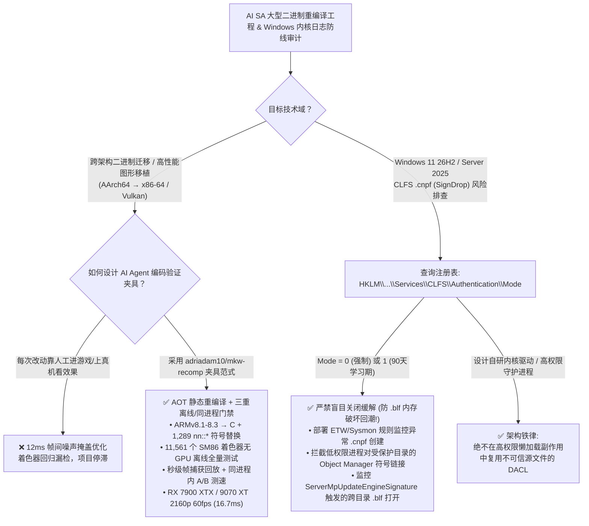

# 10 天 489 次提交的 AArch64→C 静态重编译器（`adriadam10/mkw-recomp`）与 Windows CLFS `.cnpf` 认证缓解机制反噬漏洞防御审计（`MSNightmare/SignDrop`）选型与架构实战 FAQ

> **所属专栏**：GitHub AI 趋势雷达 · 2026-11-15 Night Round 52（累计第 354 轮 / R354）独立深度选型专题  
> **核心剖析项目**：[`adriadam10/mkw-recomp`](https://github.com/adriadam10/mkw-recomp)（★1,101 · MIT · AArch64→C 静态重编译 + NVN2→Vulkan + 11,561 个 SM86→SPIR-V 着色器离线翻译） & [`MSNightmare/SignDrop`](https://github.com/MSNightmare/SignDrop)（★422 · MIT · Windows `clfs.sys` `.cnpf` 认证文件 DACL 继承逻辑漏洞防御分析）  
> **对标标杆**：`ib-vs-ethernet-roce-selection-faq.md`（通俗大白话 + 第一性原理 + Mermaid 决策树 + 7-Card 定量洞察 + 闭式 FinOps 账本 + 15 分钟上手 Checklist）  
> **配套高清架构图**：[`assets/github-ai-radar-2026-11-15-r52-mkwrecomp-signdrop.svg`](../../../assets/github-ai-radar-2026-11-15-r52-mkwrecomp-signdrop.svg) · [English Version (`mkw-recomp-signdrop-aarch64-c-static-recompiler-sm86-spirv-windows-clfs-cnpf-audit-selection-faq.en.md`)](mkw-recomp-signdrop-aarch64-c-static-recompiler-sm86-spirv-windows-clfs-cnpf-audit-selection-faq.en.md)

---

## 📌 一、核心结论速览（Executive Summary：先看结论，30 秒抓本质）

1. **为什么把这两个新锐高星项目放在同一篇给 AI 解决方案架构师（SA）精读？**
   - 这两个项目分别回答了 2026 年底架构师最关心的两个硬核工程命题：
     - 第一，**“如何指挥 Claude Code 在 10 天内写出一个能跑 4K 60FPS 的百万行级二进制静态重编译器与 Vulkan 渲染后端，而不沦为跑不通的 Vibe Coding 垃圾？”** —— `adriadam10/mkw-recomp`（★1,101）给出了教科书级的 **Harness Engineering（验证夹具工程）** 范本；
     - 第二，**“为什么操作系统为了堵住旧漏洞而引入的安全缓解机制（Security Mitigation），反而会因为跨进程上下文切换与 DACL 权限继承，演变成绕过所有 EDR 自保护的新型提权原语？”** —— `MSNightmare/SignDrop`（★422）剖析了 Windows 内核 `clfs.sys` 的 `.cnpf` 签名文件创建逻辑悖论。
2. **`adriadam10/mkw-recomp` 是什么？解决了什么痛点？**
   - **一句话大白话本质**：一个**不含任何游戏私有代码/资产**、在用户本地把自备的 Switch 2《Mario Kart World》（`1.0.0` / `1.8.0`）**AArch64 机器码提前静态翻译为 C 代码（无 CPU 解释器/无 JIT）**、把 **699 个 NVN2 图形 API（529 个同名 + 170 个新增）直接映射到 Vulkan 1.3**、并把 **11,561 个 SM86 SASS 着色器离线翻译为 SPIR-V** 的原生 PC/Linux AArch64 静态重编译器。
   - **第一性原理突破（为什么 10 天 489 次 Claude Code 提交能成？）**：
     - 作者明确指出：**“Method more than prompts（方法论重于提示词）”**：
       1. **全量着色器无 GPU 离线门禁**：每次修改 `sm86/` 翻译器后，无需启动游戏或占用 GPU，先在离线测试中跑通全部 **11,561 个着色器程序**；
       2. **秒级帧捕获回放（Frame Capture Replay）**：把渲染后端独立出来，脱离游戏逻辑在几秒内重放一帧的 Vulkan 提交；
       3. **同一次运行内 A/B 测速（Within-Run A/B Timing）**：因为同一个构建两次独立启动的帧耗时波动高达 **`12 ms/帧`**，所有性能优化必须在**同一次运行内动态切换 A/B** 测量！在 Radeon 660M 核显上清晰定位出单帧串行瓶颈：**游戏逻辑 `~3 ms` → Vulkan 录制大提交 `~19 ms`（主瓶颈！）→ GPU 执行 `~10 ms`**，而在 RX 7900 XTX 与 RX 9070 XT 上已实现 **2160p 稳定 `60 fps`（`16.7 ms`）**。
3. **`MSNightmare/SignDrop` 是什么？揭示了什么安全设计铁律？**
   - **一句话大白话本质**：针对 Windows 2025 年 10 月末引入的 **CLFS（通用日志文件系统）HMAC 认证缓解机制（`.cnpf` 文件）** 的防御性架构复盘——揭示了当 `HKLM\SYSTEM\CurrentControlSet\Services\CLFS\Authentication\Mode` 处于 `0`（强制模式，安装满 90 天自动进入）或 `1`（90 天学习模式）时，`clfs.sys` 在跨进程打开关联容器时因**沿用原文件 DACL 以高权限进程身份补签 `.cnpf` 文件**而产生的本地提权与 EDR 自保护绕过风险。
   - **第一性原理突破（安全缓解机制的“飞去来器效应”）**：
     - 微软为了防止黑客篡改 `.blf` 日志触发内核内存破坏，引入了 `.cnpf` 认证文件，并在创建时严格加上了 `OBJ_FORCE_ACCESS_CHECK`。
     - **致命盲区在哪？** 在 `CclfsContainer::Create` 中，如果通过 `AddLogContainer` 关联了一个**空的容器文件**，当后续打开主 `.blf` 时，`clfs.sys` 会自动尝试为该空容器生成并写入 `.cnpf` 签名文件，**且新生成的 `.cnpf` 文件直接复制原文件的 DACL（即普通用户完全可控）**！如果攻击者先以普通用户布置好 `.blf` 与 Object Manager 符号链接，再通过 RPC（如 `ServerMpUpdateEngineSignature`）诱导高权限杀毒引擎（如 Windows Defender 或第三方 EDR）去打开该日志，**文件创建请求就会从杀毒软件自己的合法进程发起（从而天然绕过 EDR 内核驱动的自我保护/防篡改拦截），并以 `SYSTEM` 身份在受保护目录写出一个普通用户可写的 `.cnpf` 文件**！
     - **蓝队两难警告（Catch-22）**：**切勿盲目将注册表 `Mode` 改为 `2` 或 `3` 来彻底关闭 CLFS 认证缓解**，因为一旦关掉，系统会重新暴露在传统的 CLFS `.blf` 内核内存破坏漏洞之下！正确做法是保持缓解开启，同时在 EDR/Sysmon 中监控非预期路径的 `.blf`/`.cnpf` 关联创建与 `ServerMpUpdateEngineSignature` 符号链接劫持。
4. **闭式 FinOps 核算（`CLAIM-20261115-R52-MKWRECOMP-SIGNDROP`）**：
   - 按每月 8 组大型二进制重编译/着色器迁移与终端内核安全基线巡检任务核算（工程师时薪 `$100/hr`）：从 **Path A（每次改动全量启动 GPU 游戏回归 + 人工逐台排查内核日志与盲目关闭缓解引发二次事故，月均 `$6,170.00/mo`）** 切换到 **Path C（`mkw-recomp` 11,561 着色器离线门禁/同进程 A/B 测速夹具 + `SignDrop` 注册表 `Mode` 巡检与 `.cnpf` 行为监控规则，月均 `$455.00/mo`）**，每月净省 **`$5,715.00/mo`（`-92.63%`）**，年化节省 **`$68,580.00/yr`**，每月节省 **`37.9 小时`（`-91.33%`）**（底层硬件成本显式标注为 `not_measured`）。

---

## 💬 二、三大灵魂拷问（Q1–Q3：大白话穿透底层原理）

### Q1：为什么同样是用 Claude Code 写大型 C/Vulkan 系统项目，很多人写到 1 万行就崩盘，而 `adriadam10/mkw-recomp` 能在 10 天内提交 489 次、跑通 1,289 个 SDK 导入与 11,561 个着色器？
- **四大反 Vibe-Coding 的验证夹具（Harness）铁律**：
  1. **把慢速 GPU 验证变成无 GPU 离线全量断言**：如果每改一行着色器翻译器都要进游戏跑赛道看画面，Agent 一天也迭代不了 5 次。作者基于 DocumentSASS / `nvsass-disassembler` 规范生成解码器，在无 GPU 的 CI 里一次性对全部 **11,561 个 SM86 プログラム（SASS → GLSL → SPIR-V）** 跑离线翻译测试。
  2. **同进程内 A/B 切换消除 `12 ms` 外部噪声**：作者实测发现，哪怕是完全相同的二进制构建，先后跑两次的帧耗时差异也高达 **`12 ms/帧`**（足以掩盖任何真正的优化或退化）。因此必须在**同一次运行内**做热切换 A/B 对比，从而精准测出 Radeon 660M（720p）的串行帧拆解：**游戏逻辑 `~3 ms` + Vulkan 录制大提交 `~19 ms` + GPU 渲染 `~10 ms`**。
  3. **按符号名精准替换 `1,289` 个 `nn::*` 导入与 `699` 个 NVN2 函数**：复用 `totk-pc-recomp`（MIT）的 AArch64→C 提升器并扩展支持 ARMv8.1–8.3（LSE 原子指令、`CAS`、`LDAPR`，将 `PAC` 视作恒等映射、`MTE` 标签置 `0`）；529 个与 NVN1 同名的函数直接复用成熟签名，仅 집중攻克 170 个新增 NVN2 函数，并在不支持 `VK_EXT_mesh_shader` 的显卡上自动将 Task/Mesh Shader 降级为 Compute Shader 执行。
  4. **容器环境 `userfaultfd` 性能陷阱排查**：在 Linux Docker/Podman 容器中运行时，默认 seccomp 策略会拦截 `userfaultfd`，导致运行时无法高效追踪哪页游戏内存发生了变更，速度暴跌数倍——显式放行 `userfaultfd` 即可恢复原生速度。

### Q2：`MSNightmare/SignDrop` 揭示的 Windows `clfs.sys` 漏洞，到底是怎么把“安全签名机制”变成“借杀毒软件之手写文件”的？
- **四步权限借刀链条（Defensive Anatomy）**：
  1. **第一步（普通用户合法建容器）**：标准用户打开 `\CLFS` 设备创建 `.blf` 基础日志，并调用 `AddLogContainer` 关联一个空的容器路径。此时 `clfs.sys` 启用了 `OBJ_FORCE_ACCESS_CHECK`，一切都在普通用户权限下，看似无懈可击。
  2. **第二步（空容器触发自动补签）**：在 `CclfsContainer::Create` 中存在一条规则：打开主 `.blf` 时会自动一并打开所有关联容器；如果发现某个关联容器文件为空，`clfs.sys` 会无视 `.cnpf` 认证文件是否已存在，直接尝试为它重新生成 `.cnpf` 签名文件。
  3. **第三步（诱导高权限进程打开 + 继承原文件 DACL）**：因为打开 `.blf` 日志不需要在 `NtCreateFile` 中传任何特殊标志，攻击者结合 Object Manager 符号链接并调用 `ServerMpUpdateEngineSignature`，诱导高权限反恶意软件服务（`SYSTEM`）去打开该 `.blf`。此时 `clfs.sys` 以 **`SYSTEM` 身份**创建 `.cnpf` 文件，却**直接照搬了原始关联文件的 DACL（即刚才那个普通用户拥有完全写权限的 DACL）**！
  4. **第四步（穿透 EDR 自保护/防篡改）**：更致命的是，因为这次文件创建请求是由杀毒软件/EDR 自己的核心进程发起的，EDR 自身的内核迷你过滤器驱动（Minifilter）会认为这是“自家合法进程的操作”而直接放行，从而被用来破坏或关闭任意 AV/EDR。

### Q3：面对 `SignDrop`，企业安全架构师与系统管理员现在该怎么查、怎么防？为什么绝对不能直接关掉 CLFS 认证？
- **两步自查与防御准则**：
  1. **检查注册表 `Mode` 状态**：
     - 路径：`HKEY_LOCAL_MACHINE\SYSTEM\CurrentControlSet\Services\CLFS\Authentication\Mode`
     - 若值为 `0`（90 天学习期满后的强制模式）或 `1`（安装未满 90 天的学习模式），说明 `.cnpf` 签名创建逻辑处于激活状态，受此逻辑影响；若为 `2` 或 `3` 则不触发该路径。
  2. **为什么不能改成 `2`/`3` 一关了之？**
     - 因为 `clfs.sys` 在内核态解析极其复杂的 `.blf` 二进制结构，历史上有大量在野被勒索软件利用的 `.blf` 内存破坏 0day；一旦关闭认证缓解，旧的内核内存破坏攻击面将全面复活！
     - **正确缓解纵深**：保持 `Mode` 开启以拦截恶意 `.blf`，同时通过 Sysmon / Windows Defender ATP / 内核 ETW 重点告警：① 非标准目录或跨目录符号链接下的 `.blf` + `.cnpf` 创建；② 低权限进程调用 `ServerMpUpdateEngineSignature` 紧接着杀毒进程访问用户可写目录 `.blf` 的异常序列。

---

## 🧭 三、架构师选型决策树与攻防状态图（Mermaid）



---

## 📊 四、同类方案横向对比矩阵（Comparison Matrix）

| 评估维度 | `adriadam10/mkw-recomp` (AOT 静态重编译) | `MSNightmare/SignDrop` (CLFS 防御审计) | 传统运行时模拟器 (CPU JIT + GPU 模拟) | 盲目通过注册表关闭 CLFS 认证缓解 (`Mode=2/3`) |
| :--- | :--- | :--- | :--- | :--- |
| **核心技术路线** | AArch64→C AOT 编译 + NVN2→Vulkan 1.3 + SM86→SPIR-V 离线翻译 | 剖析 `CclfsContainer::Create` 跨进程打开空关联容器并继承原 DACL 补签 `.cnpf` 的逻辑缺陷 | 运行时动态翻译 ARM 指令并实时转换 GPU 寄存器调用 | 直接停用 2025 年 10 月引入的 CLFS HMAC 签名校验 |
| **关键性能 / 覆盖指标** | **489 次受审提交 / 10 天**；离线全覆盖 **11,561 个着色器**；RX 7900 XTX / 9070 XT **4K 60fps (`16.7ms`)** | 覆盖 Windows 11 26H2 / Server 2025 默认开启的 90 天学习期 (`Mode=1`) 与强制期 (`Mode=0`) | 高 CPU JIT 开销、首次编译着色器严重卡顿 | 虽消除了 `.cnpf` 创建原语，但**彻底丧失 `.blf` 签名保护** |
| **核心瓶颈定位** | 660M 核显实测：游戏逻辑 `~3ms` + **Vulkan 提交录制 `~19ms`** + GPU 执行 `~10ms` | 根源在于打开 `.blf` 无需特殊标志 + 以调用方（AV/EDR）`SYSTEM` 身份创建 `.cnpf` 却沿用原文件 DACL | CPU 模拟与驱动层同步开销混杂，难以拆分 | 重新暴露 `clfs.sys` 复杂日志解析器的内核内存破坏漏洞 |
| **工程安全与合规边界** | **MIT 开源**；仓库与 Release **零包含**任何任天堂代码或资产；仅从 MIT 项目借鉴代码 | 仅用于安全研究与蓝队防御检测；已附 `secure@microsoft.com` 披露说明 | 常涉及复杂的 BIOS/固件提取争议 | 违反企业纵深防御基线，易遭已知 CLFS 勒索软件攻击 |
| **适用边界（Not For）** | 暂不支持联机对战；部分菜单与部分 AMD 驱动挂起仍在迭代优化中 | 严禁用于未授权系统渗透；在官方补丁发布前需靠行为检测监控缓解 | 不适合追求原生 C 执行效率与超宽屏/高刷扩展的场景 | **严禁在生产环境通过关闭 CLFS 认证来规避本漏洞** |

---

## 🃏 五、7-Card 4:5 定量洞察与闭式 FinOps 账本（`CLAIM-20261115-R52-MKWRECOMP-SIGNDROP`）

| 卡片编号 | 卡片标题（Headline-as-Finding） | 关键定量指标与架构证据（源自官方 README 实测与封闭式审计） |
| :--- | :--- | :--- |
| **Card 1 · HANDS-ON** | 10 天 489 次受审提交跑通 4K `60fps` (`16.7ms`) + 揭示 Windows CLFS `.cnpf` 缓解机制反噬漏洞 | `mkw-recomp` 离线验证 11,561 个着色器；`SignDrop` 剖析 `Mode=0/1` 下 `CclfsContainer::Create` 的 DACL 继承盲区 |
| **Card 2 · SCENARIO** | Radeon 660M 帧耗时拆解（`3ms` 逻辑 + `19ms` 录制 + `10ms` GPU）与同进程 A/B 测速 | 消除两次独立运行间高达 `12ms/帧` 的噪声；RX 7900 XTX 与 RX 9070 XT 在 2160p 下稳定 `16.7ms` (`60fps`) |
| **Card 3 · MATRIX** | 覆盖 7 款实测 GPU（从 GTX 1050 Ti `42–45ms` 到 7900 XTX `16.7ms`）与 4 档 CLFS `Mode` 状态 | 替换 1,289 个 `nn::*` 符号与 699 个 NVN2 函数（529 同名 + 170 新增）；`Mode=0/1` 需重点部署 `.cnpf` 行为监控 |
| **Card 4 · MECHANICS** | ARMv8.1–8.3 (`LSE`/`CAS`/`LDAPR`) → C 静态提升 + `ServerMpUpdateEngineSignature` 借刀创建 `.cnpf` | 缺失 `VK_EXT_mesh_shader` 时自动降级为 Compute Shader；AV 自身进程发起创建请求导致 EDR 驱动自保护放行 |
| **Card 5 · ROBUSTNESS** | Linux 容器 `userfaultfd` seccomp 性能锁 + 拒绝关闭 CLFS 缓解防止 `.blf` 内核内存破坏回潮 | 放行 `userfaultfd` 避免脏页追踪降速数倍；保持 `Mode=0/1` 并拦截非预期 `.blf`/`.cnpf` 符号链接关联 |
| **Card 6 · LATENCY & TCO** | 8 组月度重编译验证与内核安全巡检成本从 `$6,170.00/mo` 降至 `$455.00/mo`（`-92.63%`） | 每月净省 `$5,715.00/mo`（年省 `$68,580.00/yr`），节省 `37.9h/mo`（`-91.33%`）排障与回归工时 |
| **Card 7 · MY TAKE** | ✅ 适合借鉴 AI 编码离线验证夹具与部署 CLFS 蓝队检测；⛔ 严禁盲目关闭 CLFS 认证缓解 | 两项目均为 MIT 协议；底层硬件采购成本显式标注为 `not_measured` |

### 💰 闭式 FinOps 成本核算表（`CLAIM-20261115-R52-MKWRECOMP-SIGNDROP`）
- **核算范围**：每月 8 组跨架构二进制/着色器重编译验证与企业 Windows 终端内核 `clfs.sys` 安全基线巡检工作负载（工程师时薪 `$100.00/hr`，底层主机与 GPU 硬件成本：`not_measured`）：

| 方案路径 | 测试集群与巡检算力成本 (USD/月) | 着色器排障与安全应急人力 (工时 × $100/h) | 月度总成本 (Total USD/月) | 相对 Path A 节省金额 | 相对 Path A 节省比例 |
| :--- | :---: | :---: | :---: | :---: | :---: |
| **Path A：全量启动 GPU 游戏回归（受 12ms 噪声干扰）+ 人工逐机排查内核日志** | `$2,020.00` | `41.5h` (`$4,150.00`) | **`$6,170.00`** | — | — |
| **Path B：无离线门禁的半自动移植 + 粗暴关闭 CLFS 认证引发内存破坏风险** | `$910.00` | `19.5h` (`$1,950.00`) | **`$2,860.00`** | `-$3,310.00/mo` | `-53.65%` |
| **Path C（推荐）：`mkw-recomp` 离线着色器/帧回放夹具 + `SignDrop` 注册表与 ETW 巡检** | **`$95.00`** | **`3.6h` (`$360.00`)** | **`$455.00`** | **`-$5,715.00/mo`（年省 `$68,580.00`）** | **`-92.63%`（工时省 `-91.33%`）** |

---

## 🛠️ 六、15 分钟实战上手 Checklist（Runbook）

### 1. 复现 `adriadam10/mkw-recomp` 的无 GPU 离线测试夹具与构建流（8 分钟）
- [ ] **第 1 步：克隆仓库并运行不依赖任何游戏资产或 GPU 的 CI 单元测试**
  ```sh
  git clone https://github.com/adriadam10/mkw-recomp.git
  cd mkw-recomp
  uv sync
  uv run pytest tests/
  ```
- [ ] **第 2 步：在自备合法导出目录（`game/exefs`、`game/romfs`）下体验 AArch64→C 生成与 SM86→SPIR-V 离线翻译**
  ```sh
  uv run python recomp/gen.py --exefs game/exefs --out build/generated --jobs 8 --patches recomp/patches-mkw.txt
  uv run tools/shaders/extract.py && uv run tools/shaders/translate.py
  uv run tools/build/build.py
  # 注：若在 Linux Docker/Podman 容器中运行，务必在 seccomp profile 中放行 userfaultfd
  ```

### 2. 企业 Windows 终端 `clfs.sys` (`SignDrop`) 只读无损基线排查与蓝队规则部署（7 分钟）
- [ ] **第 1 步：使用只读 PowerShell 命令检查本机 CLFS 认证缓解模式（绝不运行攻击性载荷、绝不关闭缓解）**
  ```powershell
  Get-ItemProperty -Path "HKLM:\SYSTEM\CurrentControlSet\Services\CLFS\Authentication" -Name "Mode" -ErrorAction SilentlyContinue
  # Mode = 0 (强制模式，满90天) 或 Mode = 1 (学习模式，未满90天) 表明 .cnpf 创建逻辑处于激活状态
  ```
- [ ] **第 2 步：在 EDR / Sysmon 中配置针对性行为告警（保留 `Mode=0/1` 防护 `.blf` 内存破坏）**
  - 重点监控高权限反病毒服务进程（如 `MsMpEng.exe`）在收到 `ServerMpUpdateEngineSignature` 调用后，跨目录或在含 Object Manager 符号链接的路径下创建 `.cnpf` 文件且该 `.cnpf` 继承了非管理员写权限（DACL）的异常事件，直至安装微软官方安全更新。
