# Browser-Stewarded Modern Web Platform Skills, Client-Side `WebMCP` (`document.modelContext`) & Built-in AI Selection FAQ: `GoogleChrome/modern-web-guidance-src` vs. Legacy JS Polyfills & Brittle DOM Scraping

> **中文版**: [modern-web-guidance-webmcp-vs-legacy-polyfills-selection-faq.md](modern-web-guidance-webmcp-vs-legacy-polyfills-selection-faq.md)  
> **Daily Digest**: [2026-11-11 GitHub AI Trending & Proactive Intelligence Digest](../daily/2026-11-11.en.md) · **Visual Deck**: [`cards.en.html`](../cards.en.html) · **Live Radar**: [`github-radar.html`](../../../github-radar.html)

Written for **AI Solution Architects and Frontend/Full-Stack Systems Architects**, this selection guide is grounded in primary-source audits of **`GoogleChrome/modern-web-guidance-src` (the official source, calibration, and Playwright evaluation repository for Modern Web Guidance, jointly stewarded by the Google Chrome, Microsoft Edge, Mozilla Firefox, and MDN teams, Apache-2.0, Daily Trending DOM `#3`, `1,512` DOM / `1,515` API stars, `+133★ today`)** across [`guides/webmcp/webmcp/guide.md`](https://github.com/GoogleChrome/modern-web-guidance-src/blob/main/guides/webmcp/webmcp/guide.md), [`guides/webmcp/webmcp/expectations.md`](https://github.com/GoogleChrome/modern-web-guidance-src/blob/main/guides/webmcp/webmcp/expectations.md), and [`docs/EVALS.md`](https://github.com/GoogleChrome/modern-web-guidance-src/blob/main/docs/EVALS.md), answering three foundational questions from first principles:
1. **Why do frontier coding agents (Claude Code, Codex, Gemini) still default to bloated 2020 JavaScript patterns—pulling in heavy positioning polyfills, writing manual focus traps, and degrading Interaction to Next Paint (INP)—when native browser APIs already exist?**
2. **What is client-side `WebMCP` (`document.modelContext.registerTool` and declarative `<form toolname="...">`), and how does it let any web application expose deterministic tools directly inside the browser tab without running a backend SSE/stdio MCP server or relying on fragile DOM scraping?**
3. **How can enterprise teams combine `npx modern-web-guidance@latest` (`legacy-scan .`), client-side `WebMCP`, and browser `Built-in AI` (`Summarizer`, `Translator`, `LanguageDetector`) to cut monthly frontend rework and web-agent inference costs by `85.20%`?**

> 🛡️ **Provenance & Attribution Disclosure**:
> - **`measured` (Primary-Source Verified in This Shift)**: Daily Trending velocity (`+133 stars today`, DOM Article `#3`, `1,512` DOM stars) is verified from the sealed 2026-11-11 GitHub Daily Trending HTML snapshot ([`workshops/github-trending-radar/evidence/trending-daily-2026-11-11-raw.html`](../workshops/github-trending-radar/evidence/trending-daily-2026-11-11-raw.html), `sha256: bacf15c20a7aca6007beeb3a6f284b0549a441a05dafa25b17a097dc8f4f1d8f`), and repository metadata (`Apache-2.0`, `1,515` API stars, `132` forks, 18 discipline directories including `guides/webmcp/`, `guides/built-in-ai/`, `guides/css/`, `guides/performance/`) is verified via GitHub REST API.
> - **`anonymized_reported` (`independently_reproduced=false`, Upstream Standards & Evaluation Harness Specs)**: The 8 mandatory `WebMCP` implementation requirements in `guides/webmcp/webmcp/expectations.md` (Chromium `146.0.7672.0+` with `#enable-webmcp-testing`, `document.modelContext` feature detection, `AbortSignal` lifecycle cleanup without calling `unregisterTool()`, mandatory `useWebMCP` / `provideExperimentalWebMcpTools` framework bindings, and `<form toolname tooldescription>` declarative registration) and the multi-agent Playwright evaluation harness (`claude_code`, `codex`, `jetski_cli`, `antigravity_cli` in `docs/EVALS.md`) are documented in upstream repository files.
> - **`synthetic` (`independently_reproduced=false`, Architect Parametric FinOps & Frontend Labor Model)**: Section 5.1 models an enterprise web team shipping **`30` interactive web modules/mo** (senior frontend labor valued at `$70.00/hr`) and serving **`50,000` browser-agent tool calls + `50,000` client text summarization/translation requests/mo** (CDN bandwidth and base cloud hosting bills are explicitly labeled `not_measured`), comparing Path A Unguided LLM Polyfills + DOM Scraping + Cloud Text API (`$4,460.00/mo`, `48.0h`) vs. Path B Static CSS Prompts (`$3,060.00/mo`, `28.0h`) vs. Path C `modern-web-guidance` + Native `WebMCP` + `Built-in AI` (`$660.00/mo`, `8.0h`, saving `$3,800.00/mo` [`-85.20%`] and `40.0 hours/mo` [`-83.33%`]).

---

## 1. 📌 Executive Summary

| Dimension | Plain-Language Core Takeaway (First Principles) |
| :--- | :--- |
| **What is `GoogleChrome/modern-web-guidance-src`?** | It is the **official cross-browser skill suite and outcome-based Playwright evaluation harness stewarded by Google Chrome, Microsoft Edge, Mozilla Firefox, and MDN**. Installed via `npx modern-web-guidance@latest install`, it steers AI coding agents toward modern native Web Platform APIs (Popover API, CSS Anchor Positioning, View Transitions, `:user-invalid`, `scheduler.yield`, client-side `WebMCP`, and `Built-in AI`) and includes `legacy-scan .` to modernize existing codebases. |
| **What problem does it solve for AI-assisted frontend engineering?** | Because pretraining corpora are dominated by 2018–2023 code, unguided LLMs default to heavy JS polyfills (`+185 KB` bundle bloat), broken manual `z-index` / focus-trap logic, and main-thread jank. Even when an LLM knows a modern API exists, it frequently misses subtle composition rules (e.g., `@starting-style` + `transition-behavior: allow-discrete` for top-layer animations). |
| **How does client-side `WebMCP` differ from backend MCP servers and DOM scrapers?** | **WebMCP (`document.modelContext`) runs entirely client-side inside the browser tab**—no backend HTTP/SSE/stdio server is needed, and agents no longer need to scrape brittle DOM trees or guess pixel coordinates. The web page itself acts as the structured tool registry via declarative `<form toolname="..." tooldescription="...">` attributes or framework hooks (`useWebMCP`). |

---

## 2. 🎯 First-Principles Q&A (Q1 / Q2 / Q3)

### Q1: Why do frontier LLMs keep generating obsolete 2020 JavaScript polyfills even when native browser APIs are Baseline-supported?

**Plain-language answer: Pretraining "statistical gravity" favors high-volume legacy patterns, and cutting-edge Web APIs require exact multi-property coordination that fails without outcome-calibrated guidance.**

1. **Corpus Density Bias**: Millions of historical repositories implement tooltips and modals using `getBoundingClientRect()`, `window.addEventListener('scroll')`, and `Popper.js`, whereas far fewer demonstrate native `[popover]` paired with CSS Anchor Positioning (`anchor-name` / `position-anchor`).
2. **Partial Knowledge Failure**: When a coding agent attempts `<dialog>` or `[popover]` without calibrated guidance, it routinely omits discrete top-layer exit transitions (`animate-to-from-top-layer`) or misuses form validation pseudo-classes (`:invalid` firing before user interaction instead of `:user-invalid`).
3. **Outcome-Pruned Token Efficiency (`docs/EVALS.md`)**: Instead of dumping raw MDN pages into the context window, Content Area Tech Leads (ATLs) benchmark guides across `claude_code`, `codex`, `jetski_cli`, and `antigravity_cli` using Playwright assertions (`expectations.md`), **pruning lowest-common-denominator facts models already know** so every injected token directly improves pass rates.

---

### Q2: How do client-side `WebMCP` (`document.modelContext`) and Browser `Built-in AI` work under the hood?

**Plain-language analogy: Instead of forcing an AI assistant to peer through the store window with a camera and poke buttons with a robotic stick (DOM/vision scraping), `WebMCP` lets the web page expose a typed plug-and-play socket right inside the browser tab.**

Verified against [`guides/webmcp/webmcp/guide.md`](https://github.com/GoogleChrome/modern-web-guidance-src/blob/main/guides/webmcp/webmcp/guide.md) and [`expectations.md`](https://github.com/GoogleChrome/modern-web-guidance-src/blob/main/guides/webmcp/webmcp/expectations.md):
1. **Client-Side `WebMCP` Contract (Chromium `146.0.7672.0+` with `#enable-webmcp-testing`)**:
   - **Declarative HTML Forms**: Annotate any `<form>` with `toolname` and `tooldescription`. The browser automatically derives the JSON input schema from the form's native controls.
   - **Imperative Dynamic Tools (`document.modelContext.registerTool`)**: Feature-detect `document.modelContext`, pass `name`, `description`, `inputSchema` (with explicit `type` and `description` on every parameter, without repeating schema constraints in the top-level prose description), and set `annotations: { readOnlyHint: true }` on read-only queries.
   - **Mandatory Lifecycle & Framework Rules**:
     - Pass an `AbortSignal` from an `AbortController` and clean up exclusively via **`AbortController.abort()`** (**never** call `unregisterTool()` directly);
     - In frameworks, **never** call `registerTool()` directly inside components—use `useWebMCP` from `use-webmcp-tool` (React), `useWebMCP` from `@vueuse/core` (Vue), or `provideExperimentalWebMcpTools` / `declareExperimentalWebMcpTool` from `@angular/core` (Angular);
     - Ensure `execute` promises resolve **only after** corresponding UI state updates have completed.
2. **Browser `Built-in AI` (`guides/built-in-ai/`)**:
   - Offloads `Summarizer`, `Translator`, `LanguageDetector`, and local `LanguageModel` prompts directly to the browser's on-device model runtime—delivering zero cloud token spend and full client-side privacy.

---

### Q3: When should an AI Solution Architect choose `WebMCP` vs. `vercel-labs/agent-browser` vs. Backend MCP Servers?

- **Choose `vercel-labs/agent-browser` (`v0.42.0`)**: When automating **third-party external websites** whose source code you do not control (using ~140-token `@e1` accessibility snapshots).
- **Choose Backend MCP Servers (`FastMCP` / `ha-mcp`)**: When exposing **server-side databases, cloud APIs, or IoT gateways** outside the browser.
- **Choose Client-Side `WebMCP` + `modern-web-guidance` + `Built-in AI`**: When building **your own enterprise web applications, SaaS dashboards, or customer portals** so browser agents and assistive technologies can invoke in-tab actions deterministically and run summarization/translation locally for `$0`.

---

## 3. 🧭 Mermaid Selection Decision Tree & WebMCP Architecture Flow

### 3.1 Modern Web Platform & Browser Agent Integration Decision Tree

```mermaid
flowchart TD
    Start(["🌐 Select Web UI Modernization & Browser Agent Architecture"]) --> Q_Own{"Do you control the target web application's source code?"}
    
    Q_Own -- "No — Third-Party External Website<br/>Must automate black-box external pages" --> AgentBrowser["🦀 vercel-labs/agent-browser (v0.42.0)<br/>Rust @e1/@e2 accessibility-tree CLI · No DOM bloat"]
    
    Q_Own -- "Yes — First-Party Enterprise Web App / SaaS Portal" --> Q_Layer{"Which architectural capability do you need?"}
    
    Q_Layer -- "Expose in-tab client actions as deterministic tools<br/>to browser AI assistants without backend servers" --> WebMCP["🔥 Client-Side WebMCP (document.modelContext)<br/><form toolname> + useWebMCP + AbortSignal lifecycle"]
    
    Q_Layer -- "Eliminate legacy 2020 JS polyfills & fix INP/a11y<br/>across AI coding agents" --> MWG["📐 GoogleChrome/modern-web-guidance-src<br/>npx modern-web-guidance@latest install + legacy-scan ."]
    
    Q_Layer -- "Run text summarization, translation & language detection<br/>at $0 cloud API cost inside the browser" --> BuiltInAI["🤖 Browser Built-in AI Guides<br/>Native Summarizer / Translator / LanguageDetector APIs"]

    style WebMCP fill:#dcfce7,stroke:#16a34a,stroke-width:2.5px,color:#0f172a
    style MWG fill:#dbeafe,stroke:#2563eb,stroke-width:2px,color:#0f172a
    style BuiltInAI fill:#fef3c7,stroke:#d97706,stroke-width:2px,color:#0f172a
    style AgentBrowser fill:#f1f5f9,stroke:#64748b,stroke-width:1.5px,color:#0f172a
```

### 3.2 Legacy Polyfills & DOM Scraping vs. `modern-web-guidance` + `WebMCP` + `Built-in AI`

```mermaid
flowchart LR
    subgraph Legacy["❌ Legacy Stack: 2020 JS Polyfills + External DOM Scraping"]
        direction TB
        L1["Unguided LLM Emits Legacy UI<br/>(+185 KB Popper/Modal JS Polyfills)"] --> L2["External Agent Scrapes DOM / Screenshots<br/>Multi-step brittle retries (@$0.018/run)"]
        L2 --> L3["Cloud API Calls for Every Summary/Translation<br/>High latency + recurring token spend"]
    end

    subgraph Modern["✅ Modern Stack: modern-web-guidance + Native WebMCP + Built-in AI"]
        direction TB
        M1["npx modern-web-guidance@latest<br/>Native Popover + Anchor + scheduler.yield"] --> M2["Client-Side WebMCP (Chromium 146+)<br/><form toolname> & useWebMCP + AbortSignal"]
        M2 --> M3["Resolves After UI State Updates<br/>+ On-Device Built-in AI ($0 Cloud API)"]
    end

    Legacy -. "npx modern-web-guidance@latest legacy-scan ." .-> Modern

    style Legacy fill:#fef2f2,stroke:#dc2626,stroke-width:2px
    style Modern fill:#f0fdf4,stroke:#16a34a,stroke-width:2px
```

---

## 4. 📊 Architecture Selection Decision Matrix

| Evaluation Dimension | **`GoogleChrome/modern-web-guidance-src` (`WebMCP` + `Built-in AI`)** | **Unguided LLM Default Web Code** | **External DOM / Vision Scraping on First-Party App** | **Custom Backend SSE/WebSocket Relay for UI State** |
| :--- | :--- | :--- | :--- | :--- |
| **Standards Governance** | ✅ **Jointly stewarded by Chrome, Edge, Firefox, and MDN ATLs** | ❌ Anchored to 2018–2023 training corpus | ⚠️ Workaround for black-box sites | ⚠️ Custom proprietary plumbing |
| **Overlays, Tooltips & Layout** | ✅ **Zero-JS Popover API + CSS Anchor Positioning + `subgrid` + `oklch`** | ❌ Heavy JS positioning libs & broken `z-index` | N/A | N/A |
| **In-Tab Agent Tool Exposure** | ✅ **Client-side `WebMCP` (`<form toolname>` / `useWebMCP`), resolves post-UI update** | ❌ None | ❌ Breaks on CSS/layout refactors | ❌ High-latency backend round-trip |
| **Tool Cleanup & Memory Safety** | ✅ **Mandatory `AbortController.abort()` via `AbortSignal` (no raw `unregisterTool`)** | ❌ Frequent listener leaks | ❌ No component lifecycle awareness | ❌ Stale sessions on route change |
| **Client Summarization / Translation** | ✅ **Native Browser `Built-in AI` (`$0.00` cloud token cost)** | ❌ Calls paid cloud LLM endpoints | ❌ Paid cloud LLM endpoints | ❌ Paid cloud LLM endpoints |
| **Prompt Token Efficiency** | ✅ **Playwright-calibrated (`EVALS.md`) to prune baseline knowledge models already know** | ✅ 0 extra prompt tokens (high rework) | ⚠️ Sends DOM snapshots every step | ⚠️ Verbose custom schemas |

---

## 5. 🧪 Quantitative FinOps & Frontend Rework Model (`synthetic`, `independently_reproduced=false`)

### 5.1 Monthly 30 Web Modules + 50,000 Browser-Agent Interactions TCO Model (`synthetic`, `independently_reproduced=false`)

> 📌 **Scope & Provenance Disclosure**: This worked example is a **parametric API + frontend engineering rework model (`synthetic`, `independently_reproduced=false`; CDN bandwidth and base cloud hosting bills are explicitly labeled `not_measured`)**. Scenario: **An enterprise web product team shipping `30` interactive web modules/mo (senior frontend engineer labor at `$70.00/hr`) while serving `50,000` in-browser AI assistant tool interactions and `50,000` client text summarization/translation requests per month**:

| Architecture Path | Monthly Frontend Polyfill / A11y / INP Rework (`@ $70/hr`) | Monthly 50,000 Browser-Agent Action Cost | Monthly 50,000 Client Summary / Translation Cost | Total Monthly Cost (Rework + API) | Savings vs. Path A |
| :--- | :--- | :--- | :--- | :--- | :--- |
| **Path A: Unguided LLM Legacy Polyfills + External DOM Scraping + Cloud Text API** | `48.0 hours / mo` × `$70.00` = **`$3,360.00 / mo`** (fixing custom focus traps, positioning bugs & `+185 KB` bundle jank) | `50,000 runs` × `$0.018` = **`$900.00 / mo`** (multi-step DOM/vision retries) | `50,000 calls` × `$0.004` = **`$200.00 / mo`** (cloud LLM API) | **`$4,460.00 / mo`** (**`48.0 hours / mo`** frontend rework) | Baseline (bloated bundles, fragile scraping & recurring cloud API spend) |
| **Path B: Generic Static CSS Prompt Rules (No `legacy-scan`, `WebMCP`, or `Built-in AI`)** | `28.0 hours / mo` × `$70.00` = **`$1,960.00 / mo`** | `50,000 runs` × `$0.018` = **`$900.00 / mo`** | `50,000 calls` × `$0.004` = **`$200.00 / mo`** | **`$3,060.00 / mo`** (**`28.0 hours / mo`** frontend rework) | Net savings `-$1,400.00/mo` (`-31.39%`) |
| **Path C: `GoogleChrome/modern-web-guidance-src` (`WebMCP` + `Built-in AI` + `legacy-scan`)** | `8.0 hours / mo` × `$70.00` = **`$560.00 / mo`** (native Popover/Anchor/View Transitions, `0 KB` polyfill bloat) | `50,000 calls` × `$0.002` = **`$100.00 / mo`** (1-step deterministic client `WebMCP` tool call) | Browser on-device `Built-in AI` (`Summarizer`/`Translator`) = **`$0.00 / mo`** | Rework `$560.00` + WebMCP `$100.00` + Built-in AI `$0.00` = **`$660.00 / mo`** | **Net savings `$3,800.00/mo` (`-85.20%`, `$45,600.00/yr`); Frontend rework `-40.0h/mo` (`-83.33%`)** |

---

## 6. 🛠️ Production Adoption & 30-Minute PoC Checklist

- [ ] **Step 1 — Install Official Guidance & Run `legacy-scan`**: Execute `npx modern-web-guidance@latest install` in your web repo and run `npx modern-web-guidance@latest legacy-scan .` to identify legacy JS popovers, tooltips, animations, and form validators ready for native platform replacement.
- [ ] **Step 2 — Expose Core HTML Forms via Declarative `WebMCP`**: Add `toolname` and `tooldescription` attributes to key `<form>` elements so Chromium `146+` browsers automatically synthesize structured tool schemas from form controls.
- [ ] **Step 3 — Enforce the 8 `expectations.md` Rules for Imperative `WebMCP`**: Use `useWebMCP` (React/Vue) or `provideExperimentalWebMcpTools` (Angular), feature-detect `document.modelContext`, set `annotations: { readOnlyHint: true }` on read queries, clean up via `AbortController.abort()` (never `unregisterTool()`), and resolve `execute` only after UI state updates complete.
- [ ] **Step 4 — Offload Client Text Tasks to Browser `Built-in AI`**: Retrieve the official guides (`npx modern-web-guidance@latest retrieve "summarizer"` and `"translator"`) to run summarization, translation, and language detection locally at `$0` cloud API cost.
- [ ] **Step 5 — Adopt `scheduler.yield()` and Top-Layer Discrete Animations**: Break up long main-thread tasks with `await scheduler.yield()` for responsive INP, and apply `animate-to-from-top-layer` (`@starting-style` + `transition-behavior: allow-discrete`) to native `<dialog>` and `[popover]` components.
