# 四大浏览器官方现代 Web 平台技能、浏览器端原生 `WebMCP` (`document.modelContext`) 与内置 AI 选型常见问题解答：`GoogleChrome/modern-web-guidance-src` vs 传统重型 JS Polyfill & 脆弱 DOM 爬虫

> **English Edition**: [modern-web-guidance-webmcp-vs-legacy-polyfills-selection-faq.en.md](modern-web-guidance-webmcp-vs-legacy-polyfills-selection-faq.en.md)  
> **关联日报**: [2026-11-11 GitHub AI 最热榜单与情报摘要](../daily/2026-11-11.md) · **视觉评测卡**: [`cards.html`](../cards.html) · **在线面板**: [`zh-github-radar.html`](../../../zh-github-radar.html)

本文档面向 **AI Solution Architect（AI 解决方案架构师）与前端/全栈架构师**，基于 2026-11-11 GitHub Daily Trending 主日榜高优突破项目 **`GoogleChrome/modern-web-guidance-src`（由 Google Chrome、Microsoft Edge、Mozilla Firefox 与 MDN 四大官方团队联合维护的现代 Web 平台 Agent 技能源仓与 Playwright 评测校准系统，Apache-2.0，主日榜 DOM `#3`，总 Star `1,512` / API `1,515`，今日新增 `+133★ today`）** 的一手源码、[`guides/webmcp/webmcp/guide.md`](https://github.com/GoogleChrome/modern-web-guidance-src/blob/main/guides/webmcp/webmcp/guide.md)、[`guides/webmcp/webmcp/expectations.md`](https://github.com/GoogleChrome/modern-web-guidance-src/blob/main/guides/webmcp/webmcp/expectations.md) 与 [`docs/EVALS.md`](https://github.com/GoogleChrome/modern-web-guidance-src/blob/main/docs/EVALS.md) 深度核验，用通俗大白话与第一性原理解答：
1. **为什么哪怕用上最顶级的 Coding Agent（Claude Code / Codex / Gemini），写出来的前端代码依然满是 2020 年的过时写法（手写百行 JS 算坐标定位菜单、引一堆重型 Polyfill 库、漏掉无障碍焦点控制）？**
2. **四大浏览器厂商联合力推的浏览器端原生 `WebMCP`（`document.modelContext.registerTool` 与 `<form toolname="...">`）到底是个什么革命性机制？它如何让任何网页不写一行后端 SSE/stdio 服务就能直接变身 AI Agent 的确定性工具箱？**
3. **在企业前端与 Agent 协同架构选型中，如何用 `npx modern-web-guidance@latest`、`legacy-scan`、`WebMCP` 与浏览器 `Built-in AI`（本地摘要/翻译/语种检测）砍掉 85%+ 的前端返工与云端小模型账单？**

> 🛡️ **数据来源、归属核验与证据分级声明（Provenance & Attribution Disclosure）**：
> - **`measured`（本班次一手实测抓取）**：`GoogleChrome/modern-web-guidance-src` 在 `https://github.com/trending?since=daily` 页面 DOM Article `#3` 的单日增量 `+133 stars today` 与 DOM 总 Star `1,512`（原始 HTML 证据已封存至 [`workshops/github-trending-radar/evidence/trending-daily-2026-11-11-raw.html`](../evidence/trending-daily-2026-11-11-raw.html)，`sha256: bacf15c20a7aca6007beeb3a6f284b0549a441a05dafa25b17a097dc8f4f1d8f`），以及 GitHub REST API 元数据（`Apache-2.0`，TypeScript，API Stars `1,515`，Forks `132`，18 个核心指南目录 `guides/webmcp/`、`guides/built-in-ai/`、`guides/css/` 等）。
> - **`anonymized_reported`（`independently_reproduced=false`，上游仓库文档与规范声明）**：`guides/webmcp/webmcp/guide.md` 与 `expectations.md` 规定的 Chromium `146.0.7672.0+` (`#enable-webmcp-testing`) 规范、8 条强制 Playwright 验收断言（`document.modelContext` 特性检测、`AbortSignal` 卸载、React/Vue `useWebMCP` 与 Angular `provideExperimentalWebMcpTools` 强制约定），以及 `docs/EVALS.md` 中跨 `claude_code`、`codex`、`jetski_cli`、`antigravity_cli` 的自动化评测校准机制。
> - **`synthetic`（`independently_reproduced=false`，架构师参数化 FinOps 与前端返工工时算例）**：第 5.1 节「企业 Web 团队每月交付 `30 个` 交互功能模块 + 承载 `50,000 次` 浏览器端智能体/助手调用（前端高工综合时薪 `$70.00/h`；CDN 流量与云主机费标注为 `not_measured`）」的闭式对比（Path A 裸 LLM 过时 Polyfill + 外部 DOM 抓取 + 云端摘要 API `$4,460.00/月` vs Path B 静态 CSS Prompt `$3,060.00/月` vs Path C `modern-web-guidance` + 原生 `WebMCP` + `Built-in AI` `$660.00/月`，净省 `$3,800.00/月` [`-85.20%`] 与 `40.0 小时/月` [`-83.33%`] 前端返工工时）。

---

## 1. 📌 核心结论速览（Executive Summary）

| 评估维度 | 一句话大白话核心结论（直指本质） |
| :--- | :--- |
| **`GoogleChrome/modern-web-guidance-src` 到底是什么？** | 它是 **Google Chrome、Microsoft Edge、Mozilla Firefox 与 MDN 四大浏览器与标准组织官方联合打造的 Coding Agent “现代 Web 平台知识补丁与校准评测工程”**。只需一条 `npx modern-web-guidance@latest install`，就能把近几年浏览器原生落地的现代能力（Popover API、CSS Anchor Positioning、View Transitions、端侧 Built-in AI、浏览器原生 `WebMCP`）精准注入 Agent 上下文，并提供 `legacy-scan .` 自动扫描老代码库里的过时套路。 |
| **它解决了以前 AI 写前端代码的什么痛点？** | 大模型训练语料里 90% 都是 2018–2023 年的历史旧代码，导致 Agent 遇到弹窗就手搓 `z-index: 9999` + 焦点锁定脚本、遇到气泡提示就拉取几十 KB 的 `Popper.js`、遇到表单验证就写一堆 `onChange` 状态机——既让包体积膨胀、破坏屏幕阅读器无障碍，又导致主线程卡顿（INP 恶化）。 |
| **它里面的 `WebMCP` 和传统后端 MCP / 浏览器爬虫有什么本质区别？** | **以前让 AI 操控你的网页，要么靠 Agent 从外部暴力爬 DOM/截屏猜按钮（极慢且改个样式就崩），要么得专门在后端额外部署一套 MCP Server**；而 **`WebMCP`（`document.modelContext`）直接运行在浏览器标签页客户端内部**——你只需给 HTML `<form>` 加上 `toolname` 和 `tooldescription` 属性，或者用 React `useWebMCP` 注册一个前端函数，**网页自己就变成了 AI Agent 的原生工具注册表**！ |

---

## 2. 🎯 第一性原理灵魂三问（Q1 / Q2 / Q3 大白话拆解）

### Q1：为什么大模型明明“听说过”新 Web API，写代码时却总是退回 5 年前的臃肿老套路？

**先说大白话结论：因为预训练语料的“统计重力（Statistical Gravity）”永远偏向存量最多的旧代码，而且新 API 往往有微妙的组合规则（比如 Top-Layer 动画需要配合 `@starting-style` 和 `transition-behavior: allow-discrete`），没有经过实测校准的指南，模型一写就错！**

根据 `GoogleChrome/modern-web-guidance-src` 官方第一性原理剖析：
1. **旧代码语料密度压倒新标准**：GitHub 历史公开仓库里有几千万个用 `div + z-index + window.addEventListener('resize')` 实现的下拉菜单，却只有极少数正确使用 `popover` + `anchor-name` + `position-anchor` 的现代代码。不给外部高权重引导，模型按最大概率解码必定吐出旧代码。
2. **“一知半解”比“完全不知道”更危险**：哪怕模型知道 `<dialog>` 或 `popover` 的存在，它也经常漏掉配套的 `animate-to-from-top-layer`（顶层离散过渡动画）或用错 `:user-invalid` 伪类时机，导致写出来的原生组件没有动画或报错，开发者误以为“原生 API 不好用”又退回重型第三方库。
3. **基于 Playwright 结果评测的“去废话剪枝（Token-Efficient Calibration）”**：普通文档仓库把整本 MDN 手册塞进 Prompt 浪费几万 Token；而 `modern-web-guidance-src` 对每篇指南配套了 `expectations.md` 和真实的 Playwright 自动化验证套件（在 `claude_code`、`codex`、`jetski_cli`、`antigravity_cli` 上实测跑分），**凡是模型不看指南就能自己写对的常识一律删掉，只保留模型容易踩坑的高密度关键指令**！

---

### Q2：浏览器端原生 `WebMCP`（`document.modelContext`）与 `Built-in AI` 是如何彻底重构“AI 友好型 Web 应用”的？

**大白话比喻：以前网页是个“哑巴玻璃柜”，AI 助手只能在玻璃外拿摄像头拍照、用机械臂盲戳屏幕（CUA 视觉爬虫）；现在通过 `WebMCP`，网页直接在柜台前伸出了一排带说明书的标准插座，AI 助手插上就能零误差调用网页内部状态！**

根据 [`guides/webmcp/webmcp/guide.md`](https://github.com/GoogleChrome/modern-web-guidance-src/blob/main/guides/webmcp/webmcp/guide.md) 与 [`expectations.md`](https://github.com/GoogleChrome/modern-web-guidance-src/blob/main/guides/webmcp/webmcp/expectations.md) 的一手硬性规范，构建新一代 Agent-Ready Web 应用有两大杀手锏：
1. **客户端原生 `WebMCP`（Chromium `146.0.7672.0+`，无需任何后端 MCP Server）**：
   - **声明式零代码暴露（Declarative `<form>` API）**：直接在标准 HTML `<form>` 标签上添加 `toolname="create-event"` 和 `tooldescription="在当前日历视图创建新日程"`，浏览器内核会自动解析表单内部的 `<input>` / `<select>` 控件并构建 JSON Schema，直接暴露给浏览器内置 AI 或网页 Agent！
   - **命令式动态工具（Imperative `document.modelContext.registerTool`）**：先执行特性检测 `if (document.modelContext)`，注册包含 `name`、`description`、`inputSchema`（纯查询工具必须标注 `annotations: { readOnlyHint: true }`）与 `execute` 的客户端函数。
   - **三条防踩坑铁律（Playwright 强校验）**：
     - ① **严禁直接调用 `unregisterTool()`**：必须传入 `AbortController` 的 `AbortSignal`，在组件卸载时通过 `abortController.abort()` 清理工具；
     - ② **严禁在组件内裸调 `registerTool()`**：在 React 中必须使用 `use-webmcp-tool` 的 `useWebMCP`，在 Vue 中使用 `@vueuse/core` 的 `useWebMCP`，在 Angular 中使用 `@angular/core` 的 `provideExperimentalWebMcpTools` / `declareExperimentalWebMcpTool`；
     - ③ **UI 状态同步一致性**：`execute` 异步函数必须等待关联的 UI 视图状态彻底更新完毕后才能 `resolve`，防止 Agent 读到半更新的脏界面！
2. **浏览器内置端侧 AI（`guides/built-in-ai/`）**：
   - 直接调用浏览器内置的 `Summarizer`（摘要）、`Translator`（多语种翻译）、`LanguageDetector`（语种识别）与端侧 `LanguageModel` API，利用用户本地设备算力完成文本处理，**零云端 Token 账单、零隐私数据出境**！

---

### Q3：面对存量老旧前端项目与新建 AI Web 应用，架构师该如何用这套工具链落地？

- **存量老项目现代化体检**：直接在项目根目录运行 **`npx modern-web-guidance@latest legacy-scan .`**，自动扫描出代码库中可以被原生 Popover、CSS Anchor Positioning、`oklch` 色彩空间、`scheduler.yield()`（优化 INP 响应延迟）与 `:user-invalid` 替代的陈旧 JS 代码。
- **新建企业级 Web 应用**：运行 `npx modern-web-guidance@latest install` 将官方技能装入团队 Coding Agent，配合 `meta/astryx`（组件契约）+ `GoogleChrome/modern-web-guidance`（现代 Web 平台 API + `WebMCP` 暴露），一次性交付既符合人类高审美无障碍标准、又能被 AI Agent 零脆弱度原生调用的“双栖 Web 应用”。

---

## 3. 🧭 Mermaid 选型决策树与 WebMCP 端侧交互架构图

### 3.1 现代 Web 平台工程化与浏览器 Agent 交互选型决策树（Decision Tree）

```mermaid
flowchart TD
    Start(["🌐 启动现代 Web 应用与浏览器 Agent 交互架构选型"]) --> Q_Scenario{"你要操作的是第三方外部网站<br/>还是你们团队自己掌控源码的 Web 应用？"}
    
    Q_Scenario -- "第三方黑盒外部网站 (无源码权限)<br/>需让 AI 跨站自动填表或抓取数据" --> AgentBrowser["🦀 选 vercel-labs/agent-browser (v0.42.0)<br/>Rust 无障碍树 (@e1/@e2) 快照 CLI · 免视觉截图盲猜"]
    
    Q_Scenario -- "自有源码的企业 Web 应用 / SaaS 工作台" --> Q_Layer{"当前要解决的核心技术债或能力层？"}
    
    Q_Layer -- "让自有 Web 应用原生支持 AI 助手零误差调用<br/>避免维护脆弱 DOM 选择器或额外写后端 MCP" --> WebMCP["🔥 选 WebMCP (document.modelContext / <form toolname>)<br/>网页即工具注册表 · React/Vue useWebMCP + AbortSignal 生命周期"]
    
    Q_Layer -- "根治 Coding Agent 生成 2020 过时 JS Polyfill<br/>升级原生 Popover / Anchor / View Transitions" --> MWG["📐 选 GoogleChrome/modern-web-guidance-src<br/>npx modern-web-guidance@latest install + legacy-scan ."]
    
    Q_Layer -- "端侧网页摘要 / 多语种翻译 / 语种识别<br/>要求 $0 云端 Token 账单与数据不出浏览器" --> BuiltInAI["🤖 选 Browser Built-in AI Guides<br/>原生 Summarizer / Translator / LanguageDetector API"]

    style WebMCP fill:#dcfce7,stroke:#16a34a,stroke-width:2.5px,color:#0f172a
    style MWG fill:#dbeafe,stroke:#2563eb,stroke-width:2px,color:#0f172a
    style BuiltInAI fill:#fef3c7,stroke:#d97706,stroke-width:2px,color:#0f172a
    style AgentBrowser fill:#f1f5f9,stroke:#64748b,stroke-width:1.5px,color:#0f172a
```

### 3.2 传统外部 DOM 爬虫 vs 浏览器端原生 `WebMCP` + `Built-in AI` 架构对比图

```mermaid
flowchart LR
    subgraph Legacy["❌ 传统方案：2020 臃肿 Polyfill + 外部 DOM 暴力爬虫"]
        direction TB
        L1["裸 LLM 生成旧式前端代码<br/>(+185 KB Popper/Modal JS Polyfills)"] --> L2["外部 Agent 截屏 / 爬数万行 DOM<br/>多轮重试猜按钮 (@$0.018/次)"]
        L2 --> L3["简单文本摘要/翻译全发往云端 API<br/>高延迟 + 持续烧云端 Token"]
    end

    subgraph Modern["✅ 现代方案：modern-web-guidance + 原生 WebMCP + Built-in AI"]
        direction TB
        M1["npx modern-web-guidance@latest<br/>原生 Popover + Anchor + scheduler.yield"] --> M2["客户端原生 WebMCP (Chromium 146+)<br/><form toolname> & useWebMCP + AbortSignal"]
        M2 --> M3["UI 更新完毕后确定性 resolve<br/>+ 端侧 Built-in AI ($0 云端 Token)"]
    end

    Legacy -. "legacy-scan . 一键现代化演进" .-> Modern

    style Legacy fill:#fef2f2,stroke:#dc2626,stroke-width:2px
    style Modern fill:#f0fdf4,stroke:#16a34a,stroke-width:2px
```

---

## 4. 📊 同类方案全方位选型决策矩阵（Decision Matrix）

| 评估维度 | **`GoogleChrome/modern-web-guidance-src` (`WebMCP` + `Built-in AI`)** | **裸大模型默认前端生成 (Unguided LLM)** | **外部 DOM / 视觉爬虫驱动自有网页** | **自建重型后端 SSE/stdio MCP 转发网页操作** |
| :--- | :--- | :--- | :--- | :--- |
| **标准权威性与浏览器背书** | ✅ **Chrome + Edge + Firefox + MDN 四方官方领域 ATL 联合签署** | ❌ 停留在预训练语料的历史平均水平 | ⚠️ 仅作为外部黑盒测试权宜之计 | ⚠️ 需自行维护后端与前端双向 WebSocket 同步 |
| **UI 弹层与布局实现方式** | ✅ **零依赖原生 Popover API + CSS Anchor Positioning + `subgrid` + `oklch`** | ❌ 手写脆弱 `getBoundingClientRect` 或引入过时重型库 | N/A | N/A |
| **AI 操控自有网页的机制** | ✅ **标签页内原生 `WebMCP`（`<form toolname>` / `useWebMCP`），UI 更新后确定性返回** | ❌ 无原生 Agent 接口 | ❌ 改个 CSS 类名或布局即导致爬虫崩溃 | ❌ 绕远路（Agent → 后端 MCP → WebSocket → 前端状态） |
| **工具卸载与生命周期安全** | ✅ **强制 `AbortController.abort()` 信号绑定组件卸载，杜绝僵尸工具泄漏** | ❌ 常遗漏事件解绑导致内存泄漏 | ❌ 无组件级生命周期感知 | ❌ 页面刷新或路由切换极易导致会话脱节 |
| **端侧文本摘要/翻译成本** | ✅ **原生调用浏览器 `Built-in AI`（`$0.00` 云端 API 账单）** | ❌ 默认写 `fetch('/api/openai')` 消耗云端额度 | ❌ 全部走云端推理 | ❌ 全部走云端推理 |
| **技能 Token 效率与实测验证** | ✅ **经 Playwright 结果评测（`EVALS.md`）剪除模型已知废话，极度精炼** | ✅ 0 额外 Prompt（但返工轮次极多） | ⚠️ 每步携带页面快照 Token | ⚠️ 需维护复杂后端 Schema |

---

## 5. 🧪 定量算例与 7-Card 评测洞察（Quantitative Example & 7-Card Insights）

### 5.1 月度 30 个 Web 模块交付 + 50,000 次浏览器智能体交互闭式成本算例（`synthetic`，`independently_reproduced=false`）

> 📌 **透明口径与边界声明（Scope & Provenance）**：本算例为架构师评估现代 Web 平台技能与 `WebMCP` 落地的 **API + 前端研发返工工时参数化算例（`synthetic` model；公网 CDN 流量费与云主机基础底座费明确标注为 `not_measured`）**。场景设定为：**企业 Web 产品团队每月迭代交付 `30 个` 交互功能模块（前端高工综合工时成本按 `$70.00 / 小时` 计算），同时该 Web 工作台每月承载 `50,000 次` 浏览器端 AI 助手工具操作与 `50,000 次` 端侧文本摘要/多语种翻译请求**：

| 方案路径 | 每月前端修补过时 Polyfill / 无障碍 / INP 返工成本 | 每月 50,000 次浏览器 Agent 操控网页开销 | 每月 50,000 次网页内摘要/翻译推理开销 | 每月总综合成本（前端返工 + 交互/推理 API） | 相对 Path A 降本增效幅度 |
| :--- | :--- | :--- | :--- | :--- | :--- |
| **Path A：裸 LLM 生成 2020 过时 Polyfill + 外部 DOM/截图爬虫 + 云端摘要 API** | `48.0 小时 / 月` × `$70.00` = **`$3,360.00 / 月`**（修补手搓弹层定位、焦点逃逸与 `+185 KB` 包体积卡顿） | `50,000 次` × `$0.018` = **`$900.00 / 月`**（多步 DOM/截图解析与报错重试） | `50,000 次` × `$0.004` = **`$200.00 / 月`**（全部调云端小模型 API） | **`$4,460.00 / 月`** （耗费 **`48.0 小时 / 月`** 前端返工） | 基线（代码臃肿、外部操控脆弱、云端账单持续累加） |
| **Path B：普通静态 CSS Prompt 规则（无 `legacy-scan`、无 `WebMCP` 与 `Built-in AI`）** | `28.0 小时 / 月` × `$70.00` = **`$1,960.00 / 月`** | `50,000 次` × `$0.018` = **`$900.00 / 月`** | `50,000 次` × `$0.004` = **`$200.00 / 月`** | **`$3,060.00 / 月`** （耗费 **`28.0 小时 / 月`** 前端返工） | 综合降本 `-$1,400.00/月` (`-31.39%`) |
| **Path C：`GoogleChrome/modern-web-guidance-src` (`WebMCP` + `Built-in AI` + `legacy-scan`)** | `8.0 小时 / 月` × `$70.00` = **`$560.00 / 月`**（原生 Popover/Anchor/View Transitions 一次成型，`0 KB` 额外 Polyfill） | `50,000 次` × `$0.002` = **`$100.00 / 月`**（单步调用客户端 `WebMCP` 注册工具） | 浏览器本地 `Built-in AI` (`Summarizer`/`Translator`) = **`$0.00 / 月`** | 前端 `$560.00` + WebMCP `$100.00` + 端侧 AI `$0.00` = **`$660.00 / 月`** | **月度净省 `$3,800.00/月` (`-85.20%`，年省 `$45,600.00`)；前端返工省 `40.0h/月` (`-83.33%`)** |

---

## 6. 🛠️ 架构师生产落地与 30 分钟 PoC 核验清单（Production & PoC Checklist）

- [ ] **Step 1 — 安装官方技能并对存量前端仓库跑 `legacy-scan`**：在项目根目录执行 `npx modern-web-guidance@latest install` 将现代 Web 平台技能注入 Claude Code / Codex / Cursor，随后运行 `npx modern-web-guidance@latest legacy-scan .` 列出所有可被原生 Popover、CSS Anchor Positioning 与 `:user-invalid` 替换的旧代码。
- [ ] **Step 2 — 用声明式 `WebMCP` 改造核心业务表单**：为关键业务 `<form>` 标签添加 `toolname` 与 `tooldescription` 属性（保持控件标签语义清晰），验证浏览器能否自动生成对应的工具输入 Schema。
- [ ] **Step 3 — 按 8 条铁律实现命令式 `WebMCP` 动态工具**：在 React/Vue (`useWebMCP`) 或原生 JS (`if (document.modelContext) document.modelContext.registerTool(...)`) 中注册工具，严格检查：① 只读工具包含 `annotations: { readOnlyHint: true }`；② 传入 `AbortController` 的 `signal` 管理卸载（绝不直接调用 `unregisterTool()`）；③ `execute` 必须在 UI 状态渲染完成后再 `resolve`。
- [ ] **Step 4 — 将高频文本辅助功能切换至浏览器 `Built-in AI`**：按 `npx modern-web-guidance@latest retrieve "summarizer"` 与 `"translator"` 指南，将页面内的评论摘要、多语言实时翻译与语种检测优先路由至浏览器本地模型，仅在不支持的旧版浏览器上优雅降级。
- [ ] **Step 5 — 用 `scheduler.yield()` 与顶层离散动画优化交互体验**：在长耗时前端处理任务中插入 `await scheduler.yield()` 降低 INP 延迟，并使用 `npx modern-web-guidance@latest retrieve "animate-to-from-top-layer"` 为原生 `<dialog>` 和 `[popover]` 加上丝滑入场/退场过渡动画。
