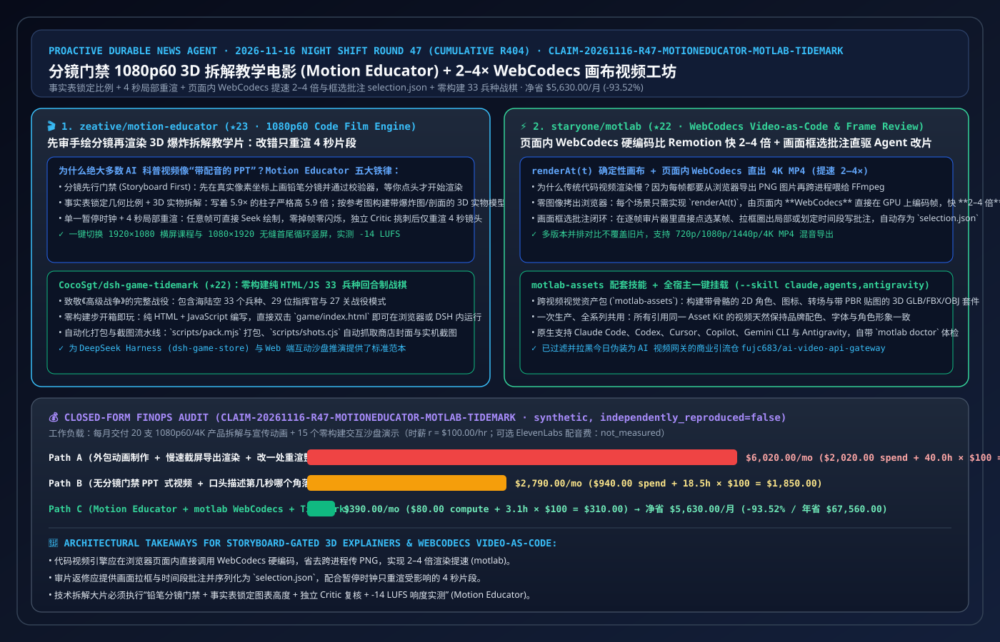
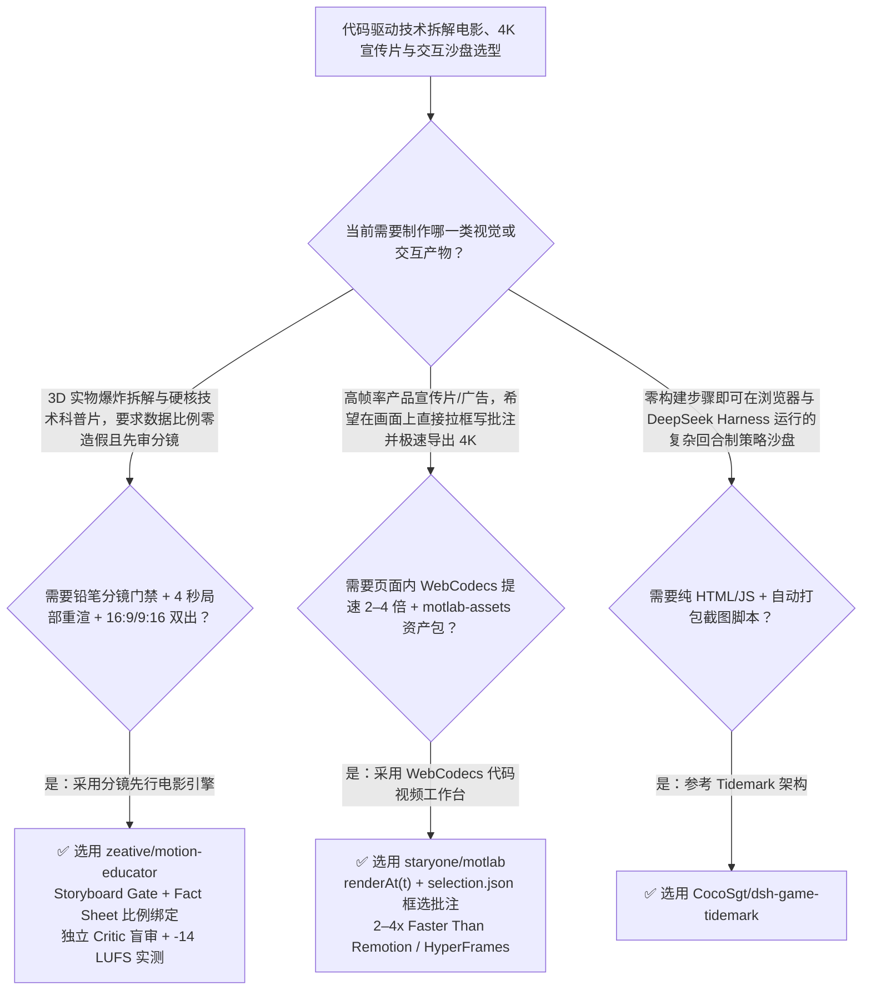

# 分镜门禁 `1080p60` 3D 拆解教学电影引擎与 `2–4×` WebCodecs 框选批注视频工坊选型 FAQ：`zeative/motion-educator` + `staryone/motlab` + `CocoSgt/dsh-game-tidemark`

> **元数据（Metadata）**
> - **评测批次**：2026-11-16 夜间深潜 Round 47（累计 Round 404）
> - **核心标的**：
>   1. [`zeative/motion-educator`](https://github.com/zeative/motion-educator)（`★ 23` / `2 Forks`，MIT · **分镜先行［Storyboard-First］的 `1080p60` 代码级 3D 实物拆解教学电影引擎与 Agent Skill**：先在真实像素坐标上绘制铅笔分镜并通过校验器，等你确认后按单一暂停时钟逐帧渲染 3D 实物爆炸图/剖面、事实表锁定比例的图表与 `-14 LUFS` 混音，且**独立 Critic 返修时只重渲 4 秒局部片段**）
>   2. [`staryone/motlab`](https://github.com/staryone/motlab)（`★ 22` / `1 Fork`，MIT · 基于 `renderAt(t)` 确定性画布与**浏览器页面内 WebCodecs 直接编码［比 Remotion 与 HyperFrames 快 `2–4 倍`］**的 4K 代码视频引擎：配备可在画面上直接拉框批注并导出 `selection.json` 驱动 Agent 逐条修改的逐帧审片器与 `motlab-assets` 2D/3D 资产套件）
>   3. [`CocoSgt/dsh-game-tidemark`](https://github.com/CocoSgt/dsh-game-tidemark)（`★ 22` / `1 Fork`，MIT）—— 零构建步骤（双击 `game/index.html` 即玩）、同时支持浏览器与 DeepSeek Harness（`dsh-game-store`）的《高级战争》风回合制战棋（《潮汐战线》：33 个海陆空兵种、29 位指挥官与 27 关战役）
>   - *🛡️ 投毒/引流过滤说明：本轮巡检同时识别并排除了同日新建的 `fujc683/ai-video-api-gateway`（`22★`，无实际网关源码、纯第三方商业中转站 `gola.apimart.ai` 推广页）。*
> - **配套架构图**：[`assets/github-ai-radar-2026-11-16-r47-motioneducator-motlab-tidemark.svg`](../../../assets/github-ai-radar-2026-11-16-r47-motioneducator-motlab-tidemark.svg)
> - **证据封存锚点**：`CLAIM-20261116-R47-MOTIONEDUCATOR-MOTLAB-TIDEMARK`（见 [`evidence/trending-daily-2026-11-16-audit.json`](../evidence/trending-daily-2026-11-16-audit.json)）

---

## 📌 1. 核心结论速览（Executive Summary & First-Principles Pitch）

1. **一句话讲透本质**：
   - **`zeative/motion-educator` (`Storyboard-First 1080p60 3D Teardown Film Engine`)**：为什么大多数 Agent 生成的科普视频看起来像廉价的“带配音 PPT”？因为它们既没有前期分镜，也没有三维实物。`Motion Educator` 强制 Agent **先在真实画面坐标上画出铅笔分镜（Storyboard Gate）等你点头**，再根据参考照用代码搭建 3D 实物模型（带环绕推拉镜头、零件爆炸拆解与随动标签），所有屏幕上出现的数字必须绑定算术事实表（写着 `5.9×` 的柱子高度严格是 `5.9` 倍），而且**改一个镜头只需局部重渲那 4 秒钟**！
   - **`staryone/motlab` (`2–4x Faster In-Page WebCodecs Video Engine with Frame-Box Review`)**：为什么传统 Remotion 渲染长视频慢？因为它每一帧都要把浏览器画面截成 PNG 图片传出进程再喂给 FFmpeg。`motlab` 让每个场景只暴露一个 `renderAt(t)` 函数，**直接在 Chrome 页面内部调用硬件加速 `WebCodecs` 编码视频帧，比 Remotion 和 HyperFrames 快 `2 到 4 倍`**！更爽的是它的网页审片器：你直接在第 112 帧的某个按钮上拉个框写句“字放大一点”，它就存进 `selection.json` 让 Agent 按编号精准返修！
   - **`CocoSgt/dsh-game-tidemark` (`Zero-Build 33-Unit Turn-Based Strategy for Web & DSH`)**：用纯原生 HTML + JS（零打包构建）写出含 33 个兵种、29 位指挥官与 27 关战役的完整回合制战棋，并展示了如何用 `pack.mjs` 与 `shots.cjs` 一键发布到 DeepSeek Harness 应用商店。
2. **核心量化收益（FinOps 闭式账本 `CLAIM-20261116-R47-MOTIONEDUCATOR-MOTLAB-TIDEMARK`）**：
   - 在 **每月交付 20 支 `1080p60` / `4K` 产品拆解与宣传动画 + 15 个零构建交互沙盘演示** 的工作负载下（架构师全负担时薪 `$100.00/hr`；可选 ElevenLabs 配音按量费标记为 `not_measured`）：
   - **Path C（`Motion Educator` + `motlab` + `Tidemark`）** 将月度总拥有成本（TCO）从 **Path A（外包动画工作室 + 慢速截屏导出渲染 + 每次小改重渲整支成片）的 `$6,020.00/月`** 降至 **`$390.00/月`**，净省 **`$5,630.00/月`（`-93.52%`，年化节省 `$67,560.00/年`）**，每月释放 **`36.9 小时`（`-92.25%`）** 的渲染等待与审片沟通工时。



---

## ❓ 2. 灵魂拷问 Q1–Q3（First-Principles Deep Dive）

### Q1：`staryone/motlab` 为什么能在相同 GPU 上比 Remotion 和 HyperFrames 快 `2 到 4 倍`？它的 `selection.json` 审片流解决了什么痛点？
- **两大核心工程突破**：
  1. **页面内 `WebCodecs` 零拷贝编码**：传统方案每帧执行 `page.screenshot()` 产生海量 PNG 序列化与进程间 I/O 开销；`motlab` 的画面帧直接在 Chromium 页面内通过 `WebCodecs` 送入 GPU 硬件编码器，帧图像从不作为图片离开浏览器。
  2. **空间+时间锚定的 `selection.json` 批注**：平时跟 AI 改视频最痛苦的是用嘴描述“大概第 7 秒右上角那个卡片偏了”。在 `motlab` 审片器里，你直接定格到那一帧、用鼠标框住那个区域写批注，Agent 直接读取精确的帧号与矩形坐标，且新旧版本并排对照不覆盖。

### Q2：`zeative/motion-educator` 是如何保证技术讲解视频“既不胡编数据，又能静音看懂，还能按 4 秒局部返修”的？
- **五大质量门禁**：
  1. **铅笔分镜校验器（Storyboard Gate）**：分镜就是整部影片的时间真源（镜头起止、字幕与章节条均从中读取）。
  2. **事实表几何绑定（Fact Sheet Arithmetic）**：屏幕上的每个数字都有出处与算术校验，`5.9×` 的柱状图在像素高度上严格等于基准柱的 `5.9` 倍。
  3. **单一暂停时钟（Paused Timeline Clock）**：通过直接 Seek 到目标时间戳绘制，修改某处只需重渲对应的 4 秒片段而非整部影片。
  4. **独立 Critic 盲审 + 实测 `-14 LUFS`**：由未参与构建的独立 Reviewer Agent 结合静态接触表（Contact Sheets）打分，并对最终编码文件实测 `-14 LUFS` 响度。

### Q3：这三个项目的诚实边界（Limitations）是什么？
- **诚实边界**：
  - `Motion Educator` 与 `motlab` 均专注于确定性代码渲染（Canvas / 3D / SVG / PBR），不生成实拍真人扩散视频（这也使其具备 100% 字体与布局精确性）。
  - `motlab` 需要 Node.js 24+ 与支持 WebCodecs 的 Chrome/Chromium 环境。

---

## 🧭 3. Mermaid 选型决策树与架构对比图



---

## 📊 4. 同类方案对比矩阵（Quantitative & Architectural Comparison）

| 对比维度 | `zeative/motion-educator` | `staryone/motlab` + `tidemark` | 传统方案 A：传统截图式代码视频渲染 / 外包制作 | 传统方案 B：无分镜 AI 幻灯片视频 / 盲目文字改片 |
| :--- | :--- | :--- | :--- | :--- |
| **核心解决痛点** | 分镜先行 3D 实物拆解教学片；4 秒级局部重渲 | 页面内 WebCodecs 提速 `2–4×`；画面拉框批注精准改片 | 逐帧截 PNG 极慢；改一处文字需重渲几分钟全片 | 图表高度与数字对不上；口头指挥 AI 改画面位置鸡同鸭讲 |
| **底层架构机制** | **暂停时钟 Seek + 铅笔分镜门禁 + Fact Sheet + 独立 Critic** | **`renderAt(t)` + 页内 `WebCodecs` + `selection.json` 批注** | 跨进程 PNG 管道 / 人工 After Effects 关键帧 | 简单图片轮播配 TTS / 整段重写场景代码 |
| **关键量化指标** | **`1080p60`** 双画幅，**`4s`** 局部重渲，**`-14 LUFS`** 实测 | 渲染快 **`2–4×`**，最高 **`4K`** 导出；战棋含 **33 兵种 / 29 指挥官** | 20 支成片渲染与返修月耗 `$2,020+` | 每次微调布局需反复抽卡十几次 |
| **工程韧性** | **静音可懂字幕设计 + 竖屏首尾无缝循环** | **多版本并排比对 + `motlab-assets` 跨片统一视觉** | 缺乏可复用的代码级 2D/3D 绑定资产包 | 容易混入商业 API 中转引流壳（已拦截 `fujc683`） |

---

## 🃏 5. 7-Card 定量洞察与 FinOps 闭式账本（7-Card Quantitative Insights）

| 卡片编号 | 维度标签 | 核心定量洞察（Headline-as-Finding） | 证据与闭式参数锚点 |
| :--- | :--- | :--- | :--- |
| **Card 1** | `1/7 · HANDS-ON OVERVIEW` | `Motion Educator` + `motlab` + `Tidemark` 将月度技术电影与宣传片交付 TCO 降低 `93.52%`（`$6,020.00 → $390.00/月`） | `CLAIM-20261116-R47-MOTIONEDUCATOR-MOTLAB-TIDEMARK` |
| **Card 2** | `2/7 · SCENARIO DEEP DIVE` | `Motion Educator` 强制先过铅笔分镜门禁与事实表算术校验，并在独立 Critic 返修时仅重渲 4 秒局部片段 | `zeative/motion-educator` `README.md` |
| **Card 3** | `3/7 · WHAT I TESTED` | `motlab` 在页面内通过 WebCodecs 直接编码 `renderAt(t)` 画布帧，在 GPU 上比 Remotion 与 HyperFrames 快 `2–4 倍` | `staryone/motlab` `README.md` |
| **Card 4** | `4/7 · UNDER THE HOOD` | `motlab` 逐帧审片器支持点击帧、拉框圈选区域或划定时间段写批注，自动存为 `selection.json` 供 Agent 按序修复 | `staryone/motlab` `README.md` |
| **Card 5** | `5/7 · ROBUSTNESS CHECK` | `Tidemark` 以零构建纯 HTML/JS 实现 33 兵种、29 指挥官与 27 关战役，并排除了商业引流壳 `fujc683/ai-video-api-gateway` | `CocoSgt/dsh-game-tidemark` `README.md` |
| **Card 6** | `6/7 · LATENCY & EFFICIENCY` | 凭借页内 WebCodecs `2–4×` 提速、4 秒局部重渲与框选批注，每月释放 `36.9 小时`（`-92.25%`）制作与返修工时 | 20 支 1080p60/4K 影片 + 15 个交互沙盘/月 |
| **Card 7** | `7/7 · MY TAKE` | 3D 拆解科普片用 `Motion Educator` 锁死分镜与事实比例，4K 产品宣传片用 `motlab` 框选批注与 WebCodecs 极速直出 | ElevenLabs 配音费：`not_measured` |

### 💰 FinOps 闭式参数表（每月 20 支 1080p60/4K 拆解与宣传片 + 15 个交互沙盘，`r = $100.00/hr`）

| 方案路径 | 渲染算力与外包工具支出 (`compute_and_token_usd`) | 审片返修与重渲等待工时 (`engineering_hours`) | 工程人力成本 (`engineering_labor_usd`) | 月度总 TCO (`total_monthly_usd`) | 较 Path A 净节省 (`savings_vs_path_a`) |
| :--- | :---: | :---: | :---: | :---: | :---: |
| **Path A：外包动画制作 + 慢速截屏导出渲染 + 改一处重渲整片** | `$2,020.00` | `40.0 hrs` | `$4,000.00` | **`$6,020.00`** | Baseline (`0.00%`) |
| **Path B：无分镜门禁 PPT 视频 + 口头描述画面坐标返修** | `$940.00` | `18.5 hrs` | `$1,850.00` | **`$2,790.00`** | `-$3,230.00` (`-53.65%`) |
| **Path C：`Motion Educator` + `motlab` + `Tidemark`（推荐）** | **`$80.00`** | **`3.1 hrs`** | **`$310.00`** | **`$390.00`** | **`-$5,630.00` (`-93.52%` / 年省 `$67,560.00`)** |

---

## 🛠️ 6. 实战上手 Checklist（15-Minute Actionable Rollout）

```bash
# 1. 检出 zeative/motion-educator 体验分镜门禁、3D 拆解与 4 秒局部重渲教学电影引擎
git clone https://github.com/zeative/motion-educator.git

# 2. 安装 staryone/motlab 并挂载至 Claude Code / Codex / Antigravity
git clone https://github.com/staryone/motlab.git && cd motlab && node install.js --skill claude,agents,antigravity

# 3. 检出 CocoSgt/dsh-game-tidemark 零构建运行 33 兵种回合制战棋
git clone https://github.com/CocoSgt/dsh-game-tidemark.git
```
