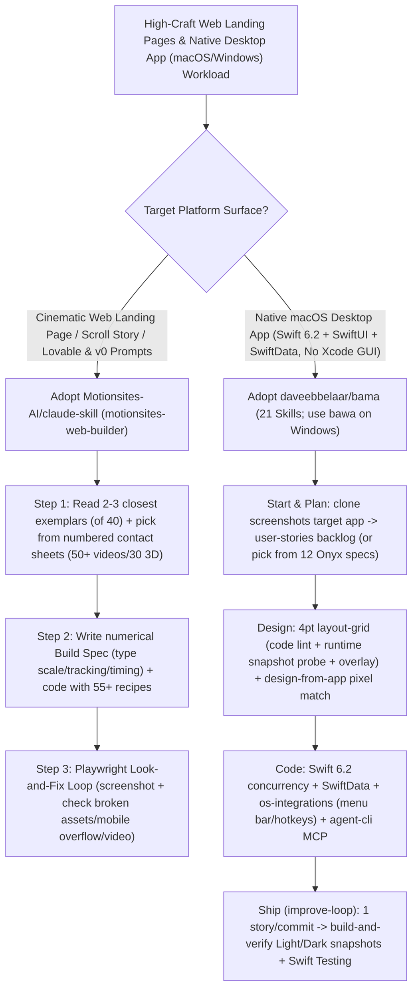

# Cinematic Web Self-Screenshotting Skills (`Motionsites-AI/claude-skill` 55+ Recipes) & 21-Skill No-Xcode-GUI Native Mac Factory (`daveebbelaar/bama`) Selection FAQ

> **Positioning**: This standalone guide is **Round 35 of the 2026-11-11 Night Shift (Cumulative Guide #80)**, written in the plain-language, first-principles, closed-form FinOps style of `ib-vs-ethernet-roce-selection-faq.md` for Frontend Design-System and Native Desktop Application Solution Architects evaluating two high-velocity (`3,700+★` combined) visual Look-and-Fix Agent Skills repositories:
> 1. **`Motionsites-AI/claude-skill` (`motionsites-web-builder`, `1,996★`, Python, MIT)**: Eliminates generic "AI purple-gradient template layouts" by pairing **40 top-liked exemplar briefs, a numbered contact-sheet media shelf (`50+` cinematic hero videos, `30` transparent 3D cut-outs, `29` stills), and 55+ working motion recipes** (liquid glass, mouse-scrubbed video, word-blur headlines, Three.js 3D) with an automated **Playwright Look-and-Fix Loop (screenshot + QA script + scoring rubric)**;
> 2. **`daveebbelaar/bama` (BAMA: Build Any Mac App, `1,767★`, Swift 6.2 / macOS 26+, MIT, alongside Windows `daveebbelaar/bawa`)**: A 5-stage, **21-skill native macOS factory (`Start → Plan → Code → Design → Ship`)** that builds Swift 6.2 + SwiftUI + SwiftData apps with **zero Xcode GUI**, enforcing a **3-tier `4 pt` grid gate (`layout-grid`)**, pixel-by-pixel reference cloning (`clone` + `design-from-app`), **per-commit Light & Dark mode snapshot verification (`build-and-verify`)**, and an embedded **`agent-cli` MCP server**.
>
> **中文版 FAQ**: [motionsites-bama-cinematic-web-native-mac-app-skills-selection-faq.md](motionsites-bama-cinematic-web-native-mac-app-skills-selection-faq.md) · **Architecture Summary SVG**: [`assets/github-ai-radar-2026-11-11-r35-motionsites-bama.svg`](../../../assets/github-ai-radar-2026-11-11-r35-motionsites-bama.svg)

---

## 📌 1. Executive Summary

1. **In plain English, what problems do these two repositories actually solve?**
   - **Ending Generic "AI-Built" Web Layouts, Placeholder Boxes & Unseen Mobile Overflow (`Motionsites-AI/claude-skill`)**: AI-generated landing pages look identical because the model codes from a vague plan, lacks real hero videos or 3D assets, and never visually inspects the rendered DOM. `motionsites-web-builder` forces the agent to study the closest 2–3 exemplars from 40 top-voted MotionSites designs, pick hosted hero videos (`50+`) and 3D cut-outs (`30`) visually from numbered contact sheets, write a numerical build spec (exact type scale, tracking, spacing, and motion timing), apply **55+ working recipes**, and then **screenshot its own rendered page via Playwright to fix broken assets, mobile overflow, font failures, and dead video playback** against a scoring rubric.
   - **Building Native Swift 6.2 macOS Apps Without Xcode GUI Traps or Off-Grid Layouts (`daveebbelaar/bama`)**: Coding agents struggle with native macOS apps when forced through `.xcodeproj` files, unaligned SwiftUI padding, and untested dark mode states. `BAMA` orchestrates **21 composable skills** over a pure Swift Package architecture (`new-mac-app` + 12 full app specs like `window-snapper.md` from Onyx): `clone` screenshots every screen of a reference app -> `user-stories` writes milestone acceptance criteria -> `layout-grid` enforces a strict **`4 pt` grid** via static lint, runtime layout probe, and visual overlay -> `improve-loop` commits one story at a time only after **`build-and-verify` snapshots every page in both Light and Dark mode and runs `Swift Testing`**!
2. **Closed-Form FinOps Verdict (`CLAIM-20261111-R35-MOTIONSITES-BAMA`)**:
   - For a 12-person Product Studio & Native App Engineering Team shipping **25 cinematic product launch landing pages** and **8 native macOS/Windows desktop utilities per month** (senior frontend/macOS engineer loaded rate `$90.00/hr`; Apple Developer notarization fees and custom domain hosting: `not_measured`):
   - Upgrading from **Path A (Vague-prompt AI layouts requiring manual redesign + manual Xcode GUI wrangling and Light/Dark QA, `$6,000.00/mo`)** to **Path C (`motionsites-web-builder` 55-recipe spec & Playwright look-and-fix loop + `BAMA` 21-skill Swift 6.2 factory & `4 pt` grid snapshot gate, `$820.00/mo`)** saves **`$5,180.00/mo` (`-86.33%`, `$62,160.00/yr`)** and cuts frontend and native UI rework labor from `48.0 hrs/mo` to `6.0 hrs/mo` (**`-87.50%`**).

---

## 🎯 2. Three Core Architectural Questions (Q1 / Q2 / Q3 Deep-Dive)

### Q1: How does `Motionsites-AI/claude-skill` combine numbered contact sheets, numerical taste rules, and a Playwright Look-and-Fix loop to produce gallery-grade web pages?
- **First-Principles Breakdown**:
  1. **Numbered Contact-Sheet Media Shelf & Numerical Spec Template**:
     - Instead of inventing broken stock URLs, the agent inspects numbered contact sheets covering **50+ hosted hero videos, 30 transparent 3D cut-outs, and 29 high-res stills**, reads the 2–3 closest exemplar prompts out of 40 curated designs, and writes a concrete build spec defining exact type scales, letter tracking, spacing tokens, and easing curves before writing code.
  2. **55+ Motion Recipes & Multi-Platform Prompt Mode**:
     - Ships working implementations for seamless video loops, liquid glass, word-by-word blur headlines, mouse-scrubbed video, spotlight reveals, depth carousels, scroll stories, and Three.js 3D models—plus a **Prompt Mode** that outputs tuned prompts for Lovable, Bolt, v0, Cursor, Manus, Google AI Studio, or Kimi.
  3. **Playwright Look-and-Fix Loop**:
     - Launches headless Chromium to screenshot desktop and mobile viewports, running automated checks for broken media, mobile horizontal overflow, font loading, and video playback against a quantitative rubric.

### Q2: How do `daveebbelaar/bama`'s 21 skills take a native macOS app from screenshot cloning to Dock installation without ever opening the Xcode GUI?
- **First-Principles Breakdown**:
  1. **App Cloning (`clone` + `design-from-app`) & 12 Ready-to-Build Onyx Specs**:
     - Inspired by `morluto/rea`, `clone` uses computer-use or browser automation to screenshot every screen of a target app and generate a screen index; `design-from-app` measures dimensions, typography, and colors and iterates with pixel-by-pixel comparison until matched (or starts from one of 12 included `specs/*.md` blueprints).
  2. **Three-Tier `4 pt` Grid Enforcement (`layout-grid`) & Liquid Glass Icon Composer (`app-icon`)**:
     - Prevents off-grid SwiftUI spacing via three automated checks: a code lint, a runtime layout probe executed in snapshot mode, and a visual grid overlay, while `app-icon` generates macOS 26 Liquid Glass icons verified across all system appearances.
  3. **One-Story-Per-Commit Light/Dark Snapshot Loop (`build-and-verify`) & Embedded `agent-cli` MCP**:
     - `improve-loop` works through the `user-stories` backlog one story per commit: before every commit, `build-and-verify` snapshots every screen in both Light and Dark mode and runs `Swift Testing` + in-app self-tests (`test-mac-app`). Adding `agent-cli` equips the finished Mac app with its own CLI and MCP server so external agents can drive it!

### Q3: How should Solution Architects combine `motionsites-web-builder` and `BAMA` (plus Windows `BAWA`) in product engineering teams?
- **Deployment Blueprint**:
  - Use **`Motionsites-AI/claude-skill`** (with `playwright` Chromium installed) to build the product's cinematic marketing site, interactive scroll explainers, and waitlist pages.
  - Use **`daveebbelaar/bama`** (and **`daveebbelaar/bawa`** on Windows) to build the product's native desktop client (`Swift 6.2` + `SwiftData` + `os-integrations` global hotkeys, menu bar, floating panels, and `agent-cli` MCP server).

---

## 🧭 3. Mermaid Decision Tree & Visual Self-Verification Pipeline

---

## 📊 4. Architectural Comparison Matrix

| Evaluation Dimension | Path A: Vague Prompt Web + Manual Xcode GUI | Path B: Static UI Kits (No Visual Look-and-Fix Loop) | **Path C (Recommended): `MotionSites` + `BAMA` 21-Skill** |
| :--- | :--- | :--- | :--- |
| **Web Visual Craft & Media Richness** | Generic purple-gradient AI layouts; empty gray placeholders | Clean but repetitive components; lacks 3D/video scroll recipes | **Contact-sheet selection (50+ videos, 30 3D cut-outs) + 55+ motion recipes** |
| **Automated Post-Render Web QA** | Blind HTML output; mobile overflow and dead videos ship unnoticed | TypeScript/lint checks only; blind to rendered layout bugs | **Playwright screenshot + QA script (assets, overflow, fonts, video) + rubric** |
| **Native Mac Build & Grid Precision** | Brittle `.xcodeproj` merges; arbitrary off-grid SwiftUI padding | Code snippets without runtime `4 pt` layout probes | **Zero-Xcode-GUI Swift Package + 3-tier `4 pt` grid probe + pixel-match** |
| **Desktop App Verification & Agent CLI** | Manual window clicking in Light/Dark mode; no agent control hook | Basic unit tests only; no automated per-page visual snapshots | **Per-commit Light/Dark full-page snapshots + embedded `agent-cli` MCP** |
| **Monthly TCO (25 Pages + 8 Apps)** | **`$6,000.00 / mo`** (`$1,680` assets/re-gen + `$4,320` labor) | **`$3,150.00 / mo`** (`$810` compute + `$2,340` labor) | **`$820.00 / mo` (Saves `$5,180.00/mo` · `-86.33%`)** |

---

## 🧪 5. Closed-Form FinOps Example & 7-Card Insights (`CLAIM-20261111-R35-MOTIONSITES-BAMA`)

### 5.1 Workload & Scope Boundary
- **Workload**: A 12-person Product & Design Engineering Studio delivering **25 cinematic product landing pages** and building/iterating **8 native macOS/Windows desktop utilities per month**.
- **Rates**: Senior frontend/macOS engineer loaded rate at **`$90.00 / hr`**.
- **Explicit Scope Boundary**: Apple Developer Program notarization membership fees and custom domain CDN hosting are marked **`not_measured`**.

### 5.2 Closed-Form Monthly Cost Breakdown

| Cost Component | Path A: Vague AI Layouts + Manual Xcode & Visual QA | Path B: Static UI Kits (No Self-Screenshot Loop) | **Path C: `MotionSites` + `BAMA` (Recommended)** |
| :--- | :--- | :--- | :--- |
| **Stock Video/3D Assets & Re-Gen Token Spend** | **`$1,680.00`** | **`$810.00`** | **`$280.00`** (Bundled media shelf + spec-first build) |
| **UI Redesign, Mobile Overflow & Light/Dark QA (`$90/hr`)** | `48.0 hrs × $90.00` = **`$4,320.00`** | `26.0 hrs × $90.00` = **`$2,340.00`** | `6.0 hrs × $90.00` = **`$540.00`** |
| **Total Monthly TCO** | **`$6,000.00 / mo`** | **`$3,150.00 / mo`** (`-47.50%`) | **`$820.00 / mo`** |
| **Net Savings vs. Path A** | Baseline | Saves `$2,850.00 / mo` | **Saves `$5,180.00 / mo` (`-86.33%` · `$62,160.00/yr`)** |
| **Apple Developer Fees & Domain Hosting** | `not_measured` | `not_measured` | `not_measured` |

---

## 🛠️ 6. Production Verification Checklist

- [ ] **1. `motionsites-web-builder` & Playwright Chromium Setup**: Install via `/plugin marketplace add Motionsites-AI/claude-skill` and `/plugin install motionsites-web-builder@motionsites`, then run `pip install playwright && python -m playwright install chromium` so the Look-and-Fix screenshot loop is active.
- [ ] **2. Contact-Sheet Selection & Pre-Code Spec Gate**: Verify that the agent selects media from the numbered contact sheets and writes a complete numerical spec (type scale, tracking, spacing, motion timing) before generating page code.
- [ ] **3. Single-Route `BAMA` Installation**: Install `daveebbelaar/bama` via **one** route per agent (`/plugin install bama@bama` in Claude Code, `codex plugin add bama@bama` in Codex, or `npx skills@latest add daveebbelaar/bama -a <agent>`) so the 21 skills are not registered twice.
- [ ] **4. `4 pt` `layout-grid` Probe & Per-Commit Light/Dark Snapshots**: Enforce `layout-grid` (static lint + snapshot layout probe) and `build-and-verify` (Light and Dark mode page snapshots + `Swift Testing`) before every milestone commit.
- [ ] **5. Embedded `agent-cli` MCP & CLI `Instruments` Profiling**: Enable the `agent-cli` skill on desktop utilities that coding agents should drive over MCP, and run the `performance` skill's command-line `Instruments` profile before release.
