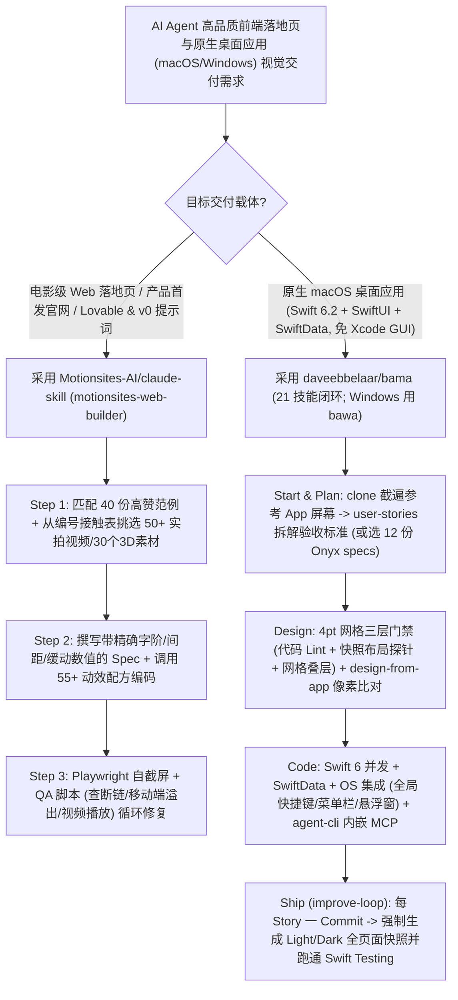

# 电影级网页自截屏修复技能（`Motionsites-AI/claude-skill` 55+ 动效配方）与免 Xcode GUI 原生 Mac 应用工厂（`daveebbelaar/bama` 21 技能闭环）选型 FAQ

> **文档定位**：本文是 **2026-11-11 夜班多轮深潜 Round 35（累计第 80 篇独立选型专题）**，严格对标 `ib-vs-ethernet-roce-selection-faq.md` 的「通俗大白话 + 第一性原理 + 可核算定量算例」标杆文风，为前端/设计系统与 Apple 原生桌面应用架构师深度拆解今日两款均突破 `1,750★` 的视觉闭环自检（Look-and-Fix）技能标杆：
> 1. **`Motionsites-AI/claude-skill`（`motionsites-web-builder`，`1,996★`，Python，MIT）**：终结“一眼假 AI 紫渐变模板网站”的电影级网页构建 Skill——内置 **40 份高赞范例 Spec、编号接触表媒体架（50+ 实拍英雄区循环视频、30 个透明 3D 抠图、29 张高清大图）、55+ 可运行动效配方（液态玻璃、鼠标搓盘视频、逐词模糊标题、Three.js 3D）**，以及基于 Playwright 的 **「自截屏 + 移动端溢出/死链/视频播放 QA + 量表打分修复循环」**；
> 2. **`daveebbelaar/bama`（BAMA: Build Any Mac App，`1,767★`，Swift 6.2 / macOS 26+，MIT，含 Windows 姊妹篇 `bawa`）**：无需打开 Xcode GUI，将任意参考应用或创意通过 **5 大阶段 21 个技能（`Clone → Plan → Code → Design → Ship`）** 转化为原生 Swift 6.2 + SwiftUI + SwiftData 桌面应用——独创 **`4 pt` 网格三层硬门禁（静态 Lint + 快照模式运行时布局探针 + 视觉网格叠层）**、每 Commit 强制跑通的 **亮/暗双模式全页面自动快照核验**，以及为编译出的 Mac 应用直接内嵌 **`agent-cli` 与 MCP Server**。
>
> **English Companion**: [motionsites-bama-cinematic-web-native-mac-app-skills-selection-faq.en.md](motionsites-bama-cinematic-web-native-mac-app-skills-selection-faq.en.md) · **架构总结图**: [`assets/github-ai-radar-2026-11-11-r35-motionsites-bama.svg`](../../../assets/github-ai-radar-2026-11-11-r35-motionsites-bama.svg)

---

## 📌 一、核心结论速览（Executive Summary）

1. **先用大白话讲透这两个项目到底解决了什么痛点？**
   - **让大模型写网站“千篇一律全是廉价 AI 模板味、放一堆灰框占位图、手机端文字溢出自己却看不见”的痛点（`Motionsites-AI/claude-skill` 解决的问题）**：为什么平时让 Claude、v0 或 Cursor 写出来的落地页一眼就能看出是 AI 做的？原因只有三个：① 没写代码前缺乏带精确数字（字阶、字距 Tracking、留白间距、缓动时长）的设计规格书；② 没有真正的电影级视频和透明 3D 素材可用；③ 写完 HTML/CSS 后模型根本没睁眼看过渲染出来的页面长什么样！`motionsites-web-builder` 把这三件事一次性补齐：先对标 40 个最受欢迎的真实案例写出精确 Spec，从**带编号的接触表媒体架（Media Shelf：50+ 托管英雄区视频、30 个透明 3D 切片、29 张静帧）**里用“眼睛”挑出匹配素材，调用 **55+ 个经过验证的高级动效配方**（如 Liquid Glass 液态玻璃、鼠标滚动搓视频帧、Three.js 3D 模型）完成编码，最后启动 **Playwright 自截屏与 QA 脚本**（自动抓出破损资源、移动端横向溢出、字体未加载与视频未播放），对照评分量表自我迭代直到达到设计画廊水准！
   - **让 Coding Agent 写原生 macOS 应用“死在复杂的 `.xcodeproj` 工程文件、控件没对齐 4pt 网格、暗黑模式配色翻车、做完的 App 无法被自动化测试”的痛点（`daveebbelaar/bama` 解决的问题）**：在 Mac 上写原生 Swift/SwiftUI 应用，传统流程强依赖人工打开笨重的 Xcode GUI 点选配置。`BAMA`（及 Windows 版 `BAWA`）提供了 21 个环环相扣的技能与 12 份拆解自商业菜单栏应用 Onyx 的完整规格书（`specs/window-snapper.md` 等）：全程采用纯 Swift Package Manager（零 Xcode GUI 操心），先用 `clone` 自动截遍目标参考 App 的所有界面生成索引 → `user-stories` 拆成带验收标准的里程碑 → `layout-grid` 用**代码 Lint + 运行时布局探针（Layout Probe）+ 网格叠层**强制卡死 **`4 pt` 像素网格对齐** → 每完成一个 Story 提交 Git 前，必须由 `build-and-verify` **在亮色（Light）和暗色（Dark）模式下把每个页面自动快照截屏并自检**，甚至还能用 `agent-cli` 给做出来的 Mac App 内置一套 CLI 与 MCP Server，让 Agent 直接驱动它自己写出来的桌面软件！
2. **闭式 FinOps 核算结论（`CLAIM-20261111-R35-MOTIONSITES-BAMA`）**：
   - 在 **12 人创新产品工作室每月交付 25 个电影级产品发布落地页 + 研发迭代 8 款原生 macOS/Windows 桌面效率工具** 基准下（高级前端/macOS 工程师全包时薪 `$90.00/hr`；Apple 开发者公证年费与自定义域名托管：`not_measured`）：
   - 从 **Path A（生成廉价 AI 网页后人工推倒重做 + 手工折腾 Xcode GUI 与人工逐页测亮暗模式/像素对齐，`$6,000.00/月`）** 升级至 **Path C（`motionsites-web-builder` 55 配方与 Playwright 视觉自检 + `BAMA` 21 技能免 Xcode 工厂与 `4 pt` 快照探针，`$820.00/月`）**，每月净省 **`$5,180.00/月`（降幅 `-86.33%`，年化节省 `$62,160.00/年`）**，UI 返工与手工截图验收工时从 `48.0 小时/月` 降至 `6.0 小时/月`（**节省 `87.50%`**）。

---

## 🎯 二、三大灵魂拷问（Q1 / Q2 / Q3 Deep-Dive）

### Q1：`Motionsites-AI/claude-skill` 是如何通过「接触表选媒 + 数字化审美法则 + Playwright Look-and-Fix 循环」彻底消灭“AI 塑料感网页”的？
- **第一性原理拆解**：
  1. **编号接触表媒体架（Numbered Contact-Sheet Media Shelf）与前置 Spec 模板**：
     - 纯文本提示词写不出好页面，因为设计必须围绕真实的核心视觉素材展开。该 Skill 内置了托管在公网 CDN 上的 **50+ 条无缝循环视频、30 个透明通道 3D 渲染件和 29 张摄影大图**，并预先拼成了带编号的缩略接触表（Contact Sheets）——Claude 先看缩略图挑中最佳视频/3D 素材，读取最相近的 2～3 篇高赞范例，再按包含精确字号比例、字间距（Tracking）、留白与动效曲线数值的 **Spec Template** 锁死设计方案。
  2. **55+ 工业级动效配方与跨平台 Prompt Mode**：
     - 涵盖 Liquid Glass（液态毛玻璃）、逐词高斯模糊渐显标题、鼠标/滚动条驱动视频帧（Mouse-Scrubbed Video）、聚光灯遮罩揭示（Spotlight Reveals）、景深轮播与 Three.js 实时 3D；如果用户使用的是 Lovable、Bolt、v0、Cursor、Manus、Google AI Studio 或 Kimi，还可直接触发 **Prompt Mode** 输出专为目标平台调优的高精度生成提示词。
  3. **Playwright 视觉闭环自检（Look-and-Fix Loop）**：
     - 代码写完绝不算完：内置脚本自动拉起无头 Chromium 截取桌面与移动端视口，检测破损图片/视频 URL、移动端横向滚动条溢出（Overflow）、字体回退失败与视频自动播放状态，对照评分量表自动回炉修改。

### Q2：`daveebbelaar/bama` 的 21 个技能是如何实现“不打开一次 Xcode GUI，从参考 App 截图克隆到原生 Swift 6.2 交付”的？
- **第一性原理拆解**：
  1. **受 `morluto/rea` 启发的原生界面逆向克隆（`clone` + `design-from-app`）**：
     - `clone` 技能通过 Computer-Use 或浏览器遍历目标参考应用的所有界面并建立屏幕索引（Screen Index）；`design-from-app` 进一步从截图中精确测量控件尺寸、字号与色值，并在构建后通过**逐像素比对（Pixel-by-Pixel Comparison）**迭代至视觉完全吻合。
  2. **三层 `4 pt` 网格对齐硬门禁（`layout-grid`）与 Liquid Glass 图标合成（`app-icon`）**：
     - 大模型手写 SwiftUI 经常出现间距 `7pt` 或 `13pt` 的歪斜布局。`layout-grid` 同时部署三道防线：① 静态代码 Lint 拦截非 `4 pt` 倍数间距；② 在应用内置的 **Snapshot Mode（快照模式）** 下注入运行时布局探针（Layout Probe）自动断言所有视图边界坐标；③ 渲染可视化 `4 pt` 网格叠层供视觉复核；而 `app-icon` 则直接以代码生成 macOS 26 **Icon Composer** 格式的 Liquid Glass 图标并在亮/暗/着色全外观下自动核验。
  3. **一 Story 一 Commit 的亮暗双模快照门禁（`improve-loop` + `build-and-verify`）与内嵌 `agent-cli`**：
     - `new-mac-app` 创建的纯 Swift Package 模板自带命令行编译脚本、快照模式与 Swift Testing 自测桥（`test-mac-app`）；`improve-loop` 按里程碑逐个完成 User Story，**每次 `git commit` 前强制将所有页面在 Light 与 Dark 模式下全部导出快照图片并自检**；更妙的是，`agent-cli` 可为你的 Mac App 直接加上命令行与 MCP Server 接口，让外部 Agent 也能像调 API 一样操控你的桌面软件！

### Q3：架构师在团队中如何选型和组合使用这两套视觉工程 Skill？
- **选型建议**：
  - **对外营销官网、产品发布页、交互式技术演说页（Web / Lovable / Bolt / v0）**：挂载 **`Motionsites-AI/claude-skill`**（并安装 `playwright` 开启自截屏质检循环）；
  - **macOS 原生效率工具、菜单栏助手、AI 客户端壳开发**：安装 **`daveebbelaar/bama`**（Windows 端对应使用 **`daveebbelaar/bawa`**），直接从 `specs/` 下的 12 个 Onyx 拆解蓝图（如分屏器、剪贴板历史、启动器、录屏器）起步。

---

## 🧭 三、Mermaid 选型决策树与双端视觉自检（Look-and-Fix）流水线

---

## 📊 四、同类方案核心能力对比矩阵（Comparison Matrix）

| 评估维度 | Path A：裸写提示词生成网页 + 手工调 Xcode GUI | Path B：普通静态组件库（无视觉自截屏与网格探针） | **Path C（推荐标杆）：`MotionSites` + `BAMA` 21 技能** |
| :--- | :--- | :--- | :--- |
| **Web 页面视觉质感与媒体丰富度** | 典型 AI 紫渐变模板、空洞灰框占位图、无 3D/视频交互 | 组件规整但千篇一律，缺乏鼠标搓视频/液态玻璃等高级动效 | **接触表精选 50+ 实拍视频/30 个 3D 切片 + 55+ 获奖级动效配方** |
| **前端交付前视觉与移动端 QA** | 写完即交差，手机端横向溢出、字体失效全靠人工肉眼抓 | 仅做 TypeScript 类型检查，看不见真实 DOM 渲染溢出 | **Playwright 自动截屏 + 断链/移动端溢出/视频播放 QA 量表打分闭环** |
| **原生 Mac 应用构建与网格精度** | 被 `.xcodeproj` 配置文件卡死；间距随意歪斜，暗黑模式翻车 | 有 SwiftUI 代码片段，但无运行时 `4 pt` 坐标探针与像素对比 | **纯 Swift Package 免 Xcode GUI + `4 pt` 三层门禁 + 像素级克隆比对** |
| **原生应用可测试性与 Agent 驱动** | 必须人工点开窗口逐页测试，外部 Agent 无法操控生成的 App | 仅有基础单测，无自动全页面 Light/Dark 快照对比 | **每 Commit 自动生成 Light/Dark 全页快照 + `agent-cli` 内嵌 MCP** |
| **月度总拥有成本（25 网页+8 桌面端）** | **`$6,000.00 / 月`**（素材/重跑 `$1,680` + 人工 `$4,320`） | **`$3,150.00 / 月`**（算力 `$810` + 人工 `$2,340`） | **`$820.00 / 月`（净省 `$5,180.00/月`，降幅 `-86.33%`）** |

---

## 🧪 五、闭式定量 FinOps 算例与 7-Card 评测洞察（`CLAIM-20261111-R35-MOTIONSITES-BAMA`）

### 5.1 基准假设与边界声明
- **评测负载**：12 人创新产品与设计工程工作室每月交付 **25 个电影级高转化产品落地页**，并研发迭代 **8 款原生 macOS/Windows 桌面效率应用**。
- **单价基准**：高级前端/macOS 工程师全包时薪 **`$90.00 / hr`**。
- **显式边界声明（Scope Boundary）**：Apple Developer 官方公证年费（`$99/yr`）及生产环境自定义域名 CDN 托管费标记为 **`not_measured`**。

### 5.2 三路径闭式成本核算表

| 成本构成项 | Path A：裸提示词重做 + 手工调 Xcode 与肉眼 QA | Path B：静态组件库（无自截屏与 `4 pt` 探针） | **Path C：`MotionSites` + `BAMA` 视觉闭环（推荐）** |
| :--- | :--- | :--- | :--- |
| **商用视频/3D 素材与多轮重生成 Token** | **`$1,680.00`** | **`$810.00`** | **`$280.00`**（内置免费媒体架 + 前置 Spec 一次成型） |
| **UI 推倒重做、移动端溢出与亮暗模式 QA（`$90/hr`）** | `48.0 hrs × $90.00` = **`$4,320.00`** | `26.0 hrs × $90.00` = **`$2,340.00`** | `6.0 hrs × $90.00` = **`$540.00`** |
| **月度总成本（Monthly Total）** | **`$6,000.00 / 月`** | **`$3,150.00 / 月`**（`-47.50%`） | **`$820.00 / 月`** |
| **相对 Path A 净节省（Savings）** | 基准线（Baseline） | 节省 `$2,850.00 / 月` | **净省 `$5,180.00 / 月`（`-86.33%` · 年省 `$62,160.00`）** |
| **Apple 开发者公证费与域名托管** | `not_measured` | `not_measured` | `not_measured` |

---

## 🛠️ 六、生产级落地核验 Checklist（SA Actionable Verification）

- [ ] **1. `motionsites-web-builder` 与 Playwright 视觉回路安装**：通过 `/plugin marketplace add Motionsites-AI/claude-skill` 与 `/plugin install motionsites-web-builder@motionsites` 安装技能，并执行 `pip install playwright && python -m playwright install chromium` 激活 Look-and-Fix 自截屏质检循环。
- [ ] **2. 前置 Spec 模板与接触表选媒门禁**：在写任何前端代码前，强制核验 Agent 已参考 2～3 篇最接近的范例、从编号接触表选定了真实视频/3D 素材，并产出了带字号/间距/动效时长数值的 Spec。
- [ ] **3. `BAMA` 唯一渠道安装防重复告警**：在 Claude Code（`/plugin install bama@bama`）、Codex（`codex plugin add bama@bama`）或 `npx skills@latest add daveebbelaar/bama` 中**仅选择一种安装路径**（切勿混用两种方式导致 21 个技能重复注册两遍）。
- [ ] **4. `layout-grid` (`4 pt`) 与 Light/Dark 双模快照强制校验**：在每次里程碑 Story 提交前，运行 `build-and-verify` 与 `layout-grid` 探针，确保零 `4 pt` 网格偏移且所有页面的 Light 与 Dark 模式快照图片均通过视觉审查。
- [ ] **5. 原生应用 `agent-cli` MCP 与 Instruments 性能剖析**：对需要自动化联动的核心桌面工具启用 `agent-cli` 技能内嵌 CLI/MCP Server，并在发布前通过 `performance` 技能调用命令行 `Instruments` 排查主线程阻塞与 GPU 合成瓶颈。
