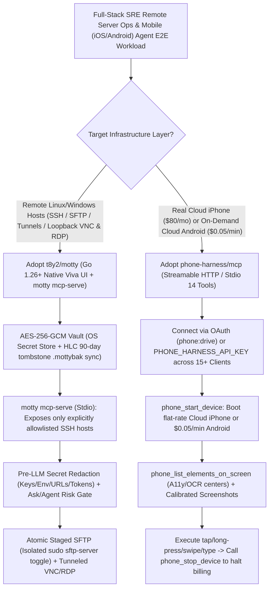

# Zero-WebView Native Go SSH/VNC Workbench (`t8y2/motty` Secret Redaction & `mcp-serve`) & Cloud iPhone/Android Bridge (`phone-harness/mcp`) Selection FAQ

> **Positioning**: This standalone guide is **Round 25 of the 2026-11-11 Night Shift (Cumulative Guide #70)**, written in the plain-language, first-principles, closed-form FinOps style of `ib-vs-ethernet-roce-selection-faq.md` for Full-Stack SRE and Mobile QA Solution Architects evaluating two high-velocity infrastructure and mobile MCP repositories:
> 1. **`t8y2/motty` (`945★`, Go 1.26+ built on the native GPU `Viva` framework with zero WebView)**: Unifies PTY terminals, atomic staged SFTP (with a dedicated non-terminal-elevating `sudo` toggle), loopback port forwarding, SSH-tunneled VNC/RDP remote desktops, host resource monitoring, **pre-LLM terminal secret redaction**, and **dual-mode MCP (`windowed HTTP MCP` + headless stdio `motty mcp-serve`)** inside one native desktop window;
> 2. **`phone-harness/mcp` (`785★`, Python, MIT, `mobile-mcp` standard)**: Connects any MCP-compatible agent (`Claude`, `Cursor`, `Codex`, `ChatGPT`, `VS Code`, `Devin`, `Gemini CLI`, `GitHub Copilot`, `OpenClaw`) over Streamable HTTP (`https://mcp.phone-harness.com/mcp`) or local stdio to **dedicated real cloud iPhones (`$80/mo` flat) and on-demand Android emulators (`$0.05/min`)** via 14 standardized mobile control tools.
>
> **中文版 FAQ**: [motty-phone-harness-native-ssh-mobile-mcp-selection-faq.md](motty-phone-harness-native-ssh-mobile-mcp-selection-faq.md) · **Architecture Summary SVG**: [`assets/github-ai-radar-2026-11-11-r25-motty-phoneharness.svg`](../../../assets/github-ai-radar-2026-11-11-r25-motty-phoneharness.svg)

---

## 📌 1. Executive Summary

1. **In plain English, what problems do these two repositories actually solve?**
   - **Eliminating Multi-App SSH/SFTP/VNC Context Switching & Terminal Secret Leakage to LLMs (`t8y2/motty`)**: Troubleshooting remote servers usually forces engineers to juggle separate terminal, SFTP, and VNC/RDP apps, while giving coding agents raw `ssh` access risks sending terminal scrollback containing private keys, `KEY=...` assignments, or URL credentials straight to cloud LLMs. Built in Go 1.26+ atop the native GPU `Viva` framework (zero Electron WebView bloat), `Motty` combines DECSET 2026 synchronized terminals, atomic staged SFTP (with a per-pane `sudo sftp-server` toggle that never elevates the interactive shell), loopback tunnels, and SSH-tunneled VNC/RDP in one window. Crucially, it **redacts secrets from terminal text before any model sees it** and exposes a headless **`motty mcp-serve`** over stdio that strictly omits unauthorized hosts.
   - **Giving Any Coding Agent a Real Cloud iPhone or Android Emulator with Zero Local Setup (`phone-harness/mcp`)**: Driving mobile apps from an AI agent traditionally requires a local Mac, Xcode signing, fragile USB cables, `adb` daemons, or `$1,500+/mo` enterprise device-farm contracts. `phone-harness/mcp` exposes **real cloud iPhones (`$80/mo` flat or `$64/mo` annual; `$100/mo` with eSIM)** and **pay-as-you-go cloud Android emulators (`$0` start, `$0.05/min`, stopped instantly via `phone_stop_device`)** through a single Streamable HTTP URL (`https://mcp.phone-harness.com/mcp`) and 14 `mobile-mcp` tools with coordinate-calibrated screenshots and tap-ready Accessibility/OCR element centers.
2. **Closed-Form FinOps Verdict (`CLAIM-20261111-R25-MOTTY-PHONEHARNESS`)**:
   - For a Full-Stack SRE & Mobile QA Team managing **60 remote Linux/Windows hosts** and executing **6,000 mobile E2E test minutes (100 hours) + 1,500 remote SSH/SFTP diagnostic operations per month** (senior SRE/QA engineer loaded rate `$85.00/hr`; production cloud server bills and Apple Developer Program fees: `not_measured`):
   - Upgrading from **Path A (Enterprise mobile device farm SaaS + unredacted raw SSH scripts & multi-app switching, `$5,900.00/mo`)** to **Path C (`t8y2/motty` native window & secret-redacted `motty mcp-serve` + `phone-harness/mcp` 2 flat-rate Cloud iPhones & on-demand Android, `$990.00/mo`)** saves **`$4,910.00/mo` (`-83.22%`, `$58,920.00/yr`)** and cuts SRE/QA maintenance and credential-rotation labor from `44.0 hrs/mo` to `6.0 hrs/mo` (**`-86.36%`**).

---

## 🎯 2. Three Core Architectural Questions (Q1 / Q2 / Q3 Deep-Dive)

### Q1: How does `t8y2/motty` prevent terminal secret leakage to LLMs, isolate unauthorized SSH hosts in `motty mcp-serve`, and safely handle privileged remote file edits?
- **First-Principles Breakdown**:
  1. **Pre-LLM Secret Redaction & Fixed Context Budgeting**:
     - Before visible terminal output is sent to a model in `Ask` or `Agent` mode (which classifies command risk, gates execution behind approval, and strips Motty's own capture wrapper from screen and history), Motty scrubs private key blocks, variable assignments, embedded URL credentials, and well-known token formats. Provider keys remain locked in an AES-256-GCM vault backed by the OS secret store.
  2. **Host-Allowlisted Dual MCP (`Windowed HTTP` vs. Headless `motty mcp-serve`)**:
     - The windowed HTTP MCP is off by default, loopback-only, bearer-token protected, and exposes only open terminal sessions (`list_sessions`) in `observe` or `ask` mode;
     - Headless `motty mcp-serve` starts over stdio (no port or token required) and exposes `list_hosts` and file/command tools **strictly for saved SSH hosts explicitly opened to agents**—omitting all other hosts completely.
  3. **Atomic Staged SFTP & Non-Elevating `sudo sftp-server` Toggle**:
     - Remote file replacements stage a temporary copy, verify resumed prefixes and pre/post hashes, and rename atomically only after a complete sync. Enabling the SFTP `sudo` toggle elevates only the remote `sftp-server` subsystem for root-owned configs without elevating the interactive shell or saving the sudo password to disk.

### Q2: How does `phone-harness/mcp` solve coordinate misalignment on mobile screens and prevent runaway cloud device bills?
- **First-Principles Breakdown**:
  1. **Coordinate-Header Screenshots + Tap-Ready Accessibility/OCR Centers**:
     - Vision models frequently miscalculate tap coordinates when high-DPI phone screenshots are downscaled. `phone_take_screenshot` caps the long edge at `max_size: 1024` and prepends explicit conversion metadata mapping image pixels to device tap coordinates.
     - Even better, `phone_list_elements_on_screen` returns the **Accessibility tree on Android** and **OCR text recognition on real iPhones** with pre-computed tap-ready center coordinates (`text` or `json`).
  2. **Predictable Billing & Explicit Session Termination (`phone_stop_device`)**:
     - `minutes` on `phone_start_device` (default 30) sets the session timeout ceiling rather than a minimum billing block: cloud Android emulators cost `$0` to start and `$0.05/min` until `phone_stop_device` is called, while dedicated cloud iPhones run on a flat `$80/mo` (`$64/mo` annual) subscription with unlimited minutes.

### Q3: How should Solution Architects combine `t8y2/motty` and `phone-harness/mcp` for end-to-end full-stack debugging?
- **Combined Blueprint**:
  - Connect your coding agent (`Claude Code` or `Codex`) to both `motty mcp-serve` (allowlisted staging servers) and `https://mcp.phone-harness.com/mcp` (real cloud iPhone + Android emulator): the agent drives the mobile UI via `phone_launch_app` and `phone_list_elements_on_screen` while simultaneously inspecting redacted backend logs and service health through `motty mcp-serve`.

---

## 🧭 3. Mermaid Decision Tree & Full-Stack Mobile+Server MCP Pipeline

---

## 📊 4. Architectural Comparison Matrix

| Evaluation Dimension | Path A: Enterprise Device Farm SaaS + Raw SSH Scripts | Path B: Local USB Phone Rig + Electron SSH Client | **Path C (Recommended): `t8y2/motty` + `phone-harness/mcp`** |
| :--- | :--- | :--- | :--- |
| **Desktop Client Footprint** | Juggling 3–4 separate SSH, SFTP, and VNC apps | Heavy Electron WebView memory footprint | **Go 1.26+ native `Viva` GPU window; zero WebView; all-in-one** |
| **Terminal Secret Safety & Host Scope** | Raw `ssh` output leaks tokens and passwords to LLMs | No per-host agent allowlist or automated terminal redaction | **Pre-LLM secret redaction + `motty mcp-serve` omits unauthorized hosts** |
| **Real iPhone & Android Provisioning** | `$1,500+/mo` enterprise seat contracts | Requires Mac mini, Xcode provisioning, and flaky USB/adb cables | **Zero-setup URL: `$80/mo` flat real iPhone & `$0.05/min` Android** |
| **Mobile Tap Coordinate Accuracy** | Blind pixel guessing on downscaled screenshots | Custom Appium/WDA coordinate glue scripts | **`phone_list_elements_on_screen` tap centers + image-to-screen header** |
| **Monthly TCO (60 Hosts + 100h Mobile)** | **`$5,900.00 / mo`** (`$2,160` farm/tokens + `$3,740` labor) | **`$3,130.00 / mo`** (`$920` lab/tokens + `$2,210` labor) | **`$990.00 / mo` (Saves `$4,910.00/mo` · `-83.22%`)** |

---

## 🧪 5. Closed-Form FinOps Example & 7-Card Insights (`CLAIM-20261111-R25-MOTTY-PHONEHARNESS`)

### 5.1 Workload & Scope Boundary
- **Workload**: A Full-Stack SRE & Mobile QA team managing **60 remote servers** (`1,500` diagnostic operations/mo) and running **6,000 mobile E2E test minutes (100 hours: 2 dedicated Cloud iPhones + 4,000 Android emulator minutes) per month**.
- **Rates**: Senior SRE/QA engineer loaded rate at **`$85.00 / hr`**; Cloud iPhone at **`$80.00 / mo`**, Cloud Android at **`$0.05 / min`**.
- **Explicit Scope Boundary**: Underlying production cloud server bills and Apple Developer Program membership fees are marked **`not_measured`**.

### 5.2 Closed-Form Monthly Cost Breakdown

| Cost Component | Path A: Enterprise Device Farm + Raw Unredacted SSH | Path B: Local USB Phone Rig + Electron SSH Client | **Path C: `t8y2/motty` + `phone-harness/mcp` (Recommended)** |
| :--- | :--- | :--- | :--- |
| **Mobile Devices & Terminal LLM Spend** | `$1,650.00 + $510.00` = **`$2,160.00`** | **`$920.00`** | `2×$80 + 4,000×$0.05 + $120` = **`$480.00`** |
| **Rig Maintenance, Key Rotation & QA (`$85/hr`)** | `44.0 hrs × $85.00` = **`$3,740.00`** | `26.0 hrs × $85.00` = **`$2,210.00`** | `6.0 hrs × $85.00` = **`$510.00`** |
| **Total Monthly TCO** | **`$5,900.00 / mo`** | **`$3,130.00 / mo`** (`-46.95%`) | **`$990.00 / mo`** |
| **Net Savings vs. Path A** | Baseline | Saves `$2,770.00 / mo` | **Saves `$4,910.00 / mo` (`-83.22%` · `$58,920.00/yr`)** |
| **Prod Server Bills & Apple Dev Fees** | `not_measured` | `not_measured` | `not_measured` |

---

## 🛠️ 6. Production Verification Checklist

- [ ] **1. `Motty` Host-Key Verification & AES-256-GCM Vault**: Install via `brew install --cask t8y2/tap/motty` or `scoop install t8y2/motty`, verify `known_hosts` fingerprints on first connection, and store credentials/TOTP seeds in the OS-backed AES-256-GCM vault.
- [ ] **2. `motty mcp-serve` Explicit Host Allowlisting**: Open only non-production or diagnostic hosts to agents, verify `list_hosts` omits all unauthorized hosts, and keep windowed HTTP MCP in `observe` or `ask` mode.
- [ ] **3. Atomic Staged SFTP & Temporary `sudo` Toggle**: Confirm remote edits stage and hash-verify before atomic rename, and toggle off privileged `sudo sftp-server` mode immediately after editing root-owned configs.
- [ ] **4. `phone-harness/mcp` OAuth or Env-Var Bearer Setup**: Register `https://mcp.phone-harness.com/mcp` via OAuth (`phone:drive`) or `bearer_token_env_var = "PHONE_HARNESS_API_KEY"` without committing `pck_...` tokens to Git.
- [ ] **5. Element-Center Targeting & Mandatory `phone_stop_device`**: Prefer `phone_list_elements_on_screen` tap centers over raw screenshot guessing, and always invoke `phone_stop_device` at the end of Android runs to stop per-minute billing.
