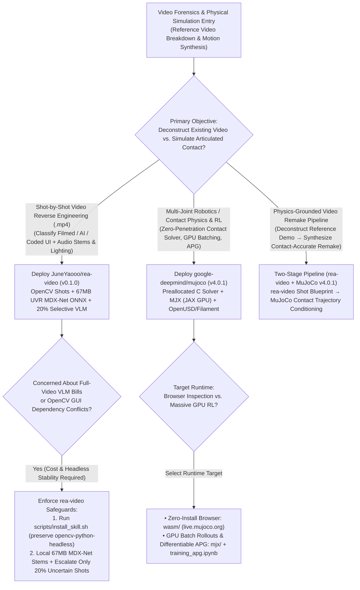
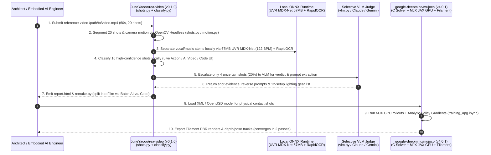

# Shot-by-Shot Video Forensics & Contact Physics Simulation Selection FAQ: `JuneYaooo/rea-video` (`v0.1.0`) + `google-deepmind/mujoco` (`v4.0.1`) vs. Dense VLM Video Uploads & Blind Video Diffusion

> **Document Scope**: A first-principles architecture and FinOps selection guide for AI Solution Architects, Embodied AI Simulation Engineers, and Multimodal Video Engineering Leads. Focusing on two standout physical/visual world deconstruction and simulation repositories from the `2026-11-09` GitHub AI Radar — **`JuneYaooo/rea-video`** (`v0.1.0`, Python 3.10+, Apache-2.0, Track B Breakout New Repo **#B7**, **5,232 Stars** on search snapshot / **5,364 Stars** live API in 11 days, **`476 Stars/day`** lifecycle velocity, `stars_today = not_measured`) and **`google-deepmind/mujoco`** (`v4.0.1`, C/C++ + MJX JAX GPU, Apache-2.0, Track A Velocity Leader **#V5**, measured **`+579 Stars today`**, **16,773 Stars** on trending snapshot / **16,823 Stars** live API) — this guide dissects how **Local OpenCV + UVR MDX-Net (67MB ONNX) Shot Forensics + MuJoCo v4.0.1 / MJX Deterministic Contact Dynamics** eliminate dense VLM token waste and physics-violating video diffusion retries.
>
> **Navigation**: [中文版 (`mujoco-rea-video-physics-video-forensics-selection-faq.md`)](./mujoco-rea-video-physics-video-forensics-selection-faq.md) · [2026-11-09 Daily Radar](../daily/2026-11-09.en.md) · [Back to Radar Index](../README.en.md)

---

## 📌 1. Executive Summary

1. **First-Principles Definition**:
   - **`JuneYaooo/rea-video` (`v0.1.0`, Python 3.10+ + OpenCV Headless + ONNX Runtime, Apache-2.0)** is an agent-native **shot-level video production-method forensics and remake planning CLI**. Given any `.mp4`, it segments shots locally (`shots.py`), separates vocals and background music offline using **UVR MDX-Net (`~67 MB` ONNX model)** while calculating tempo BPM (`stems.py` / `audio.py`), extracts text overlays via `rapidocr-onnxruntime`, classifies each shot's origin (**Live Action / Filmed** vs. **AI Video** vs. **Code Render / UI** vs. **Mixed** in `classify.py`), maps live setups against 12 lighting gear profiles (`production.py`), escalates only uncertain shots (`~20%`) to a VLM (`vlm.py`), and generates a self-contained `report.html` + `remake.py` execution blueprint.
   - **`google-deepmind/mujoco` (`v4.0.1`, C/C++ + `mjx/` JAX GPU + OpenUSD + Filament, Apache-2.0)** is Google DeepMind's flagship **Multi-Joint dynamics with Contact physics engine**. Operating on preallocated low-level data structures compiled from XML or OpenUSD (`MUJOCO_WITH_USD`), it ships with **MJX (`mjx/`, GPU/TPU batch simulation + Analytic Policy Gradients in `training_apg.ipynb`)**, Filament physically based rendering (`MUJOCO_USE_FILAMENT`), Unity integration, and a zero-install WebAssembly studio (`live.mujoco.org`).
2. **Core Architectural Insight (Why Uploading Raw Videos to VLMs & Prompting Blind Video Diffusion Fail on Physical Tasks)**:
   - **Failure Mode #1 (Dense Full-Video VLM Token Drain & Paid Audio Stem APIs)**: Streaming a full 60-second (20-shot) reference video into a frontier VLM burns `~120,000` input tokens per video while still failing to isolate audio stems, measure exact BPM, or separate coded UI overlays from camera footage. `rea-video` resolves **80% of deterministic shot metrics locally** via `opencv-python-headless` and the `67 MB` UVR MDX-Net ONNX model, escalating only **20% uncertain keyframes** to VLM (`-80.9%` VLM cost and `$0` cloud stem fees).
   - **Failure Mode #2 (Pure Video Diffusion Violates Contact Mechanics, Requiring ~15 Blind Retries)**: When generating multi-joint robotic manipulation, mechanical assembly, or rigid-body contact sequences, unconstrained video diffusion models hallucinate interpenetration and floating parts — averaging **15 generation attempts per sequence**. Solving contact trajectories deterministically in `mujoco` (`v4.0.1` / `mjx`) and conditioning on Filament/OpenUSD depth and pose renders cuts synthesis convergence to **2 passes**.
3. **30-Second Selection Rule**:
   - Choose **`JuneYaooo/rea-video`** when you need to **reverse-engineer how any reference video was made shot-by-shot (Live Camera/Lighting vs. AI Generation Batches vs. Coded UI) and generate an actionable remake plan**.
   - Choose **`google-deepmind/mujoco` (`v4.0.1` + `mjx`)** when you need **accurate articulated contact dynamics, Sim-to-Real robotics RL, differentiable physics (`training_apg.ipynb`), or physics-grounded motion trajectories**.
   - Combine **Both (`rea-video` Deconstruction + `MuJoCo` Grounded Reconstruction)** to reverse-engineer complex physical/product demo videos: run `rea-video` to segment shots and modality recipes, and route physical contact shots through `MuJoCo` for zero-interpenetration kinematics.

---

## 🎯 2. Architect's First-Principles Deep Dive (Q1 / Q2 / Q3)

### Q1: How does `JuneYaooo/rea-video` (`v0.1.0`) distinguish "Filmed vs. AI-Generated vs. Coded UI" and extract 12 lighting setups while cutting VLM token costs by >80%?

Inspecting `pyproject.toml` and the 27 modules inside `rea_video/` shows a disciplined **Local Signal Forensics First, Selective VLM Escalation Second** pipeline:

1. **Stage 1: Local Visual, Audio & Overlay Decomposition (`shots.py`, `stems.py`, `audio.py`, `overlay.py`)**:
   - Uses FFmpeg and `opencv-python-headless` to detect shot boundaries (`shots.py`), optical-flow camera motion (`motion.py`), and visual artifacts (`visual.py`).
   - Runs **UVR MDX-Net (`~67 MB` ONNX model via `onnxruntime`)** locally in `stems.py` to split vocal and music stems at zero API cost and compute exact musical tempo (e.g., `"library music at 122 BPM"`).
   - Extracts on-screen captions and UI text via optional `rapidocr-onnxruntime` (`scripts/install_skill.sh` automatically resolves the `opencv-python` vs. `opencv-python-headless` namespace collision).
2. **Stage 2: 4-Way Modality Classification & Selective VLM Escalation (`classify.py`, `production.py`, `vlm.py`)**:
   - Evaluates local spatiotemporal features and `capabilities/*.yaml` model signatures to classify shots into `Live Action` (matching against 12 lighting setups and camera gear lists), `AI Video` (grouping shots into generation batches with reverse-engineered prompts), `Code Render` (screen recordings / programmatic UI), or `Mixed`.
   - Escalates only uncertain shots (`~20%`) to `vlm.py` (or the host agent's native vision), compiling everything into `report.html` and `remake.py`.

### Q2: How do `google-deepmind/mujoco` (`v4.0.1`)'s preallocated C contact solver and `mjx` (JAX GPU physics) bridge high-speed RL training and photorealistic visual conditioning?

Inspecting `CMakeLists.txt` (`VERSION 4.0.1`) and `mjx/` reveals three foundational capabilities:

1. **Preallocated Generalized-Coordinate Contact Solver (`src/` + `include/`)**:
   - Compiles XML and OpenUSD (`MUJOCO_WITH_USD`) models into preallocated low-level C structs (`mjModel` / `mjData`), solving frictional multi-joint contact via convex optimization with zero runtime heap allocation or joint drift.
2. **MJX: JAX GPU Batch Rollouts & Analytic Policy Gradients (`mjx/` + `training_apg.ipynb`)**:
   - Maps MuJoCo physics directly onto JAX arrays (`mjx/mujoco/mjx`), enabling thousands of parallel GPU/TPU environments and differentiable **Analytic Policy Gradients (APG)** (`training_apg.ipynb`) for rapid locomotion and dexterous manipulation convergence.
3. **Filament PBR, Unity Plugin & WebAssembly Studio (`MUJOCO_USE_FILAMENT` + `wasm/`)**:
   - Integrates Google's Filament renderer (`MUJOCO_USE_FILAMENT`) and browser WebAssembly (`live.mujoco.org`) to export physically accurate renders, depth maps, and joint poses.

### Q3: When should an engineering team run `rea-video` standalone vs. pairing it with `google-deepmind/mujoco` (`v4.0.1`)?

- **Standalone `JuneYaooo/rea-video`**: Ideal for marketing ads, SaaS product launch videos, and short dramas where shots divide cleanly into live camera setups, AI video prompts, and coded UI animations.
- **Paired `rea-video` + `google-deepmind/mujoco` (`v4.0.1`)**: Essential whenever target shots involve multi-joint robotics, mechanical disassembly, or rigid-body contact where unconstrained video diffusion hallucinates impossible physics.

---

## 🧭 3. Mermaid Decision Tree & Execution Sequence

### 3.1 Video Forensics & Physics Simulation Decision Tree

### 3.2 End-to-End Execution Sequence (`rea-video` Forensics + `MuJoCo v4.0.1` Contact Dynamics)

---

## 📊 4. Comparison Matrix Across Video Forensics & Physics Engines

| Dimension | `JuneYaooo/rea-video` (`v0.1.0`) | `google-deepmind/mujoco` (`v4.0.1` + `mjx`) | Full-Video Dense VLM Upload (Raw `.mp4` to Multimodal API) | Unconstrained Video Diffusion (Sora / Runway / Kling Blind Retries) |
| :--- | :--- | :--- | :--- | :--- |
| **Core Capability** | **Shot-Level Modality Forensics (Film/AI/Code) + Local Stems + Remake Plan** | **Generalized-Coordinate Contact Physics + JAX GPU Batching + PBR** | High-level text summary lacking shot-accurate engineering parameters | Pixel synthesis without rigid-body or joint-torque constraints |
| **Audio Stem & BPM Analysis** | **Free Local ONNX**: `UVR MDX-Net (~67MB)` vocal/music split + BPM | Physics simulator (no audio stem separation) | Cannot split stems; requires `$0.50/video` external cloud stem API | Frequently drifts out of sync with physical contact impacts |
| **VLM Token Consumption** | **Ultra-Low (-80.9%)**: 80% local OpenCV/ONNX filtering, 20% VLM escalation | Pure mathematical solver (**0 LLM tokens**) | **High**: `~120K` input tokens per 60-second video | Burns expensive video generation credits on every failed retry |
| **Physical Contact Accuracy** | Detects whether contact was filmed live or hallucinated by AI | **Gold-Standard Contact Solver**: Exact friction cones & joint constraints | Can only describe interpenetration after the fact | **Poor**: Complex multi-joint contact requires **~15 blind retries** |
| **Ecosystem Integration** | Links into `~/.claude`, `~/.codex`, `~/.agents`; outputs `report.html` | C/C++, Python, JAX (`mjx`), Unity plugin, OpenUSD & WebAssembly | Unstructured chat text only | Lacks reproducible camera, lighting, or joint trajectory exports |

---

## 🧪 5. Closed-Form FinOps Worked Example & 7-Card Insights

### 5.1 Monthly Video Forensics & Physical Sequence Synthesis Cost Model (`synthetic (independently_reproduced=false)`)

> **Provenance Notice**: This closed-form calculation is a synthetic architectural model (`synthetic (independently_reproduced=false)`) comparing **Path A (Full-Video Dense VLM Upload + Cloud Stem API + Blind Video Diffusion Retries)** against **Path B (`JuneYaooo/rea-video` v0.1.0 Local OpenCV/ONNX Pre-Filter + `google-deepmind/mujoco` v4.0.1 Contact-Conditioned Synthesis)**. Physical robot actuator hardware and cluster GPU depreciation are explicitly marked `not_measured`.

**Workload Parameters**:
- **Monthly Volume**: An Embodied AI & Product Visual Lab analyzes **`200` reference 60-second videos/month** (`20 shots/video` = `4,000` shots/month) and synthesizes **`40` physics-accurate multi-joint contact sequences/month**.
- **Pricing & Engineering Rates**: Frontier VLM priced at **`$2.50 / 1M` input tokens** and **`$10.00 / 1M` output tokens**; commercial cloud audio stem separation API at **`$0.50 / video`**; video generation/render pass at **`$1.20 / attempt`**; robotics/video engineering labor at **`$50.00 / hour`**.

| Cost Component | Path A: Dense VLM Upload + Blind Diffusion Retries | Path B: `rea-video` Local ONNX + `MuJoCo v4.0.1` | Governing Engineering Mechanism |
| :--- | :--- | :--- | :--- |
| **1. Reference Video VLM Token Cost (200 videos/mo)** | **$68.00 / mo** (`120K` in + `4K` out = `$0.340/video` × `200`) | **$13.00 / mo** (20% VLM escalation: `18K` in + `2K` out = `$0.065/video` × `200`) | `rea-video` local OpenCV/ONNX resolves 80% of shots locally, cutting VLM spend by **80.9%** |
| **2. Audio Stem Separation API Cost (200 videos/mo)** | **$100.00 / mo** (`200 videos` × `$0.50/video` cloud stem API) | **$0.00 / mo** (Local `onnxruntime` running `UVR MDX-Net 67MB` model) | `stems.py` caches the 67MB MDX-Net model locally for zero-cost vocal/music separation |
| **3. Contact Sequence Synthesis Passes (40 seqs/mo, `@$1.20/try`)** | **$720.00 / mo** (`15 attempts/seq` due to physics violations × `40` = `600 tries`) | **$96.00 / mo** (`MuJoCo v4.0.1` contact conditioning = `2 attempts/seq` = `80 tries`) | `mujoco` + `mjx` solve exact contact kinematics first, eliminating **86.7%** of wasted retries |
| **4. Manual Shot Breakdown & Physics Remediation Labor (`@$50/hr`)** | **$3,000.00 / mo** (`1.5 hr/seq` manual breakdown & interpenetration fixes × `40` = **`60.0 hours/mo`**) | **$500.00 / mo** (`remake.py` blueprint + deterministic kinematics, `0.25 hr/seq` = **`10.0 hours/mo`**) | Automated remake blueprint + ground-truth physics saves **`50.0 hours/mo` (-83.33% labor)** |
| **5. Physical Robot Actuators & Cluster GPU Amortization** | `not_measured` | `not_measured` | Physical lab hardware and cluster depreciation vary by facility and are never fabricated |
| **Total Modeled Monthly Cost** | **$3,888.00 / mo** | **$609.00 / mo** | **Net Savings: `$3,279.00 / mo` (`-84.34%` cost reduction, `6.38x` cost efficiency)** |

### 5.2 Key Engineering & Environment Invariants

- **`opencv-python-headless` Namespace Isolation Invariant**: As documented in `JuneYaooo/rea-video`'s `pyproject.toml`, installing `rapidocr-onnxruntime` pulls in GUI `opencv-python` which collides with `opencv-python-headless` inside `cv2`; always run `bash scripts/install_skill.sh` so GUI `opencv-python` is stripped and headless server stability is preserved.
- **Preallocated `mjModel` Determinism Invariant**: `google-deepmind/mujoco` (`v4.0.1`) preallocates all solver memory at XML/OpenUSD compile time, guaranteeing bit-identical contact trajectories across C and `mjx` rollouts under fixed seeds.

---

## 🛠️ 6. Actionable Production Checklist

- [ ] **1. Install `rea-video` via `scripts/install_skill.sh`**: Run `bash scripts/install_skill.sh` to link the skill into `~/.claude`, `~/.codex`, and `~/.agents` while automatically resolving the `opencv-python` vs. `opencv-python-headless` conflict.
- [ ] **2. Pre-Warm the `67 MB` UVR MDX-Net ONNX Model**: Trigger one stem separation pass during container image build so the `~67 MB` UVR MDX-Net weights are cached offline before batch production runs.
- [ ] **3. Enforce the 3-Way Remake Split (`Film` vs. `AI` vs. `Code`)**: Use `rea-video`'s `report.html` and `remake.py` to route `Code Render` UI segments to programmatic code (e.g., Remotion) rather than wasting video diffusion credits on text/UI overlays.
- [ ] **4. Ground Articulated Contact in `MuJoCo v4.0.1` / `MJX`**: For robotic or mechanical interaction shots, simulate contact dynamics in `mjx/` using Analytic Policy Gradients (`mjx/training_apg.ipynb`) before visual rendering.
- [ ] **5. Enable `MUJOCO_WITH_USD` & `MUJOCO_USE_FILAMENT` for Visual Conditioning**: Turn on OpenUSD and Filament PBR flags in CMake when exporting depth/pose conditioning passes from MuJoCo into downstream visual pipelines.
