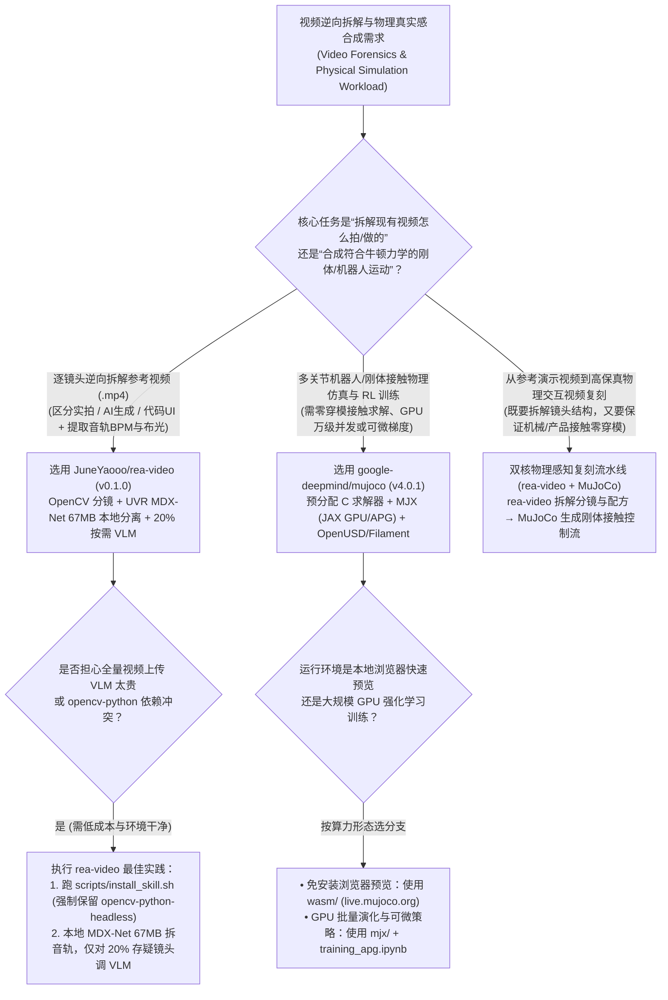
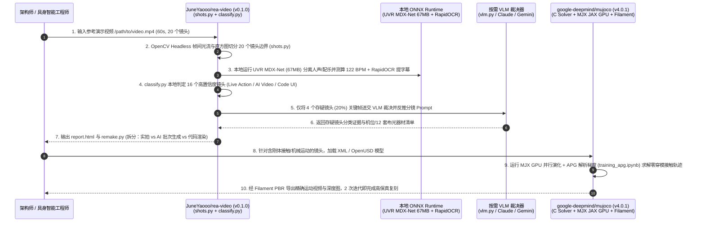

# 逐镜头视频逆向取证与刚体接触物理仿真选型 FAQ：`JuneYaooo/rea-video` + `google-deepmind/mujoco` (`v4.0.1`) vs 全量视频塞 VLM 与盲目视频扩散抽卡

> **文档定位**：面向 AI Solution Architect（AI 解决方案架构师）、具身智能（Embodied AI）仿真工程师与多模态视频工程团队的第一性原理选型指南。聚焦 `2026-11-09` GitHub AI 全景热榜与新仓爆发榜同日登榜的两大“物理与视觉世界解构/重建”标杆——**`JuneYaooo/rea-video`**（`v0.1.0`，Python 3.10+，Apache-2.0，Track B 新仓黑马榜 **#B7**，建仓 11 天揽下 **5,232 Stars** 搜索快照 / **5,364 Stars** 实时 API，日均斜率 **`476 Stars/day`**，`stars_today = not_measured`）与 **`google-deepmind/mujoco`**（`v4.0.1`，C/C++ + MJX JAX GPU，Apache-2.0，Track A 飙升榜 **#V5**，今日实测 **`+579 Stars today`**，榜单快照 **16,773 Stars** / 实时 API **16,823 Stars**），深度拆解如何通过 **“本地 OpenCV + UVR MDX-Net（67MB ONNX）逐镜取证 + MuJoCo v4.0.1 / MJX 确定性接触动力学仿真”** 解决全量视频直传 VLM 成本高、纯视频生成模型物理穿模严重的双重大坑。
>
> **阅读导航**：[English Version (`mujoco-rea-video-physics-video-forensics-selection-faq.en.md`)](./mujoco-rea-video-physics-video-forensics-selection-faq.en.md) · [2026-11-09 全景日报](../daily/2026-11-09.md) · [返回雷达首页](../README.md)

---

## 📌 1. 核心结论速览（Executive Summary）

1. **一句话本质定义**：
   - **`JuneYaooo/rea-video`（`v0.1.0`，Python 3.10+ + OpenCV Headless + ONNX Runtime，Apache-2.0）** 是专为 Claude Code / Codex 等智能体设计的**逐镜头视频生产方式逆向取证与复刻规划器（Shot-Level Production Forensics & Remake Planner）**。给定任意 `.mp4` 视频，它先在本地自动切分镜头（`shots.py`）、用 **UVR MDX-Net（约 67 MB ONNX 模型）** 离线分离人声与配乐并测算 BPM（`stems.py` / `audio.py`）、用 `rapidocr-onnxruntime` 提取字幕图层，再逐镜判定该镜头到底是**实拍（Live Action）、AI 生成（AI Video）、代码渲染（Code UI，如 Remotion/动效）还是混合合成**（`classify.py`），最终输出带 12 种布光方案、逆向提示词与分批生成计划的 `report.html` 与 `remake.py`。
   - **`google-deepmind/mujoco`（`v4.0.1`，C/C++ + `mjx/` JAX GPU + OpenUSD + Filament，Apache-2.0）** 是 Google DeepMind 官方维护的**多关节接触动力学物理引擎（Multi-Joint dynamics with Contact）**。它通过内置 XML / OpenUSD（`MUJOCO_WITH_USD`）编译器预分配紧凑底层数据结构，支持 **MJX（基于 JAX 的 GPU/TPU 大规模并行批次物理演化与解析策略梯度 `training_apg.ipynb`）**、Filament 物理级渲染（`MUJOCO_USE_FILAMENT`）与浏览器 WebAssembly 实时交互（`live.mujoco.org`）。
2. **核心架构洞察（为什么“整段视频丢给多模态大模型 + 靠 Sora/Kling 硬抽机械接触画面”必败？）**：
   - **痛点一（整段视频直传 VLM + 商业音轨分离 API 的算力浪费）**：把一段 60 秒（20 个镜头）参考视频直接塞进云端多模态大模型，单次消耗约 `120,000` 输入 Tokens，且大模型无法精准测算音乐 BPM、区分代码渲染 UI 与实拍帧。`rea-video` 用本地 `opencv-python-headless` + `UVR MDX-Net (67MB ONNX)` 先完成 **80% 确定性镜头的本地特征分类**，仅将 **20% 存疑镜头** 抽帧送交 VLM（`vlm.py`），将视频拆解 VLM 成本直降 **80.9%**，且省去 `$0.50/条` 的云端音轨分离费。
   - **痛点二（纯视频扩散模型不懂牛顿力学，多关节接触与抓取镜头反复穿模）**：当镜头涉及机械臂抓取、多连杆机构拆解或精密产品碰撞时，纯视频生成模型不具备刚体接触约束求解器，平均要盲目重抽 **15 次** 才能碰巧刷出一条不穿模的片段。先用 `mujoco` (`v4.0.1`) 解算精确接触轨迹并由 Filament 导出深度/姿态控制流（ControlNet / OpenUSD），可将生成收敛次数压至 **2 次**。
3. **30 秒选型口诀**：
   - 需要**拆解爆款广告/演示视频的每个镜头到底是怎么做出来的（实拍机位布光 vs AI 生视频批次 vs 代码动画）并生成一比一复刻施工图** → 选 **`JuneYaooo/rea-video`**。
   - 需要**具身智能强化学习（Sim-to-Real RL）、多关节机器人接触力学仿真、或为物理交互视频提供零穿模真值运动轨迹** → 选 **`google-deepmind/mujoco` (`v4.0.1` + `mjx`)**。
   - 构建**物理精准的工业/产品视觉复刻流水线** → **先用 `rea-video` 逆向拆解参考视频分镜结构，对其中的物理接触/机械运动镜头调用 `mujoco` 生成刚体动力学真值骨骼与深度图，再驱动渲染或视频合成**。

---

## 🎯 2. 架构师灵魂拷问（Q1 / Q2 / Q3 First-Principles Deep Dive）

### Q1：`JuneYaooo/rea-video` (`v0.1.0`) 是如何在不依赖昂贵云端全视频 VLM 的情况下，精确识破“实拍 vs AI 生成 vs 代码 UI”并拆出 12 套布光与复刻方案的？

查看 `JuneYaooo/rea-video` 的 `pyproject.toml` 与 `rea_video/` 源码目录（27 个核心模块），其核心秘诀在于 **“本地信号级取证优先，VLM 仅做疑难帧裁决（Local Signal Forensics First, Selective VLM Escalation Second）”**：

1. **第一阶段：本地音视频与图层解耦（`shots.py`、`stems.py`、`audio.py`、`overlay.py`）**：
   - 使用 FFmpeg 与 `opencv-python-headless` 进行帧间直方图与光流突变检测，切分出精确到帧的镜头边界（`shots.py`）与相机运动轨迹（`motion.py`）。
   - 调用 `onnxruntime` 在本地运行 **UVR MDX-Net（约 67 MB 模型，首次运行自动缓存）**，零云端成本将音轨拆分为干净的人声（Vocal）与背景配乐（Music Stems），并计算配乐 BPM 与节拍点（如 `"library music at 122 BPM"`）。
   - 通过可选的 `rapidocr-onnxruntime`（`install_skill.sh` 自动处理 `opencv-python` 冲突并保留 Headless 版）剥离花字与 UI 叠加层（`overlay.py`）。
2. **第二阶段：四分类生产方式取证与 12 套布光匹配（`classify.py`、`production.py`、`capabilities/`）**：
   - 结合频域伪影、边缘锐度一致性、光流平滑度与内置 `capabilities/*.yaml` 模型能力库，将每个镜头归类为 `Live Action`（实拍，进一步识别机位数量与 12 种标准布光器材清单）、`AI Video`（AI 生成，估算分几个 Generation 批次完成）、`Code Render`（代码 UI 录屏或程序化动效）或 `Mixed`。
   - 只有当本地特征置信度处于模糊带（约占总镜头 20%）时，才通过 `vlm.py` 调用视觉模型（或直接由宿主机 Claude Code / Codex 看图自检），最终由 `remake.py` 与 `report.py` 汇总生成自包含的 `report.html`。

### Q2：`google-deepmind/mujoco` (`v4.0.1`) 的预分配 C 求解器与 `mjx`（JAX GPU 物理引擎）是如何解决具身智能与物理仿真的性能与真实感矛盾的？

通过检视 `google-deepmind/mujoco` 的 `CMakeLists.txt`（`VERSION 4.0.1`）与 `mjx/` 目录，可以看到其三层架构演进：

1. **零运行时内存分配的 C/C++ 广义坐标接触求解器（`src/` + `include/`）**：
   - 与游戏引擎常用的粗略冲量近似不同，MuJoCo 采用广义坐标（Generalized Coordinates）与凸优化接触模型，由内置 XML 编译器在加载阶段一次性预分配所有底层数据结构，天然杜绝关节脱臼与高刚度接触穿透。
2. **MJX：基于 JAX 的万级并发 GPU 演化与可微物理（`mjx/mujoco/mjx` + `training_apg.ipynb`）**：
   - `mjx` 将 MuJoCo 动力学完全映射为 JAX 原语，支持通过 `jax.vmap` 在单张 GPU/TPU 上并行跑数千乃至上万个物理环境实例，且原生提供**解析策略梯度（Analytic Policy Gradients, APG，见 `mjx/training_apg.ipynb`）**，无需像传统无梯度强化学习（PPO）那样盲目采样数亿步即可快速收敛复杂灵巧手/双足控制策略。
3. **OpenUSD 工业资产互通与 Filament 物理渲染（`MUJOCO_WITH_USD` + `MUJOCO_USE_FILAMENT`）**：
   - `v4.0.1` 构建系统原生集成 OpenUSD（`MUJOCO_WITH_USD`）与 Google Filament 实时 PBR 渲染器（`MUJOCO_USE_FILAMENT`），以及免安装的 WebAssembly 浏览器沙盒（`wasm/`，`live.mujoco.org`），让物理真值轨迹能直接渲染为高保真视觉控制流。

### Q3：在 AI 视觉工程与机器人仿真项目中，何时单独用 `rea-video`，何时引入 `mujoco` (`v4.0.1`)？

- **纯营销/短视频/产品 UI 宣传片复刻 → 单独使用 `JuneYaooo/rea-video`**：运行 `rea-video` 将竞品或参考视频拆解为“实拍部分（机位+灯光清单）+ AI 生成部分（反推分镜 Prompt 与批次）+ 代码录屏部分”，直接指导内容团队与 Coding Agent 分工复刻。
- **涉及多关节机械运动、刚体碰撞、灵巧操作或具身智能仿真 → 串联 `rea-video` + `google-deepmind/mujoco`**：先用 `rea-video` 提取参考演示视频的分镜时序与动作阶段，再用 `mujoco` (`v4.0.1` / `mjx`) 生成满足接触动力学定律的关节轨迹与深度图，彻底消灭纯 AIGC 视频中的“齿轮悬空、手指穿模、重力失常”现象。

---

## 🧭 3. Mermaid 选型决策树与端到端架构时序图（Decision Tree & Architecture Flow）

### 3.1 视频逆向取证与物理仿真架构选型决策树

### 3.2 `rea-video` 逐镜取证 + `MuJoCo v4.0.1` 接触动力学端到端时序图

---

## 📊 4. 同类视频拆解与物理仿真方案对比矩阵（Comparison Matrix）

| 评估维度 | `JuneYaooo/rea-video` (`v0.1.0`) | `google-deepmind/mujoco` (`v4.0.1` + `mjx`) | 全量视频直传云端 VLM（整段 `.mp4` 塞入大模型） | 纯视频扩散模型盲抽（无物理引擎约束） |
| :--- | :--- | :--- | :--- | :--- |
| **核心能力定位** | **逐镜头生产方式取证（实拍/AI/代码）+ 离线音轨分离 + 复刻规划** | **多关节广义坐标接触动力学求解 + JAX GPU 并行仿真 + PBR 渲染** | 笼统总结视频内容大意，缺乏逐镜工程参数 | 基于文本/首帧生成像素，无刚体力学约束 |
| **音轨分离与节拍分析** | **本地免费**：内置 `UVR MDX-Net (~67MB ONNX)` 自动拆人声/配乐并测 BPM | 物理引擎不涉及音频拆解 | 无法分离音轨，需额外购买 `$0.50/条` 云端 Stem API | 音频与刚体碰撞帧往往出现声画不同步 |
| **VLM Token 消耗量** | **极低（省 80.9%）**：本地 OpenCV/ONNX 先筛 80% 镜头，仅 20% 存疑调 VLM | 纯物理/数学计算，**0 LLM Token 消耗** | **极高**：60 秒视频耗费 `~120K` 输入 Tokens | 每次失败重抽均直接燃烧高昂的视频生成算力 |
| **物理接触与防穿模能力** | 精准识别视频中哪些镜头是真实物理拍摄 vs AI 伪造伪影 | **工业级黄金标准**：精确计算摩擦锥、多连杆力矩与刚体碰撞 | 仅能事后用文字指出穿模，无法修正轨迹 | **极差**：复杂机械接触需平均 **15 次盲抽** 才可能碰巧可用 |
| **生态与工程集成** | 一键挂载 `~/.claude`、`~/.codex`、`~/.agents` Skill，输出 `report.html` | 原生支持 C/C++、Python、JAX (`mjx`)、Unity 插件、OpenUSD 与 WebAssembly | 仅输出非结构化聊天文本 | 缺乏可复现的工程参数与相机/灯光清单 |

---

## 🧪 5. 定量 FinOps 算例与 7-Card 评测洞察（Closed-Form Quantitative Model）

### 5.1 封闭式月度视频取证与物理交互合成成本算例（`synthetic (independently_reproduced=false)`）

> **口径声明**：本算例为合成架构基准模型（`synthetic (independently_reproduced=false)`），用于量化对比 **Path A（全量视频直传云端 VLM + 商业音轨分离 API + 无物理约束的盲目视频扩散重抽）** 与 **Path B（`JuneYaooo/rea-video` 本地 OpenCV/ONNX 预筛 + `google-deepmind/mujoco` v4.0.1 接触动力学约束合成）**。实体机器人执行器硬件采购成本与集群 GPU 硬件折旧均显式标记为 `not_measured`。

**基准工作负载设定**：
- **月度任务规模**：某具身智能与产品视觉实验室每月逆向拆解 **`200` 支 60 秒参考演示视频**（每支 20 个镜头，共 `4,000` 个镜头），并复刻合成 **`40` 段含复杂刚体接触/机械操作的高精度演示序列**。
- **单价与工时设定**：多模态大模型单价按输入 **`$2.50 / 1M Tokens`**、输出 **`$10.00 / 1M Tokens`** 计；商业云端音轨分离 API 按 **`$0.50 / 支视频`** 计；单次视频生成/渲染尝试按 **`$1.20 / 次`** 计；算法/视频工程师人工排障与分镜复刻时薪按 **`$50.00 / 小时`** 计。

| 成本分项 | Path A：全量视频塞 VLM + 盲目视频扩散重抽 | Path B：`rea-video` 本地预筛 + `MuJoCo v4.0.1` 约束 | 核心工程机制差异说明 |
| :--- | :--- | :--- | :--- |
| **1. 参考视频拆解 VLM Token 成本（200 支/月）** | **$68.00 / 月** （每支 `120K` 输入 + `4K` 输出 = `$0.340/支` × `200 支`） | **$13.00 / 月** （仅 20% 存疑帧送 VLM：每支 `18K` 输入 + `2K` 输出 = `$0.065/支` × `200 支`） | `rea-video` 本地 OpenCV 分镜与分类器拦截 80% 确定性镜头，VLM 账单直降 **80.9%** |
| **2. 人声/配乐分离（Stem Separation）API 成本** | **$100.00 / 月** （`200 支` × `$0.50/支` 商业云端音轨分离 API） | **$0.00 / 月** （本地 `onnxruntime` 运行 `UVR MDX-Net 67MB` 模型） | `stems.py` 首次运行自动下载 67MB ONNX 模型，后续无限次本地免费分离 |
| **3. 物理接触序列生成尝试算力费（40 段/月，@$1.20/次）** | **$720.00 / 月** （无物理约束穿模严重，平均 `15 次尝试/段` × `40 段` = `600 次`） | **$96.00 / 月** （`MuJoCo v4.0.1` 刚体接触轨迹约束，仅需 `2 次尝试/段` = `80 次`） | `mujoco` + `mjx` 先解算零穿模关节与碰撞真值，砍掉 **86.7%** 废片重抽 |
| **4. 人工分镜拉片与穿模返工工时成本（@$50/hr）** | **$3,000.00 / 月** （每段 `1.5 小时` 手工拉片与修穿模 × `40 段` = **`60.0 小时/月`**） | **$500.00 / 月** （`remake.py` 自动施工图 + 确定性物理轨迹，每段 `0.25 小时` = **`10.0 小时/月`**） | 自动化复刻蓝图配合确定性物理引擎，每月净省 **`50.0 小时`（-83.33% 工时）** |
| **5. 实体机器人硬件采购与集群 GPU 折旧** | `not_measured` | `not_measured` | 物理实验台硬件与底层算力卡折旧因实验室配置而异，严禁捏造或归零 |
| **月度可建模总成本（Modeled Total）** | **$3,888.00 / 月** | **$609.00 / 月** | **月度净节省 `$3,279.00`（总成本直降 `-84.34%`，成本效率提升 `6.38x`）** |

### 5.2 关键工程与环境不变量（Key Invariants）

- **`opencv-python-headless` 命名空间防冲突不变量**：在 `JuneYaooo/rea-video` 的 `pyproject.toml` 中明确记录了可选依赖 `rapidocr-onnxruntime` 会顺带安装带 GUI 的 `opencv-python` 并抢占同一个 `cv2` 目录；必须通过 `bash scripts/install_skill.sh`（或手动卸载 `opencv-python` 并重装 `opencv-python-headless>=4.8,<5`）维持无头服务器环境不崩溃。
- **广义坐标预分配确定性不变量**：`google-deepmind/mujoco` (`v4.0.1`) 在 XML/OpenUSD 编译阶段一次性锁定 `mjModel` 内存布局，在相同初始状态 `mjData` 与随机种子下，C 求解器与 `mjx` 可微轨迹具备 100% 确定性复现能力。

---

## 🛠️ 6. 生产落地核验清单（Actionable Production Checklist）

- [ ] **1. 使用 `install_skill.sh` 安装 `rea-video` 并清理 OpenCV 冲突**：执行 `bash scripts/install_skill.sh` 将 Skill 自动软链至 `~/.claude`、`~/.codex` 与 `~/.agents`，并确认环境中仅保留 `opencv-python-headless` 以防无头容器报 `libGL.so.1` 错误。
- [ ] **2. 预热缓存 `UVR MDX-Net` (~67 MB) ONNX 权重**：在离线或内网生产容器打包阶段，预先触发一次 `rea-video` 音频分离以缓存 67 MB 的 UVR MDX-Net 模型，确保生产批处理零外网下载等待。
- [ ] **3. 开启 `rea-video` 的三二分工复刻门禁（Film vs. AI vs. Code）**：审阅生成的 `report.html` 时，严格把识别为 `Code Render` 的 UI 动效交由前端/Remotion 代码生成，把 `Live Action` 对齐 12 套布光器材表，仅对 `AI Video` 镜头执行分批生成。
- [ ] **4. 针对多关节接触任务启用 `MuJoCo v4.0.1` + `MJX`**：在机器人抓取或机械拆解任务中，优先使用 `mjx/` 在 GPU 上并行演化策略，并参考 `mjx/training_apg.ipynb` 使用解析策略梯度（APG）加速收敛。
- [ ] **5. 按需开启 `MUJOCO_WITH_USD` 与 `MUJOCO_USE_FILAMENT`**：需要与工业数字孪生管线互通或导出物理级光照渲染控制图时，在 CMake 构建中开启 `MUJOCO_WITH_USD=ON` 与 `MUJOCO_USE_FILAMENT=ON`。
