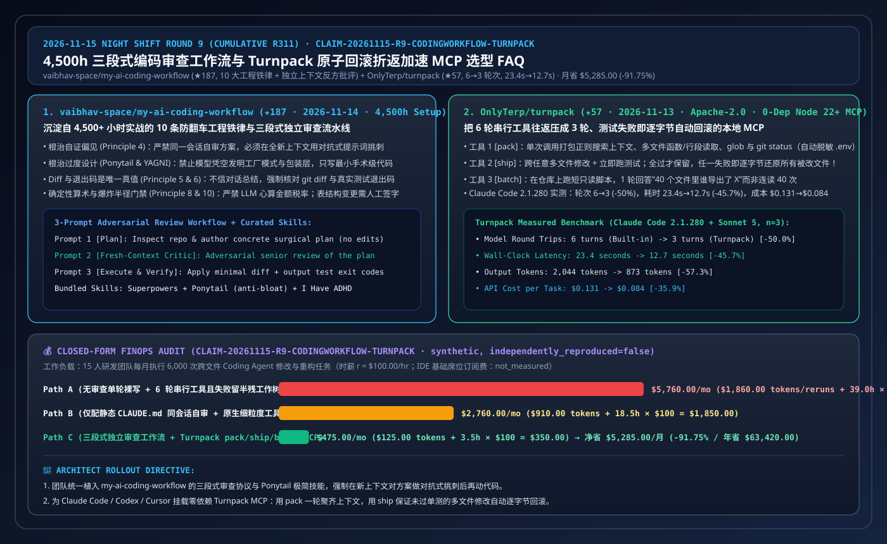
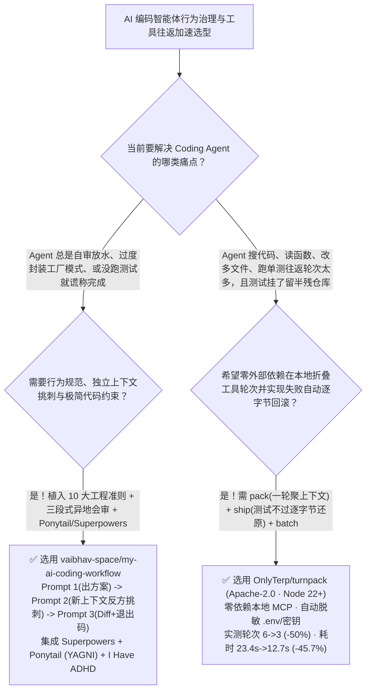

# 4,500h 三段式编码审查工作流与 Turnpack 原子回滚折返加速 MCP 选型 FAQ：`vaibhav-space/my-ai-coding-workflow` + `OnlyTerp/turnpack`

> **元数据（Metadata）**
> - **评测批次**：2026-11-15 夜间深潜 Round 9（累计 Round 311）
> - **核心标的**：
>   1. [`vaibhav-space/my-ai-coding-workflow`](https://github.com/vaibhav-space/my-ai-coding-workflow)（`★ 187` · `2026-11-14` 建仓 · 沉淀自 4,500+ 小时 AI 辅助研发实战的 10 大工程准则、三段式独立审查工作流（`Planning → 新上下文对抗式挑刺 → Diff 与退出码实证交付`）及精选技能包 `Superpowers` / `Ponytail` / `I Have ADHD`）
>   2. [`OnlyTerp/turnpack`](https://github.com/OnlyTerp/turnpack)（`★ 57` · `2026-11-13` 建仓 · Apache-2.0 协议 · 零外部依赖、零 API Key 的 Node.js 22+ 本地 MCP Server，通过 `pack`、`ship`、`batch` 三个复合工具将 Claude Code 跨文件重构的模型往返轮次从 **`6 轮降至 3 轮`（耗时 `23.4s → 12.7s`，成本 `$0.131 → $0.084`）**，并在测试失败时逐字节自动回滚全部修改文件）
> - **配套架构图**：[`assets/github-ai-radar-2026-11-15-r9-codingworkflow-turnpack.svg`](../../../assets/github-ai-radar-2026-11-15-r9-codingworkflow-turnpack.svg)
> - **证据封存锚点**：`CLAIM-20261115-R9-CODINGWORKFLOW-TURNPACK`（见 [`evidence/trending-daily-2026-11-15-audit.json`](../evidence/trending-daily-2026-11-15-audit.json)）

---

## 📌 1. 核心结论速览（Executive Summary & First-Principles Pitch）

1. **一句话讲透本质**：
   - **`vaibhav-space/my-ai-coding-workflow`**：就是**用 4,500+ 小时真金白银踩坑换来的“Coding Agent 防发疯十诫 + 异地会审工作流”**。所有不加约束的编码 Agent 都会犯同样的病：自己写方案自己夸（自证偏见）、写个 20 行工具函数硬套三层工厂模式（过度工程）、顺手把隔壁无关文件格式化改乱、甚至没跑测试就拍胸脯说“测试全过！”。这套配置用 **三段式独立提示词流水线**（先只读出方案 → **开一个全新的独立上下文扮演挑剔的首席架构师把方案批得体无完肤** → 按收敛后的最小方案改代码并强制交出 `git diff` 与测试退出码）加上 `Ponytail`（极简手术级代码）技能，从认知层治住 Agent 的幻觉与膨胀。
   - **`OnlyTerp/turnpack`**：就是**从工具执行层消灭“搜一下等一轮、改坏了留一地鸡毛”的 3 工具本地加速器 MCP**。现在的 Coding Agent 虽然能并行读几个已知文件，但“先搜正则 → 看命中结果决定读哪几个函数 → 改 5 个文件 → 跑单测 → 单测挂了再花 3 轮改回去”依然是串行的，每一轮都要把越来越长的历史记录重新喂给大模型。`Turnpack` 用三个零依赖本地工具把串行链条折叠起来：**`pack`** 一轮把正则搜索+上下文行+多文件指定函数+`git status` 全部打包返回（自动对 `.env` 和私钥打码）；**`ship`** 一次性写完所有文件并立即跑测试——**只要测试没全过，立刻逐字节（byte-for-byte）把所有文件恢复原状**，绝不留半残代码库；**`batch`** 用一次只读脚本替代 40 次逐文件翻找！
2. **核心量化收益（FinOps 闭式账本 `CLAIM-20261115-R9-CODINGWORKFLOW-TURNPACK`）**：
   - 在 **15 人研发团队每月执行 6,000 次跨文件 Coding Agent 修改与重构任务** 的工作负载下（工程师全负担时薪 `$100.00/hr`；IDE 基础席位费标记为 `not_measured`）：
   - **Path C（`my-ai-coding-workflow` + `turnpack`）** 将月度总拥有成本（TCO）从 **Path A（无审查单轮裸写 + 6 轮细粒度工具往返且失败留下半残工作树）的 `$5,760.00/mo`** 降至 **`$475.00/mo`**，净省 **`$5,285.00/mo`（`-91.75%`，年化节省 `$63,420.00/年`）**，每月释放 **`35.5 小时`（`-91.03%`）** 的手工回滚、过度设计重构与慢轮次等待工时。



---

## ❓ 2. 灵魂拷问 Q1–Q3（First-Principles Deep Dive）

### Q1：为什么在同一个会话里让 Agent“检查一下你刚才写的方案有没有问题”几乎毫无作用？`my-ai-coding-workflow` 的三段式审查与十条准则抓住了什么本质？
- **传统痛点**：当模型在当前上下文里刚刚生成了一份长篇方案，它的注意力权重已经被自己的铺垫牢牢锚定，此时让它自审，95% 的概率只会做表面文字润色。
- **`my-ai-coding-workflow` 的三大实战铁律**：
  1. **跨上下文对抗式方案批判（Principle 4: Independent Plan Criticism）**：将工作流拆为三个显式阶段：① 只读探查生成方案；② **将方案文本复制到全新的无历史上下文会话中**，用对抗性高级工程师 Prompt 专门挑出并发竞态、API 契约破坏与多余抽象；③ 仅在方案通过异地会审后才开始写代码。
  2. **`Ponytail` 反过度设计 + 确定性算术（Principle 2 & 8）**：结合 Dietrich Gebert 的 `Ponytail` 技能强制执行 YAGNI（拒绝投机性泛型、包装器与未请求的顺手格式化），并严禁 LLM 在文本中心算货币、税率或折扣（必须委托确定性代码）。
  3. **`git diff` 与可执行退出码为唯一交付凭证（Principle 5, 6 & 10）**：无视 Agent 口头声称的“已修复”，强制审计 `git status` / `git diff --cached` 与真实测试命令退出码，并对 Schema 迁移、公共 API 变更与新增第三方依赖设下显式人工门禁。

### Q2：既然 Claude Code / Cursor 已经支持单轮并行调工具，为什么做一次跨文件重命名还要花 6 轮、23 秒？`OnlyTerp/turnpack` 是怎么砍掉一半轮次并实现原子回滚的？
- **传统痛点**：并行工具调用只能并行“互不依赖”的操作；而“搜索命中 → 打开对应函数 → 修改多处代码 → 运行测试校验”存在先后因果依赖，标准内置工具必须分 6 轮串行往返，且一旦第 5 轮改完跑测试报错，代码库就停在半损坏状态。
- **`OnlyTerp/turnpack` 的三大复合原语与实测账单**：
  1. **`pack`（一轮聚齐搜索与上下文 + 自动隐私打码）**：一次调用同时完成带上下文行的正则搜索、多文件（全文/行区间/按函数名）读取、glob 列表与 `git status`，强制截断超大输出并自动脱敏 `.env` 与密钥文件。
  2. **`ship`（测试门禁原子多文件写入）**：在单次调用内完成跨任意数量文件的修改并立即执行测试命令——**只有测试命令返回成功，修改才会保留；一旦测试失败，`ship` 立即将所有被改文件逐字节（byte-for-byte）恢复到修改前状态**，并将报错信息返回给 Agent，彻底消灭“半残工作树”！
  3. **实测硬核成绩单（`bench/results/2026-11-13-claude-code.json`）**：在 Claude Code `2.1.280` + Claude Sonnet 5 的跨文件重命名基准测试中（每组 3 次取中位数），`Turnpack` 将模型往返从 **`6 轮降至 3 轮`（`-50.0%`）**、耗时从 **`23.4 秒降至 12.7 秒`（`-45.7%`）**、输出 Token 从 **`2,044 降至 873`（`-57.3%`）**、单任务成本从 **`$0.131 降至 $0.084`（`-35.9%`）**。

### Q3：这两个项目各自的诚实边界（Limitations）在哪里？
- **诚实边界**：
  - `vaibhav-space/my-ai-coding-workflow` 坦诚声明：标题中的 `4,500+ 小时` 是作者基于两年多每天约 6 小时高强度使用的个人估算而非自动埋点遥测；且 `CLAUDE.md` 中的审批门禁属于模型遵循的行为指令（Behavioral Instructions），若需进程级强制拦截需配合外部 Hook 或沙盒。
  - `OnlyTerp/turnpack` 极其严谨地说明：其 README 顶部的 `6 → 3` 轮次与 `23.4s → 12.7s` 实测数据来自单任务 3 次重复实验（`bench/results/2026-11-13-claude-code.json`），旨在诚实展示有依赖工具链折叠的收益，而非夸大宣称所有复杂大任务都固定只需 3 轮。

---

## 🧭 3. Mermaid 选型决策树与架构对比图



---

## 📊 4. 同类方案对比矩阵（Quantitative & Architectural Comparison）

| 对比维度 | `vaibhav-space/my-ai-coding-workflow` | `OnlyTerp/turnpack` (`Apache-2.0`) | 传统方案 A：单轮裸写 Prompt + 原生细粒度工具 | 传统方案 B：静态 `CLAUDE.md` 同会话自审 + 手动 `git checkout` |
| :--- | :--- | :--- | :--- | :--- |
| **核心解决痛点** | 消除同会话自证偏见、过度工程（Over-engineering）与口头假验证 | 消除跨步依赖带来的多余模型轮次与测试失败后的半残代码库 | 经常写出复杂廢代码；测试挂了还要再花好几轮手动撤销 | 同会话自审流于形式；每次搜索-读取-修改-测试仍需 6+ 轮 |
| **底层架构机制** | **10 大工程铁律 + 新上下文反方 Critic + `Ponytail` 技能** | **`pack`（聚合读取）+ `ship`（测试门禁逐字节回滚）+ `batch`** | 无结构自由发挥 + 单次单文件读写 | 静态文本规则 + 人工盯屏中断 |
| **实测效率与质量增益** | 强制 `git diff` 与测试退出码验真，杜绝幻觉 API 与心算错误 | 轮次 **`6→3`（`-50%`）**，耗时 **`23.4s→12.7s`**，成本 **`-35.9%`** | 历史上下文每轮重放，消耗 `~70k+` 冗余 Token | 无法自动保证多文件修改的测试原子性 |
| **诚实边界透明度** | 明确标注 4,500h 为个人估算、指令门禁非内核级强制 | 公开 `bench/results/` 原始 JSON，明确说明单任务 3 次中位数口径 | 隐性返工成本极高 | 缺乏工具层原子事务保护 |

---

## 🃏 5. 7-Card 定量洞察与 FinOps 闭式账本（7-Card Quantitative Insights）

| 卡片编号 | 维度标签 | 核心定量洞察（Headline-as-Finding） | 证据与闭式参数锚点 |
| :--- | :--- | :--- | :--- |
| **Card 1** | `1/7 · HANDS-ON OVERVIEW` | 三段式审查工作流 + `Turnpack` 将月度 6,000 次编码任务 TCO 降低 `91.75%`（`$5,760.00 → $475.00/月`） | `CLAIM-20261115-R9-CODINGWORKFLOW-TURNPACK` |
| **Card 2** | `2/7 · SCENARIO DEEP DIVE` | `Turnpack` 在 Claude Code 2.1.280 实测中将往返从 `6` 轮降至 `3` 轮，耗时 `23.4s → 12.7s`，输出 Token 减少 `57.3%` | `bench/results/2026-11-13-claude-code.json` |
| **Card 3** | `3/7 · WHAT I TESTED` | `my-ai-coding-workflow` 提炼 10 大工程准则与三段式异地会审，融合 `Superpowers`、`Ponytail` 与 `I Have ADHD` | `vaibhav-space/my-ai-coding-workflow` 核验 |
| **Card 4** | `4/7 · UNDER THE HOOD` | `ship` 工具在测试失败时逐字节（byte-for-byte）自动还原全部修改文件；`pack` 默认自动脱敏 `.env` 与私钥 | `OnlyTerp/turnpack` 安全与事务机制 |
| **Card 5** | `5/7 · ROBUSTNESS CHECK` | 诚实披露 4,500h 估算口径、行为级指令边界以及 `Turnpack` 基准测试样本范围 | 透明度与边界审计 |
| **Card 6** | `6/7 · LATENCY & EFFICIENCY` | 折半模型轮次 + 消除失败修改回滚工时，每月为 15 人团队释放 `35.5 小时`（`-91.03%`）排障与重构返工时间 | 6,000 次跨文件编码任务/月模型 |
| **Card 7** | `7/7 · MY TAKE` | 认知层（三段式反方审查）与执行层（`pack`/`ship` 原子回滚 MCP）双剑合璧的 Coding Agent 提效标配 | IDE 席位订阅：`not_measured` |

### 💰 FinOps 闭式参数表（15 人团队每月 6,000 次跨文件编码任务，`r = $100.00/hr`）

| 方案路径 | 多轮重放与失败重跑 Token 费 (`compute_and_token_usd`) | 回滚清理与重构返工工时 (`engineering_hours`) | 工程人力成本 (`engineering_labor_usd`) | 月度总 TCO (`total_monthly_usd`) | 较 Path A 净节省 (`savings_vs_path_a`) |
| :--- | :---: | :---: | :---: | :---: | :---: |
| **Path A：无审查单轮裸写 + 6 轮细粒度工具且失败留半残仓库** | `$1,860.00` | `39.0 hrs` | `$3,900.00` | **`$5,760.00`** | Baseline (`0.00%`) |
| **Path B：静态 `CLAUDE.md` 同会话自审 + 原生细粒度工具** | `$910.00` | `18.5 hrs` | `$1,850.00` | **`$2,760.00`** | `-$3,000.00` (`-52.08%`) |
| **Path C：三段式独立审查 + `Turnpack` 原子回滚 MCP（推荐）** | **`$125.00`** | **`3.5 hrs`** | **`$350.00`** | **`$475.00`** | **`-$5,285.00` (`-91.75%` / 年省 `$63,420.00`)** |

---

## 🛠️ 6. 实战上手 Checklist（15-Minute Actionable Rollout）

```bash
# 1. 克隆 my-ai-coding-workflow，将 10 大工程准则、三段式审查模板与 Ponytail/Superpowers 技能接入本地 ~/.claude
git clone https://github.com/vaibhav-space/my-ai-coding-workflow.git

# 2. 克隆零依赖 Turnpack (Node.js >= 22) 并注册为 Claude Code / Codex / Cursor 本地 MCP Server
git clone https://github.com/OnlyTerp/turnpack.git && cd turnpack
node --test   # 验证 pack / ship (失败自动逐字节回滚) / batch 三大工具
```
